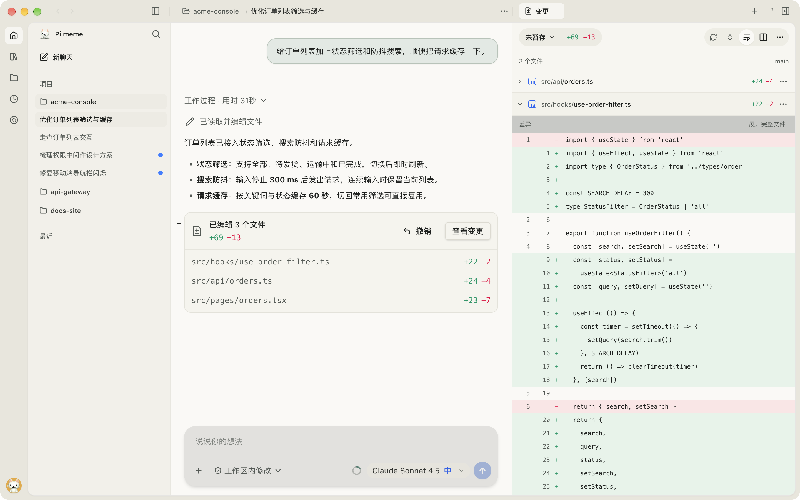
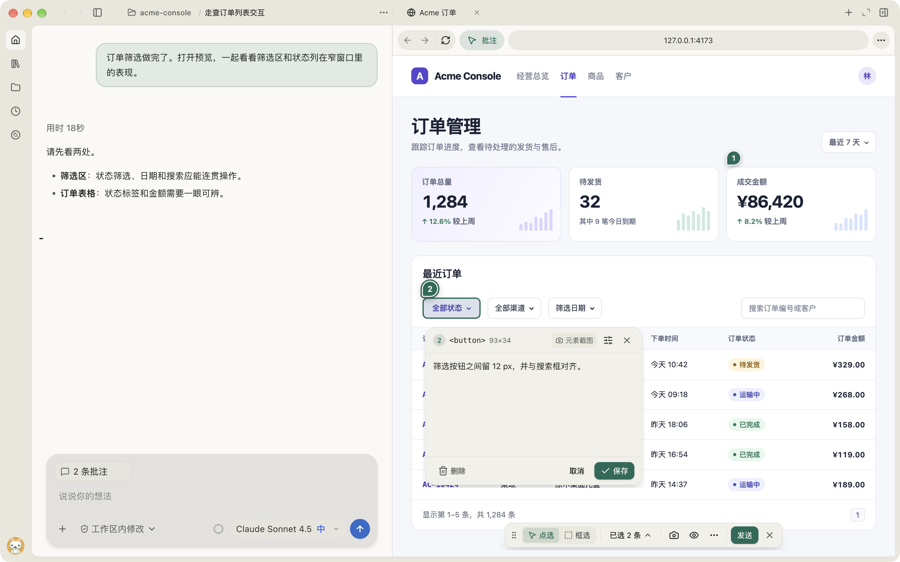
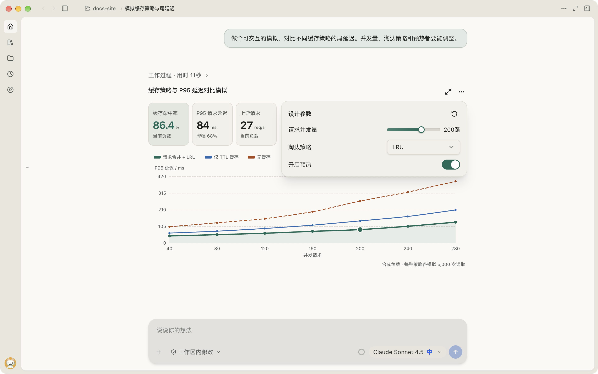
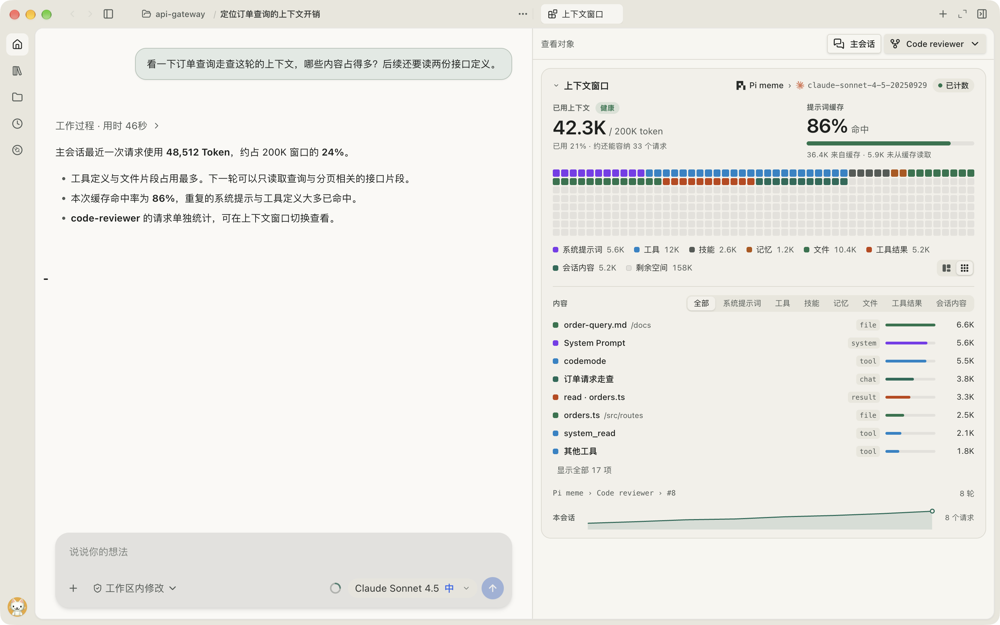
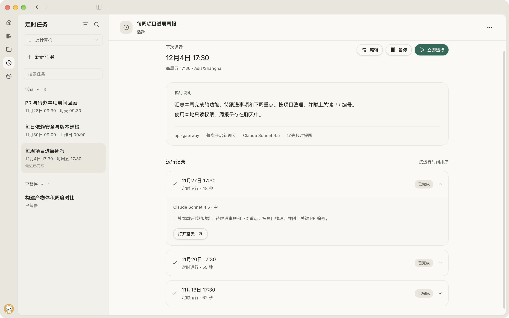

<div align="center">

<picture>
  <source media="(prefers-color-scheme: dark)" srcset="packages/assets/files/brand/pi-dev-dark-128x128.png" />
  
</picture>

# Pi meme

**本地优先的 AI 编码工作台，支持桌面端、Web 与远程 Host。**

[下载安装](https://github.com/xidongdong-153/Pi-meme/releases) · [快速开始](docs/getting-started.md#下载使用) · [远程部署](docs/remote.md) · [插件开发](docs/plugins.md) · [全部文档](docs/index.md)

</div>

<picture>
  <source media="(prefers-color-scheme: dark)" srcset="docs/assets/hero-dark.png" />
  
</picture>

基于 [Pi](https://github.com/earendil-works/pi) 构建，内置运行环境，开箱即用。Desktop、Web 与外部 Bot 共用同一执行 Host。

## 核心能力

<table>
  <tr>
    <td width="50%" valign="top">
      <a href="docs/browser.md"></a>
      <br />
      <strong><a href="docs/browser.md">内置浏览器与网页批注</a></strong><br />
      Desktop 原生分栏预览，点击元素或框选截图批注，直接发给 Agent 修改。
    </td>
    <td width="50%" valign="top">
      <a href="docs/visualize.md"></a>
      <br />
      <strong><a href="docs/visualize.md">对话内交互式可视化</a></strong><br />
      渲染图表、交互讲解与 UI 预览，实时调参，支持 PNG 与离线 HTML 导出。
    </td>
  </tr>
  <tr>
    <td width="50%" valign="top">
      <a href="docs/context-window.md"></a>
      <br />
      <strong><a href="docs/context-window.md">上下文窗口透视</a></strong><br />
      实时查看主会话与子代理的 Token 构成、缓存命中率与历史趋势。
    </td>
    <td width="50%" valign="top">
      <a href="docs/schedules.md"></a>
      <br />
      <strong><a href="docs/schedules.md">定时任务</a></strong><br />
      由 Host 按时区自动执行周报、巡检与待办回顾，随时回看完整聊天记录。
    </td>
  </tr>
</table>

| 更多能力           | 说明                                                                                                           | 文档                                                                           |
| ------------------ | -------------------------------------------------------------------------------------------------------------- | ------------------------------------------------------------------------------ |
| **规划与执行**     | `/plan` 先规划后动手，`/goal` 推进长程目标；支持插话、排队、分叉与本轮文件变更一键撤销                         | [会话与协作](docs/sessions.md)                                                 |
| **持续子代理**     | 派发独立子任务并行协作，在右侧面板查看各自进程、模型配置与结果                                                 | [持续子代理](docs/sessions.md#持续子代理)                                      |
| **记忆与资料空间** | 按项目自动沉淀记忆并支持手工锁定；同屏管理文件、Git、终端、受管服务与图片素材                                  | [记忆](docs/memory.md) · [资料空间](docs/configuration.md#资料空间)            |
| **多端与开放扩展** | 支持 HTTPS / SSH 远程 Host、移动端 Web、独立 MCP App，以及 `SKILL.md`、MCP 与 App SDK 3 插件（工具/页面/主题） | [Remote](docs/remote.md) · [MCP](apps/mcp/README.md) · [插件](docs/plugins.md) |

## 开始使用

安装包已内置运行时与 Pi SDK，无需安装 Node.js、pnpm 或 Pi CLI。

| 平台                 | 下载包                                           | 说明                         |
| -------------------- | ------------------------------------------------ | ---------------------------- |
| **macOS 桌面端**     | `pi-meme-desktop-<版本>-macos-arm64.zip`         | Apple Silicon                |
| **Windows 桌面端**   | `pi-meme-desktop-<版本>-windows-x64.zip`         | Windows x64                  |
| **macOS Host + Web** | `pi-meme-host-<版本>-macos-arm64.tar.gz`         | 访问 `http://127.0.0.1:3185` |
| **Linux Host + Web** | `pi-meme-host-<版本>-linux-x64.tar.gz`           | Linux x64 / WSL2             |
| **Docker**           | `pi-meme-host-<版本>-docker-linux-<架构>.tar.gz` | `linux/amd64`、`linux/arm64` |

1. 从 [Releases](https://github.com/xidongdong-153/Pi-meme/releases) 下载对应包与 `SHA256SUMS`，[校验后启动](docs/getting-started.md#下载使用)。
2. 打开 **设置 → Agent → 模型**，配置服务商与模型。
3. 选择项目发送任务；需要先对齐方案时使用 `/plan`。

<details>
<summary>平台要求与首次打开说明</summary>

- **支持范围**：macOS 15 arm64、Ubuntu 24.04 x64、Windows x64；Linux ARM64 使用 Docker。暂无 Intel Mac 与 Windows arm64 包。
- **macOS**：默认 ad-hoc 签名、未公证，首次拦截见[macOS 首次打开](docs/getting-started.md#macos-首次打开)。
- **Windows**：需 Git for Windows，解压整包运行 `Pi meme.exe`（未签名）；受限沙箱需已更新的 Windows 11 原生 PSEC，详见[安装说明](docs/getting-started.md#安装-windows-desktop)与[Windows 隔离](docs/configuration.md#windows-隔离)。
- **Linux / WSL2**：需 Git、bash 与 `bubblewrap`。
- **远程 Host**：支持 [HTTPS / SSH 连接](docs/remote.md)，项目与数据保留在远端。

</details>

## 数据与安全

- **本地优先**：会话、配置、记忆与凭据默认存于所属 Host 的 `~/.pi-meme`，请求直连所配模型服务商（[存储说明](docs/storage.md)）。
- **系统级沙箱**：默认**工作区写入**，可选只读或完全权限；沙箱不可用时直接报错，不自动降级（[权限与沙箱](docs/configuration.md#权限与沙箱)）。
- **插件隔离**：安装、启停与授权分离；Plan 与受限模式不加载外部插件 Agent 与 MCP。

## 从源码运行

需要 **Node.js ≥ 22.19.0**（推荐 `24.14.0`）与 **pnpm 10.29.1**。

```bash
pnpm install --frozen-lockfile
pnpm start
```

Web 开发入口 `http://127.0.0.1:3181`，开发 Host 端口 `3180`，独立数据目录 `~/.pi-meme-dev`。

<details>
<summary>分别启动 Host 与 Web</summary>

```bash
# 终端 1
pnpm start:server

# 终端 2
pnpm start:web
```

更多环境与构建说明见[源码开发](docs/getting-started.md#源码开发)。

</details>

## 文档与开发

| 主题       | 入口                                                                                           |
| ---------- | ---------------------------------------------------------------------------------------------- |
| 架构与开发 | [开发指南](docs/development.md) · [系统架构](docs/architecture.md)                             |
| 技能与插件 | [技能与资源](docs/skills-and-extensions.md) · [App SDK 3](docs/plugins.md)                     |
| 外部集成   | [HostApi](docs/host-api.md) · [MCP App](apps/mcp/README.md) · [移动端 Web](docs/mobile-web.md) |
| 验证与发布 | [测试与验证](docs/testing.md) · [版本发布](docs/releasing.md) · [AGENTS.md](AGENTS.md)         |

完整索引见 [docs/index.md](docs/index.md)。反馈 [Issue](https://github.com/xidongdong-153/Pi-meme/issues) 请附版本、系统架构、复现步骤与报错，切勿包含凭据或完整数据目录。

## 许可

自有代码采用 [MIT License](LICENSE)。Agent 能力基于 [Pi](https://github.com/earendil-works/pi)，插件作用域基于 [Chord](https://github.com/earendil-works/pi/tree/main/packages/chord)，其余第三方许可见 [THIRD_PARTY_NOTICES.md](THIRD_PARTY_NOTICES.md)。
