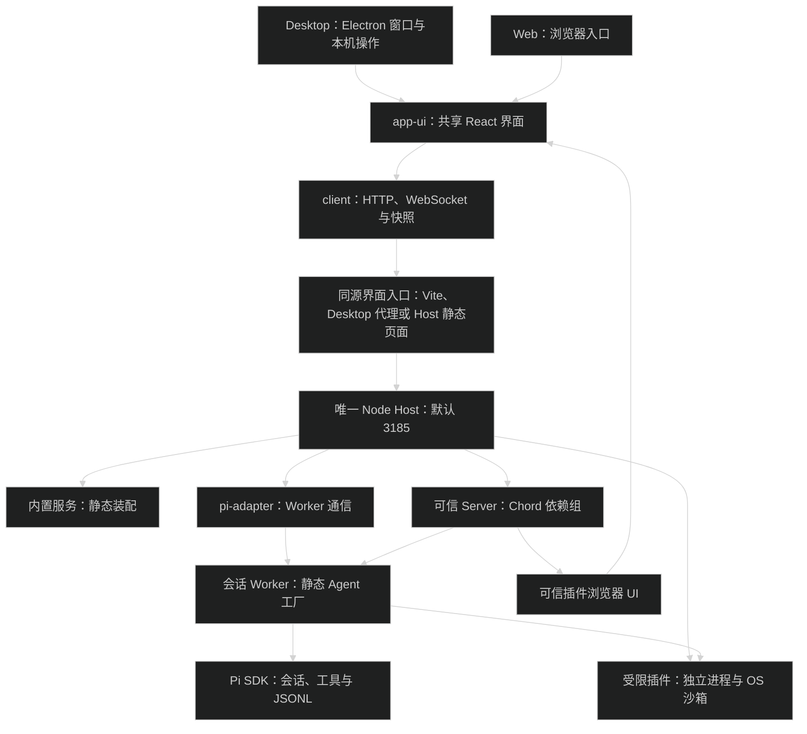
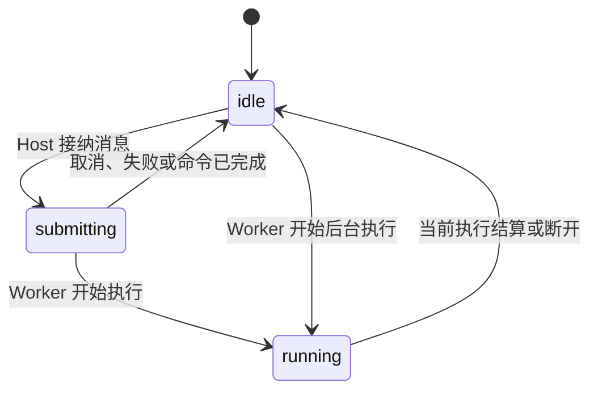

# 架构

Electron 是平台壳，Node Host 负责应用数据和执行调度。Desktop 与 Web 共用 React `app-ui`，通过相同 HTTP/WebSocket 协议连接 Host；Pi SDK 负责原生会话与扩展执行，Chord 负责外部插件的服务作用域；依赖版本分别见 [pi-runtime](../packages/pi-runtime/package.json) 和 [plugin-runtime](../packages/plugin-runtime/package.json)。

## 进程与调用

入口证据：[Desktop main](../apps/desktop/src/main/main.ts)、[Server main](../apps/server/src/main.ts)、[Web main](../apps/web/src/main.tsx)、[Host 启动](../packages/host/src/server.ts)、[Worker 工厂](../packages/host/src/session-worker.ts)。

Host 使用 Hono、`@hono/node-server` 和 `ws`，由 [transport-app.ts](../packages/host/src/transport-app.ts) 注册路由，[transport-auth.ts](../packages/host/src/transport-auth.ts) 处理认证与来源检查，不替换全局 `Request`、`Response`。

### 本机 Host 复用与界面入口

[运行契约](../packages/contracts/src/host-runtime.ts) 统一默认端口 `3185` 与本机状态结构。[local-host.ts](../packages/host/src/local-host.ts) 先探测 `/api/status`，校验产品、状态字段、真实数据目录和持久 Host 身份；没有监听者才创建。并发创建依靠 `host.lock` 决定唯一写入者，其余入口等待并复用。状态只允许本机来源读取，不包含令牌或 Cookie。

Desktop 退出前等待本机启动完成。对于 `owned` 的 Host，主进程在关闭窗口前读取正在运行的会话数。Host 将模型执行、待答交互、活动目标与子任务按根会话去重，空闲时直接退出，有活动会话时等待用户确认。窗口同意关闭后，Desktop 释放界面代理并等待 Host 停机。`attached` 的独立 Server 由其启动方管理。macOS 安装版会识别旧版专用 Host 登录项，核对用户域、启动脚本和归属，按相同流程处理它管理的会话，并在窗口同意关闭后停用该项，防止自动重启。[退出确认](../apps/desktop/src/main/quit-confirmation.ts) · [本机进程管理](../apps/desktop/src/main/local-host.ts) · [Host 登录项](../apps/desktop/src/main/host-login-item.ts)

Server 入口发现兼容 Host 后输出地址并退出，不转移所有权。管理方退出后其他客户端只重连，不自动创建替代 Host。

开发态 Desktop 直接加载端口 `3181` 的 Vite，代理到端口 `3180` 的 Host；正式版加载随包界面，由 [frontend-server.ts](../packages/host/src/frontend-server.ts) 在端口 `2159` 提供同源 HTTP/WebSocket 代理，连接端口 `3185` 的 Host。该入口不持有数据锁、不装配业务服务、不创建会话 Worker，因此不是第二个 Host。已有 Server 没有 Web 静态资源时，也不影响 Desktop 加载自己的界面。Host 自身仍可为普通浏览器提供 Web 页面；静态资源逻辑共用 [frontend.ts](../packages/host/src/frontend.ts)。

主进程保留真实后端地址，Renderer 的 `HostConnection.url` 指向自己的同源界面入口。平台 IPC 只信任该 origin；远程登记与已保存连接管理通过已认证 HTTP 完成，停机和维护准备只走拥有方的私有进程通道。存储维护按所有权再次校验，见 [存储维护](storage.md#desktop-自定义目录)。

## 包职责与依赖方向

| 目录                                                   | 职责                                                         |
| ------------------------------------------------------ | ------------------------------------------------------------ |
| [apps/desktop](../apps/desktop/)                       | 窗口、本地 Host 子进程、平台 IPC、Desktop 入口与验收         |
| [apps/server](../apps/server/)                         | 独立 Host 启动、环境变量、退出清理                           |
| [apps/web](../apps/web/)                               | Web 登录、Vite 构建与共享 React import map                   |
| [packages/contracts](../packages/contracts/)           | HostApi、内部 Pi 类型、事件、资源与平台契约                  |
| [packages/ui](../packages/ui/)                         | 基础交互原语、ErrorBoundary、`cn`、tokens 和通用卡片         |
| [packages/assets](../packages/assets/)                 | 内置界面图片、应用图标和 Dock 图标                           |
| [packages/app-ui](../packages/app-ui/)                 | 页面与布局组合、连接管理、右侧工具标签和贡献槽               |
| [packages/client](../packages/client/)                 | HostApi 客户端、内部功能 Bridge、认证、事件与快照            |
| [packages/host](../packages/host/)                     | 数据目录写入锁、会话身份、操作分派、内置与外部装配           |
| [packages/pi-adapter](../packages/pi-adapter/)         | 通用 Worker 调用与通信、凭据同步、外部 AppAgent 接入         |
| [packages/pi-runtime](../packages/pi-runtime/)         | Pi SDK 装配、会话池、事件、JSONL、历史与安全执行底层         |
| [packages/plugin-sdk](../packages/plugin-sdk/)         | SDK 3 manifest、可信/受限入口、输入框、消息、页面与 RPC 契约 |
| [packages/plugin-runtime](../packages/plugin-runtime/) | 包校验、授权、代码快照、Chord、受限进程与代次切换            |
| [packages/plugin-devkit](../packages/plugin-devkit/)   | 插件创建、Node/浏览器构建、校验与 `.pim` 打包                |
| [plugins](../plugins/)                                 | 独立分发的 App 插件源码；当前包含主题示范                    |

Host 与 app-ui 是组合根。基础包和契约不得反向依赖业务实现；业务包和插件不互导私有实现，通过契约、显式 Props 或声明的服务协作。UI 不导入 Server、Agent、Node 或 Electron；Electron main 不实现聊天、配置、会话或插件生命周期。

[check-package-boundaries.mjs](../scripts/check-package-boundaries.mjs) 检查静态导入、动态 `import()`、re-export、包依赖声明和 UI 边界。修改方式与命令见 [开发指南](development.md)。

## 状态转移与唯一写入点

每个窗口有自己的选中项、草稿和网络连接。打开同一份原生会话历史时，Host 按文件的规范路径复用运行时。两个窗口可以读取不同的消息页，但看到的是同一次执行、同一组待答请求和同一份会话权限。

根会话的 `PiState.executionPhase` 随 Host 事件和快照发送。`submitting` 从 Host 接纳提交开始，涵盖 Worker 启动和消息投递。新执行、压缩或重试开始后进入 `running`。结算、取消或启动失败后回到 `idle`。[会话池](../packages/pi-runtime/src/session-pool.ts) · [执行阶段契约](../packages/contracts/src/pi.ts)

| 状态             | 唯一写入点                                                                                                                            | 对外投影                                                                                                                                                                                                                                                                        |
| ---------------- | ------------------------------------------------------------------------------------------------------------------------------------- | ------------------------------------------------------------------------------------------------------------------------------------------------------------------------------------------------------------------------------------------------------------------------------- |
| 根执行与会话摘要 | `PiSessionPool.setExecutionPhase` 接纳当前执行的变化。每次运行持有自己的序号                                                          | `projectSessionActivity` 组合根执行、子代理、暂停和待答请求，供侧栏、`sessions.list` 和 `sessions.get` 使用。待答提醒的已读状态另由 Host 查看服务保存。[会话摘要](../packages/contracts/src/sessions.ts)                                                                        |
| 任务进度         | Worker 的 `update_plan` 把一次成功的完整清单提交为原生工具结果。`taskId` 标识任务，`userEntryId` 标识本次更新所属轮次                 | `projectTaskProgress` 用分支结果、运行区间和停止状态计算完成数与阶段。任务卡与 `taskProgress.list` 调用同一函数。[任务投影](../packages/contracts/src/task-progress.ts)                                                                                                         |
| 会话权限         | `PiSessionPool.commitExecutionPolicy` 提交权限与任务模式。首次恢复从存储读取，修改前校验执行状态、沙箱和客户端提供的 `accessRevision` | 新版客户端按目标 `sessionKey` 和修订更新权限选择。Plan 的有效权限由共享规则计算。新会话默认值另由 `SettingsStore` 按变更字段保存。[权限规则](../packages/contracts/src/agent-access.ts) · [会话权限存储](../packages/pi-runtime/src/access-store.ts)                            |
| 远端连接         | SSH 由 `SshConnections.transition` 推进，HTTPS 登记后由 `RemoteServices.httpsStatus` 更新。Host 发布 `status` 和 SSH `phase`          | `HostServiceRegistry` 单独记录本窗口的 `clientStatus`。一个窗口离线时，其他窗口仍能读取 Host 对远端的观察。[SSH 连接](../packages/host/src/ssh-connections.ts) · [远端服务](../packages/host/src/remote-services.ts) · [客户端连接](../packages/client/src/service-registry.ts) |

接口同步从契约开始。HTTP 接收方先验证 RPC 信封，客户端在使用回执前检查 Host 和请求标识。Host 与 Worker 共用启动参数、命令和回执定义，接收端检查权限、任务模式与暂停修订。缺少新阶段字段的旧 Host 使用既有执行标志投影，历史会话沿用原生条目。[RPC 契约](../packages/contracts/src/host.ts) · [Worker 协议](../packages/pi-adapter/src/worker-protocol.ts)

服务目录和设置的读取支持取消。新一轮刷新会中止旧读取，旧结果失去更新当前视图的资格。写操作在接纳前可取消，已接纳的写入由 Host 结算，断开客户端后仍可用原请求标识查询或重试。后台任务运行期间，停止和继续通过各自的业务操作完成。[内部 RPC 幂等边界](host-api.md#内置界面的-rpc-回执) · [对话任务进度](sessions.md#对话任务进度)

## 内置能力与系统工具

[builtin-modules.ts](../packages/host/src/builtin-modules.ts) 静态装配内置服务模块；[平台选择](../packages/host/src/sandbox-platform.ts) 在 Windows、Linux 与 macOS 沙箱中选一个。内置 UI 由 app-ui 直接组合，不读取外部插件启用记录。

| 模块                                                  | 职责与源码                                                                                                                                   |
| ----------------------------------------------------- | -------------------------------------------------------------------------------------------------------------------------------------------- |
| `goals`                                               | [持久目标、用量核对与续跑调度](../packages/goals/src/)                                                                                       |
| `chat`                                                | [消息、输入、队列与聊天操作](../packages/chat/src/)                                                                                          |
| `workspace`                                           | [项目、会话摘要索引与侧栏](../packages/workspace/src/)                                                                                       |
| `history`                                             | [Pi JSONL 查询、导出和分支树](../packages/history/src/)                                                                                      |
| `models`                                              | [模型配置、发现、默认选择和上下文用量](../packages/models/src/)                                                                              |
| `image-generation`                                    | [图片模型配置、生图、编辑与图像素材库](../packages/image-generation/src/)                                                                    |
| `memory`                                              | [项目与通用记忆、来源管理和自动学习](../packages/memory/src/)                                                                                |
| `visualize`                                           | [可视化版本、分支引用与预览运行时](../packages/visualize/src/)                                                                               |
| `browser`                                             | [内置网页工具的 Host 与客户端协作](../packages/browser/src/)                                                                                 |
| `schedules`                                           | [定时任务、执行调度与运行记录](../packages/schedules/src/)                                                                                   |
| `context-window`                                      | [实际请求采集、分类估算、正文保留和上下文卡片](../packages/context-window/src/)                                                              |
| `settings`                                            | [偏好、外观、主题和指令](../packages/settings/src/)                                                                                          |
| `resources`                                           | [技能导入、策略、编辑与资源快照](../packages/resources/src/)                                                                                 |
| `interaction`                                         | [Agent 提问、通知、状态与图形交互](../packages/interaction/src/)                                                                             |
| `subagents`                                           | [持续身份、任务树、邮箱、调度与计划元数据](../packages/subagents/src/)                                                                       |
| `mcp`                                                 | [服务配置、逐服务授权、诊断和 Pi MCP 扩展](../packages/mcp/src/)                                                                             |
| `codemode`                                            | [Pi codemode 扩展与工具执行设置](../packages/codemode/src/)                                                                                  |
| `permissions`                                         | [三档权限与 Agent 权限扩展工厂](../packages/permissions/src/)                                                                                |
| `sandbox-macos` / `sandbox-linux` / `sandbox-windows` | [macOS 沙箱](../packages/sandbox-macos/src/)、[Linux 沙箱](../packages/sandbox-linux/src/)、[Windows 沙箱](../packages/sandbox-windows/src/) |
| `usage`                                               | [原生会话用量与活动展示](../packages/usage/src/)                                                                                             |
| `git`                                                 | [工作区、提交与分支 review，保存的轮次差异及文件撤销入口](../packages/git/src/)                                                              |

Git 工作区 review 读取本地仓库；轮次差异使用会话及所属子代理保存的 `edit/write` 前后快照，不覆盖任意命令造成的文件修改。轮次撤销通过正式 HostApi 写回文件。接口和权限见 [HostApi](host-api.md#git-查看与轮次撤销)，记录归属与撤销边界见[本轮文件变更](sessions.md#本轮文件变更)。

“系统插件”是插件页面中的工具展示分类，不是全部内置服务的启停清单。[system-plugins.ts](../packages/plugin-sdk/src/system-plugins.ts) 只列出变更、文件、终端，始终启用。文件和终端的 UI 分别在 [file-directory](../packages/file-directory/src/ui/) 和 [terminal](../packages/terminal/src/ui/)，底层操作由 HostApi 提供。

Agent 项目服务由 [activities](../packages/activities/src/server/service.ts) 管理，Host 持有进程，不依赖会话 Worker 或右侧面板的生命周期。启动走内置 `manage_service` 工具；列表、日志和用户停止走正式 HostApi。受限服务复用 [AccessSandbox](../packages/pi-runtime/src/sdk/access-sandbox.ts)，不借用无 Agent 沙箱的用户终端。

外部 App 插件由用户安装，进入独立启停、卸载和更新流程。内置身份冲突在执行外部入口前拒绝；内置初始化失败中止 Host，外部插件恢复失败隔离相关依赖组并保留诊断。

## 界面组合

[设置导航](../packages/app-ui/src/settings/settings-page.tsx) 由 app-ui 组合，按个人、Agent、系统分组；具体配置含义见[配置与安全](configuration.md)。技能与插件是独立页面，创建操作将对应系统技能插入当前草稿。

首页聊天保留置顶、项目、最近列表。插件可新增自己的活动栏入口、分组菜单与中央业务页；返回首页恢复原聊天，切页不终止任务、PTY 或项目服务。页面路由捕获同 Host 目标，不修改后台聊天选择；仅当前插件页挂载。工具面板位置仍只允许 `right`，分栏模式在当前聊天右侧打开可关闭标签页；完整视图由应用将当前会话与工具合并为顶栏标签，工具独占内容区，聊天保持挂载；标签和宽度按 Host、会话保存。活动工具仅在当前会话存在受管服务时出现在工具目录；停止最后一个服务后，已经打开的标签保留结果，关闭、切换或刷新后不恢复空标签。关闭标签不会停止服务。六类 render 槽为 `composer`、`composer-actions`、`tool-card`、`message`、`status`、`settings`；四类消息统一动作使用 `messageActions.register`。输入框 API 复用唯一草稿与提交守卫，发送前处理逐项授权；响应式投影直接订阅 ChatStream，元数据与正文分开订阅。

源码见 [workspace-panels.tsx](../packages/app-ui/src/layout/workspace-panels.tsx)、[plugin-workspace-page.tsx](../packages/app-ui/src/layout/plugin-workspace-page.tsx)、[use-app-navigation.ts](../packages/app-ui/src/layout/use-app-navigation.ts)、[UI 契约](../packages/plugin-sdk/src/ui.ts)。插件不能替换内置导航、管理页面或聊天实现。

## 协议与平台适配

正式接口 [HostApi](host-api.md) 使用稳定 `ProjectRef` / `SessionRef` 操作显式目标；App 内部 `/api/rpc` 和客户端选择继续服务内置界面。正式操作不读取或改变界面选择。

[PlatformAdapter](../packages/contracts/src/host.ts) 提供本机文件选择、连接配置、文件管理器/编辑器启动和主题导入导出等平台操作；Electron preload 只连接平台 channel。Remote 目录查询、会话和插件安装经 Host，不把远程路径交给本机文件选择器。

“在…打开”只在 macOS Desktop 的本机项目菜单中显示；Web（包括 localhost Host）和远程项目隐藏入口，不查询本机应用。判断使用服务的本机属性与客户端 `nativePlatformAvailable`，不能只看 `service.local`。顶栏、侧栏和项目页共用此限制，侧栏的“复制项目路径”不受影响。

[应用发现与打开](../apps/desktop/src/main/project-apps.ts) 在 Desktop 主进程通过 AppKit `NSWorkspace` 按 bundle ID 查询 VS Code、Cursor、Zed、Windsurf、Sublime Text，以及 IntelliJ IDEA、WebStorm、PyCharm、GoLand、PhpStorm、RubyMine、CLion、Rider、RustRover。只返回已安装且实际存在的候选应用，同产品的不同 edition 合并；不扫描磁盘、不依赖编辑器 CLI，也不保证识别未注册的便携应用。每次展开菜单刷新，进行中的查询合并，不永久缓存。

系统文件管理器沿用 `finder` ID，通过 Electron `shell.openPath` 使用默认目录处理程序。编辑器打开前重新解析安装位置，由主进程以参数数组调用 `/usr/bin/open -a`，不接受界面传入的启动命令或应用路径；未安装或启动失败明确报错，不自动改用其他编辑器。[平台 IPC](../apps/desktop/src/main/ipc/register.ts) 保留来源、本机连接及项目目录校验。[应用 ID 契约](../packages/contracts/src/desktop.ts) 同时供默认应用偏好校验使用，已有偏好无需迁移。

同一个 Host 是其数据目录的唯一写入者。会话 Worker 按执行会话独立创建，持有固定资源快照和插件代次；JSONL 仍由 Pi SDK 保存。外部可信 Server 使用独立 Chord 作用域，安装、卸载和服务拓扑变化通过创建/释放作用域完成，不能只依赖 Chord `reload`。SDK 3 的 Agent/Server 分 trusted 与 restricted；受限入口由 Host 监督独立进程，不进入可信 Worker，联网和共享数据走窄 broker。UI/Agent 的同插件 RPC 固定 generation，页面未保存编辑使用独立租约，不把旧 UI 调用交给新版 Server。可信 React UI 和可信 Node 入口不是恶意代码沙箱。

具体规则分别见 [会话与协作](sessions.md)、[配置与安全](configuration.md)、[插件生命周期](plugins.md#释放与更新)、[资源快照](skills-and-extensions.md#聊天中的技能)。Pi 和 Host 二进制随应用发布，不通过插件热更新升级。
