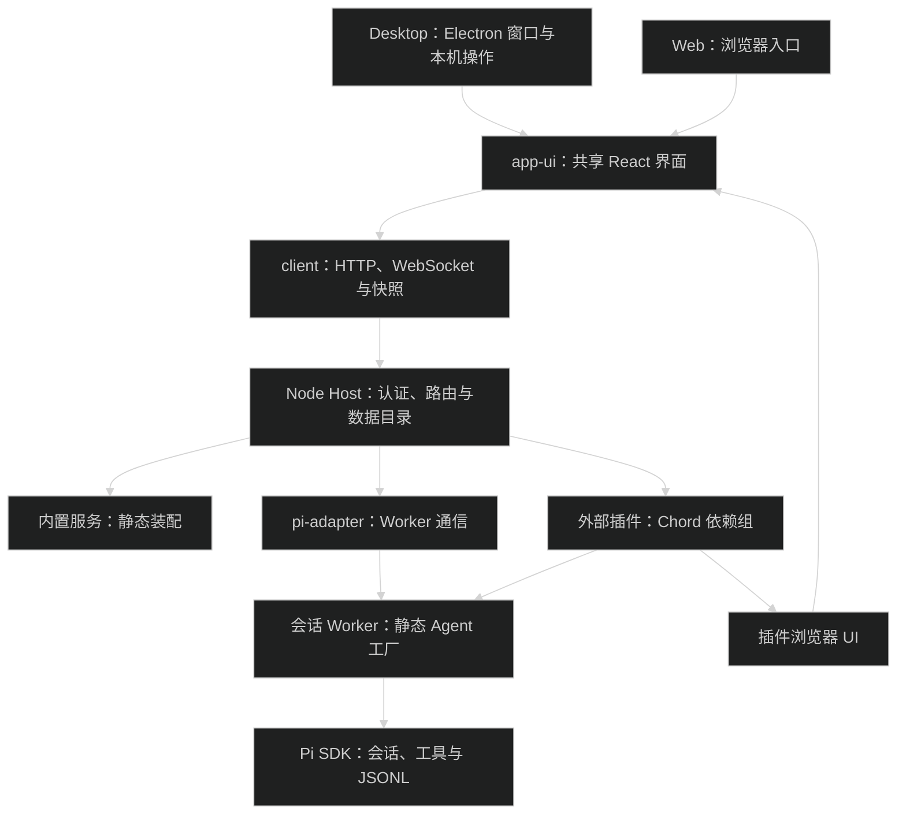

# 架构

Electron 是平台壳，Node Host 负责应用数据和执行调度。Desktop 与 Web 共用 React `app-ui`，通过相同 HTTP/WebSocket 协议连接 Host；Pi 1.1 负责原生会话与扩展执行，Chord 1.1 负责外部插件的服务作用域。

## 进程与调用

入口证据：[Desktop main](../apps/desktop/src/main/main.ts)、[Server main](../apps/server/src/main.ts)、[Web main](../apps/web/src/main.tsx)、[Host 启动](../packages/host/src/server.ts)、[Worker 工厂](../packages/host/src/session-worker.ts)。

Host 使用 Hono、`@hono/node-server` 和 `ws`，由 [transport-app.ts](../packages/host/src/transport-app.ts) 注册路由，[transport-auth.ts](../packages/host/src/transport-auth.ts) 处理认证与来源检查，不替换全局 `Request`、`Response`。

## 包职责与依赖方向

| 目录                                                   | 职责                                                 |
| ------------------------------------------------------ | ---------------------------------------------------- |
| [apps/desktop](../apps/desktop/)                       | 窗口、本地 Host 子进程、平台 IPC、Desktop 入口与验收 |
| [apps/server](../apps/server/)                         | 独立 Host 启动、环境变量、退出清理                   |
| [apps/web](../apps/web/)                               | Web 登录、Vite 构建与共享 React import map           |
| [packages/contracts](../packages/contracts/)           | HostApi、内部 Pi 类型、事件、资源与平台契约          |
| [packages/ui](../packages/ui/)                         | 基础交互原语、ErrorBoundary、`cn`、tokens 和通用卡片 |
| [packages/app-ui](../packages/app-ui/)                 | 页面与布局组合、连接管理、右侧工具标签和贡献槽       |
| [packages/client](../packages/client/)                 | HostApi 客户端、内部功能 Bridge、认证、事件与快照    |
| [packages/host](../packages/host/)                     | 数据目录写入锁、会话身份、操作分派、内置与外部装配   |
| [packages/pi-adapter](../packages/pi-adapter/)         | 通用 Worker 调用与通信、凭据同步、外部 AppAgent 接入 |
| [packages/pi-runtime](../packages/pi-runtime/)         | Pi SDK 装配、会话池、事件、JSONL、历史与安全执行底层 |
| [packages/plugin-sdk](../packages/plugin-sdk/)         | 外部插件 manifest、Server/Agent/UI 契约与释放作用域  |
| [packages/plugin-runtime](../packages/plugin-runtime/) | 包校验、安装记录、不可变代码快照、Chord 与安全切换   |
| [packages/plugin-devkit](../packages/plugin-devkit/)   | 插件创建、Node/浏览器构建、校验与 `.pim` 打包        |
| [plugins](../plugins/)                                 | 独立分发的 App 插件源码；当前包含主题示范            |

Host 与 app-ui 是组合根。基础包和契约不得反向依赖业务实现；业务包和插件不互导私有实现，通过契约、显式 Props 或声明的服务协作。UI 不导入 Server、Agent、Node 或 Electron；Electron main 不实现聊天、配置、会话或插件生命周期。

[check-package-boundaries.mjs](../scripts/check-package-boundaries.mjs) 检查静态导入、动态 `import()`、re-export、包依赖声明和 UI 边界。修改方式与命令见 [开发与验证](development.md)。

## 内置能力与系统工具

[builtin-modules.ts](../packages/host/src/builtin-modules.ts) 每次静态装配 14 个服务模块；两个平台沙箱包按当前平台选一个。内置 UI 由 app-ui 直接组合，不读取外部插件启用记录。

| 模块                              | 职责与源码                                                                                 |
| --------------------------------- | ------------------------------------------------------------------------------------------ |
| `chat`                            | [消息、输入、队列与聊天操作](../packages/chat/src/)                                        |
| `workspace`                       | [项目、会话摘要索引与侧栏](../packages/workspace/src/)                                     |
| `history`                         | [Pi JSONL 查询、导出和分支树](../packages/history/src/)                                    |
| `models`                          | [模型配置、发现、默认选择和上下文用量](../packages/models/src/)                            |
| `settings`                        | [偏好、外观、主题和指令](../packages/settings/src/)                                        |
| `resources`                       | [技能导入、策略、编辑与资源快照](../packages/resources/src/)                               |
| `interaction`                     | [Agent 提问、通知、状态与图形交互](../packages/interaction/src/)                           |
| `subagents`                       | [持续身份、任务树、邮箱、调度与计划元数据](../packages/subagents/src/)                     |
| `mcp`                             | [服务配置、逐服务授权、诊断和 Pi MCP 扩展](../packages/mcp/src/)                           |
| `codemode`                        | [Pi codemode 扩展与工具执行设置](../packages/codemode/src/)                                |
| `permissions`                     | [三档权限与 Agent 权限扩展工厂](../packages/permissions/src/)                              |
| `sandbox-macos` / `sandbox-linux` | [macOS 沙箱](../packages/sandbox-macos/src/)、[Linux 沙箱](../packages/sandbox-linux/src/) |
| `usage`                           | [原生会话用量与活动展示](../packages/usage/src/)                                           |
| `git`                             | [工作区 Git 状态、Diff 与面板](../packages/git/src/)                                       |

“系统插件”是插件页面中的工具展示分类，不是全部内置服务的启停清单。[system-plugins.ts](../packages/plugin-sdk/src/system-plugins.ts) 只列出变更、文件、终端，始终启用。文件和终端的 UI 分别在 [file-directory](../packages/file-directory/src/ui/) 和 [terminal](../packages/terminal/src/ui/)，底层操作由 HostApi 提供。

外部 App 插件由用户安装，进入独立启停、卸载和更新流程。内置身份冲突在执行外部入口前拒绝；内置初始化失败中止 Host，外部插件恢复失败隔离相关依赖组并保留诊断。对应测试见 [builtin-modules.test.ts](../packages/host/tests/builtin-modules.test.ts)。

## 界面组合

[设置导航](../packages/app-ui/src/settings-page.tsx) 分三组：个人包含常规、外观、用量；Agent 包含模型、指令、技能、插件、MCP；系统包含远程、关于。常规只设置新会话默认权限。指令页编辑 Host 的用户指令与系统提示词。技能与插件是独立页面，没有共享资源页。[技能页](../packages/app-ui/src/skill-page.tsx)和[插件页](../packages/app-ui/src/plugin-page.tsx)各自在“个人 / 系统”间切换。创建技能或插件会把对应系统技能插入当前对话。

左侧为置顶、项目、最近，中间固定聊天。工具面板位置只允许 `right`，在当前聊天右侧栏打开可关闭标签页；标签和宽度按 Host、会话保存。七类贡献槽为 `composer`、`composer-actions`、`tool-card`、`message`、`message-actions`、`status`、`settings`。

源码见 [workspace-panels.tsx](../packages/app-ui/src/workspace-panels.tsx)、[right-sidebar.tsx](../packages/app-ui/src/right-sidebar.tsx)、[UI 契约](../packages/plugin-sdk/src/ui.ts)。插件不能替换左侧导航或中央聊天。

## 协议与平台适配

正式接口 [HostApi v2](host-api.md) 使用稳定 `ProjectRef` / `SessionRef` 操作显式目标；App 内部 `/api/rpc` 和客户端选择继续服务内置界面。正式操作不读取或改变界面选择。

[PlatformAdapter](../packages/contracts/src/host.ts) 提供本机文件选择、连接配置、Finder/编辑器启动和主题导入导出等平台操作；Electron preload 只连接平台 channel。Remote 目录查询、会话和插件安装经 Host，不把远程路径交给本机文件选择器。

同一个 Host 是其数据目录的唯一写入者。会话 Worker 按执行会话独立创建，持有固定资源快照和插件代次；JSONL 仍由 Pi SDK 保存。外部插件使用独立 Chord 作用域，安装、卸载和服务拓扑变化通过创建/释放作用域完成，不能只依赖 Chord `reload`。

具体规则分别见 [会话与协作](sessions.md)、[配置与安全](configuration.md)、[插件生命周期](plugins.md#释放与更新)、[资源快照](skills-and-extensions.md#聊天中的技能)。Pi 和 Host 二进制随应用发布，不通过插件热更新升级。
