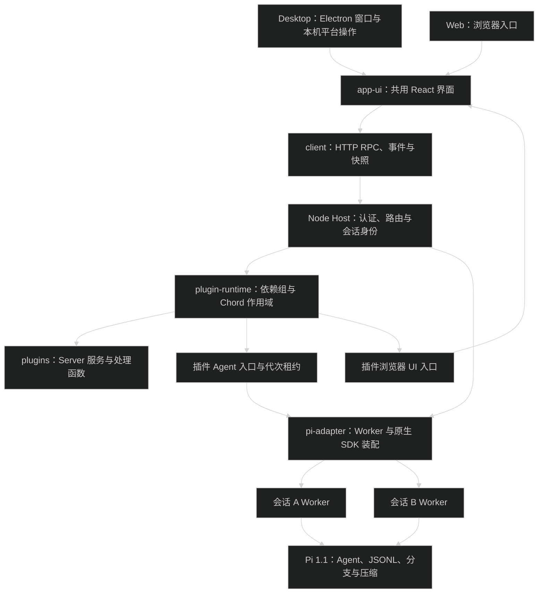
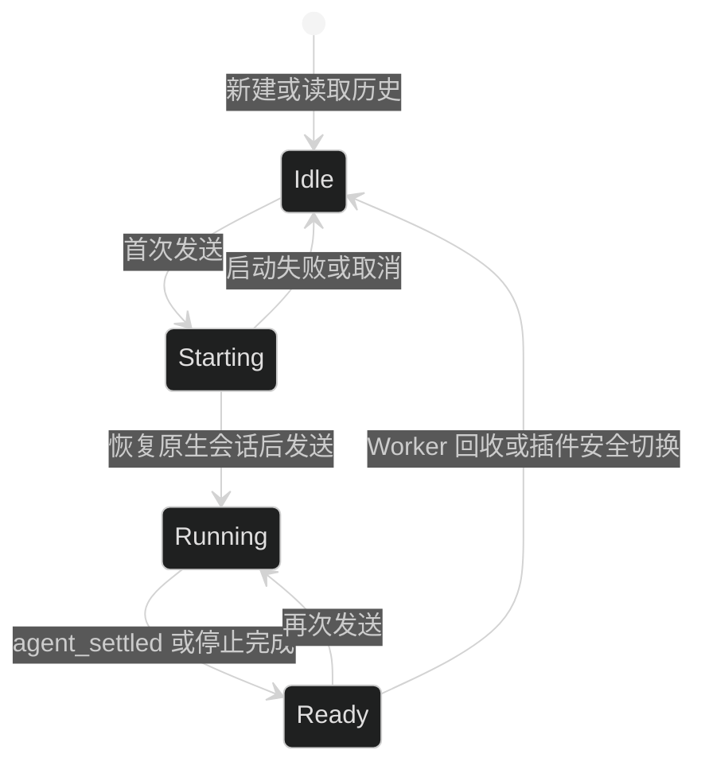
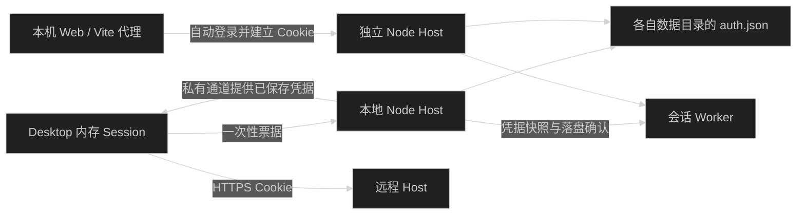

# 基础架构

Electron 是平台壳；Node Host 持有应用配置、会话池、Worker 和插件作用域。Desktop 与 Web 共用 React 界面，通过同一 HTTP/WebSocket 协议操作 Host。Pi 1.1 的公开 SDK 负责原生会话与扩展执行，Chord 1.1 负责插件服务作用域。



## 目录与包边界

| 目录                      | 职责                                                          |
| ------------------------- | ------------------------------------------------------------- |
| `apps/desktop`            | Electron 窗口、本地 Host 子进程、平台 IPC、Desktop 入口和验收 |
| `apps/server`             | 独立 Node Host 启动、环境变量与退出清理                       |
| `apps/web`                | Web 登录入口、Vite 构建及共享 React import map                |
| `packages/contracts`      | Pi 派生类型、Host 请求/事件、平台适配器与功能契约             |
| `packages/ui`             | 通用原语、图标、ErrorBoundary、主题 tokens 和工具卡片贡献入口 |
| `packages/app-ui`         | 共同布局、设置导航、Host 连接、插件中心与六类 UI 槽           |
| `packages/client`         | 类型化功能 Bridge、HTTP/WebSocket、认证、快照与平台适配       |
| `packages/host`           | 唯一数据写入者、客户端选择、业务操作分派与插件装配            |
| `packages/pi-adapter`     | 会话 Worker、SDK 路径、凭据同步和插件 Agent 初始化            |
| `packages/pi-runtime`     | SDK 加载、会话池、事件转换、原生 JSONL 读取及受限执行底层     |
| `packages/plugin-sdk`     | manifest、Server/Agent/UI 类型与资源释放作用域                |
| `packages/plugin-runtime` | 目录快照、包校验、持久化状态、Chord 加载与安全切换            |
| `packages/plugin-devkit`  | 模板创建、Node/浏览器构建、校验与 `.pim` 打包                 |
| `plugins/*`               | 实际业务实现、Pi 扩展和 UI 贡献                               |

插件按实际能力创建 `src/server/entry.ts`、`src/agent/entry.ts`、`src/ui/entry.tsx` 和 `src/shared`。保留包名与功能身份，例如聊天为 `@pi-meme/chat`；扩展交互包 `@pi-meme/pi-extensions` 位于 `plugins/interaction`。对外入口使用 `/server/`、`/agent/`、`/ui/` 子路径。

约束：

- Electron main 不实现聊天、模型、历史、MCP 或插件生命周期。
- UI 不导入 Electron、Node、Server 或 Agent 实现。
- 插件不导入其他插件实现；跨插件需要的数据使用契约、Props 或 Chord 服务注入。
- Host 与 App 显式组合插件；契约包不反向导入功能实现。
- 包内使用相对导入，跨包使用 `@pi-meme/<包名>/<子路径>`，不新增批量导出的 `index.ts`。
- Pi 会话与 Host 二进制不属于插件热更新对象。

## 业务插件

| 插件            | 实际职责                                                        |
| --------------- | --------------------------------------------------------------- |
| `chat`          | 消息投影、输入、附件、队列、编辑与回复操作、Markdown 和工具卡片 |
| `workspace`     | 项目登记、会话摘要索引、侧栏与会话选择                          |
| `history`       | 原生 JSONL 历史查询、预取、导出和分支树 UI                      |
| `models`        | 模型配置、发现、默认模型、选择和上下文用量                      |
| `settings`      | 偏好存储、外观、主题与个性化指令                                |
| `resources`     | Host/项目技能、提示词和扩展路径注册、资源查询及相关 UI          |
| `interaction`   | Pi 扩展的弹窗、通知、状态、文本挂件和编辑器预填                 |
| `subagents`     | Markdown 定义、启用目录、Task 工具和受限子任务执行              |
| `mcp`           | 全局与工作区 MCP 配置、诊断、OAuth 和 Pi 原生 MCP 扩展          |
| `codemode`      | Pi 原生 codemode 扩展与设置 UI                                  |
| `permissions`   | 三档权限操作、选择 UI 和 Agent 权限扩展工厂                     |
| `sandbox-macos` | macOS 沙箱服务与 Worker 沙箱工厂                                |
| `usage`         | 原生会话用量查询与活动页面                                      |
| `git`           | Git 状态、Diff 查询和面板                                       |

停用插件会撤销对应操作、会话扩展和 UI 贡献；App 协调 Hook 停止读取已停用的功能。设置导航由 app-ui 持有，业务页面通过插件贡献注入；设置插件停用后仍能管理插件与 Host 连接。

## Host 协议与平台能力

`HostRpcRequest` 携带 `requestId`、`clientId`、可选 `hostId`、可选 `sessionId`、`method` 和 `args`。响应回传 `requestId` 与 Host 身份。Host 使用请求上下文确定客户端正在查看的会话，实际写操作继续传稳定 `sessionKey`；异步完成时不会重新读取界面选择。

业务方法由 Server 插件登记，Host 通过 `PluginManager.runHandler` 分派并记录进行中的服务调用。HTTP、事件 WebSocket、快照和插件静态资源共用认证与来源检查。客户端先读取连接状态；事件订阅建立后补读会话快照，缓冲读取期间的事件，随后按会话、generation 和 sequence 去重。

`PlatformAdapter` 只提供窗口所需的本机操作、连接配置、文件选择、Finder/编辑器启动和主题文件导入导出。Electron preload 仅接这类平台 channel。Remote 目录查询、会话操作与插件安装都经 Host，浏览器不会把 Host 路径交给本机文件选择器。

## 会话与 Pi 原生数据

`PiSessionPool` 保存稳定会话身份、执行状态和当前客户端选择。首次落盘补充 `sessionFile`，不更换 `sessionKey`。新建、选择历史和切换页面先读取本地投影；首次发送才创建或恢复所属 Worker 中的 Pi 会话。



每个执行会话持有独立 Worker。旧 Worker 事件通过 generation 隔离，过期启动结果立即释放。`agent_end` 不表示空闲，`agent_settled` 才结束执行；停止响应和结束事件只处理一次。选择其他会话不改变已发送消息的目标。

持久化继续使用 Pi SDK 的 JSONL、会话分支、恢复、编辑版本和压缩。`history` 只查询、索引、导出和展示这些数据；停用它不停止 Pi 会话写入，也不提供任意 SQLite 存储替换承诺。

模型配置修改保留空闲检查、恢复状态捕获、写文件、重连与恢复的顺序。失败保留会话身份、正文和已保存配置，原模型不存在时要求重新选择。模型与命令缓存随重连失效。

## 插件代次与作用域

服务依赖来自 manifest 的 `requires`/`provides`。PluginManager 用 Chord local services 组装连通依赖组；每组使用独立 `createFacetHost` 与插件释放作用域。外部 Server 产物由 Chord fresh VM loader 加载，释放后丢弃模块引用，不通过永久增加的 ESM query 参数热更。

Chord 1.1 的 `reload` 只替换已有相同服务 shape 的 facet，不能新增或删除；App 安装、卸载与依赖变化通过创建/释放受影响作用域完成。

- 纯 Agent 版本允许共存，新会话取得新代次，旧任务持有原租约直到完成。
- 共享 Server 组切换前阻止该组新调用，等待相关任务、工具、SubAgent 与未答交互结束，随后先释放旧资源再初始化新版。
- 服务调用单独持有引用；Git/历史查询更新不等待无关 Agent 会话。
- UI 贡献与所属代次绑定；无关的服务/UI 插件继续按当前版本即时启停。

`interaction` 的 Agent 入口决定会话是否绑定图形 UI 桥，同时让会话租约保留交互服务与 UI 代次。停用后，新会话的扩展 `hasUI` 为 `false`，不会发起无人可答的弹窗。切换期间，已租用的会话通过旧代次回答未结束交互；相关新调用仍被 gate 拒绝。等待相关任务排空不占发布锁，无关 Git/history 更新可以提交；发布时合并本次修改并重新核验依赖，失败只恢复本次影响的组。

- 更新失败重建上一版作用域；持久化失败不会先撤销旧版。依赖服务的唯一提供者不能被拔掉。

构建目录和上传包复制为不可变代码快照；目录重新加载读取原开发目录，上传包更新需要新包。代码目录只在没有引用时回收；插件数据默认保留。详细接口见 [插件文档](plugins.md)。

## 路径、凭据与权限

Host 默认数据根目录为 `~/.pi-meme`，可由 `PI_MEME_DATA_ROOT` 修改。同一数据目录由心跳锁保证单个 Host 写入。

```text
~/.pi-meme/
├── auth.json            # 模型、MCP、Host 令牌和 Desktop 远程连接凭据
├── settings.json
├── themes/
├── pi/                  # SDK 设置、模型、MCP、技能、扩展、提示词、SubAgent 定义
├── sessions/            # 按工作区真实路径哈希分组的 Pi JSONL
├── workspaces/          # 工作区 MCP 覆盖与 Host 数据
├── plugins/             # 不可变代码快照与安装/启用状态
└── plugin-data/         # 各插件的数据，卸载默认保留
```

模型、MCP 和 Host 认证由 Node Host 写入根目录 `auth.json`，采用项目自己的字符串键值格式，权限为 `0600`。文件通过串行写入和原子替换保存，Worker 保持内存副本，Host 落盘成功后才确认操作。启动不读取钥匙串；“设置 → Host 连接 → 导入旧钥匙串凭据”只导入缺失项，保留文件中已有凭据和旧钥匙串条目。读取或写入失败会明确报错，不覆盖原文件。

Desktop 每次默认启动本地 Host，使用一次性票据自动登录。本地 Host 在切换远程后继续运行，并通过 utilityProcess 私有通道管理已保存的远程地址、Host 身份和令牌。Electron main 使用窗口所属 Session 认证远程，长期令牌不返回 Renderer。显式 `PI_MEME_REMOTE_HOST` 也需要本地数据目录写锁；同一目录已有独立 Server 时不能同时运行。

Desktop 窗口使用内存 Session，认证 Cookie 不写入磁盘，不触发 Chromium Cookie 加密的系统钥匙串读取。重新启动时由本地票据或 `auth.json` 中的远程令牌重新认证。



Pi 1.1 的 `ModelRuntime.create` 没有公开认证环境注入参数。唯一的 private shape 依赖位于 `packages/pi-runtime/src/sdk/model-runtime.ts`：先检查 `runtime.models.authContext`，再注入空环境与不可用文件检查，阻止读取本机环境和认证文件。守卫失败会明确报错。升级 Pi SDK 时必须重新验证此隔离层；会话、JSONL、扩展和资源加载继续使用公开入口。能力接线见 [Pi SDK 说明](rpc-capabilities.md)。

项目 `.pi` 和 `AGENTS.md` 是只读输入，不读取本机 Pi CLI 全局目录、外部认证文件或模型认证环境变量。资源插件登记 Host/项目路径，未启用时不加载这些可选资源。主题保持 JSON，只解析允许的颜色与字体，不执行 JavaScript 或任意 CSS。

保留 `read-only`、`workspace-write`、`full-access` 三档权限。Worker 的权限策略由已租用的 `permissions` 与 `sandbox-macos` Agent 入口注入；缺失或沙箱检查失败时拒绝受限会话。完全权限的外部扩展与 MCP 仍按各插件及设置开关装配。codemode 内部工具与 SubAgent 工具通过父会话执行，继续受同一权限与沙箱约束。

插件是可信 Node 宿主代码；Agent 权限不会因安装插件自动升级。Pi 原生 hook 使用 `pi.on`，图形 UI 由 `interaction` 与插件 UI 入口补充，不承诺 TUI `custom()` 组件兼容。

## 构建与验证

`pnpm build:plugins` 构建内置插件；Server/Agent 使用 Node 目标，UI 使用浏览器目标且共享宿主 React。Desktop 与 Server 构建分发 Pi 运行时和内置插件，不要求用户安装 Pi CLI。

代码修改后依次运行 `pnpm type-check`、`pnpm lint`、`pnpm format`。`pnpm test` 运行单元与集成测试；`pnpm check-boundaries` 检查依赖与进程边界。涉及 Desktop 平台接线时运行 `pnpm package`、`pnpm test:package` 和 `pnpm test:desktop`，验收截图位于 `apps/desktop/out/desktop-smoke/`。
