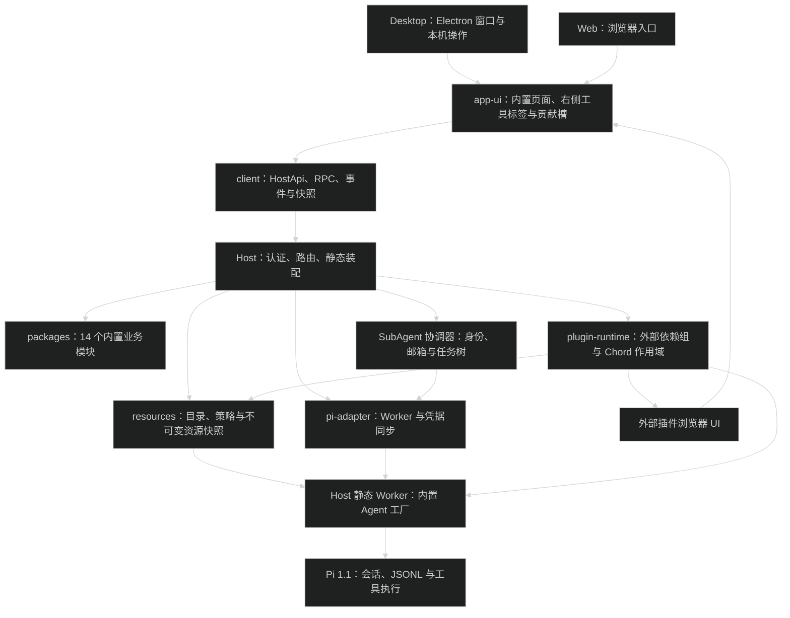
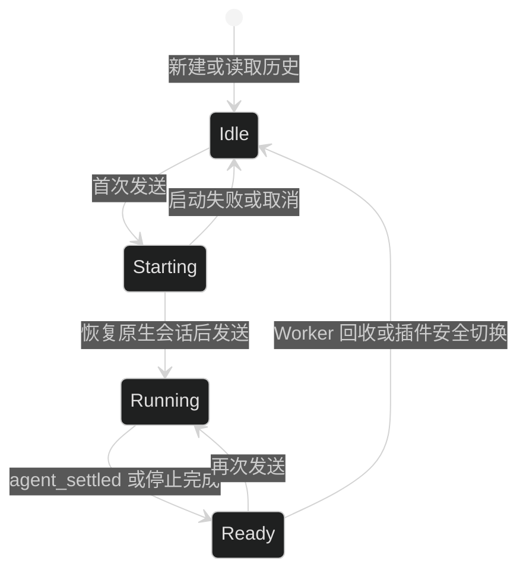
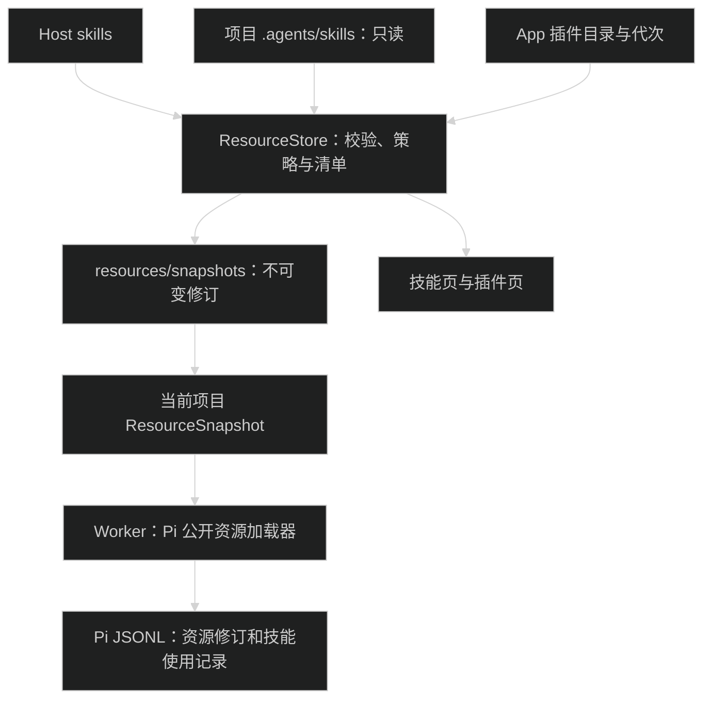
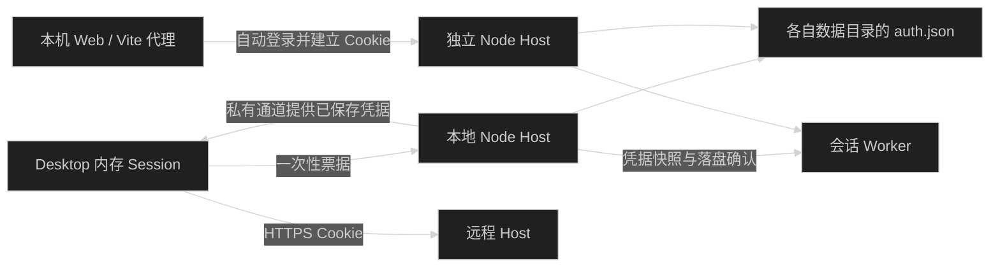

# 基础架构

Electron 是平台壳；Node Host 持有应用配置、会话池、Worker 和插件作用域。Desktop 与 Web 共用 React 界面，通过同一 HTTP/WebSocket 协议操作 Host。Pi 1.1 的公开 SDK 负责原生会话与扩展执行，Chord 1.1 负责插件服务作用域。

内置能力与用户插件的划分、设置入口、SubAgent 和计划模式见 [内置能力与用户插件设计](core-and-plugins-design.md)。下面描述当前实现。



## 目录与包边界

| 目录                      | 职责                                                                       |
| ------------------------- | -------------------------------------------------------------------------- |
| `apps/desktop`            | Electron 窗口、本地 Host 子进程、平台 IPC、Desktop 入口和验收              |
| `apps/server`             | 独立 Node Host 启动、环境变量与退出清理                                    |
| `apps/web`                | Web 登录入口、Vite 构建及共享 React import map                             |
| `packages/contracts`      | 正式 HostApi、内部 Pi 类型、平台适配器与功能契约                           |
| `packages/ui`             | 通用原语、图标、ErrorBoundary、主题 tokens 和工具卡片贡献入口              |
| `packages/app-ui`         | 共同布局、设置导航、Host 连接、技能/插件独立页面、右侧工具标签与七类贡献槽 |
| `packages/client`         | 类型化功能 Bridge、HTTP/WebSocket、认证、快照与平台适配                    |
| `packages/host`           | 唯一数据写入者、客户端选择、业务操作分派与插件装配                         |
| `packages/pi-adapter`     | 通用 Worker 调用、通信、SDK 路径、凭据同步和外部 Agent 加载                |
| `packages/pi-runtime`     | SDK 加载、会话池、事件转换、原生 JSONL 读取及受限执行底层                  |
| `packages/plugin-sdk`     | manifest、Server/Agent/UI 类型与资源释放作用域                             |
| `packages/plugin-runtime` | 目录快照、包校验、持久化状态、Chord 加载与安全切换                         |
| `packages/plugin-devkit`  | 模板创建、Node/浏览器构建、校验与 `.pim` 打包                              |
| `packages/{chat,...}`     | 14 个内置业务模块，保留 Server、Agent、UI 分层                             |
| `plugins/*`               | 可选的独立 App 插件源码，不要求此目录存在                                  |

内置模块与外部插件按实际能力创建 `src/server/entry.ts`、`src/agent/entry.ts`、`src/ui/entry.tsx` 和 `src/shared`。保留包名与功能身份，例如聊天为 `@pi-meme/chat`；交互包 `@pi-meme/interaction` 位于 `packages/interaction`。对外入口使用 `/server/`、`/agent/`、`/ui/` 子路径。

约束：

- Electron main 不实现聊天、模型、历史、MCP 或插件生命周期。
- UI 不导入 Electron、Node、Server 或 Agent 实现。
- 业务包与插件不互导私有实现；通过契约、Props 或声明的服务通信。
- Host 与 app-ui 是组合根；基础包和契约不反向导入业务实现。
- 包内使用相对导入，跨包使用 `@pi-meme/<包名>/<子路径>`，不新增批量导出的 `index.ts`。
- Pi 会话与 Host 二进制不属于插件热更新对象。

## 内置业务模块

| 模块                          | 实际职责                                                        |
| ----------------------------- | --------------------------------------------------------------- |
| `chat`                        | 消息投影、输入、附件、队列、编辑与回复操作、Markdown 和工具卡片 |
| `workspace`                   | 项目登记、会话摘要索引、侧栏与会话选择                          |
| `history`                     | 原生 JSONL 历史查询、预取、导出和分支树 UI                      |
| `models`                      | 模型配置、发现、默认模型、选择和上下文用量                      |
| `settings`                    | 偏好存储、外观、主题与个性化指令                                |
| `resources`                   | Host/项目/App 技能、导入、策略、编辑及不可变资源快照            |
| `interaction`                 | Pi 扩展的弹窗、通知、状态、文本挂件和编辑器预填                 |
| `subagents`                   | 持续子代理身份、邮箱、spawn/wait/followup、取消与 Pi JSONL      |
| `mcp`                         | 全局与工作区 MCP 配置、诊断、OAuth 和 Pi 原生 MCP 扩展          |
| `codemode`                    | Pi 原生 codemode 扩展与设置 UI                                  |
| `permissions`                 | 三档权限操作、选择 UI 和 Agent 权限扩展工厂                     |
| `sandbox-macos/sandbox-linux` | 当前平台沙箱服务与 Worker 沙箱工厂                              |
| `usage`                       | 原生会话用量查询与活动页面                                      |
| `git`                         | Git 状态、Diff 查询和面板                                       |

14 个模块由 `packages/host/src/builtin-modules.ts` 静态组合，UI 由 app-ui 直接组合，不读取用户插件启用状态。内置模块初始化失败会中止 Host 启动；外部插件恢复失败只隔离相关依赖组，并保留恢复诊断。

设置侧栏显示“个人、集成、系统”三组，所有入口可搜索。集成区只有“技能、插件、MCP”三个独立入口；技能页与插件页不共用 Tab 或类型筛选。AI 模型配置在个人区的模型页。资源目录查询不要求启动模型。高级指令和插件重新加载仍在开发者页面。目录、接口和调用规则见 [技能与 App 资源管理](skills-and-extensions.md)。

## Host 协议与平台能力

正式控制契约在 `packages/contracts/src/app-host.ts`，公共版本为 `apiVersion: 2`。`ProjectRef = { hostId, projectId }`、`SessionRef = { hostId, sessionId }` 标识持久目标；API 支持项目、会话、文件、终端、Git 读取、交互答复、子代理查询与停止、计划查询和能力检查。Server/UI 插件通过 `context.host` 调用；外部插件不取得内置 Store、Pool 或 Worker。

HTTP 控制入口是 `/api/control`，事件入口是 `/api/control/events`。写请求携带调用方幂等键；控制日志 `control.json` 保存稳定身份、操作结果、提交回执和关键状态事件。相同客户端与键的相同内容返回已有结果，冲突内容被拒绝。重启将未完成提交记为中断，不重放模型调用；这不是任务自动续跑保证。

关键事件用 `journalEpoch/seq/eventId` 标识，订阅可按目标过滤并补读。游标失效要求重新读取快照；快照带 `controlCursor`。token 流和终端输出只实时发送，不写入控制日志；聊天正文继续保存在 Pi JSONL，终端重连读取输出快照。认证、Cookie 续期和客户端用法见 [Remote 文档](remote.md)。后续 Bot 使用独立客户端，本轮未实现 Bot。

App 内部已有 `/api/rpc`、`HostRpcRequest` 和客户端选择继续服务聊天与设置页面。正式控制操作指定目标，不读取或改变客户端的界面选择。HTTP、事件 WebSocket、快照和插件静态资源共用认证与来源检查。

`PlatformAdapter` 只提供窗口所需的本机操作、连接配置、文件选择、Finder/编辑器启动和主题文件导入导出。Electron preload 仅接这类平台 channel。Remote 目录查询、会话操作与插件安装都经 Host，浏览器不会把 Host 路径交给本机文件选择器。

## 会话与 Pi 原生数据

正式会话创建立即保存稳定 SessionRef，Pi 会话文件生成后再保存绑定，两个空会话也有不同身份；`sessionKey` 只作当前进程的运行时映射，重启可重新建立。`PiSessionPool` 保存执行状态和内部客户端选择。新建、选择历史和切换页面先读取本地投影；首次发送才创建或恢复所属 Worker。



每个执行会话持有独立 Worker。旧 Worker 事件通过 generation 隔离，过期启动结果立即释放。`agent_end` 不表示空闲，`agent_settled` 才结束执行；停止响应和结束事件只处理一次。选择其他会话不改变已发送消息的目标。

持久化继续使用 Pi SDK 的 JSONL、会话分支、恢复、编辑版本和压缩。`history` 只查询、索引、导出和展示这些数据，不提供任意 SQLite 存储替换承诺。

模型配置修改保留空闲检查、恢复状态捕获、写文件、重连与恢复的顺序。失败保留会话身份、正文和已保存配置，原模型不存在时要求重新选择。模型与命令缓存随重连失效。

## 外部插件代次与作用域

服务依赖来自 manifest 的 `requires`/`provides`。PluginManager 用 Chord local services 组装连通依赖组；每组使用独立 `createFacetHost` 与插件释放作用域。外部 Server 产物由 Chord fresh VM loader 加载，释放后丢弃模块引用，不通过永久增加的 ESM query 参数热更。

Chord 1.1 的 `reload` 只替换已有相同服务 shape 的 facet，不能新增或删除；App 安装、卸载与依赖变化通过创建/释放受影响作用域完成。

- 纯 Agent 版本允许共存，新会话取得新代次，旧任务持有原租约直到完成。
- 共享 Server 组切换前阻止该组新调用，等待相关任务、工具、SubAgent 与未答交互结束，随后先释放旧资源再初始化新版。
- 服务调用单独持有引用；Git/历史查询更新不等待无关 Agent 会话。
- UI 贡献与所属代次绑定；无关的服务/UI 插件继续按当前版本即时启停。

图形交互桥由内置 `interaction` 始终提供，不随用户插件停用撤销。每个父子 Worker 分别取得外部 Agent 租约；外部插件更新仍等待相关工具、子任务和未答交互。回答使用实际源 sessionKey 与执行代次，不能通过切换根视图误答另一个子任务。

- 更新失败重建上一版作用域；持久化失败不会先撤销旧版。依赖服务的唯一提供者不能被拔掉。

构建目录和上传包复制为不可变代码快照；目录重新加载读取原开发目录，上传包更新需要新包。代码目录只在没有引用时回收；插件数据默认保留。详细接口见 [插件文档](plugins.md)。

App SDK 2 manifest 的 `piMeme.resources` 只声明 `skills`、`themes` 和 `assets`，`display` 声明显示名称和包内图标。`PluginManager.resourcePackages()` 提供包目录、启用状态和代次；`ResourceStore` 索引技能，SettingsStore 加载启用插件的主题 JSON 与包内素材。Server 服务依赖只用于插件之间；App 系统操作走正式 `HostApi`。

Agent 入口导出 `activate(context)`，由 Pi 内部适配层装配工具、命令、hook 和交互。新会话默认不选外部 Agent；Host 可保存新会话默认列表，单个会话的 `configuration.agentPlugins` 独立持久化。运行中拒绝改配置，子 Worker 继承父选择与代次。按选择取得租约时仍保留整个 Chord 依赖组，项目策略不释放全局 Server 服务。

左侧仅置顶、项目与最近，中间固定聊天。UI 面板仅允许 `right`；通过 `panels.register` 登记，并声明 `app/project/session` 作用范围。右侧顶栏提供可关闭标签、“＋”工具选择页、加宽和收起；标签与宽度按 Host、会话保存。聊天和左侧导航不注册为面板。UI 贡献有 `composer`、`composer-actions`、`tool-card`、`message`、`message-actions`、`status`、`settings` 七类，通过 `contributions.register` 登记；`reactive` 提供目标与会话快照订阅。工具贡献按真实 `ownerId`、`generation` 和 `toolName` 匹配；消息贡献按相同来源与代次、`customType` 匹配。Registry 限制来源为贡献插件自身。没有可信来源或对应代次的消息保留普通文字，工具贡献补充通用详情。图标与 UI 代码通过同一认证资源接口访问。

## 资源目录与 Worker 快照

Host 扫描数据根下的 `skills/`、项目 `.agents/skills/` 和 App 插件声明的技能目录。项目目录只读；Host 默认策略在 `resources/state.json`，项目覆盖在 `workspaces/<cwd-hash>/resources.json`。不读取旧 `.pi/skills`、`.pi/extensions`，不迁移旧文件，也不读取本机 Pi CLI 或其他 Agent 的全局技能目录。

`ResourceStore` 校验资源并把完整目录保存到内容哈希快照；目录中的脚本、引用文件和包内相对导入跟随修订。内置同名技能优先，其次项目技能，再其次 Host 技能；包内技能使用包名前缀区分。所有冲突项保留在管理清单中并标记 `shadowedBy`。



Worker 启动取得资源快照与插件租约；子代理继承父 Worker 的资源快照。安装、策略修改和技能保存先发布新修订，再通知客户端；受影响 Worker 等待执行与待答交互结束后退役，下一轮取得新修订。技能保存检查读取时的修订，不覆盖其他客户端已经保存的正文。编辑器只修改 Host 散装技能的 `SKILL.md`；项目、内置和包技能只读，可复制成用户技能后编辑。

技能默认允许模型按描述选择，正文仍按需读取。仅手动技能从自动选择列表隐藏，但可从 `$` 选择；显式选择携带资源 ID 和修订，发送前展开快照中的正文并校验修订。技能不会授予新的文件、工具或网络权限。

## 路径、凭据与权限

Host 默认数据根目录为 `~/.pi-meme`，可由 `PI_MEME_DATA_ROOT` 修改。同一数据目录由心跳锁保证单个 Host 写入。

内置 `skill-creator` 的源码位于 `pi/skills/skill-creator`。Desktop 与独立 Server 构建时携带完整技能目录，Host 启动时将其复制到 `builtin-resources/skills/skill-creator`，不改用户的 `skills/`。新安装应用无需 Codex、Pi CLI 或模型凭据即可在 `$` 列表看到该技能；列表标记“内置”，悬停显示文件路径。内置同名技能优先于用户和项目技能，用户文件保留。

```text
~/.pi-meme/
├── auth.json            # 模型、MCP、Host 令牌和 Desktop 远程连接凭据
├── settings.json
├── themes/
├── skills/              # Host 散装技能，含 SKILL.md 与辅助文件
├── builtin-resources/   # 随应用分发的内置技能
├── resources/           # 导入清单、Host 策略和不可变资源快照
├── pi/                  # SDK 设置、模型、MCP、提示词与 SubAgent 定义
├── sessions/            # 按工作区真实路径哈希分组的 Pi JSONL
├── workspaces/          # 工作区 MCP 覆盖与 Host 数据
├── plugins/             # 不可变代码快照与安装/启用状态
├── plugin-data/         # 各模块/插件的数据，卸载默认保留
├── control.json         # 稳定身份、幂等操作、回执与关键事件
├── collaboration.json   # 协作身份、邮箱与计划元数据
└── plans/               # sessionId/id.md 计划正文
```

模型、MCP 和 Host 认证由 Node Host 写入根目录 `auth.json`，采用项目自己的字符串键值格式，权限为 `0600`。文件通过串行写入和原子替换保存，Worker 保持内存副本，Host 落盘成功后才确认操作。启动不读取钥匙串；“设置 → 更多 → Host 连接 → 导入旧钥匙串凭据”只导入缺失项，保留文件中已有凭据和旧钥匙串条目。读取或写入失败会明确报错，不覆盖原文件。

Desktop 每次默认启动本地 Host，使用一次性票据自动登录。本地 Host 在切换远程后继续运行，并通过 utilityProcess 私有通道管理已保存的远程地址、Host 身份和令牌。Electron main 使用窗口所属 Session 认证远程，长期令牌不返回 Renderer。显式 `PI_MEME_REMOTE_HOST` 也需要本地数据目录写锁；同一目录已有独立 Server 时不能同时运行。

Desktop 窗口使用内存 Session，认证 Cookie 不写入磁盘，不触发 Chromium Cookie 加密的系统钥匙串读取。重新启动时由本地票据或 `auth.json` 中的远程令牌重新认证。



Pi 1.1 的 `ModelRuntime.create` 没有公开认证环境注入参数。唯一的 private shape 依赖位于 `packages/pi-runtime/src/sdk/model-runtime.ts`：先检查 `runtime.models.authContext`，再注入空环境与不可用文件检查，阻止读取本机环境和认证文件。守卫失败会明确报错。升级 Pi SDK 时必须重新验证此隔离层；会话、JSONL、扩展和资源加载继续使用公开入口。外部插件接口见 [插件文档](plugins.md)。

项目 `.agents/skills` 和 `AGENTS.md` 是只读输入；不装配 Host/项目裸 Pi 扩展或原生 Pi 包，也不读取本机 Pi CLI 全局目录、外部认证文件或模型认证环境变量。技能加载限定于 Host 资源快照。用户主题和 App 主题保持 JSON，包内背景图经认证资源 URL 读取；只解析允许的颜色、字体和背景参数，不执行 JavaScript 或任意 CSS。

保留 `read-only`、`workspace-write`、`full-access` 三档权限。Worker 的权限策略由静态 `permissions` 与当前平台沙箱 Agent 工厂注入；工厂不可用或沙箱检查失败时拒绝受限会话。MCP 和已选择的外部 AppAgent 只在完全权限普通任务装配；未选择、受限权限或规划模式不加载 AppAgent。MCP 逐服务启停和授权。旧 `mcpEnabled: false` 继续阻止未重新授权的服务；授权记录绑定服务配置，外部配置变更不能沿用旧授权。codemode 的嵌套工具继续经过实际执行检查；子 Agent 使用独立 Pi 会话与 Worker，继承父任务权限和模式。

插件是可信 Node 宿主代码；Agent 权限不会因安装插件自动升级。内置 Pi hook 使用 `pi.on`；外部 AppAgent 使用 App SDK，图形 UI 使用面板与贡献入口。

## 子代理与计划模式

`packages/subagents/src/server/coordinator.ts` 持有树、邮箱与调度，Host 协作桥按实际 Worker 身份处理请求，不接受客户端伪造 `spawn_agent` 或 `save_plan`。六个工具是 `spawn_agent`、`send_message`、`followup_task`、`interrupt_agent`、`list_agents`、`wait_agent`。最多 4 个活动子 Agent、两层后代和 16 个身份；等待中的任务仍占活动容量。

子 Agent 共享工作区并继承父模型、思考等级、权限和模式。默认 `fork_turns=all` 取最新闭合历史安全分支提供给模型作为背景，委派消息指定子任务当前范围，避免再次执行父创建指令；`none` 使用新上下文；followup 保留 agentId 与 JSONL，后续轮次使用新的 runId。根任务每轮更新 rootTaskId/epoch，事件还携带执行代次；主任务停止和 Host 退出取消后代及未启动任务；外部服务组切换等待相关任务、交互及父子 Worker 租约释放，不取消正在执行的任务。重启恢复身份和历史，先前未完成任务按中断状态恢复，不自行重放模型调用。

`wait_agent` 的工具结果写入 Pi JSONL 后，按消息身份确认结果邮箱已读。普通来源消息在安全边界写入 JSONL 后按 messageId 确认；入队不等于落盘或已读。

子 JSONL 仍在 `sessions/`，普通最近列表与项目计数过滤子身份。`task_name` 按职责使用 snake_case 短名；界面将 `chat_activity` 显示为 `Chat activity`，内部名称与寻址路径不变。子代理使用八款 meme 小猫头像，按任务名中的明确职责词匹配；无法识别职责时按随机生成的 agentId 稳定分配，右栏、详情和主对话保持一致，续跑不更换头像。主会话按完成时间显示“名称 已完成”等简短阶段，过滤原始子报告和内部控制消息；会话树也过滤这些内部节点。右侧栏按已开启与已结束分组，开启项显示状态和用时，暂停项显示“已暂停”，结束项显示结束距今时间，悬停查看状态与总用时；后代按层级缩进。详情按持久的 `conversationOrigin` 原生 entry 来源边界，只读取子任务自己的完整只读消息、思考、工具、错误与 followup，不展示继承的父历史，也不改变根会话选择。旧子会话根据原生 header 的 `parentSession` 与共同 entry IDs 恢复边界；无法确认时明确报错，不猜测裁剪或修改 JSONL。自动续跑使用隐藏的 custom message，不新增用户 JSONL 节点或改写输入草稿。待答子交互进入根快照，并按子会话来源回答。

```mermaid
%%{init: {"theme": "dark"}}%%
sequenceDiagram
  participant Parent as 根 Worker
  participant Host as Host 协调器
  participant Child as 子 Worker
  participant UI as 根界面
  Parent->>Host: spawn_agent
  Host->>Child: 创建继承权限与模式的 Pi 会话
  Child-->>Host: 带 agentId、runId 与代次的事件
  Host-->>UI: 任务状态及子交互
  Parent->>Host: wait_agent 读取结果邮箱
  Parent->>Host: followup_task
  Host->>Child: 同一身份与 JSONL 开始下一轮
  Child-->>Host: 结果与状态
  Parent->>Host: wait_agent 读取后续结果
```



`/plan`、`/计划` 与 `/计划模式` 只切换输入模式；带正文时发送计划任务。每条发送、插话和排队输入保存自己的模式。规划模式只允许 read/grep/find/ls、协作、request_user_input 与 save_plan；执行链也拒绝 bash、edit、write、codemode、MCP、外部工具和嵌套越权，不依赖模型遵守提示词。

根 Agent 只有在子任务结束、结果邮箱已读后才能保存计划。同轮重复保存更新同一文档修订；Markdown 在 `plans/<sessionId>/<id>.md` 原子写入，元数据在 `collaboration.json`。右侧栏“计划”标签显示完整只读 Markdown，可切换已保存文档、复制和导出，保存后不自动执行。关闭计划标记返回 default；模式与计划随会话恢复。

## 构建与验证

14 个内置模块位于 `packages/*`，由 Desktop、Server 和 Web 入口直接构建，不再单独构建或复制内置插件 `dist/`。Server 与 Desktop 的会话 Worker 入口为 `packages/host/src/session-worker.ts`，此入口提供静态内置 Agent 工厂；pi-adapter 只做通用调用和通信，不持有业务导入。Desktop 继续复制 Pi SDK 与 native runtime。外部插件继续使用 DevKit 分别构建 Node 和浏览器产物，UI 共享宿主 React。

代码修改后依次运行 `pnpm type-check`、`pnpm lint`、`pnpm format`。`pnpm test` 运行单元与集成测试；`pnpm check-boundaries` 检查依赖与进程边界。涉及 Desktop 平台接线时运行 `pnpm package`、`pnpm test:package` 和 `pnpm test:desktop`，验收截图位于 `apps/desktop/out/desktop-smoke/`。

## Linux 沙箱装配

Host 的 `sandbox-platform.ts` 同时用于 Server 和静态 Worker：Linux 装配 `sandbox-linux`，macOS 装配 `sandbox-macos`，每次只注册一个 `agent.sandbox`。两个身份都在 `reservedPluginIds` 中，外部插件不能使用；`host:modules` 只返回实际装配的身份。未支持平台保留不可用状态。

`pi-runtime/sdk/access-sandbox.ts` 定义 `AccessSandboxOperations`，共用路径校验、写入工具、取消和进程清理。Linux 启动参数和 seccomp 在 `sdk/linux-sandbox.ts`。Linux 将根文件系统挂为只读，按权限覆盖工作区和会话临时目录，并将工作区内的 Host 数据再次覆盖为只读。无项目会话只允许写入分配的 `standalone-workspaces/<id>`，其余 Host 数据不可写。

Server 初始化实际探测白名单写入、项目外写入拒绝及 Linux AF_UNIX 阻断。结果进入会话池，并经 `Connection.restrictedAccessSupported/restrictedAccessReason` 返回。初始化失败保留设置和历史操作，受限会话拒绝执行；每个受限 Worker 创建时还会验证实际命令启动，工具也使用同一后端。已有权限、子代理继承值和默认权限都不自动改为完全权限。

Linux 使用独立 user、mount、PID 与 IPC namespace，禁用嵌套 user namespace，丢弃 capabilities，保留网络。隔离 `/run`、公共临时目录、Windows 驱动器和 WSL 互操作入口；seccomp 阻断 AF_UNIX、i386 socketcall、x32 和 io_uring socket 绕过，未知 ABI 拒绝执行。取消与退出同时使用进程组、`--die-with-parent` 和 PID namespace 清理后代。具体运行与验收见 [Linux 与 WSL](linux-wsl.md)。
