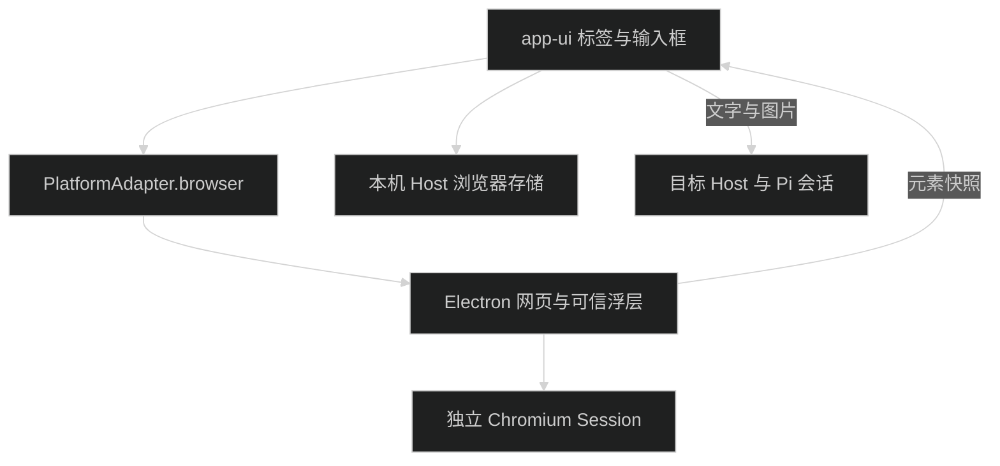

# 内置浏览器

Desktop 的右侧工具区提供「新建网页」。每个网页有独立标签。浏览器顶部提供前进、后退、刷新、地址输入和批注；查找、缩放、截图、历史与下载入口在「更多」菜单。网页可以与聊天分栏，也可以切换到现有完整视图。

网页按聊天保存。同一台电脑的网页共享独立的浏览器登录状态；浏览器配置不会随聊天切换到远端 Host。Web 可以显示已发送的网页批注，暂不提供原生网页视图。

## 查找与缩放

从「更多 → 在页面中查找」打开独立查找栏，地址栏保留。网页或浏览器工具栏获得焦点时，按 `Cmd+F`（Windows/Linux 为 `Ctrl+F`）也可打开。输入文字后显示当前匹配序号与总数；无结果时显示「无匹配」。按 `Enter` 查找下一项，`Shift+Enter` 查找上一项；`Esc` 或关闭按钮清除高亮并将焦点交回网页。页面导航后关闭查找栏。

「更多」菜单中的缩放按钮每次调整 10 个百分点，范围为 25% 至 300%；点击百分比恢复 100%。连续点击立即更新百分比，网页预览随后刷新；到达边界后禁用对应按钮。

网页或浏览器工具栏获得焦点时，按 `Cmd+L`（Windows/Linux 为 `Ctrl+L`）选中完整网址。编辑地址时按 `Esc` 恢复当前网址；空地址不会触发导航。

## 网页批注

点击「批注」，再点击网页元素。浮动输入框填写评论，展开属性面板可查看采集到的元素样式，并选择元素截图、当前视口截图或不附截图。点击保存按钮或按 `Cmd+Enter` 加入聊天草稿。点击页面上的编号标记可编辑或删除已有批注。

「区域批注」通过拖动选框创建截图批注。普通元素、开放 Shadow DOM 和同源 iframe 支持元素采集；跨域 iframe、Canvas、封闭 Shadow DOM 和 PDF 使用截图方式提供上下文。

底部工具条支持拖动、截图、隐藏标记、按住查看原始页面、丢弃批注、发送和退出。有未保存的批注时，「发送」先保存当前批注再调用聊天发送。退出批注模式、关闭网页标签不会删除已经加入聊天的批注。

输入框将网页批注收为「N 条批注」标签。点击标签可展开查看缩略图、元素标签和评论，并编辑或删除单条批注；标签上的关闭按钮移除当前草稿中的全部网页批注。已发送消息仍展示批注卡片。

批注记录网址、标题、采集时间、元素摘要、评论和可选截图。页面跳转后，批注仍是采集当时的快照；旧页面标记不会直接应用到新文档。元素截图裁剪到当前可见区域，不是整页长截图。

发送使用已有聊天提交入口。批注转换为结构化文字和 Pi 图片，随原生会话 JSONL 保存；历史回看、消息编辑和队列恢复共用解析器。远端会话接收图片内容，不接收本机截图路径。单独发送批注时会补充「请分析所附的网页批注。」作为消息正文。

## 设置与浏览数据

在「设置 → 浏览器」管理以下选项：

- 普通网页默认在系统浏览器打开；localhost 和回环 IP 默认在内置浏览器打开。
- 默认搜索引擎为 Bing，可改为 Google 或 DuckDuckGo。
- 默认隐藏网址路径，编辑地址时显示完整 URL。
- 默认附带元素截图；每条批注可单独调整。
- 默认恢复网页地址与批注草稿；恢复的网页在选中时重新加载，不恢复未提交的网页表单。
- 下载位置默认是系统下载目录，默认询问保存位置；关闭询问后，同名文件使用递增编号保存。
- 网站权限默认询问，可按来源单独设置。摄像头和麦克风还需要 macOS 的系统授权。

历史记录支持搜索、重新打开和删除。下载记录支持查看进度、取消、打开文件、在 Finder 显示和删除记录。清理缓存、Cookie/网站存储、历史和下载记录分别选择。删除下载记录不删除文件；清理网站数据不删除聊天批注或应用认证。

当前浏览器没有 Agent 自动操作、密码管理、Cookie 导入、Chrome 扩展、WebMCP、设备模拟、打印和自动端口转发。Desktop 中的 `localhost` 指当前电脑，远端开发服务需要可访问地址。

## 实现与存储



业务包是 [packages/browser](../packages/browser/)。平台契约在 [browser.ts](../packages/contracts/src/browser.ts)，Electron 接线在 [browser-runtime.ts](../apps/desktop/src/main/browser/browser-runtime.ts)。

本机 Host 是浏览器业务数据的唯一写入者。模块目录 `state/modules/%40pi-meme%2Fbrowser/` 保存设置、权限、历史、下载记录和按聊天分片的工作区；截图以内容哈希单独保存，原子替换草稿后删除无引用图片。

Chromium 使用 `persist:pi-meme-browser-v1` 分区，其 Cookie、网站存储和缓存位于 Electron `userData` 的对应分区目录。该分区与应用认证用的内存 Session 分开，开发版与正式版继续使用不同 `userData`。Host 数据目录迁移会包含浏览器模块数据；Chromium 分区仍属于当前 Desktop。

评论框与工具条是可信原生视图，使用专用 preload。外部网页只连接有限的选取通道，不能调用 `piPlatform`、执行任意平台脚本或读取评论输入。平台 IPC 校验主窗口、主框架、来源和网页文档代次。浏览器 Host RPC 仅接受本机来源。

## 验证

在仓库根目录运行相关检查：

```bash
pnpm test --file packages/browser/tests/store.integration.test.ts
pnpm test --file packages/browser/tests/navigation.unit.test.ts
pnpm test --file packages/chat/tests/browser-annotations.unit.test.ts
pnpm test --file packages/app-ui/tests/browser-workspace.component.test.tsx
pnpm test --file apps/desktop/tests/browser-runtime.unit.test.ts
```

源码用例验证聊天隔离、批注与图片保存、消息往返、异步切换、保存失败恢复、IPC 来源和站点权限。原生视图定位、浮层焦点、系统授权与网站兼容性需要 Desktop 开发态验证。测试使用临时目录和本地假模型，不读写真实凭据。
