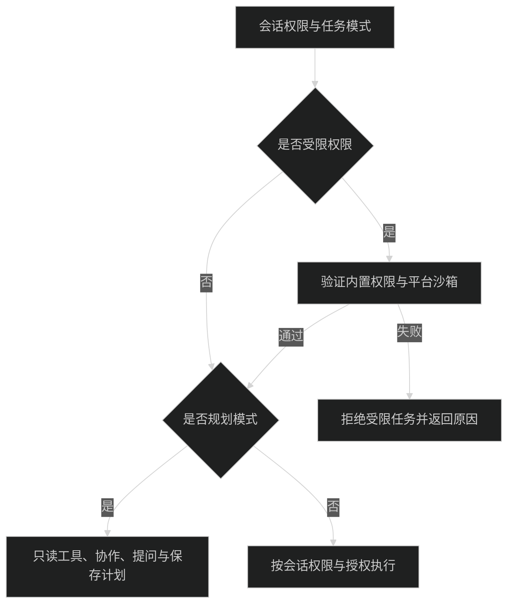

# 配置与安全

所有配置和执行数据属于所连接的 Host。连接远程服务后，模型、MCP、技能、插件和会话操作都发生在远程机器；浏览器平台不决定 Agent 沙箱。HTTPS、SSH 参数与具体连接步骤见 [Remote](remote.md)。

## 数据目录

配置写入当前 Host 的数据根。构建 App、构建后的 Server 和独立包默认使用 `~/.pi-meme`；Desktop 与 Server 开发入口使用 `~/.pi-meme-dev`。`PI_MEME_DATA_ROOT` 可覆盖目录，Desktop 还支持本机保存的自定义目录。

完整文件布局、唯一写入锁、[Desktop 更改目录](storage.md#desktop-自定义目录)与[缓存清理](storage.md#缓存清理白名单与保护边界)统一见[数据目录与存储](storage.md)。Web 和远程页面不提供本机迁移或清理操作。

## 应用设置与模型

[config/app.json](../packages/settings/src/server/store.ts)（原 `settings.json`）保存应用外观、主题、侧栏、新会话默认权限和 `defaultAgentPlugins` 等设置；字段见 [DesktopSettings](../packages/contracts/src/settings.ts)。`config/agent/settings.json`（原 `pi/settings.json`）是 SDK 设置文件，与应用设置分开。项目 `.pi/settings.json` 可读，SDK 存储适配器不向项目写回，见 [sdk/settings.ts](../packages/pi-runtime/src/sdk/settings.ts)。

“设置 → Agent → 模型”管理 Host 的 `config/agent/models.json`（原 `pi/models.json`）。非敏感服务商和模型声明保存在此文件，API Key、OAuth 与敏感请求头由凭据存储管理；界面只返回是否已保存密钥等状态。协议与可编辑字段见 [model-config.ts](../packages/contracts/src/model-config.ts)，校验和保存见 [config-store.ts](../packages/models/src/server/config-store.ts)。

同一页可以登录 Pi 自带目录里的服务商，不把这些服务商写进 `models.json`。API Key 和订阅账号都调用 `ModelRuntime.login`，退出调用 `logout`，凭据进入上面的凭据存储。登录或退出后重连 Pi，模型选择器才会出现新的可用模型。会话正在运行时凭据仍会保存，重连失败时页面会提示稍后再点“重新连接”。OpenAI 等登录用的设备标识写在 `config/agent/device-id`（原 `pi/device-id`）。这里不读取本机环境变量，也不执行 `!command`。实现见 [builtin-auth.ts](../packages/models/src/server/builtin-auth.ts)。

默认模型和思考强度默认值写入 `config/agent/settings.json` 的 `defaultProvider`、`defaultModel`、`defaultThinkingLevel`。思考强度为 `off`、`minimal`、`low`、`medium`、`high`、`xhigh`、`max` 之一；未设置时 Pi 使用 `medium`。同一文件里的 `modelThinkingLevels` 可按 `provider/modelId` 覆盖该模型的启动强度。二者都不改变已经打开的会话。

模型配置的主要限制：

- Base URL 必须是完整 HTTP(S) 地址，不包含账号、查询参数或片段。
- 模型 ID 非空，`contextWindow` 和 `maxTokens` 为正整数；输入类型包含 `text`，可包含 `image`。
- 凭据和请求头不能引用本机环境变量或 `!command`；请求头不能含换行。
- 保存携带文件修订，配置已被其他操作修改时要求重新读取，不覆盖新内容。

## MCP 配置与授权

MCP 合并 Host `config/agent/mcp.json`（原 `pi/mcp.json`）、项目只读 `.pi/mcp.json` 和 Host 侧 `config/workspaces/<cwd-hash>/mcp-overrides.json`。界面从“设置 → Agent → MCP”管理服务；项目覆盖不写回项目文件。

逐服务启停与明确授权分开校验，授权绑定配置摘要；外部修改配置后旧授权不能继续使用。旧 `mcpEnabled: false` 保留不连接未重新授权服务的选择，升级不会自动连接。MCP 只在完全权限的普通任务中装配，规划模式不运行 MCP。

配置损坏时显示错误并保留原文件；保存使用修订检查。OAuth Client Secret 和令牌进入凭据存储。配置合并、授权和诊断见 [runtime-config.ts](../packages/mcp/src/server/runtime-config.ts)、[config-store.ts](../packages/mcp/src/server/config-store.ts) 与 [MCP 测试](../packages/mcp/tests/)。

## 指令、资源与主题

Host 指令在 `config/agent/AGENTS.md`、`config/agent/SYSTEM.md`、`config/agent/APPEND_SYSTEM.md`（原 `pi/` 目录）；当前项目分别读取根目录 AGENTS 文件和 `.pi/SYSTEM.md`、`.pi/APPEND_SYSTEM.md`。同目录存在 `AGENTS.override.md` 时优先于 `AGENTS.md`，不会向祖先目录扫描或读取其他命名。

界面从“设置 → Agent → 指令”编辑。用户分组对应 AGENTS，系统分组对应 `SYSTEM.md` 与 `APPEND_SYSTEM.md`。Host 和项目 AGENTS 可组合，项目 SYSTEM/APPEND_SYSTEM 存在时使用项目项。管理页只保存 Host 指令，携带读取修订；项目指令只读。具体优先级与写入边界见 [context-files.ts](../packages/pi-runtime/src/sdk/context-files.ts) 和 [instructions.ts](../packages/settings/src/server/instructions.ts)。

技能来源包括内置技能（`resources/builtin/skills/`）、Host 用户技能（`resources/skills/`）、项目 `.agents/skills/` 和 App 附带技能。项目资源只读，导入、修订、优先级和策略见 [技能与资源](skills-and-extensions.md)。不装配裸 Pi 扩展或原生 Pi 包，不读取本机 Pi CLI、Codex、Claude、Gemini 的全局资源配置。

用户主题保存在 `resources/themes/`，App 主题由插件的 `resources.themes/assets` 分发。主题保持 JSON，背景图来自包内素材，不执行 JavaScript 或任意 CSS；字段和范围见 [结构化主题](plugins.md#结构化主题)。

进入外观页后，三个字体选择器共用后台读取的 Host 字体列表，不等待展开菜单才读取。macOS 通过系统自带的 `osascript` 调用 AppKit，读取中文字体族名、可用样式和等宽属性，不下载或传输字体文件；代码字体优先显示等宽字体。列表由 Host 进程内存缓存，读取失败可重试；安装或移除字体后需重启 Host 更新列表。其他系统保持默认字体选项；枚举结果不包含已保存的字体时，不会改写配置。实现见 [fonts.ts](../packages/settings/src/server/fonts.ts) 与 [theme-settings.tsx](../packages/settings/src/ui/theme-settings.tsx)。

## 凭据

[FileCredentialStore](../packages/pi-adapter/src/file-credentials.ts) 保存凭据于 `credentials/auth.json`（原根目录 `auth.json`，详见 [数据目录与存储](storage.md)），格式为应用自己的字符串键值对象，权限为 `0600`。这是文件权限保护，不是系统钥匙串或加密存储；备份仍包含敏感凭据。Host 串行写入并原子替换；Worker 同步内存副本，Host 落盘后才确认成功。读取、解析或写入失败会明确报错，不覆盖损坏文件。

启动不读系统钥匙串。旧 macOS 凭据只通过主动导入操作读取，保留已有文件凭据和旧钥匙串条目；实现见 [credentials.ts](../packages/host/src/credentials.ts) 与 [HostSettings](../packages/app-ui/src/settings/host-settings.tsx)。Linux 不提供该导入操作。

Desktop 使用内存 Electron Session，认证 Cookie 不写磁盘；本机 Host 的自动登录同时校验真实连接来源、Host 和 Origin，不向 Renderer 传递长期令牌。HTTPS 和 SSH 的远程令牌留在入口 Host 凭据存储，不返回 Renderer。SSH 令牌使用 `ssh-host:<稳定连接ID>` 键，与 `config/ssh-connections.json` 中的目标、名称、身份文件路径、启用状态和已确认 `hostId` 分开；身份文件只保存路径引用，不复制私钥。认证与远程代理规则见 [Remote](remote.md)。

当前 Pi SDK 的 `ModelRuntime.create` 没有公开的认证环境注入参数。[model-runtime.ts](../packages/pi-runtime/src/sdk/model-runtime.ts) 是唯一依赖 SDK private shape 的认证隔离层：检查 `runtime.models.authContext` 后注入空环境和不可用文件检查，阻止隐式读取本机模型认证。守卫失败报错；升级 SDK 时需重新核对该守卫，并验证 [model-config.integration.test.ts](../packages/models/tests/model-config.integration.test.ts) 与 [sdk-settings-isolation.integration.test.ts](../packages/pi-runtime/tests/sdk-settings-isolation.integration.test.ts)。会话、JSONL 与扩展仍使用公开 SDK。

## SSH 连接配置与信任边界

入口 Host 使用该用户的 OpenSSH、配置、agent 和 `known_hosts`，不保存 SSH 密码或复制私钥。发现候选与实际连接有不同的执行边界，完整限制见 [SSH 配置和非交互限制](remote.md#ssh-配置和非交互限制)。管理请求要求认证及[本机来源](remote.md#本机管理资格)，不是物理在场证明或多租户隔离。

## macOS Desktop 命令环境

Desktop 创建本机 Host 前，通过用户 Shell 的 `-lic` 读取 PATH，兼容 `.zprofile`、`.zshrc` 中的工具初始化。探测异步执行，最多 5 秒，成功与失败都在当前 Desktop 进程内缓存；超时回收探测进程及其后代。只读取 PATH，不导入 Shell 导出的其他变量。

PATH 按登录 Shell、启动时继承值、已存在的常用工具目录依次合并，保留首次出现的目录并删除空项和重复项。常用目录包括 Homebrew、`/usr/local/bin`、`~/.local/bin`、`~/.cargo/bin`、`~/Library/pnpm` 和已声明的 `PNPM_HOME`，不递归扫描版本目录。探测失败会记录一次原因，继续使用继承值和常用目录。

Bash、会话 Worker、MCP 和项目终端继承本机 Host 的 PATH；MCP 显式配置的 `env.PATH` 仍优先。连接已有 Host 时不会重新探测或修改它的环境；独立 Server 和远程 Host 使用各自的启动环境。修改 Shell 配置后，需退出并重新启动拥有该 Host 的入口。

命令返回 `command not found` 时，Agent 的内置提示要求先检查 `command -v`、PATH 和明确的安装位置；无法定位时说明缺失信息，不自动执行 `find /` 或遍历整个用户目录。这是工具定位指导，不是 Shell 命令拦截。

## 权限与沙箱

默认权限为 `workspace-write`，枚举与说明见 [agent-access.ts](../packages/contracts/src/agent-access.ts)。

| 模式              | 文件写入与执行边界                                                   |
| ----------------- | -------------------------------------------------------------------- |
| `read-only`       | 允许读取和联网，拒绝修改业务文件；沙箱临时目录与必要设备仍可写       |
| `workspace-write` | 允许修改当前工作区和会话临时目录，项目外写入被拒绝；读取和联网不受限 |
| `full-access`     | 允许项目外写入，普通任务可加载已选择且获准的可信 AppAgent 和 MCP     |

三档权限只控制 Agent 的执行范围，仍受 Host 操作系统的文件授权限制。App 内的“完全权限”不会授予 macOS 的“完全磁盘访问权限”；开发态终端与 Finder 启动的应用也可能具有不同授权。系统提示与处理方法见[首次打开与目录授权的区别](getting-started.md#首次打开与目录授权的区别)。

macOS 使用 `sandbox-exec`，Linux/WSL2 使用 bubblewrap。Host 启动探测实际隔离能力，通过 `restrictedAccessSupported/restrictedAccessReason` 返回结果；受限 Worker 创建时还验证实际命令。内置权限、工厂或沙箱失效时拒绝受限执行，不自动授予完全权限。设置与历史仍可用。

路径校验与工具执行见 [access-sandbox.ts](../packages/pi-runtime/src/sdk/access-sandbox.ts)，平台选择见 [sandbox-platform.ts](../packages/host/src/sandbox-platform.ts)。Linux namespace、socket 与 WSL 互操作边界见下节。

上表描述内置 Agent 工具的边界，不是 SDK 3 受限插件的读取和联网授权。规划模式独立拒绝业务写入、codemode、MCP 和可信外部入口，但可使用获准的受限只读插件；子任务继承父级上限，并按自身真实目录、模式和权限构建执行环境。

### Linux 与 WSL 隔离

内置受限工具通过 `/usr/bin/bwrap` 执行，文件写入另有路径校验。根文件系统只读，`workspace-write` 只开放真实工作区和会话临时目录；Host 数据位于项目内时再次挂为只读。无项目会话的工作区为 `workspaces/standalone/<id>`。根目录、用户主目录、Pi 配置与系统临时目录不能整体授权，符号链接不能扩大写入范围。

Linux 隔离 user、mount、PID 和 IPC namespace，保留 TCP/UDP 网络与 DNS；seccomp 拒绝 Unix socket，包括 abstract socket。x64 同时处理 i386 ABI，拒绝 x32 与 io_uring 绕过；arm64 拒绝未知兼容 ABI。未知 CPU 架构不能启用受限权限。公共 `/tmp`、`/var/tmp` 和 `/run` 不提供额外可写空间，`TMPDIR` 指向会话临时目录；调用 `setsid` 的后代仍受 PID namespace 清理约束。这不提供秘密文件读取隔离或网络访问控制。

WSL 按实际 mountinfo 识别 Windows 驱动器，拒绝用作受限工作区，不把所有 `/mnt` 路径视为 Windows 盘。沙箱隐藏驱动器、`/init`、`/run/WSL` 和 WSLg，清除互操作变量和 Windows PATH，不继承额外文件描述符；复制 exe 到 Linux 工作区也不能通过 Windows 互操作执行。完全权限沿用普通执行方式。

Ubuntu 的 AppArmor 或内核策略可能限制 user namespace。应用不关闭 AppArmor、不修改 sysctl；依赖或探测失败时查看 `restrictedAccessReason`，修复后重启 Host，不自动退回完全权限。安装要求见[Linux 与 WSL 环境](getting-started.md#linux-与-wsl-环境)，源码与专项回归见 [linux-sandbox.ts](../packages/pi-runtime/src/sdk/linux-sandbox.ts) 和 [linux-sandbox.integration.test.ts](../packages/pi-runtime/tests/linux-sandbox.integration.test.ts)。

### 插件执行与授权

SDK 3 将 `agent/server` 分为 `trusted` 与 `restricted`。可信 Server 是 Host Node 代码，可信 Agent 在会话 Worker 中执行，UI 是宿主同源 React；三者分别取得信任授权，不能把它们称为恶意代码沙箱。受限入口运行真正 JS/TS 构建产物，使用独立进程、固定 Node 与 OS 沙箱，不通过 VM 或线程模拟隔离。

| 任务边界             | 受限入口                         | 工作区                  | 网络与共享数据                          | 可信入口             |
| -------------------- | -------------------------------- | ----------------------- | --------------------------------------- | -------------------- |
| Plan                 | 获准的只读工具与 handler         | 只读，私有 scratch 例外 | 共享记录只读；HTTPS 仅单独授权 GET/HEAD | 不导入               |
| 普通 read-only       | 获准的受限能力                   | 只读，scratch 例外      | 按 origin/method 和记录名授权           | 不导入               |
| 普通 workspace-write | 不超过 manifest 与 grant 上限    | 仅获准工作区可写        | 按授权                                  | 不导入               |
| 普通 full-access     | restricted-only 仍按受限上限运行 | 最多获准工作区          | 受限入口仍走 broker                     | 仅明确授权的可信入口 |

有效能力取 manifest 申请、用户 grant、项目可用策略、任务 mode/access 与实际运行边界的交集。安装、启用和会话选择不自动授予能力。工具 `effect/capabilities` 是分派检查，不替代 OS 拒写；同一个可写进程内的 read 标签也不提供逐工具 OS 隔离。

[state/plugins.json（原 installed.json）管理](../packages/plugin-runtime/src/manager.ts) 保存 policyHash、grant revision 与可信入口、UI 能力、受限访问、网络、命名共享数据、发送前处理器的授权。代码或申请变化后旧授权不匹配；SDK 2 记录保留为不兼容，不执行旧入口、不删除私有数据。读取损坏文件时保留原文件并报告，不默认扩大授权。

受限启动器见 [plugin-sandbox.ts](../packages/host/src/plugin-sandbox.ts)，协议与生命周期见 [restricted-runner.ts](../packages/plugin-runtime/src/restricted-runner.ts)。Linux 使用 bubblewrap 的 user/pid/ipc/net namespace 与 seccomp；工作区按权限只读或可写，环境使用白名单，不继承模型 key、代理、SSH socket 或 Node 注入变量。macOS 使用单独的 deny-by-default profile；Windows 原生不支持，WSL Windows 盘工作区拒绝受限插件。不能把 Host 数据根或其私有目录直接授权为插件工作区，Host 管理的 standalone 精确工作目录除外；路径别名先解析 realpath。平台缺少必要能力时拒绝执行，不降级为无沙箱。macOS 签名后 Node/JIT 与沙箱行为需在真实目标产物单独验收，Linux 检查不能代表 macOS 已通过。

独立插件能力探测见 [plugin-sandbox-probe.ts](../packages/host/src/plugin-sandbox-probe.ts)，结果通过连接的 `restrictedPluginRuntimeSupported/restrictedPluginRuntimeReason` 提供，不能用旧 `restrictedAccessSupported` 的 bash 检查代替。探测运行 Node 并检查工作区读写、边界秘密、TCP/Unix socket、子进程与环境白名单；它不代替真实插件协议、取消和目标产物的专项测试。开发态 Node 准备命令见 [受限 Node 运行时](plugins.md#受限-node-运行时)。

原始网络与本机 Host 通道不属于受限接口。HTTPS 走 Host broker，精确校验 origin、method、DNS 地址与重定向；默认不联网、不继承 Cookie、代理或模型认证。插件凭据使用自身 credentialRef，由 Host 注入，不把明文交给 runner。命名共享数据仅包含可信 Server 显式发布并获准读取的 JSON，不自动共享 plugin-data 目录。GET/HEAD 不能保证远端服务没有副作用。

撤销或收窄受限授权需要取消旧调用并重建进程，不能只更新 JS policy。可信代码已发生的外部副作用不能靠撤权回滚；怀疑恶意代码时停用并重启 Host。工作区内用户主动放入的秘密或硬链接、强 CPU/RSS 配额、OS 内核漏洞防护不属于此沙箱保证。更多 API 见 [App 插件](plugins.md)。

## 键盘快捷键

客户端键盘快捷键属于客户端本地偏好，不保存在 Host 数据目录中，也不随远程服务或会话切换。

- **Desktop**：保存在 Electron 用户配置目录下的 `keyboard-shortcuts.json`，由客户端平台接口独立读取与写入。
- **Web**：保存在当前浏览器来源的 `localStorage`（键名 `pi-meme:shortcuts:v1`），同一来源的标签页之间通过 storage 事件同步。
- **配置与手册**：
  - 左下角用户菜单「帮助 → 键盘快捷键」可打开只读快捷键手册并支持搜索。
  - 「设置 → 个人 → 快捷键」支持自定义按键、冲突拦截、取消绑定和恢复默认。
  - 应用级快捷键仅在当前活动聊天界面生效；弹窗、文件编辑器、终端、插件页面输入区域和输入法组字期间不抢占输入。

## 内置浏览器

Desktop 在「设置 → 浏览器」管理链接打开方式、批注截图、网页恢复、下载和网站权限。偏好属于当前电脑，不随远端聊天切换。使用方式、权限和数据归属见[内置浏览器](browser.md)。
