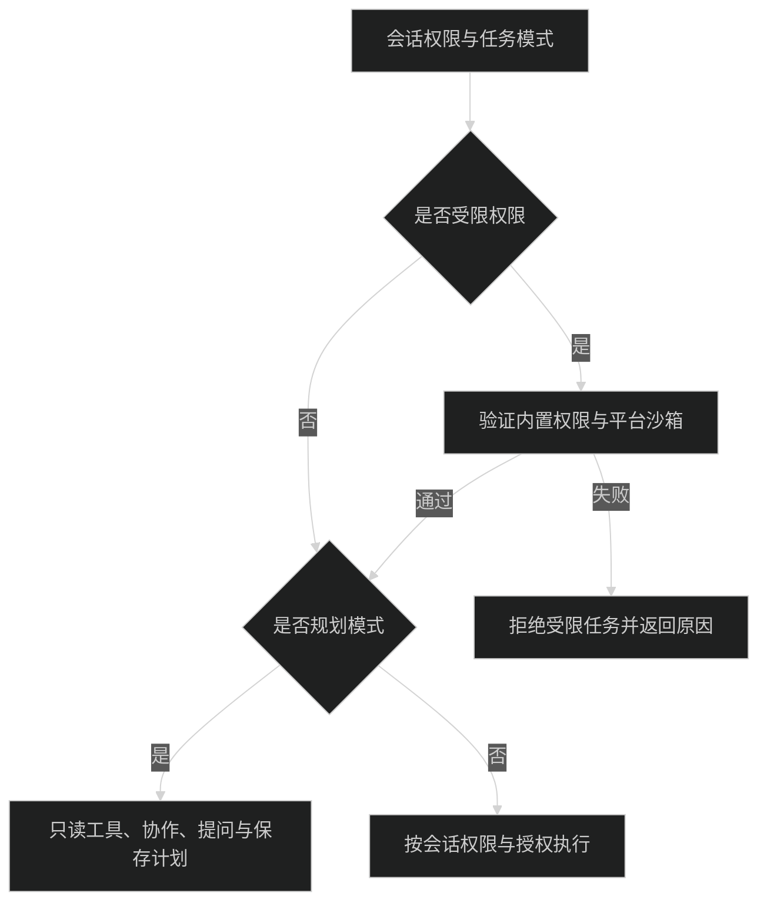

# 配置与安全

所有配置和执行数据属于所连接的 Host。连接远程服务后，模型、MCP、技能、插件和会话操作都发生在远程机器；浏览器平台不决定 Agent 沙箱。连接参数与 HTTPS 见 [Remote](remote.md)。

## 数据目录

默认根目录为 `~/.pi-meme`，`PI_MEME_DATA_ROOT` 可覆盖。[data-root.ts](../packages/host/src/data-root.ts) 将路径解析为绝对路径，用带心跳的 `host.lock` 保证一个 Host 写入。Desktop 切换或登记远程服务后仍保留本地 Host 与写锁；与独立 Server 同时运行需使用不同目录。

主要文件如下；子目录按功能使用时创建：

```text
~/.pi-meme/
├── host-id                         # 持久 Host 身份
├── host.lock                       # 唯一写入锁
├── auth.json                       # 模型、MCP、Host 与远程连接凭据
├── settings.json                   # 应用偏好与新会话默认值
├── projects.json                   # 项目与工作位置登记
├── remote-services.json            # 本机保存的远程登记与摘要
├── themes/                         # 用户主题 JSON
├── skills/                         # Host 用户技能
├── builtin-resources/skills/        # 随应用安装的内置技能
├── pi/                             # SDK 设置、模型、MCP、指令与提示词
├── resources/                      # 资源导入记录、策略与内容快照
├── sessions/<cwd-hash>/             # Pi 原生 JSONL
├── workspaces/<cwd-hash>/           # 工作区覆盖配置
├── standalone-workspaces/<id>/      # 无项目会话的工作目录
├── plugins/                        # 外部插件代码快照与安装记录
├── plugin-data/                    # 内置模块与插件数据
├── requests/                       # 内部 RPC 请求记录
├── control.json                    # 正式目标、幂等操作、回执与关键事件
├── collaboration.json              # 协作身份、邮箱与计划元数据
└── plans/<sessionId>/<id>.md        # 计划正文
```

工作区分组使用规范化真实路径的 SHA-256，见 [runtime-paths.ts](../packages/pi-runtime/src/runtime-paths.ts)。项目登记见 [project-store.ts](../packages/workspace/src/server/project-store.ts)，远程摘要见 [remote-services.ts](../packages/host/src/remote-services.ts)。Linux 拒绝把 Host 数据放在识别到的 Windows 驱动器挂载中。

## 应用设置与模型

[settings.json](../packages/settings/src/server/store.ts) 保存应用外观、主题、侧栏、新会话默认权限和 `defaultAgentPlugins` 等设置；字段见 [DesktopSettings](../packages/contracts/src/settings.ts)。`pi/settings.json` 是 SDK 设置文件，与应用设置分开。项目 `.pi/settings.json` 可读，SDK 存储适配器不向项目写回，见 [sdk/settings.ts](../packages/pi-runtime/src/sdk/settings.ts)。

“设置 → Agent → 模型”管理 Host 的 `pi/models.json`。非敏感服务商和模型声明保存在此文件，API Key、OAuth 与敏感请求头由凭据存储管理；界面只返回是否已保存密钥等状态。协议与可编辑字段见 [model-config.ts](../packages/contracts/src/model-config.ts)，校验和保存见 [config-store.ts](../packages/models/src/server/config-store.ts)。

同一页可以登录 Pi 自带目录里的服务商，不把这些服务商写进 `models.json`。API Key 和订阅账号都调用 `ModelRuntime.login`，退出调用 `logout`，凭据进入上面的凭据存储。登录或退出后重连 Pi，模型选择器才会出现新的可用模型。会话正在运行时凭据仍会保存，重连失败时页面会提示稍后再点“重新连接”。OpenAI 等登录用的设备标识写在 `pi/device-id`。这里不读取本机环境变量，也不执行 `!command`。实现见 [builtin-auth.ts](../packages/models/src/server/builtin-auth.ts)。

默认模型和思考强度默认值写入 `pi/settings.json` 的 `defaultProvider`、`defaultModel`、`defaultThinkingLevel`。思考强度为 `off`、`minimal`、`low`、`medium`、`high`、`xhigh`、`max` 之一；未设置时 Pi 使用 `medium`。同一文件里的 `modelThinkingLevels` 可按 `provider/modelId` 覆盖该模型的启动强度。二者都不改变已经打开的会话。

模型配置的主要限制：

- Base URL 必须是完整 HTTP(S) 地址，不包含账号、查询参数或片段。
- 模型 ID 非空，`contextWindow` 和 `maxTokens` 为正整数；输入类型包含 `text`，可包含 `image`。
- 凭据和请求头不能引用本机环境变量或 `!command`；请求头不能含换行。
- 保存携带文件修订，配置已被其他操作修改时要求重新读取，不覆盖新内容。

## MCP 配置与授权

MCP 合并 Host `pi/mcp.json`、项目只读 `.pi/mcp.json` 和 Host 侧 `workspaces/<cwd-hash>/mcp-overrides.json`。界面从“设置 → Agent → MCP”管理服务；项目覆盖不写回项目文件。

逐服务启停与明确授权分开校验，授权绑定配置摘要；外部修改配置后旧授权不能继续使用。旧 `mcpEnabled: false` 保留不连接未重新授权服务的选择，升级不会自动连接。MCP 只在完全权限的普通任务中装配，规划模式不运行 MCP。

配置损坏时显示错误并保留原文件；保存使用修订检查。OAuth Client Secret 和令牌进入凭据存储。配置合并、授权和诊断见 [runtime-config.ts](../packages/mcp/src/server/runtime-config.ts)、[config-store.ts](../packages/mcp/src/server/config-store.ts) 与 [MCP 测试](../packages/mcp/tests/)。

## 指令、资源与主题

Host 指令在 `pi/AGENTS.md`、`pi/SYSTEM.md`、`pi/APPEND_SYSTEM.md`；当前项目分别读取根目录 AGENTS 文件和 `.pi/SYSTEM.md`、`.pi/APPEND_SYSTEM.md`。同目录存在 `AGENTS.override.md` 时优先于 `AGENTS.md`，不会向祖先目录扫描或读取其他命名。

界面从“设置 → Agent → 指令”编辑。用户分组对应 AGENTS，系统分组对应 `SYSTEM.md` 与 `APPEND_SYSTEM.md`。Host 和项目 AGENTS 可组合，项目 SYSTEM/APPEND_SYSTEM 存在时使用项目项。管理页只保存 Host 指令，携带读取修订；项目指令只读。具体优先级与写入边界见 [context-files.ts](../packages/pi-runtime/src/sdk/context-files.ts) 和 [instructions.ts](../packages/settings/src/server/instructions.ts)。

技能来源包括内置技能、Host `skills/`、项目 `.agents/skills/` 和 App 附带技能。项目资源只读，导入、修订、优先级和策略见 [技能与资源](skills-and-extensions.md)。不装配裸 Pi 扩展或原生 Pi 包，不读取本机 Pi CLI、Codex、Claude、Gemini 的全局资源配置。

用户主题保存在 `themes/`，App 主题由插件的 `resources.themes/assets` 分发。主题保持 JSON，背景图来自包内素材，不执行 JavaScript 或任意 CSS；字段和范围见 [结构化主题](plugins.md#结构化主题)。

## 凭据

[FileCredentialStore](../packages/pi-adapter/src/file-credentials.ts) 保存根目录 `auth.json`，格式为应用自己的字符串键值对象，权限为 `0600`。Host 串行写入并原子替换；Worker 同步内存副本，Host 落盘后才确认成功。读取、解析或写入失败会明确报错，不覆盖损坏文件。

启动不读系统钥匙串。旧 macOS 凭据只通过主动导入操作读取，保留已有文件凭据和旧钥匙串条目；实现见 [credentials.ts](../packages/host/src/credentials.ts) 与 [HostSettings](../packages/app-ui/src/host-settings.tsx)。Linux 不提供该导入操作。

Desktop 使用内存 Electron Session，认证 Cookie 不写磁盘；本地自动登录使用一次性票据，远程令牌留在本地 Host 凭据存储，不返回 Renderer。认证与远程代理规则见 [Remote](remote.md)。

Pi 1.1 的 `ModelRuntime.create` 没有公开的认证环境注入参数。[model-runtime.ts](../packages/pi-runtime/src/sdk/model-runtime.ts) 是唯一依赖 SDK private shape 的认证隔离层：检查 `runtime.models.authContext` 后注入空环境和不可用文件检查，阻止隐式读取本机模型认证。守卫失败报错；升级 SDK 时需重新核对该守卫，并验证 [model-config.test.ts](../packages/models/tests/model-config.test.ts) 与 [sdk-settings-isolation.test.ts](../packages/pi-runtime/tests/sdk-settings-isolation.test.ts)。会话、JSONL 与扩展仍使用公开 SDK。

## 权限与沙箱

默认权限为 `workspace-write`，枚举与说明见 [agent-access.ts](../packages/contracts/src/agent-access.ts)。

| 模式              | 文件写入与执行边界                                                   |
| ----------------- | -------------------------------------------------------------------- |
| `read-only`       | 允许读取和联网，拒绝修改业务文件；沙箱临时目录与必要设备仍可写       |
| `workspace-write` | 允许修改当前工作区和会话临时目录，项目外写入被拒绝；读取和联网不受限 |
| `full-access`     | 允许项目外写入，可在普通任务加载已选择的外部 AppAgent 和已授权 MCP   |



macOS 使用 `sandbox-exec`，Linux/WSL2 使用 bubblewrap。Host 启动探测实际隔离能力，通过 `restrictedAccessSupported/restrictedAccessReason` 返回结果；受限 Worker 创建时还验证实际命令。内置权限、工厂或沙箱失效时拒绝受限执行，不自动授予完全权限。设置与历史仍可用。

路径校验与工具执行见 [access-sandbox.ts](../packages/pi-runtime/src/sdk/access-sandbox.ts)，平台选择见 [sandbox-platform.ts](../packages/host/src/sandbox-platform.ts)。Linux namespace、socket 与 WSL 互操作边界见 [Linux 与 WSL](linux-wsl.md)。

Agent 沙箱约束与外部插件信任边界不同：App Server 是可信 Host 代码，不因 Agent 权限而成为受限代码。安装插件不会自动升级 Agent 权限；外部 AppAgent 仅在被会话选择、完全权限、普通模式时导入。规划模式还独立拒绝写入、codemode、MCP 与外部工具，子任务继承父权限和模式，见 [会话与协作](sessions.md)。
