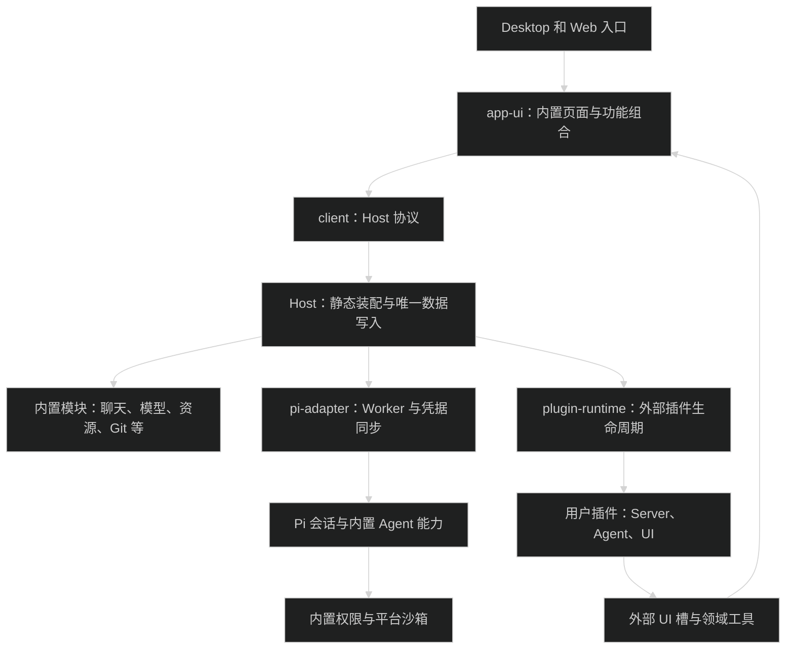
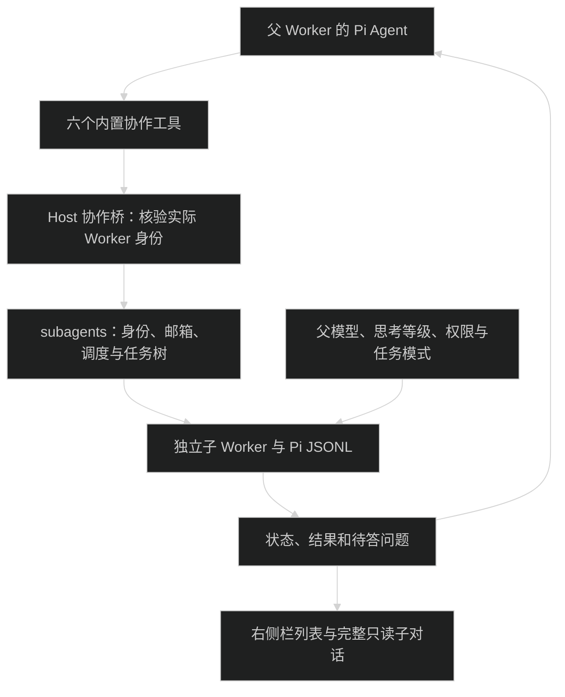
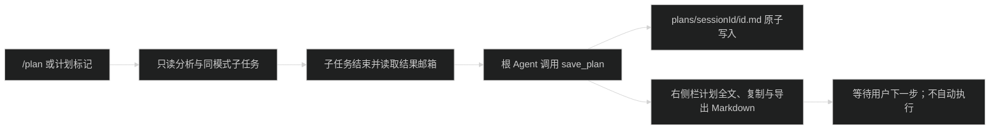

# 内置能力与用户插件设计

App 自己负责对话、会话、模型、子代理和安全执行。用户插件只增加可选能力，不能决定这些基础能力是否存在。普通用户管理 AI 模型配置、技能、App 插件、MCP 和使用偏好，不需要管理 App 的内部模块。

本文记录内置模块与用户插件的划分，以及已经实现的 SubAgent 和计划模式。静态装配与进程边界见 [基础架构](architecture.md)，外部包接口见 [插件文档](plugins.md)。三档访问权限保留，规划模式增加独立只读执行限制。

## 内置模块和用户插件的边界

产品上保留两类：**内置模块**和**用户插件**。不增加一个需要用户管理的“系统插件”分类页。

| 判断项         | 内置模块                             | 用户插件                             |
| -------------- | ------------------------------------ | ------------------------------------ |
| 谁提供         | App 发行包                           | 用户明确安装的外部包或开发目录       |
| 谁决定存在     | Host 静态装配                        | 用户安装和启用状态                   |
| 不加载的结果   | App 的基本工作、安全或既定功能不完整 | App 仍能完成基础对话和任务           |
| 谁管理生命周期 | Host 启停、会话创建、按需加载        | 插件安装、停用、卸载和安全切换       |
| 如何更新       | 随 App 发布                          | 独立更新外部插件                     |
| 用户看到什么   | 实际功能和必要操作                   | 插件名称、来源、状态、设置和卸载入口 |

“常驻能力”表示功能由 App 保证提供，不表示所有 Worker、服务连接和页面都在启动时运行。会话 Worker、Git 查询、用量统计和 MCP 连接仍可按需创建或读取。

内置代码可以继续使用 Pi 的 `ExtensionFactory`、hook 和工具注册接口。底层使用扩展机制，不会使它成为用户可安装、停用的 App 插件。

用户插件需要满足以下条件：

- 不安装它，基础对话、会话保存、模型调用和权限执行仍可工作。
- 不接管 App 的内置身份、基础 RPC 或安全策略注册。
- 安装和更新失败时，保留旧版或继续使用 App 基础功能。
- 卸载只移除它自己的操作、工具和 UI；数据按现有规则默认保留。
- 通过正式 `HostApi` 操作 App；`requires/provides` 只处理插件之间的服务，不取得 Host 内部 Store、Pool 或 Worker。

当前外部插件运行的是可信 Node Host 代码。上述划分是功能和生命周期边界，不提供恶意代码隔离保证；Agent 三档权限仍单独执行。

## 内置模块的归属

14 个内置模块已移入 `packages/*`，保留包身份、分层和测试，不再出现在用户插件清单中。

| 当前目录                                           | 目标归属                      | 普通用户入口                       |
| -------------------------------------------------- | ----------------------------- | ---------------------------------- |
| `packages/chat`                                    | 内置聊天 UI 与消息操作        | 对话和输入区                       |
| `packages/workspace`                               | 内置工作区与会话组织          | 项目、最近会话、新建会话           |
| `packages/history`                                 | 内置历史查询、导出和分支展示  | 历史、分支和导出操作               |
| `packages/models`                                  | 内置模型目录、配置和选择      | 模型连接、默认模型、输入区模型选择 |
| `packages/settings`                                | 内置偏好、外观和指令存储      | 必要偏好设置                       |
| `packages/interaction`                             | 内置 Agent 与图形界面的交互桥 | 运行中出现的确认、输入和通知       |
| `packages/permissions`                             | 强制内置权限执行              | 当前会话权限、默认权限             |
| `packages/sandbox-macos`、`packages/sandbox-linux` | 内置平台执行适配              | 权限状态和确实需要处理的错误       |
| `packages/subagents`                               | 内置持续委派与协作运行时      | 模型协作工具、右侧栏任务与只读详情 |
| `packages/codemode`                                | 内置工具执行机制              | 工具执行结果；无普通设置开关       |
| `packages/mcp`                                     | 内置 MCP 客户端、配置和认证   | 用户自己的服务连接                 |
| `packages/resources`                               | 内置技能导入、策略与资源快照  | 技能浏览、编辑与使用策略           |
| `packages/git`                                     | 内置工作区变更读取            | Git 状态和 Diff 面板               |
| `packages/usage`                                   | 内置会话用量查询              | 用量和活动展示                     |

AI 模型配置、技能、App 插件、MCP 是四个用户资源方向。删除 MCP 连接不会卸载 MCP 客户端，删除技能不会停用资源加载器。App 插件可附带技能、主题 JSON 和素材，附带资源随所属插件管理。

第三方 `.pim` 和开发目录才进入用户插件生命周期。将来出现新的业务能力时，先判断它是否能独立移除，再决定是否做成插件。

## 目标代码组织

保留 Electron、Host、Client 和 Pi 的现有进程边界。内置业务实现已经移入 `packages/*`，保留包身份和 `server`、`agent`、`ui`、`shared` 分层。例如聊天包位于 `packages/chat`，仍使用 `@pi-meme/chat`。交互模块保留 `@pi-meme/interaction` 包身份。

workspace 包含 `packages/*` 和可选 `plugins/*`。仓库没有 `plugins/` 也合法；此目录以后只放独立分发的 App 插件源码。外部安装目录仍位于 Host 数据目录。

各层职责保持具体：

- `packages/host` 显式组合内置服务和外部插件，持有数据目录、认证和协议分派。不把所有业务实现写入 `service.ts`。
- `packages/app-ui` 直接组合内置页面、输入区和设置内容；左侧仅会话导航，中间固定聊天；面板位置仅 `right`，在当前聊天右侧栏打开可关闭标签页，七类贡献槽为 `composer/composer-actions/tool-card/message/message-actions/status/settings`。
- `packages/host/src/session-worker.ts` 静态导入并提供内置 Agent 工厂；`packages/pi-adapter` 只负责通用工厂调用、AppAgent 加载、Worker 通信和凭据同步，不导入业务实现。
- `packages/pi-runtime` 提供 Pi 会话、JSONL、事件、恢复与受限执行底层，不反向导入业务模块。
- 业务模块通过现有契约、显式 Props 和必要的服务接口协作，不跨包读取其他模块私有实现。
- `plugin-sdk`、`plugin-runtime`、`plugin-devkit` 服务外部 App 插件，继续承担校验、构建、打包和安全切换。

Host 的 `builtin-modules.ts` 静态组合内置服务与释放作用域，app-ui 直接组合内置 UI。内置模块不读取用户安装记录，也不参加用户插件重载；Chord 继续管理外部服务依赖组。

### Host 必须保证的规则

内置身份来自 Host 随 App 发布的静态清单。外部 manifest 中的字段、包名和来源声明不能把外部代码变成内置代码。

1. 用户插件的启用、停用、卸载和重载接口拒绝内置 ID；开发者页面只能查看内置诊断。
2. 目录安装、包安装、替换和启动恢复都检查内置身份冲突，在运行外部入口前拒绝冲突包。
3. 系统服务由 Host 提供。外部插件只能登记自己的操作和贡献，不能替换内置安全服务。
4. 只有内置装配路径能注入 `registerSandbox`、`registerAccessExtension` 等内部工厂。外部 Agent 入口使用 App SDK 2 的 `activate(context)`，由内部适配层接入 Pi；用户不管理裸 Pi 扩展或原生 Pi 包。
5. 核心初始化失败时明确报错；权限或沙箱不可用时继续拒绝受限任务。macOS 使用 sandbox-exec，Linux/WSL2 使用 bubblewrap；不通过自动切换完全权限绕过平台限制。
6. 插件安装、停用和更新仍保留依赖检查、调用 gate、任务与交互租约、UI 代次隔离和失败恢复。

内置会话工厂来自 Host 静态清单，插件描述符与 UI 注册表只接收外部项。`host:modules` 提供内置诊断，不能通过用户插件生命周期接口改变它们。

### 数据与配置迁移

- `plugins/installed.json` 的目标内容只包含外部插件。旧内置停用记录不再控制基础能力。
- 先解析并校验旧记录，再原子写入新状态；失败不覆盖原记录。
- 同名外部覆盖记录不能继续执行，也不能删除其源目录或用户数据。应记录冲突并提示开发者处理。
- 启动恢复遇到身份冲突、损坏包、依赖或初始化错误时，记录并隔离失败的外部依赖组，内置 Host 继续启动。安装清单无法解析时保留原文件，本次不加载外部项，并报告恢复错误。
- 配置、凭据、Pi JSONL、主题和工作区数据保留原位置。代码迁移不需要改动 `auth.json` 或重写历史会话。
- `subagentsEnabled`、`enabledSubagents` 等旧字段保留配置兼容，但不控制内置协作工具是否可用；角色文件不再是委派前提。
- MCP 不再显示总开关。旧 `mcpEnabled: false` 保留“不连接外部服务”；逐服务授权记录绑定配置，服务配置被其他程序改动后需要重新授权，不因升级自动连接。

## 用户资源和会话选择

产品资源分为四个方向；设置集成区只提供技能、插件、MCP 三个独立页面，不设置共享资源页或类型筛选。AI 模型配置在个人区的模型页。

| 方向        | 管理内容                                          |
| ----------- | ------------------------------------------------- |
| AI 模型配置 | 服务商、协议、地址、凭据、默认模型                |
| 技能        | `SKILL.md`、辅助文件、启停和自动/手动调用策略     |
| App 插件    | SDK 2 包的安装、启停、更新、卸载、会话 Agent 选择 |
| MCP         | 服务配置、逐服务授权、连接与诊断                  |

新会话外部 Agent 默认列表为空。输入区的 Agent 插件选择器可保存新会话默认列表，当前会话通过 `configuration.agentPlugins` 单独选择；安装插件不会自动把所有 Agent 工具加入会话。运行中拒绝修改选择，子任务继承父选择。已选择的外部 AppAgent 只在完全权限普通任务加载；未选择、受限权限和规划模式均不加载。Server 和 UI 生命周期按插件启用状态管理，不随某个会话的 Agent 选择撤销。

设置侧栏分为“个人、集成、系统”，保留外观、偏好、用量、远程和关于等实际功能。开发者入口提供构建目录加载、插件重新加载、恢复诊断与高级指令，不提供裸 Pi 扩展目录。打开开发者页面不会改变 Agent 权限。

主题使用 JSON；App 插件通过 `resources.themes/assets` 分发主题和背景素材，停用或卸载后撤销对应主题。变更、文件、终端作为常驻系统工具从当前会话右侧栏打开。Git 保留状态与 Diff 读取；文件支持文本编辑与分类预览，终端关闭标签后保留进程。主题示范见[插件文档](plugins.md)。

正式 `HostApi` 的项目与会话目标由稳定 Ref 指定，不依赖 UI 选择。持久控制日志保存幂等结果、提交回执和关键事件，重启中断任务不重放。后续 Bot 将使用独立客户端，本轮未实现；协议和恢复规则见 [Remote 文档](remote.md)。

## SubAgent 的内置设计

### 持续子代理与工具入口

旧 `Task` 预设角色委派已经由六个工具替换：`spawn_agent`、`send_message`、`followup_task`、`interrupt_agent`、`list_agents`、`wait_agent`。模型可自行委派，用户也可在消息里要求使用子代理；无需先配置 Markdown 角色或启用列表。

| 模块                         | 当前职责                                                           |
| ---------------------------- | ------------------------------------------------------------------ |
| `packages/subagents`         | 持续身份、父子关系、状态、邮箱、容量、取消、followup 与计划元数据  |
| `packages/pi-runtime`        | Pi 会话、JSONL、安全历史分支、权限与计划执行检查，不反向导入业务包 |
| `packages/pi-adapter`        | 创建和通信 Worker、凭据同步与退出清理                              |
| `packages/host`              | 静态 Agent 工厂、实际调用者验证、根任务与子会话 RPC、唯一数据写入  |
| `packages/contracts`         | agentId/runId/epoch、状态、邮箱、模式和计划事件                    |
| `packages/app-ui` 与聊天模块 | 分组任务列表、只读子对话、来源问答与右侧栏计划文档                 |

最多 4 个活动子 Agent、两层后代与 16 个身份。等待子任务仍占活动容量。默认 `fork_turns=all` 从最新闭合历史安全分支，把父历史作为模型背景，委派消息单独指定当前子任务；`none` 使用新上下文。`followup_task` 保留 agentId 和 sessionFile，运行中按顺序排队，空闲时开启新 runId。`send_message` 向空闲 Agent 只写邮箱；`list_agents` 不消费邮箱，`wait_agent` 的工具结果写入 Pi JSONL 后，按其中的消息身份确认已读。普通来源消息也在安全边界写入 JSONL 后按 messageId 确认；进入投递队列不等于落盘或已读。

子任务共享工作目录，继承父模型、思考等级、访问权限和任务模式。工具白名单与实际执行检查同时生效，不通过完全权限绕过计划限制。主任务停止和 Host 退出取消后代与未启动任务。每个父子 Worker 分别持有外部插件租约；外部服务组切换等待相关任务、交互和父子租约释放，不为切换取消正在执行的任务。

协作身份、邮箱与计划元数据在 `collaboration.json`；子会话继续保存 Pi JSONL。子会话从普通最近列表与项目计数中过滤，主会话只显示“名称 已完成”等简短阶段，隐藏原始子报告、身份和内部控制正文；会话树也过滤内部协作节点。自动续跑用隐藏的 custom message 触发，不新增用户 JSONL 节点或改写草稿。右侧栏按运行中和已结束分组，列表只显示名称、状态、时长，后代按层级缩进。只读详情按持久原生 entry 来源边界展示子任务自己的消息、思考、工具结果、错误与 followup，不展示模型继承的父背景。旧子会话根据原生 header 的 `parentSession` 和共同 entry IDs 恢复边界；无法确认时明确报错，不猜测裁剪或修改 JSONL。打开详情不改变根会话选择，也不提供编辑、分支或发送输入。子交互保留源 agentId、sessionKey 与代次，问题进入根快照并按来源回答。Host 重启恢复身份与历史，未完成任务记为中断，不自动重放。

### 计划模式与保存产物

输入 `/plan`、`/计划` 或 `/计划模式` 激活可关闭的输入区标记；纯命令只切换模式，带正文时发送任务。发送、插话、排队、撤回与失败重试保存每条输入的模式，不让队列中后续消息追随当前界面开关。

计划模式只允许 read、grep、find、ls、协作、request_user_input 和 save_plan。执行链拒绝 bash、edit、write、codemode、MCP、外部工具与嵌套越权。子 Agent 继承规划模式；向仍在默认模式执行的子 Agent 派发消息会被拒绝。

只有规划模式根 Agent 能保存计划，子任务与未读结果未结束时拒绝保存。同轮保存更新同一文档修订；正文写入 `plans/<sessionId>/<id>.md`，元数据进入 `collaboration.json`，会话快照与 `plan_saved` 事件同步右侧栏计划文档。关闭标记返回默认模式，保存不会自动执行计划。

### Codex 参考的适用范围

给定参考文档是本地源码路径索引，不能直接作为桌面 UI 行为规范。对本次最有用的是工具入口和运行时分离：

- `core/src/tools/handlers/multi_agents_v2/spawn.rs` 调用 `session.services.agent_control.spawn`；工具负责接收模型调用，协调器负责执行。
- `core/src/agent/api.rs` 定义协调操作；`agent/registry.rs` 管理代理树与容量。
- `core/src/agent/child_config.rs` 从父有效配置派生子配置，并重新施加运行约束。
- `core/src/agent/control/spawn_guard.rs` 在创建失败或取消时回收资源。

这些路径都位于本地 `/Users/wuwanzhu/Code/codex/codex-rs/`。采用这些职责边界，不要求复制 Rust 包结构、工具全名或产品设置。

参考文档有两处描述需要校正：`core/src/client.rs` 负责模型 API 通信，实际 Session 位于 `core/src/session/session.rs`；`PlanHandler` 在 Plan 模式下拒绝的是 `update_plan` 本身，不能把它当作整个规划模式禁止文件修改的执行保证。

## 当前实现的验收条件

- `plugins:list` 和普通插件中心只显示外部项，14 个内置模块通过静态组合提供。
- 内置 ID 的生命周期调用，以及目录、`.pim` 和旧恢复记录里的同名外部包均被拒绝；失败诊断、源目录与用户数据保留。
- 外部依赖组恢复失败不阻止基础聊天，安装清单损坏时不覆盖原文件；内置初始化失败明确报错。
- 子 Agent 使用真实 Worker 和 Pi JSONL；spawn/wait/followup 保留身份，父子租约、取消、邮箱、重启与只读 UI 经过回归验证。
- 受限任务使用所属 Host 的 macOS 或 Linux 沙箱；子权限不高于父任务，计划执行链拒绝写入工具及外部工具。
- `/plan`、纯命令、模式队列与撤回恢复，以及 save_plan 文档落盘、右侧栏全文、复制、导出经过验证，保存不自动执行。
- MCP 旧 false 的服务升级后不自动连接，逐服务明确授权后可用，其他旧未授权服务继续关闭。

代码修改依次运行 `pnpm type-check`、`pnpm lint`、`pnpm format`，再运行 `pnpm check-boundaries` 与 `pnpm test`。独立产物运行 `pnpm test:server` 和 `pnpm build:web`；Desktop 使用 Node.js 24.14.0 运行 `pnpm package`、`pnpm test:package`、`pnpm test:desktop`，检查实际 `.app` 和 `apps/desktop/out/desktop-smoke/` 截图。全部测试使用临时目录与假模型，不使用真实凭据或会话。
