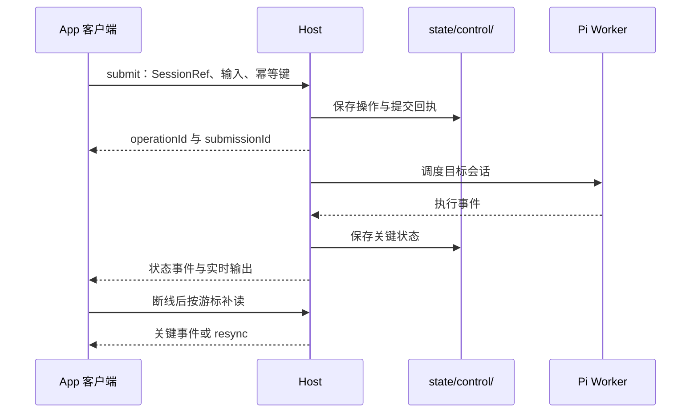

# HostApi v2

本文先描述已实现的正式接口，末节单独保留待确认规划。公共类型在 [app-host.ts](../packages/contracts/src/app-host.ts)，实现位于 [app-control.ts](../packages/host/src/app-control.ts)。Server/UI 插件通过 `context.host` 调用，不取得内部 Store、SessionPool 或 Worker。

## 稳定目标与接口组

`apiVersion` 固定为 2。`ProjectRef = { hostId, projectId }`，`SessionRef = { hostId, sessionId }`，`WorkspaceRef` 接受二者之一。Host 身份在 `host-id`，项目、会话与操作记录持久化于 `state/control/`（快照与追加日志；旧版本为单个 `control.json`，详见 [数据目录与存储](storage.md)）。

操作指定目标，不读取或改变客户端的界面选择。会话创建立即持久化身份，首次生成 Pi JSONL 后补充文件绑定；内部 `sessionKey` 不作为公开持久 ID。

| 接口组           | 已实现操作                                                                                                                                                            |
| ---------------- | --------------------------------------------------------------------------------------------------------------------------------------------------------------------- |
| `capabilities()` | Host 身份、API 版本、功能及可选文件操作能力                                                                                                                           |
| `plugins`        | `getDefaultAgentPlugins`、`setDefaultAgentPlugins`                                                                                                                    |
| `projects`       | `list`、`register`、`get`                                                                                                                                             |
| `sessions`       | `create`、`list`、`get`、`snapshot`、`history`、`messages`、`message`、`configure`、`submit`、`stop`、`pause`、`resume`、`receipt`、`submissions`、`cancelSubmission` |
| `files`          | `list`、`read`、`preview`、`search`、`write`                                                                                                                          |
| `terminal`       | `open`、`attach`、`input`、`resize`、`close`                                                                                                                          |
| `git`            | `environment`、`snapshot`、`diff`，只读                                                                                                                               |
| `interaction`    | `respond`，按根会话或子任务来源回答                                                                                                                                   |
| `agents`         | `list`、`get`、`stop`                                                                                                                                                 |
| `goals`          | `get`、`start`、`edit`、`pause`、`resume`、`clear`                                                                                                                    |
| `activities`     | `list`、`logs`、`stop`，查看和停止 Agent 启动的项目服务                                                                                                               |
| `plans`          | `list`，读取已保存计划                                                                                                                                                |
| `events`         | `read`、`subscribe`                                                                                                                                                   |

完整参数与返回类型以 [HostApi](../packages/contracts/src/app-host.ts) 为准。`sessions.history` 使用 `offset/limit`，默认 100 条、最大 500 条，返回 `totalMessages/nextOffset`。`sessions.configure` 可设置模型、思考等级、访问权限、任务模式和 `agentPlugins`；运行中拒绝变更配置。

`capabilities().features` 包含 `goals` 时，可以按 `SessionRef` 调用目标接口。`goals.start(ref, { objective, images?, skills?, sourceMessageTimestamp? }, options)` 返回 `{ goal, receipt }`；指定来源时间戳时由 Host 核对当前分支并引用原消息，正文与图片以原生记录为准。已有目标的编辑、暂停、恢复、清除需要 `goalId` 和 `revision`，旧修订会被拒绝。`edit` 只接受新正文且要求执行已停止，保留累计用量和耗时；创建和恢复均以普通模式执行，进入 Plan 会先暂停活跃目标。

目标类型见 [goal.ts](../packages/contracts/src/goal.ts)。`sessions.snapshot` 返回 `goal` 和 `goalsSupported`；`goal_updated`、`goal_cleared` 沿现有事件补读通道发送。提交回执只表示对应提交是否结束，目标是否结束以 `goal.status` 为准。目标持久化、重启恢复和 UI 操作见 [会话与协作](sessions.md#持久目标-goal)。

## 消息查找与分页

SDK 3 的消息数据仍使用 HostApi v2，不增加 HostApi v3。公共类型见 [plugin-ui-data.ts](../packages/contracts/src/plugin-ui-data.ts)，可见内容转换见 [plugin-ui-message.ts](../packages/contracts/src/plugin-ui-message.ts)。

- `sessions.messages(ref, { offset?, limit?, cursor? })`：读取当前原生分支的公共消息投影，默认 100、最大 500 条。返回 `messages/totalMessages/nextOffset/nextCursor/branchRevision/leafId`。
- `sessions.message(ref, { entryId })`：按原生条目 ID 查单条消息。调用 UI SDK 时使用 `MessageRef = { session: ref, entryId }`。
- `messages` 每项包含角色、状态、内容 revision、来源插件与 generation、工具或自定义类型，以及可见 `text`、JSON `data` 和图片元数据。不返回隐藏 thinking、技能展开全文、原始 Pi 对象或图片 base64。
- 持久 ref 只对应原生 `message/custom_message`；流式内容和压缩、分支摘要等合成内容不伪造可操作 ref。assistant 聚合回复保留多个真实 refs，不分配虚构聚合 ID。
- cursor 绑定 session、由 leaf 与消息 sourceEntry 计算的 branch revision，以及下一页 offset；分支或 context edit 改变后返回 `stale-cursor`，调用方应重新读取，不能拼接不同分支。

旧 `sessions.history` 的 offset 接口继续用于既有历史功能。这里改善公共数据契约与 UI 的按需读取，不承诺 JSONL 随机 IO；Host 仍可能读取原生文件并构建分支投影。插件消息动作不提供通用历史修改、删除或工具重跑接口。

## HTTP 与认证

认证、HTTPS 和来源检查见 [Remote](remote.md#认证与连接恢复)。正式控制入口是 `POST /api/control`，内置界面的 `/api/rpc` 继续保留；事件订阅使用 WebSocket `/api/control/events`。

以下请求使用示例身份，实际调用前先从 Host 取得目标 Ref：

```json
{
  "apiVersion": 2,
  "hostId": "example-host",
  "clientId": "example-app",
  "method": "sessions.submit",
  "args": [
    { "hostId": "example-host", "sessionId": "example-session" },
    { "delivery": "start", "text": "检查项目状态" }
  ],
  "idempotencyKey": "external-message-42"
}
```

`clientId` 为非空字符串，最多 128 字符；传入 `hostId` 时必须匹配连接目标。业务响应为 `{ hostId, result? , error?: { code, message } }`，控制接口的业务失败也可返回 HTTP 200，调用方必须检查 `error`。`events.subscribe` 不通过该 HTTP method 调用。

## 幂等操作

写操作携带 `MutationOptions = { idempotencyKey }`；HTTP 请求将键放在顶层。键长度为 1–128 字符，按 `clientId + idempotencyKey` 去重：

- 相同键和相同方法、参数返回已保存结果；并发调用等待同一次操作。
- 同键不同内容返回 `idempotency-conflict`，缺失或无效键返回 `invalid-key`。
- 已失败或中断的操作不重新执行；中断提交可读取已有回执。

[ControlStore](../packages/host/src/control-store.ts) 保存请求摘要、操作结果、回执与关键事件，不把终端输入正文存入控制日志。客户端遇到网络不确定时用相同键查询或重试，不为同一外部事件生成新键。该保证不等于工具副作用恰好执行一次。



## 提交与回执

`SubmissionInput` 包含 `delivery`、非空 `text`，以及可选 `images`、`skills`、`mode`。模式为 `default` 或 `plan`，每次提交独立保存。

| delivery | 调度规则                                         |
| -------- | ------------------------------------------------ |
| `start`  | 会话空闲时启动；运行中拒绝                       |
| `queue`  | 运行时入队，空闲后调度；空闲且未暂停时可直接启动 |
| `steer`  | 向正在运行的任务投递；空闲时拒绝                 |

回执状态包含 `accepted`、`queued`、`running`、`completed`、`failed`、`cancelled`、`interrupted`。`operationId` 用于 `sessions.receipt`，`submissionId` 标识一次提交；运行关联建立后提供 `runId`，steer 与当前运行关联。

`cancelSubmission` 只撤销排队提交，已投递任务需停止会话；`sessions.stop` 中断当前运行并撤销未投递队列。`pause/resume` 控制会话暂停与后续调度。

Host 退出或重启将未完成提交记为 `interrupted`，不重放任务。`outcomeUncertain` 表示关闭前已经开始投递；未投递队列为 false。收到受理回执不能视为任务成功，需读取回执或订阅状态事件。

## 快照与事件恢复

`sessions.snapshot(ref)` 返回 `controlCursor`。订阅参数为 `EventSubscription`，支持 `projectId/sessionId/terminalId/after`，通过 WebSocket 查询参数 `subscription` 传入 JSON；`clientId` 单独传入。

游标是 `{ journalEpoch, seq }`，关键事件还有 `eventId`、Host/项目/会话、时间与运行关联。[ControlStore](../packages/host/src/control-store.ts) 保留最近 4096 条关键事件；过期、跨 epoch 或超前游标要求重读快照：`events.read` 返回 `resyncRequired`，WebSocket 发出 `resync`。

客户端从快照游标订阅，缓冲读取期间的事件并处理重复投影。token 和终端输出使用 `stream: live`，不写入控制日志、不推进补读游标；聊天正文以 Pi JSONL 为准，终端用 `terminal.attach` 读取当前输出快照。事件日志不能恢复全部 token 或超出终端缓冲的输出。

## 文件与终端

文件操作使用显式目标的工作目录内相对路径；只有 `preview` 额外接受当前 Host 附件目录内的图片绝对路径，用于显示用户消息中的上传图片。[workspace-files.ts](../packages/host/src/workspace-files.ts) 校验目标、路径与真实符号链接目标，拒绝越界：

- `preview` 分类返回文本、图片或不支持原因；附件预览只读取数据目录 `attachments/` 内的图片，拒绝符号链接根目录与越界链接，不允许读取附件文本或修改附件。`search` 按文件名搜索并返回分页游标。
- `write` 只保存现有 UTF-8 文本文件，携带读取时的 `revision` 和幂等键，外部修改后拒绝覆盖。
- 文本读取/保存上限为 1 MiB，图片上限 8 MiB；保存保留 BOM、LF/CRLF 与文件权限。
- `capabilities().fileOperations` 用于协商 `preview/search/write`，旧 Host 未提供该字段时文件面板保持只读。

终端由 [terminal-service.ts](../packages/host/src/terminal-service.ts) 使用 `node-pty`，界面使用 xterm.js。每个 Host 最多 16 个活动终端，单终端保留 256 KiB 输出，单次输入最多 64 KiB。能力不可用时 `capabilities().features` 不包含 `terminal`。

隐藏面板、关闭右侧标签和切换会话保留 PTY；显式关闭终端实例或 Host 退出才关闭进程。重新附着读取输出序号与缓冲，重启不恢复 PTY 进程。

## Agent 项目服务

`capabilities().features` 包含 `activities` 时，可按正式 `SessionRef` 管理所属根会话的受管服务，包括子 Agent 启动的服务：

- `activities.list(ref)` 返回 `activities`、列表 `revision` 和 `cursor`。服务包含名称、命令、目录、来源、状态和启动/结束信息；进程存活不代表应用健康。
- `activities.logs(ref, serviceId)` 返回有界日志尾部 `output`、`sequence` 和 `truncated`，不创建终端。
- `activities.stop(ref, serviceId, options)` 使用幂等键停止指定服务，返回服务状态。目标不匹配会被拒绝；已经结束的服务返回当前结果，不执行其他命令。

启动仅由可信 Agent 请求桥处理，用户停止不走 `sessions.submit` 或模型续跑。服务不随 UI、Worker 或 Agent 单轮结束而终止，Host 正常退出统一清理。

状态变化使用 `type: activity` 的最小失效通知，包含服务标识和修订，可沿事件游标补读；收到后重新读取列表。日志通知走 `stream: live`，只携带服务标识和日志序号，不写入控制日志；查看日志的客户端再读取日志尾部。重连或 `resync` 后重新读取列表，不能仅凭旧服务标识认定 Host 重启后的进程仍存在。

活动运行态和日志不跨 Host 重启恢复，不支持按任意 PID 或端口接管进程。契约见 [service-activity.ts](../packages/contracts/src/service-activity.ts)，生命周期见 [会话与协作](sessions.md#当前活动项目服务)。

## Node 客户端

[createNodeHostClient](../packages/client/src/node-host-client.ts) 不依赖 Electron 或浏览器全局状态。调用应用自行提供 WebSocket 实现；以下示例假定调用应用已安装 `ws`，`PI_HOST_URL/PI_HOST_TOKEN` 是示例客户端参数，不是 Server 配置变量。

```ts
import WebSocket from 'ws'
import { createNodeHostClient } from '@pi-meme/client/node-host-client'

const url = process.env.PI_HOST_URL
const token = process.env.PI_HOST_TOKEN
if (!url || !token) throw new Error('请设置 PI_HOST_URL 和 PI_HOST_TOKEN')

const host = await createNodeHostClient({
  url,
  token,
  clientId: 'example-app',
  webSocket: (address, headers) => new WebSocket(address, { headers }),
})
try {
  const project = (await host.projects.list())[0]
  if (!project) throw new Error('请先登记项目')
  const session = await host.sessions.create({ project }, { idempotencyKey: 'create-task-42' })
  const receipt = await host.sessions.submit(
    session,
    { delivery: 'start', text: '检查项目状态' },
    { idempotencyKey: 'external-message-42' },
  )
  const current = await host.sessions.receipt(receipt.operationId)
  console.log(current.status)
} finally {
  host.dispose()
}
```

客户端处理 Cookie 登录、401 续期、事件重连和序号去重，拒绝 Host 身份变化。远程地址要求无账号信息的 HTTPS，本机回环允许 HTTP。示例只查询当前回执，不等待执行完成；同一业务操作重试时保留幂等键。

验证入口：[app-control.integration.test.ts](../packages/host/tests/app-control.integration.test.ts)、[control-store.integration.test.ts](../packages/host/tests/control-store.integration.test.ts)、[node-client.integration.test.ts](../packages/host/tests/node-client.integration.test.ts)、[workspace-files.integration.test.ts](../packages/host/tests/workspace-files.integration.test.ts) 和 [terminal-service.unit.test.ts](../packages/host/tests/terminal-service.unit.test.ts)。

## 待确认规划：Bot 接入

旧文档提出由独立 `apps/pi-durable` 关联平台消息与 Host 提交。当前仓库没有该入口、Pi Durable 依赖或平台 SDK，也没有自动审批实现。

该方向保留为待确认事项，不是已经交付的能力或本次新增需求。是否启动、接入哪个平台、成员白名单和凭据配置方式仍需单独确认。
