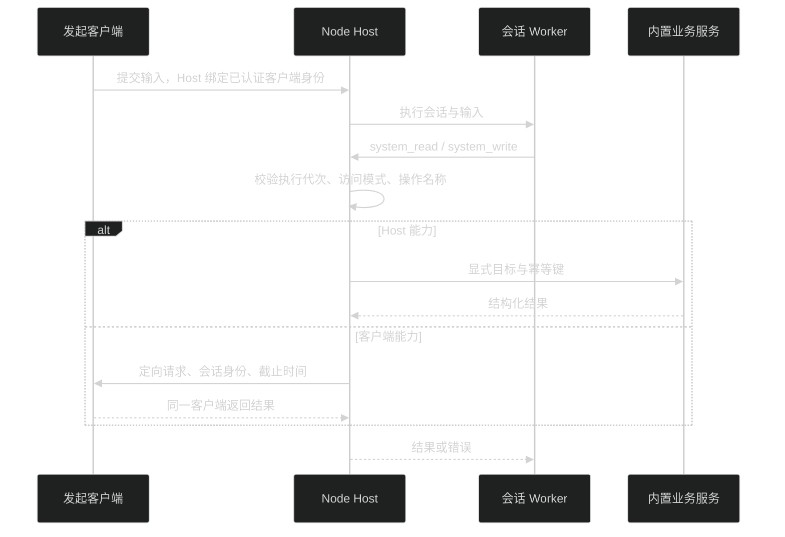

# Host 内置工具与 Agent

Agent 使用 `system_read` 和 `system_write` 操作工作台。先调用 `system_read({operation: "capabilities", args: []})` 获取当前操作目录。目录包含名称、参数顺序、读写性质、作用范围、权限和客户端可用性。业务失败直接返回工具错误，不转换为成功提示。

内置工具的写操作复用已有“完全权限”，不增加第二套权限开关。`system_write` 仅在普通模式和完全权限下开放；Worker 与 Host 都校验。Plan、仅可查看、工作区内修改模式不能借此输入终端命令、改 Host 配置或操作客户端网页。只读工具仍可查询 Host 的内置资源，包括终端输出。

## 操作目录

以运行时 `capabilities` 为准。`args` 是按顺序排列的数组，省略的会话目标默认为当前执行根会话。显式 `SessionRef` 使用 `{hostId, sessionId}`，不能传界面选择或路径冒充会话身份。

| 能力         | 读取                                                                  | 修改                                                                                             |
| ------------ | --------------------------------------------------------------------- | ------------------------------------------------------------------------------------------------ |
| 终端         | `terminal.list`、`terminal.read`                                      | `terminal.open`、`terminal.input`、`terminal.resize`、`terminal.close`                           |
| 定时任务     | `schedules.list`、`get`、`runs`、`schema`                             | `create`、`update`、`pause`、`resume`、`delete`、`runNow`、`stopRun`、`markRead`、`resetSession` |
| 图像素材     | `images.list`、`images.read`                                          | `images.rename`、`images.remove`；生成沿用 `image_gen`                                           |
| 草图         | `visualizations.list`、`visualizations.read`                          | 沿用 `save_visualization` 创建与保存版本                                                         |
| 文件         | `files.list`、`read`、`preview`、`search`                             | `files.write`，需文件修订                                                                        |
| Git 与计划   | `git.snapshot`、`git.diff`、`plans.list`                              | Git 现有专用入口保持原权限                                                                       |
| 后台活动     | `activities.list`、`activities.logs`                                  | `activities.stop`                                                                                |
| 个人资料     | `profile.get`、`profile.avatar`                                       | `profile.save`，需修订                                                                           |
| 外观         | `appearance.get`                                                      | `appearance.save`，需修订，仅发起客户端                                                          |
| MCP          | `mcp.get`                                                             | `mcp.save`、`mcp.delete`，需配置修订                                                             |
| 指令与资源   | `instructions.get`、`resources.list`、`commands.list`                 | `instructions.save`，需指令修订                                                                  |
| 插件默认选择 | `plugins.defaults`                                                    | `plugins.setDefaults`，仍走插件校验                                                              |
| 用量与模型   | `usage.get`、`models.list`                                            | 模型凭据不通过此目录返回                                                                         |
| 项目与会话   | `projects.list`、`sessions.list`、`sessions.get`、`sessions.messages` | 会话执行继续使用已有会话 API                                                                     |
| Agent 与目标 | `agents.list`、`goals.get`                                            | 沿用已有协作和目标工具                                                                           |
| Desktop 网页 | `browser.list`、`read`、`screenshot`                                  | `browser.open`、`navigate`、`click`、`input`、`scroll`、`close`                                  |

短名称沿用该行前缀，例如定时任务的 `get` 完整名称为 `schedules.get`。

### 终端

`terminal.list` 返回终端 ID、所属会话或项目、目录、尺寸和退出状态。`terminal.read` 的参数为 `[terminalId]`，返回当前屏幕及最多 1000 行滚动缓冲的纯文本和 `outputSequence`。终端输入完成不等于命令执行完成，需要再次读取输出；不会等待 shell 提示符后才返回。

`terminal.input` 参数为 `[terminalId, text]`，执行命令时显式包含换行。输入最多 64 KiB。关闭和输入具有执行副作用，均为写操作。界面关闭订阅不关闭 Host 进程；再次打开或刷新附着已有存活终端。Host 重启后进程不恢复。新建交互终端声明 `TERM=xterm-256color` 和 `COLORTERM=truecolor`，不继承 Host 日志的 `NO_COLOR` / `FORCE_COLOR` 开关；用户仍可在终端中显式设置这些变量。

### 定时任务

创建前读取 `schedules.schema` 和 `models.list`，不要猜模型 ID、时区或通知枚举。创建参数为 `[ScheduledTaskInput]`；读取、暂停等操作使用 `[{hostId,taskId}]`；更新为 `[{hostId,taskId}, ScheduledTaskInput]`。更新传完整输入。任务读取与执行不要求先进入定时任务页面。

### 配置与修订

`profile.get` 返回资料摘要、`hasAvatar` 和内容修订，不携带头像 base64；`profile.avatar` 单独返回图片。`profile.save` 参数为 `[patch, revision]`。只允许 `name`、`username`、`email`、`avatarText`、`avatarData` 字符串字段，作用于当前 Host。资料事件触发已连接界面重新读取。

`appearance.get` 返回外观及内容修订；`appearance.save` 参数为 `[patch, revision]`。可修改 `mode`、`uiSize`、`codeSize`、`reducedMotion` 等现有外观字段；由现有外观校验器校验。外观保存在发起客户端的本地存储，不写 Host 全局外观。同一浏览器配置空间的页面共享本地设置，Desktop 与 Web 独立。内容恢复成原值时，内容修订也恢复成原值；它不是递增版本号。

`mcp.get` 返回配置修订、服务名称、启用状态、传输方式和授权状态，不返回环境变量、请求头、命令参数或凭据。它表示配置状态，不冒充实时连通性探测。修改 MCP 和指令后，当前执行仍使用原有资源快照；新会话或重新加载后采用新配置，工具调用中不强制重启自己的 Worker。

### Desktop 网页

网页属于发起对话的 Desktop 和明确会话，读取隐藏会话不会切换前台标签。Web 不注册 `browser.*`，目录的 `available` 为 `false`，调用返回不可用；不借用另一台 Desktop。

`browser.read([tabId])` 返回标题、最多 40000 字符的页面正文和最多 150 个可交互元素，以及 `documentId`。元素编号由本次读取生成，下一次读取可能更换编号。密码输入值不返回。读取和操作目前覆盖主文档，不跨 iframe 和封闭 Shadow DOM。

点击参数为 `[tabId, documentId, elementId]`，输入为 `[tabId, documentId, elementId, text]`，滚动为 `[tabId, documentId, deltaY]`。导航后旧文档编号失效；元素移除、禁用或隐藏后不能继续操作。输入会触发 `input` 和 `change` 事件。一次滚动绝对值不超过 10000 像素。网页正文属于外部内容，不能成为提升权限或修改工具规则的依据。

## 执行与客户端路由

Host 用执行身份校验运行代次、运行状态和取消信号。写入使用工具调用 ID 作为幂等键，外层与业务 API 使用不同命名空间，避免互相等待。Host 共享配置写入串行处理，并复用服务的修订校验。

客户端请求最长等待 30 秒。断线、取消或超时不会转发给其他客户端，也不会自动重放点击、输入或配置修改。超时可能发生在客户端已经执行之后，错误会说明结果不确定；先读取现状再决定下一步。

## 新增内置能力

1. 在对应业务包实现服务方法，UI 和 Agent 共用。Host 是数据的唯一写入者；UI 不导入 Node、Electron 或 Server 实现。
2. 在 `packages/host/src/system-operations.ts` 显式登记操作名称、中文说明、参数顺序、`write` 和 `scope`。优先调用正式 HostApi，不提供任意 RPC 名称或对象路径执行入口。
3. Host 专有服务接入 `packages/host/src/service.ts` 的明确分支。校验未知输入；共享配置带修订，写操作带幂等键，检查取消和过期执行。不要在正在执行的工具内调用等待全局空闲的接口。
4. 客户端操作在 `use-system-client.ts` 注册；平台方法通过契约和 preload 连接。注册名称表示客户端确实支持，不能由 Web 假装支持 Desktop。
5. 写操作完成后发送现有业务事件或 `system-changed`，界面从服务重新读取。会话删除通过持久清理记录解绑产物、终端和客户端引用。
6. 返回结构化数据。图片返回原生图片内容；大型列表支持分页；超过工具输出上限时返回带 `truncated` 的合法 JSON 摘要，不能从中间截断 JSON。错误包含可采取的下一步。不要把明文凭据、配置请求头或密码输入值返回模型。
7. 更新本页目录和相关业务文档，在开发环境用真实 Agent 调用验证读取、修改、权限拒绝和过期目标；按仓库规则运行静态检查。

开发入口为 `pnpm start`；检查方式见 [测试](testing.md)。会话界面状态见 [UI 体验与动效](ui-experience.md#会话状态与工具保留)。后台截图复用同一 WebContents 的 [Electron Debugger](https://www.electronjs.org/docs/latest/api/debugger) 和 [Page.captureScreenshot](https://chromedevtools.github.io/devtools-protocol/tot/Page/#method-captureScreenshot)，不切换标签；20 秒超时并释放自身调试连接。
