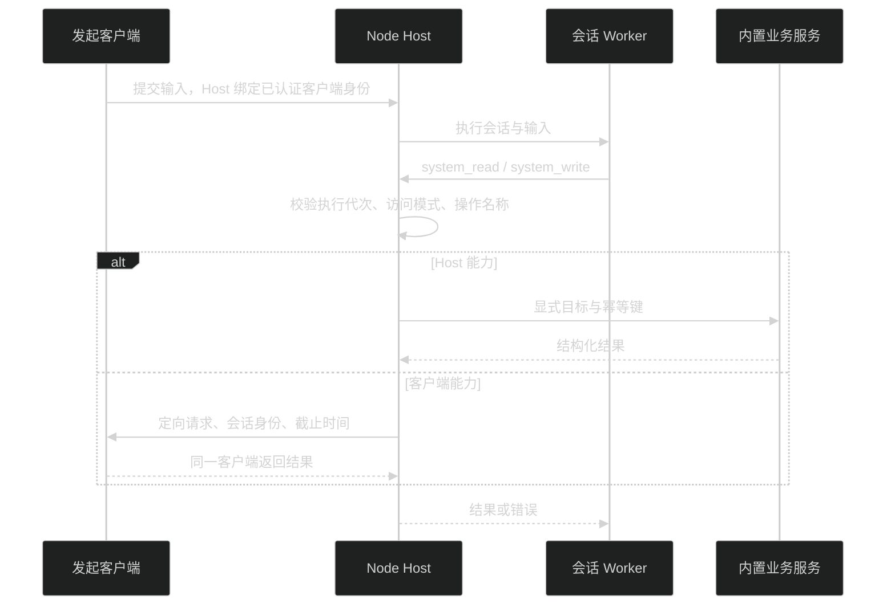

# Host 内置工具与 Agent

Agent 使用 `system_read` 和 `system_write` 操作工作台。先调用 `system_read({operation: "capabilities", args: []})` 获取分页操作目录；有 `nextCursor` 时保持筛选继续读取。再用 `capabilities.describe([operationName])` 查询单项输入 schema、公共输出、范围、限制及续读方式。目录区分 `available` 与 `allowed`；业务失败不会转换为成功空结果，读取错误返回 `{error:{code,message}}`。完整业务与 16 个设置入口的对应关系见 [Agent 读取覆盖](agent-read-coverage.md)。

工作台全局写操作复用“完全权限”，不增加第二套权限开关。`system_write` 仅在有效权限为完全权限的普通任务下开放；Worker、Host 与 codemode 嵌套调用都校验同一要求。Plan、本地只读、工作区内修改模式不能借此输入终端命令、改 Host 配置或操作客户端网页。只读工具仍可查询 Host 的内置资源，包括终端输出。内置读取、工作区写入、完全权限三类工具要求集中在 [agent-access.ts](../packages/contracts/src/agent-access.ts)。

`write`、`edit`、`image_gen` 与 `manage_service` 的启停至少要求工作区修改；本地文件写入、命令和受管服务统一使用 AccessSandbox。Plan 覆盖会话选择并按本地只读执行；计划、可视化与聊天元数据由固定 Host 入口保存，不接受任意落盘路径。权限越界只返回原因，不自动重试提权。受限会话不导入插件 Agent 或连接 MCP；`mcp.get` 只读取 Host 配置摘要。

## 操作目录

以运行时 `capabilities` 为准。它支持 `domain/scope/write/query` 筛选和有修订的分页，默认 50 项、最多 100 项。`args` 是按顺序排列的数组，省略的会话目标默认为当前执行根会话。显式 `SessionRef` 使用 `{hostId, sessionId}`，项目工作区可使用 `{hostId,projectId}`；不能传界面选择或路径冒充身份。下表保留读写入口概览，新增读取的完整分组见覆盖表。

| 能力         | 读取                                                                        | 修改                                                                                                    |
| ------------ | --------------------------------------------------------------------------- | ------------------------------------------------------------------------------------------------------- |
| 终端         | `terminal.list`、`terminal.read`                                            | `terminal.open`、`terminal.input`、`terminal.resize`、`terminal.close`                                  |
| 定时任务     | `schedules.list`、`get`、`runs`、`schema`                                   | `create`、`update`、`pause`、`resume`、`delete`、`runNow`、`stopRun`、`markRead`、`resetSession`        |
| 图像素材     | `images.list`、`images.get`、`images.read`                                  | `images.import`、`images.rename`、`images.remove`；生成沿用 `image_gen`                                 |
| 可视化       | `visualizations.list`、`visualizations.read`、`visualizations.previewState` | `visualizations.export`；创建与保存版本沿用 `save_visualization`                                        |
| 上下文窗口   | `contextWindow.list`、`get`、`item`、`reply`、`piece`、`image`              | 只读；默认摘要，正文和图片显式分页读取                                                                  |
| 文件         | `files.list`、`read`、`preview`、`search`                                   | `files.write`，需文件修订                                                                               |
| Git 与计划   | `git.availability`、`git.snapshot`、`git.diff`、`plans.list`                | Git 现有专用入口保持原权限                                                                              |
| 后台活动     | `activities.list`、`activities.logs`                                        | `activities.stop`                                                                                       |
| 个人资料     | `profile.get`、`profile.avatar`                                             | `profile.save`，需修订                                                                                  |
| 外观         | `appearance.get`                                                            | `appearance.save`，需修订，仅发起客户端                                                                 |
| MCP          | `mcp.get`                                                                   | `mcp.save`、`mcp.delete`，需配置修订                                                                    |
| 指令与资源   | `instructions.get`、`resources.list`、`commands.list`                       | `instructions.save`，需指令修订                                                                         |
| 插件默认选择 | `plugins.defaults`                                                          | `plugins.setDefaults`，仍走插件校验                                                                     |
| 记忆         | `memory.status`、`memory.list`、`memory.search`、`memory.get`               | `memory.remember`、`memory.update`、`memory.forget`；响应用户明确请求，不提供主开关或全 Host 清空       |
| 用量与模型   | `usage.get`、`models.list`                                                  | 模型凭据不通过此目录返回                                                                                |
| 项目与会话   | `projects.list/get/deletePreview`、`sessions.list/get/messages/attention`   | `projects.create/rename/setPinned/delete`、`sessions.create/rename/configure/setPinned/delete/markRead` |
| Agent 与目标 | `agents.list`、`goals.get`                                                  | 沿用已有协作和目标工具                                                                                  |
| Desktop 网页 | `browser.list`、`read`、`screenshot`                                        | `browser.open`、`navigate`、`click`、`input`、`scroll`、`close`                                         |

短名称沿用该行前缀，例如定时任务的 `get` 完整名称为 `schedules.get`。

### 终端

`terminal.list([{cursor?,offset?,limit?,revision?}?])` 分页返回有权读取的终端 ID、所属会话或项目、目录、尺寸和退出状态。`terminal.read` 的参数为 `[terminalId]`，返回当前屏幕及最多 1000 行滚动缓冲的纯文本和 `outputSequence`。终端输入完成不等于命令执行完成，需要再次读取输出；不会等待 shell 提示符后才返回。

`terminal.input` 参数为 `[terminalId, text]`，执行命令时显式包含换行。输入最多 64 KiB。关闭和输入具有执行副作用，均为写操作。界面关闭订阅不关闭 Host 进程；再次打开或刷新附着已有存活终端。Host 重启后进程不恢复。新建交互终端声明 `TERM=xterm-256color` 和 `COLORTERM=truecolor`，不继承 Host 日志的 `NO_COLOR` / `FORCE_COLOR` 开关；用户仍可在终端中显式设置这些变量。

### 定时任务

创建前读取 `schedules.schema` 和 `models.list`，不要猜模型 ID、时区或通知枚举。创建参数为 `[ScheduledTaskInput]`；读取、暂停等操作使用 `[{hostId,taskId}]`；更新为 `[{hostId,taskId}, ScheduledTaskInput]`。更新传完整输入。任务读取与执行不要求先进入定时任务页面。

### 图像素材

`images.list([{origin?,projectId?,query?,cursor?,limit?}?])` 默认只返回生成图，`origin` 可显式选择 `all`、`generated` 或 `uploaded`。来源筛选先于分页；更换来源或项目时重新开始分页。`images.get([id])` 读取单项信息，`images.read([id])` 返回保留真实 MIME 的图片 data URL 与字节数。生成图带来源会话、提示词与模型，上传图没有这些字段；不要替上传图猜造来源。

`images.import([{path,name?}])` 将当前 Host 的 `data/attachments/` 内已有 PNG、JPEG 或 WebP 收录为上传素材，单张最多 8 MiB。路径必须是该 Host 附件目录内的真实普通文件，不接受工作区外任意路径、符号链接、浏览器本机路径或 URL。导入不复制原文件，复用业务入库校验与幂等机制；改名、移除同样通过 HostApi 执行。移除只隐藏图库记录，保留聊天与原始文件，不表示进入回收站。

导入登记为 Host 范围写操作，只有普通任务的完全权限可调用；Plan、本地只读和工作区修改模式不能导入。界面上传另走已认证的 Host 级二进制接口，不以当前 Agent 任务权限替代客户端身份校验。`image-library-upload` 能力表示支持上传、真实来源筛选与联合条目协议；旧 Host 未声明时，不向它发送上传来源查询。

### 可视化

可视化涵盖图表、交互讲解、模拟与 UI 预览。`save_visualization/read_visualization` 沿用完整版本与分支访问规则；保存可选 `layout: 'regular' | 'wide'` 和 `libraries: ['echarts']`，扁平状态与控件限制保持不变。Host 保存产物通过会话范围的 `visualizations.list/read` 查询，不把保存初值当作当前浏览器状态。

| 操作                          | `args`                        | 结果与边界                                                                            |
| ----------------------------- | ----------------------------- | ------------------------------------------------------------------------------------- |
| `visualizations.previewState` | `[{id,revision}]`             | 只读 `{reference,state,source}`，source 为 `live/saved/initial`；不挂载面板或修改状态 |
| `visualizations.export`       | `[{id,revision},{format:'png' | 'html'}]`                                                                             | 在发起客户端下载当前状态的 PNG 或离线 HTML；返回下载已发起的元数据 |

两项均为 `scope: 'client'`，固定发起客户端并绑定当前执行会话。Host 先校验执行身份、临时会话归属和分支引用，再定向委托；参数不接受其他会话、客户端或路径，不按界面选择猜目标。`previewState` 的来源为 `initial` 时只表示没有可用的用户状态，不能当成用户操作证据。

PNG 需要该版本已挂载、就绪且可见的预览，否则返回 `not-loaded`，不自动打开面板；HTML 可用当前浏览器取得的状态和离线运行时生成。成功返回 `{status:'download-started',fileName,mimeType}`，不返回本机路径或承诺下载完成。`export` 是写操作，沿用普通任务与完全权限要求，Plan 可保存可视化但不能借系统写操作导出。

标题、放大、设计参数、反馈、PNG 复制/下载与 HTML 导出由宿主提供，iframe 只有状态、环境和声明的图表能力，没有业务、聊天、剪贴板或下载 API。图内选择不发起对话；用户提交宿主反馈才聊天。没有客户端、断线、不支持或执行过期时明确失败，不借其他窗口，不用默认状态冒充用户选择。先查能力目录；旧 Host 缺少 `visualize-runtime-v2` 时保留旧预览回退，不向它发送新增操作。完整运行时和示例见 [可视化](visualize.md)。

### 上下文窗口

`contextWindow.*` 使用 `[query-or-requestId, SessionRef?]`，缺省目标为执行会话。`list/get` 返回请求摘要，`item/reply` 返回项目和 piece 元数据；只有 `piece/image` 显式读取正文或内联位图。列表最多100条、文本最多20000字符且序列化文本限48 KiB。所有方法都是会话范围只读操作，临时会话仍校验归属，不会打开或切换客户端面板。完整参数、估算与保留语义见[会话上下文窗口](context-window.md)。

### Git 可用性摘要

`git.availability([SessionRef?])` 只读查询该会话是否有可查看变更，正式 HostApi 需要 `git-availability` 子能力。返回工作区与当前会话分支的轮次差异两类独立结果，以及有内容的建议打开范围和修订；不包含文件正文或 patch。工作区只运行有超时与输出限制的 status，轮次只比较已保存的前后快照。非 Git 目录仍可有轮次记录；已撤销的轮次保留历史可读性。读取失败和不支持不表示工作区干净。

操作复用显式会话访问校验，不创建 Worker、不切换客户端选择。旧 Host 不支持新摘要时，客户端保留原有 Git 显式查看能力，不将未知的未加载历史判为空。

### 项目与会话管理

新操作复用正式 [HostApi 项目与会话管理](host-api.md#项目与会话管理)，使用稳定 Ref，读取和修改不切换客户端当前选择。写入继续要求普通任务与完全权限，没有新增独立权限开关。

| 操作                     | `args`                                                                  |
| ------------------------ | ----------------------------------------------------------------------- |
| `projects.get`           | `[ProjectRef]`                                                          |
| `projects.create`        | `[{cwd,name?}]`，登记 Host 上已有绝对目录                               |
| `projects.rename`        | `[ProjectRef,name]`                                                     |
| `projects.setPinned`     | `[ProjectRef,pinned]`，`pinned` 必须为布尔值                            |
| `projects.deletePreview` | `[ProjectRef]`，读取会话数量、警告与删除清单修订                        |
| `projects.delete`        | `[ProjectRef,{revision}]`，使用预览修订删除项目及所属会话，保留工作目录 |
| `sessions.create`        | `[{project?:ProjectRef,name?,configuration?}]`，`[{}]` 创建独立新聊天   |
| `sessions.rename`        | `[name,SessionRef?]`                                                    |
| `sessions.setPinned`     | `[pinned,SessionRef?]`，`pinned` 必须为布尔值                           |
| `sessions.configure`     | `[{model?,thinkingLevel?,accessMode?,mode?,agentPlugins?},SessionRef]`  |
| `sessions.delete`        | `[SessionRef]`                                                          |

名称和置顶省略会话目标时使用执行根会话。配置与删除必须显式提供 `SessionRef`，项目操作必须提供 `ProjectRef`；从 `projects.list/sessions.list` 获取目标，不使用客户端选择或路径替代身份。运行中的会话拒绝配置修改，权限或任务模式变化与其他配置分开提交。模型 ID 先从 `models.list` 获取。

Agent 不能删除当前执行根会话或其所属项目，避免工具执行清理掉自身运行。删除其他会话复用持久清理流程；项目清单变化后旧修订会被拒绝。删除返回结果中的 `errors/warnings` 须如实处理，不将部分删除描述为全部成功。新聊天创建仅创建会话，不自动调用模型；机器人后续发消息使用正式 `sessions.submit`。

### 会话查看

`sessions.attention([SessionRef?])` 读取 Host 共享的查看状态，不清除提醒。`sessions.markRead([{completionToken?,inputRequestIds?}, SessionRef?])` 确认明确版本或请求，省略目标时使用当前执行根会话；不读取界面选择、不回答交互。此操作属于会话范围写入，仅在普通模式与完全权限下开放。过期回复 token 会被拒绝，不能用旧确认清除新回复。

### 完整读取与配置状态

会话读取新增 `sessions.snapshot/history/tree/entry/message/events/queue/interactions/stats/sources/image`，以及主机范围 `sessions.query/search`。历史只使用已有快照或保存 JSONL，不恢复冷会话、不写历史索引。条目与事件返回公共白名单投影，隐藏思考、原始 Pi/provider 对象和原始错误不返回。子代理消息、事件、邮箱与保存计划版本分别通过 `agents.*`、`plans.history/get` 查询；读取不恢复任务、消费邮件或确认交互。

大目录使用 `files.listPage`，大 UTF-8 文件使用 `files.readPiece`。后者支持超过预览上限的文件，`offset/nextOffset` 为 UTF-8 字节偏移，须携带返回的文件修订续读。通用正文分片使用 JavaScript 字符串偏移；两者都拒绝字符中间偏移。超过最终 48 KiB 文本预算的结果使用返回的 `results.read` 参数续读完整 JSON，不用预览摘要替代正文。图片单独按真实 MIME 返回。

`settings.*`、`tools.execution`、`permissions.status`、`sandbox.status`、`models.*`、`imageGeneration.config`、`subagents.*`、`plugins.*`、`mcp.status/tools`、`usage.*`、`storage.*`、`host.*` 提供字段白名单。配置、捕获和有效状态分别返回；未捕获、未加载、禁用与未知状态不冒充空列表。不返回认证通知、地址中的凭据、headers/env/args、私钥或原始错误，也不为读取而认证、联网、重载插件或探测服务。

`resources.catalog/detail/readSkill/files/file` 显式读取技能策略、正文和包内文件；读取不创建执行资源快照。`instructions.configured/captured/effective` 区分保存指令和本轮来源，正文显式分片。具体参数及字段以 describe 和 [覆盖表](agent-read-coverage.md) 为准。

### 配置与修订

`profile.get` 返回资料摘要、`hasAvatar` 和内容修订，不携带头像 base64；`profile.avatar` 单独返回图片。`profile.save` 参数为 `[patch, revision]`。只允许 `name`、`username`、`email`、`avatarText`、`avatarData` 字符串字段，作用于当前 Host。资料事件触发已连接界面重新读取。

`appearance.get` 返回外观 Host 提供的外观及内容修订；`appearance.save` 参数仍为 `[patch, revision]`。可修改 `mode`、`uiSize`、`codeSize`、`reducedMotion` 及允许的 `shared / light / dark` 覆盖叶子。缺席字段不改，可选叶子的 `null` 表示删除并恢复主题继承；必填值、未知字段和非法值会被拒绝。内容字体的 `inherit` 是明确跟随界面字体，与删除覆盖不同。

保存复用外观 Host 的队列内修订校验和原子提交；客户端不得自行计算修订后无条件写回整份外观。冲突要求重新读取，不能覆盖并发修改。底层 `settings:appearance` 和 `settings:theme` 也必须携带修订，旧的无修订调用不会兼容降级。普通设置保存不能借 `appearance / themeId` 修改外观。内容恢复成原值时，内容修订也恢复成原值；它不是递增版本号。

外观由发起客户端选定的外观 Host 保存到 `config/app.json`。Desktop 多服务界面始终使用客户端本地 Host，切换远程服务不会改写远端外观；独立 Web 使用连接入口的 Host。共享同一外观 Host 的客户端读取同一份长期配置；提交后广播修订，事件和重新连接只触发读取。Host 配置进入写保护时，Agent 与界面写入同样拒绝，不能以旧缓存或默认值覆盖原文件。

`mcp.get` 返回配置修订、服务名称、启用状态、传输方式和授权状态，不返回环境变量、请求头、命令参数或凭据。它表示配置状态，不冒充实时连通性探测。修改 MCP 和指令后，当前执行仍使用原有资源快照；新会话或重新加载后采用新配置，工具调用中不强制重启自己的 Worker。

### 记忆

记忆默认关闭，入口为“设置 → Agent → 记忆”。`memory.status([])` 可读取 Host 开关、预算及当前项目任务；主开关关闭时，其余记忆正文读取被拒绝，认证设置页仍可管理已存内容。

`memory.list([{query?,cursor?,limit?:1..20}?])` 和 `memory.search([{query,cursor?,limit?:1..20}])` 只返回当前执行项目与通用记忆的有界摘要，搜索词最多 500 字符。`memory.get([memoryId])` 读取全文及最多 8 条来源；`memory.sources([memoryId,{cursor?,limit?,revision?}?])` 继续分页读取全部保留来源。不能借显式 ID 读取其他项目，目标不取界面选择。

写操作仅在普通任务与完全权限下开放，响应用户明确的记住、纠正或忘记要求：

- `memory.remember([{title,content,scope?}])` 默认保存到当前项目；明确通用记忆使用 `scope: {kind: "global"}`，无项目会话必须显式指定范围。
- `memory.update([memoryId,{title,content,scope?},revision])` 使用条目修订，省略范围保留原范围；保存后手工锁定，自动学习不覆盖。
- `memory.forget([memoryId,revision])` 删除条目并撤销关联旧来源，保留原始聊天。已获准发出的上下文无法撤回。

Agent 不通过此目录修改主开关、每日预算或清空整个 Host。管理 HostApi 另包含 `configure/create/update/remove/clear/stop/retry`，带修订及幂等键；记忆服务回执仅保留最近 256 条，不是永久防重放。完整范围、自动学习条件与费用见 [记忆](memory.md)。

### Desktop 网页

网页属于发起对话的 Desktop 和明确会话，读取隐藏会话不会切换前台标签。Web 不注册 `browser.*`，目录的 `available` 为 `false`，调用返回不可用；不借用另一台 Desktop。

`browser.read([tabId])` 返回标题、最多 40000 字符的页面正文和最多 150 个可交互元素，以及 `documentId`。元素编号由本次读取生成，下一次读取可能更换编号。密码输入值不返回。读取和操作目前覆盖主文档，不跨 iframe 和封闭 Shadow DOM。

点击参数为 `[tabId, documentId, elementId]`，输入为 `[tabId, documentId, elementId, text]`，滚动为 `[tabId, documentId, deltaY]`。导航后旧文档编号失效；元素移除、禁用或隐藏后不能继续操作。输入会触发 `input` 和 `change` 事件。一次滚动绝对值不超过 10000 像素。网页正文属于外部内容，不能成为提升权限或修改工具规则的依据。

## 执行与客户端路由

Host 用执行身份校验运行代次、运行状态和取消信号。写入使用工具调用 ID 作为幂等键，外层与业务 API 使用不同命名空间，避免互相等待。Host 共享配置写入串行处理，并复用服务的修订校验。

客户端请求绑定提交时的 `clientId/connectionId/registrationId/documentGeneration`。保留 clientId 的重载归属，新连接和文档代次独立；同 ID 的另一连接不能接管注册或代答旧请求。事件只发送到匹配连接，回执核对当前注册与文档。读取 `client.state/navigation/panels`、`composer.*`、外观、快捷键、入口连接、SSH、平台能力与插件 UI 元数据时不跳页、不挂载面板、不发送草稿或执行插件钩子。输入框先取明确 ref 与数字修订；失效后重新读取。

客户端请求最长等待 30 秒。断线、取消或超时不会转发给其他客户端，也不会自动重放点击、输入或配置修改。超时可能发生在客户端已经执行之后，错误会说明结果不确定；先读取现状再决定下一步。Desktop 浏览器新增工作区摘要、批注、档案设置、历史、下载和权限读取，摘要不恢复标签或保存工作区，历史查询不清空数据。执行 Host、外观 Host、本地浏览器档案与发起客户端分别报告，详见 [客户端覆盖](agent-read-coverage.md#发起客户端的覆盖与隔离)。

## 新增内置能力

1. 在对应业务包实现服务方法，UI 和 Agent 共用。Host 是数据的唯一写入者；UI 不导入 Node、Electron 或 Server 实现。
2. 在 `packages/host/src/system-operations.ts` 显式登记操作名称、中文说明、参数顺序、`write` 和 `scope`。优先调用正式 HostApi，不提供任意 RPC 名称或对象路径执行入口。
3. Host 专有服务接入 `packages/host/src/service.ts` 的明确分支。校验未知输入；共享配置带修订，写操作带幂等键，检查取消和过期执行。不要在正在执行的工具内调用等待全局空闲的接口。
4. 客户端操作在 `use-system-client.ts` 注册；平台方法通过契约和 preload 连接。注册名称表示客户端确实支持，不能由 Web 假装支持 Desktop。
5. 写操作完成后发送现有业务事件或 `system-changed`，界面从服务重新读取。会话删除通过持久清理记录解绑产物、终端和客户端引用。
6. 读取登记具体 `inputSchema/outputSchema/domain/limits`，执行时校验未知字段和范围，输出使用公共白名单。大型列表和正文使用分页或分片；超过预算由 `results.read` 保留完整 JSON，图片返回原生内容。未知异常规范化为安全错误码，不能把明文凭据、配置请求头、密码输入、原始错误或任意内部对象返回模型。写操作保留其幂等与失败语义。
7. 更新本页和 [读取覆盖表](agent-read-coverage.md)。读取链路不得创建 Worker、索引文件、执行资源快照或业务状态；初始化放在生命周期。交付由未实施该功能的 Hacker 用真实界面、Agent 与临时数据检查权限、过期和完整性，写明 oracle 与未验范围；静态检查不代替功能验收。

开发入口为 `pnpm start`；检查方式见 [测试](testing.md)。会话界面状态见 [UI 体验与动效](ui-experience.md#会话状态与工具保留)。后台截图复用同一 WebContents 的 [Electron Debugger](https://www.electronjs.org/docs/latest/api/debugger) 和 [Page.captureScreenshot](https://chromedevtools.github.io/devtools-protocol/tot/Page/#method-captureScreenshot)，不切换标签；20 秒超时并释放自身调试连接。
