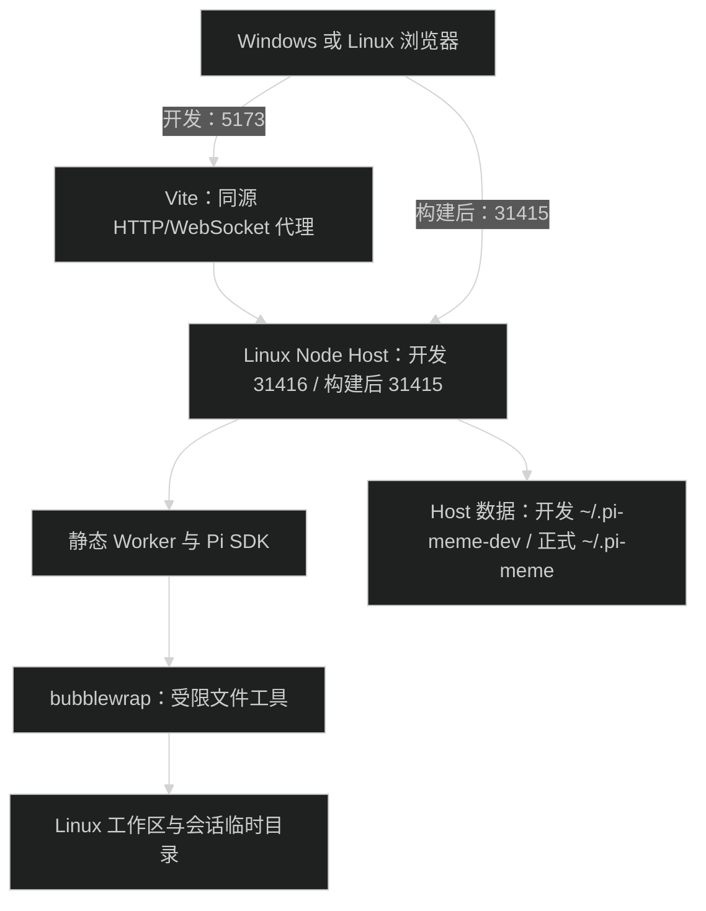

# Linux 与 WSL 开发运行

Ubuntu 24.04 和 WSL2 使用独立 Node Host 与 Web。WSL 按 Linux 装配沙箱；Windows 浏览器只处理界面，工作区、Git、模型凭据、MCP 和会话都在 Linux Host。通用入口见 [快速开始](getting-started.md)，配置和凭据见 [配置与安全](configuration.md)。

## 下载包运行

首发提供 Ubuntu 24.04 x64 的 Host/Web 独立包，包含 Node.js 24.14.0、Worker、技能与生产依赖。下载、SHA256 校验、解压和启动命令见[快速开始](getting-started.md#安装独立-host)。使用前安装 `git`、`bash` 和 `bubblewrap`，不需要 Node.js 或 pnpm。

WSL2 需要匹配的 x64 Ubuntu 环境；解压目录、数据与项目放在 Linux 文件系统，不使用 Windows 的 Node 或 `node_modules`。Windows 浏览器仍通过 localhost 访问，具体互操作和浏览器接线需在真实 WSL2 验收。

其他 Linux 发行版未作为首发验收平台；不提供 Linux arm64、Alpine/musl 或 Windows 原生下载包，不自动安装 systemd。发布流程见[版本发布](releasing.md)。

## 源码安装与运行

使用 Linux 的 Node.js 24.14.0、pnpm 10.29.1。仓库和数据放在 Linux 文件系统，例如 `~/Code/pi-meme` 和 `~/.pi-meme`。Windows 编辑器通过 WSL 连接编辑；不要复用 Windows/macOS 的 `node_modules`。参考 [微软文件系统说明](https://learn.microsoft.com/en-us/windows/wsl/filesystems)。

```bash
sudo apt-get update
sudo apt-get install -y git bubblewrap
node --version
pnpm --version
pnpm install --frozen-lockfile
```

以下项目命令在仓库根目录执行。终端一运行 `pnpm start:server`，终端二运行 `pnpm start:web`。开发 Host 默认使用 `31416` 和 `~/.pi-meme-dev`，与正式环境分开。Windows 或 Linux 浏览器打开 `http://127.0.0.1:5173`。Vite 固定 loopback 地址与端口，同源代理保留 Cookie、Host、Origin 和 WebSocket。Web 源码修改支持热更新，Host 源码修改后重启终端一。

构建后由一个 Host 提供 Web：

```bash
pnpm build:web
pnpm build:server
node apps/server/dist/main.js
```

打开 `http://127.0.0.1:31415`，本机自动登录。这组源码构建的 Server 和 Worker 依赖当前 Linux 的 `node_modules`，不是独立单文件；下载包则由 `pnpm package:host` 另行收集完整运行目录。`PI_MEME_DATA_ROOT` 和 `PI_MEME_WEB_ROOT` 继续支持覆盖；Host 数据必须位于 Linux 文件系统，Windows 驱动器挂载会被拒绝。



## 默认权限和隔离

平台选择见 [sandbox-platform.ts](../packages/host/src/sandbox-platform.ts)，bubblewrap 参数与 seccomp 见 [linux-sandbox.ts](../packages/pi-runtime/src/sdk/linux-sandbox.ts)，文件与进程操作共用 [access-sandbox.ts](../packages/pi-runtime/src/sdk/access-sandbox.ts)。

新会话默认 `workspace-write`。两档受限模式都通过 `/usr/bin/bwrap` 运行 bash、mkdir 和 tee；`write/edit` 还有路径校验。根文件系统只读，工作区内修改只允许项目真实目录和会话临时目录写入。仅可查看只允许临时目录和必要设备写入，文件工具拒绝业务文件修改。读取和 TCP/UDP 沿用现有权限含义，没有秘密文件读取隔离或网络访问控制。

后端解析真实路径，拒绝整体授权根目录、用户主目录、Pi 配置和系统临时目录。项目内的符号链接不能扩大写入边界；Host 数据在项目中时再次挂为只读。默认数据根、凭据 `0600`、唯一写入锁及 Pi JSONL 均保留。无项目会话只允许写入 Host 分配的 `standalone-workspaces/<id>`。

Linux 隔离 user、mount、PID 和 IPC namespace；保留网络，使用 seccomp 阻断 AF_UNIX socket，包括用户目录和 abstract socket。x64 同时处理 i386 ABI，并拒绝 x32 与 io_uring 绕过；arm64 拒绝未知兼容 ABI。未知 CPU 架构不启用受限权限。DNS 的真实文件只读挂载，公共 `/tmp`、`/var/tmp` 和 `/run` 不提供额外可写空间；`TMPDIR` 指向会话临时目录。后代调用 `setsid` 也受到 PID namespace 清理约束。参数规则见 [bubblewrap 官方说明](https://github.com/containers/bubblewrap)。

WSL 以实际 mountinfo 识别 Windows 驱动器，拒绝这类路径作为受限工作区，其他 `/mnt` 路径不会直接被判为 Windows 盘。沙箱隐藏驱动器、`/init`、`/run/WSL` 和 WSLg，清除互操作变量和 Windows PATH，不继承额外文件描述符。复制 exe 到 Linux 工作区也不能经 Windows 互操作执行。用户明确选择完全权限时沿用现有执行方式。参考 [微软互操作说明](https://learn.microsoft.com/en-us/windows/wsl/filesystems#run-windows-tools-from-linux)。

Host 初始化实际验证命令启动、白名单写入、项目外写入拒绝和 socket 隔离。依赖缺失、namespace 被系统策略拒绝或 seccomp 失败时，界面显示 `restrictedAccessReason`，禁用两档受限权限；默认值、已有会话和子代理继承权限保持原值。每个受限 Worker 启动也会检查实际后端。安装系统依赖后重启 Host，不会自动重试为完全权限。

Ubuntu 的 AppArmor 和具体内核策略可能限制 user namespace。应用不关闭 AppArmor、不修改 sysctl；以实际探测和 bwrap 诊断为准。参考 [Ubuntu 24.04 发布说明](https://documentation.ubuntu.com/release-notes/24.04/)。

Linux 返回空的可选系统字体列表，界面保留跟随主题、系统默认和已保存字体。Host 字体不代表 Windows 浏览器字体；Linux 不显示旧 macOS 钥匙串导入，也不调用 Finder 或 Electron IPC。

## 检查

本地开发按 [开发与验证](development.md) 保留全仓类型检查，只对变更文件执行 Lint、Format，并选择直接相关的源码测试。普通任务不自动运行全量测试、E2E、构建或产物验收。

日常 [Linux CI](../.github/workflows/linux.yml) 使用 Ubuntu 24.04、Node.js 24.14.0、pnpm 10.29.1，安装 bubblewrap 后执行全仓静态检查和源码测试：

```bash
pnpm type-check
pnpm lint
pnpm format
pnpm check-boundaries
pnpm test --all --layer unit,component,integration
```

CI 通过[沙箱准备 action](../.github/actions/setup-linux-sandbox/action.yml)安装 bubblewrap，并加载仅供 GitHub 临时 runner 使用的 [AppArmor profile](../.github/actions/setup-linux-sandbox/bwrap.apparmor)。它为 `/usr/bin/bwrap` 显式授予 user namespace 权限，再实际运行 namespace 探测，避免 Ubuntu 的默认限制导致 `setting up uid map: Permission denied`。此配置不随 Host 安装，不关闭 AppArmor、不修改全局 sysctl；受限测试仍验证文件边界和 seccomp。profile 方式见 [Ubuntu AppArmor 文档](https://documentation.ubuntu.com/security/security-features/privilege-restriction/apparmor/)。

该 action 还把后续 CI 步骤的 `TMPDIR` 设置为 `RUNNER_TEMP`。普通工作区外文件夹具因此不落在被沙箱隐藏的公共 `/tmp` 中；产品的临时目录、挂载、写入边界和 seccomp 不变。

日常 CI 不安装浏览器、不运行 Web E2E。Linux 受限回归遇到探测失败会失败，不能用 skip 代替安装依赖。WSL 互操作测试只在真实 WSL2 执行，原生 CI 会明确跳过该项。

用户明确要求平台完整验收时，手动触发 [完整测试](../.github/workflows/full-tests.yml)。单独验收 Web E2E 或 Server 产物时可以选择下列范围，入口会准备必要构建；本地 Web E2E 需先安装 Chromium，见 [测试环境](testing.md#环境报告与完整验收)：

```bash
pnpm test --all --layer e2e --target web
pnpm test --all --layer artifact --target server
```

这些是手动验收命令，不是普通开发任务的完成条件。

Server 产物测试构建后从实际产物执行默认工作区权限，覆盖 bash/write/edit、越界、只读和重启恢复；同时保留完全权限下外部工具、MCP、子代理和计划测试。通用测试覆盖主任务、子代理、规划模式、codemode 嵌套调用、权限不可用及 setsid 后代清理。测试只使用临时数据与假模型。

Windows 访问另外验收：从 Windows 浏览器访问两个 localhost 地址，确认本机登录、Cookie、RPC、事件 WebSocket、插件资源与 Vite 热更新。微软说明 Windows 应用可经 localhost 访问 WSL 服务，见 [WSL 网络说明](https://learn.microsoft.com/en-us/windows/wsl/networking#accessing-linux-networking-apps-from-windows-localhost)。失败时先检查 WSL 内服务，再检查 Windows 转发、端口和防火墙，记录实际来源和失败规则，不放宽认证。局域网访问继续使用 [Remote HTTPS](remote.md)。

Linux 不执行 macOS Desktop 的 e2e 和 artifact 层。macOS 回归需在 macOS 机器上运行。当前 Linux/WSL2 支持范围为 Host/Web，不包含 Linux Electron、Windows 原生 Host、WSL1、Alpine/musl 和 systemd 安装。

平台回归见 [linux-sandbox.integration.test.ts](../packages/pi-runtime/tests/linux-sandbox.integration.test.ts) 和 [restricted-dist.artifact.test.ts](../apps/server/tests/restricted-dist.artifact.test.ts)。通用命令与 macOS 验收条件见 [开发与验证](development.md)。

## WSL 历史验收记录

2026-10-13 的环境和实际结果见 [WSL 验收记录](wsl-validation.md)，不表示本次文档整理重跑过验收。原生 Ubuntu CI 与 macOS 应用回归需在对应机器执行，不以 WSL 的结果代替。
