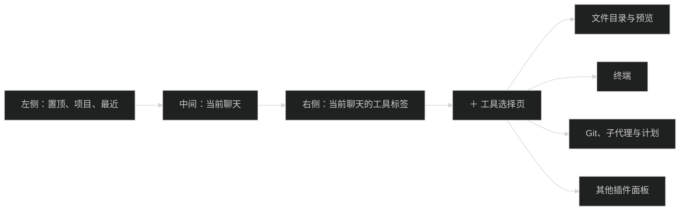
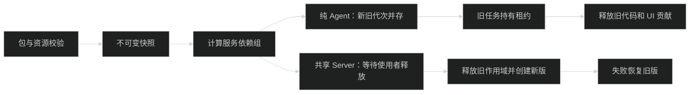

# App 插件开发

本文描述外部 App 插件。整体进程与内置模块见 [架构](architecture.md)，正式操作接口见 [HostApi v2](host-api.md)。

应用只安装 App 插件。模型配置、技能、插件、MCP 分别管理；Pi 是 Host 内部的会话引擎，不再扫描或导入用户的裸 Pi 扩展、原生 Pi 包、`resources.extensions`。内置模块静态装配，不能从插件列表停用。

插件能力可组合，不需要为每个方向另设一种包格式：

| 开发方向     | 可做的功能                                         | 入口与位置                    |
| ------------ | -------------------------------------------------- | ----------------------------- |
| Agent 与会话 | 工具、命令、运行前上下文、提问、自定义消息         | `agent`，按会话选择           |
| 会话界面     | 工具卡片、消息卡片、输入区和消息操作               | `ui` 的 contributions         |
| 工作区工具   | 文件树、预览、终端、Git 查询                       | `ui` 的 panels，调用 HostApi  |
| App 集成     | Host 后台服务、项目和任务操作、插件间服务          | `server` 与 HostApi           |
| 主题与资源   | 颜色、字体、间距、圆角、透明度、背景图片、附带技能 | `resources`，可以没有代码入口 |

插件页分“个人”和“系统”。变更、文件、终端是系统插件，始终启用，不能通过插件接口停用、卸载或更新。用户安装的 App 插件属于个人。“添加 → 创建插件”会在当前对话插入系统技能 Plugin Creator，并填入“帮我创建一个插件”；源码默认写到当前工作区，安装后才出现在个人列表。文件与终端源码在 `packages/file-directory`、`packages/terminal`。可安装的主题示范在 `plugins/theme-landscape`。系统技能正文在 [pi/skills/plugin-creator](../pi/skills/plugin-creator/SKILL.md)。

## 包格式与构建

包身份使用 `package.json` 的 `name` 和 `version`。SDK 只接受 `sdkVersion: 2`，不加载 SDK v1 入口。

```json
{
  "name": "my-workspace-plugin",
  "version": "1.0.0",
  "type": "module",
  "piMeme": {
    "sdkVersion": 2,
    "display": { "name": "工作区工具" },
    "server": "dist/server/chord-facets.json",
    "agent": "dist/agent/entry.js",
    "ui": "dist/ui/entry.js",
    "resources": {
      "skills": ["skills/review"],
      "themes": ["themes/dark.json"],
      "assets": ["assets"]
    }
  }
}
```

仅声明实际使用的入口。Server 指向 Chord 构建清单 `chord-facets.json`，Agent/UI 指向 `.js`；源码入口仍是 `src/server/entry.ts`、`src/agent/entry.ts`、`src/ui/entry.tsx`。DevKit 固定使用示例中的三个输出路径，见 [build.ts](../packages/plugin-devkit/src/build.ts)。

路径必须在包内，不接受 `..`、绝对路径、通配符和重复项。技能目录包含 `SKILL.md`。纯主题插件可以只有 `package.json`、主题 JSON 和图片，不需要 `dist`。完整校验见 [manifest.ts](../packages/plugin-sdk/src/manifest.ts) 与 [package.ts](../packages/plugin-runtime/src/package.ts)。

在仓库根目录执行：

```sh
pnpm exec tsx packages/plugin-devkit/src/cli.ts create /tmp/my-plugin my-plugin
pnpm --dir /tmp/my-plugin install --ignore-scripts
pnpm exec tsx packages/plugin-devkit/src/cli.ts build /tmp/my-plugin
pnpm exec tsx packages/plugin-devkit/src/cli.ts validate /tmp/my-plugin
pnpm exec tsx packages/plugin-devkit/src/cli.ts pack /tmp/my-plugin /tmp/my-plugin.pim
```

命令定义见 [cli.ts](../packages/plugin-devkit/src/cli.ts)。`create` 要求目标目录尚不存在，模板的 SDK 开发依赖链接到当前仓库；移动目录后需修正 link 路径。DevKit 不安装依赖、不执行安装脚本。

DevKit 分别构建 Node 与浏览器产物。UI 使用宿主 React；CSS 导入得到字符串，需要由插件插入并在释放时移除。主题 JSON 本身不执行 CSS 或 JavaScript。

插件页上传 `.pim`；开发者可从所属 Host 加载构建目录并重新加载。上传和目录安装都会生成不可变快照。目录重新加载读取原开发目录；上传包更新需要重新上传 `.pim`。

示范构建与打包：

```sh
pnpm --filter @pi-meme/theme-landscape run pack
```

主题包输出为 `plugins/theme-landscape/dist/plugin.pim`。

## Agent 入口

入口导出 `activate(context)`，类型见 [agent.ts](../packages/plugin-sdk/src/agent.ts)。适配层在内部调用 Pi SDK；插件不接收 `ExtensionAPI`、会话池、凭据或安全策略对象。

```ts
import type { AgentPluginContext } from '@pi-meme/plugin-sdk/agent'

export function activate(context: AgentPluginContext) {
  context.tools.register({
    name: 'current_time',
    title: '读取时间',
    description: '返回 UTC 时间。',
    parameters: { type: 'object', properties: {}, additionalProperties: false },
    execute: () => ({ text: new Date().toISOString() }),
  })
  context.hooks.on('beforeRun', () => ({ context: '报告时间时注明 UTC。' }))
  context.commands.register({
    name: 'plugin-help',
    description: '查看插件说明',
    execute: () => context.interaction.notify('使用 current_time 读取时间'),
  })
}
```

工具返回 `{ text, data? }`，`data` 必须可序列化为 JSON。执行参数包含 `session`、`run` 与取消 `signal`。生命周期事件是 `sessionStart`、`sessionEnd`、`beforeRun`、`runStart`、`runEnd`。`hooks.on` 返回释放函数，其他资源用 `onDispose` 注册清理。

`interaction.request(questions, signal)` 使用图形多题表单；问题格式见 `packages/contracts/src/user-input.ts`。通知使用 `notify`，状态使用 `setStatus`。`messages.emit({ type, text, data? })` 保存自定义消息；内部类型包含插件身份，图形投影恢复插件声明的类型。

新会话默认选择空 Agent 插件列表。输入区可以选择当前会话插件并保存新会话默认值。Host 层也可用 `sessions.configure(ref, { agentPlugins }, options)` 和 `plugins.setDefaultAgentPlugins(ids, options)`。运行中的会话不能修改插件选择；子代理继承父任务的插件代次与权限。安装 UI 或主题插件不要求选择 Agent。

Agent 权限与插件安装状态分开处理。当前外部 Agent 入口只在完全权限的普通任务加载；计划模式和受限任务保留内置读取、提问、协作、计划与权限检查。插件安装不会把任务改成完全权限。

## UI 面板与贡献

入口导出 `activate(context)`，可返回释放函数，类型见 [ui.ts](../packages/plugin-sdk/src/ui.ts)。`context.host` 是 HostApi，`context.call` 只调用本插件命名空间的 Server 操作；`reactive.getSnapshot/subscribe` 提供当前目标和会话投影。

```tsx
import { Folder } from 'lucide-react'
import type { UiPluginContext } from '@pi-meme/plugin-sdk/ui'

export function activate(context: UiPluginContext) {
  return context.panels.register({
    id: `${context.pluginId}:overview`,
    title: '项目概览',
    icon: <Folder size={18} />,
    location: 'right',
    scope: 'project',
    render: ({ target }) => <p>项目：{target.project?.projectId}</p>,
  })
}
```

示例使用 `lucide-react`，插件需自行声明该依赖；UI 构建将它打包，React 继续使用宿主提供的版本。

| 接口                     | 可选位置                                                                                        |
| ------------------------ | ----------------------------------------------------------------------------------------------- |
| `panels.register`        | 仅 `right`                                                                                      |
| `contributions.register` | `composer`、`composer-actions`、`tool-card`、`message`、`message-actions`、`status`、`settings` |

左侧只保留置顶、项目、最近，中间固定聊天。所有工具面板只在当前聊天的右侧栏显示，不接受左侧、中央或底部位置。右侧顶栏提供可关闭标签、“＋”工具选择页、加宽与收起；收起保留当前标签，关闭最后一个标签后收起。标签与宽度按 Host、会话保存；不支持拖拽停靠。`scope` 是 `app`、`project` 或 `session`，缺少对应目标时隐藏。`panels.open(id)` 只能打开本插件已登记的面板。切换目标时读取新的 `target`；异步结果需检查它仍属于发起请求时的目标。

贡献 ID 以 `${pluginId}:` 开头。工具卡片声明 `match.toolName`，自定义消息声明 `match.customType`。消息、消息操作和工具卡片按运行时真实 `ownerId`、`generation` 与类型匹配；插件不能声明另一个插件的来源。没有对应贡献时保留普通文字和工具详情。



## Host 服务

Server 源码入口导出 `create(context)`。可用字段见 [server.ts](../packages/plugin-sdk/src/server.ts)：

- `host`：显式 ProjectRef/SessionRef 的 HostApi。
- `dataDirectory`：插件自己的持久数据目录，卸载默认保留。
- `registerHandlers`：操作名称以 `${pluginId}:` 开头。
- `provide/services.require`：只使用 manifest 声明的插件间服务。
- `onDispose`：关闭订阅、计时器、连接和文件句柄。

外部 Server 不能取得内置 Store、PiSessionPool 或 DesktopBridge，不登记 `host.*`、`agent.*` 内部服务依赖。插件间 `requires/provides` 只描述外部服务依赖，App 操作使用 `context.host`。

文件、终端和 Git 面板调用 HostApi，使用显式目标并先检查能力。文件大小、修订冲突、PTY 输出缓冲与关闭规则统一见 [文件与终端](host-api.md#文件与终端)，认证与远程连接见 [Remote](remote.md)。

## 结构化主题

主题字段定义见 [settings.ts](../packages/contracts/src/settings.ts)，可安装的完整示例见 [landscape.json](../plugins/theme-landscape/themes/landscape.json)。下例省略 `colors/fonts`，只展示标识、布局与背景字段：

```json
{
  "id": "landscape",
  "name": "山色",
  "appearance": "dark",
  "tokens": { "spacing": 1, "radius": 10, "surfaceOpacity": 0.82 },
  "background": {
    "image": "assets/landscape.png",
    "area": "workspace",
    "fit": "cover",
    "position": "center",
    "opacity": 0.35,
    "overlay": "#16202b",
    "blur": 0
  }
}
```

`spacing` 范围 0.5–2，`radius` 范围 0–24，`surfaceOpacity` 范围 0.4–1。背景位置支持 `app/workspace/sidebar`，填充支持 `cover/contain`，锚点支持 `center/top/bottom`，透明度 0–1，模糊 0–32。

图片必须在 `resources.assets` 中声明，支持 PNG、JPEG、WebP、AVIF，最大 8 MiB；主题 JSON 最大 256 KiB。拒绝远程 URL、SVG、CSS 和脚本字段。Host 生成绑定插件代次的认证资源地址。安装前校验失败保留旧版；停用或卸载后使用内置主题；重启恢复仍有效的主题选择。

外观页可调背景透明度、模糊、间距、圆角与表面透明度。单文件 JSON 导出包含颜色、字体和布局；背景资源通过 `.pim` 分发，不放进单文件主题导入。

## 释放与更新



Chord 1.1 的 `reload` 只替换已有相同服务 shape 的 facet；安装、卸载和依赖变化通过独立作用域完成。PluginManager 按 `requires/provides` 组装连通依赖组，每组持有独立 Chord host 和释放作用域：

- 纯 Agent 版本可共存，新任务使用新代次，旧任务持有原租约直到结束。
- 共享 Server 组切换先阻止新调用，等待相关任务、工具、子代理和未答交互释放，再释放旧资源并创建新版。
- 服务调用单独持有引用；Git、历史查询等服务更新不等待无关 Agent 会话。
- UI 贡献绑定插件来源与代次，无关服务组和 UI 贡献继续使用现有版本。
- 初始化失败重建上一版作用域，持久化失败不先撤销旧版；必需服务的唯一提供者不能直接停用。

Server 产物使用 Chord fresh VM loader，释放后丢弃模块引用，不通过累加 ESM query 参数重载。不可变代码快照没有引用后才回收；卸载默认保留插件数据和 Pi 会话。

启动恢复失败只隔离相关外部组，内置模块初始化失败中止启动。安装清单无法解析时保留 `installed.json`，本次不加载外部项并报告诊断；内置身份冲突不能删除源目录或用户数据。恢复边界见 [external-recovery.test.ts](../packages/plugin-runtime/tests/external-recovery.test.ts)。

插件是可信 Host 代码，不是恶意代码沙箱。Pi 和 Host 二进制升级随应用发布，不能通过插件热更新。

源码与测试：[插件管理器](../packages/plugin-runtime/src/manager.ts)、[释放作用域](../packages/plugin-sdk/src/scope.ts)、[运行时测试](../packages/plugin-runtime/tests/)、[Host 内置边界测试](../packages/host/tests/builtin-modules.test.ts)。
