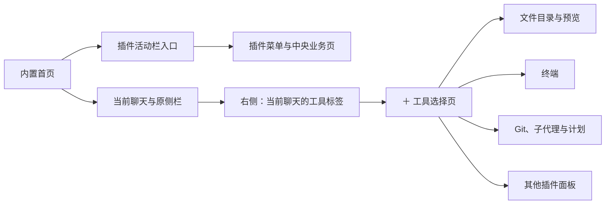
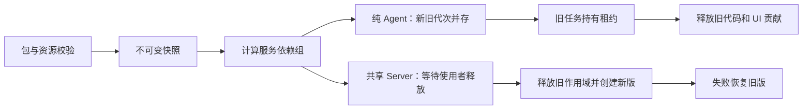

# App 插件开发

本文描述外部 App 插件。整体进程与内置模块见 [架构](architecture.md)，正式操作接口见 [HostApi v2](host-api.md)。

应用只安装 App 插件。模型配置、技能、插件、MCP 分别管理；Pi 是 Host 内部的会话引擎，不再扫描或导入用户的裸 Pi 扩展、原生 Pi 包、`resources.extensions`。内置模块静态装配，不能从插件列表停用。

插件能力可组合，不需要为每个方向另设一种包格式：

| 开发方向     | 可做的功能                                             | 入口与位置                                      |
| ------------ | ------------------------------------------------------ | ----------------------------------------------- |
| Agent 与会话 | 工具、命令、运行前上下文、提问、自定义消息             | `agent.trusted/restricted`，按会话选择          |
| 会话界面     | 输入框事务、发送前处理、工具与消息卡片、统一消息动作   | `ui` 的 composer、contributions、messageActions |
| 业务页面     | 活动栏入口、分组菜单、中央页面与 App 内历史            | `ui` 的 pages、navigation                       |
| 工作区工具   | 文件树、预览、终端、Git 查询                           | `ui` 的 panels，调用 HostApi                    |
| App 集成     | 可信 Host 服务、受限 handler、同插件 RPC、命名共享数据 | `server.trusted/restricted`                     |
| 主题与资源   | 颜色、字体、间距、圆角、透明度、背景图片、附带技能     | `resources`，可以没有代码入口                   |

插件页分“个人”和“系统”。变更、文件、终端是系统插件，始终启用，不能通过插件接口停用、卸载或更新。用户安装的 App 插件属于个人。“添加 → 创建插件”会在当前对话插入系统技能 Plugin Creator，并填入“帮我创建一个插件”；源码默认写到当前工作区，安装后才出现在个人列表。文件与终端源码在 `packages/file-directory`、`packages/terminal`。可安装的主题示范在 `plugins/theme-landscape`。系统技能正文在 [pi/skills/plugin-creator](../pi/skills/plugin-creator/SKILL.md)。

## 包格式与构建

包身份使用 `package.json` 的 `name` 和 `version`。外部插件只接受 `sdkVersion: 3`。SDK 2 安装记录保留并显示升级诊断，不运行旧 JS、不删除插件数据或会话。SDK 版本与 HostApi 版本无关，正式 HostApi 仍为 v2。

```json
{
  "name": "my-workspace-plugin",
  "version": "1.0.0",
  "type": "module",
  "piMeme": {
    "sdkVersion": 3,
    "display": { "name": "工作区工具" },
    "server": {
      "trusted": "dist/server/chord-facets.json",
      "restricted": "dist/server/restricted.js"
    },
    "agent": {
      "trusted": "dist/agent/entry.js",
      "restricted": "dist/agent/restricted.js"
    },
    "ui": "dist/ui/entry.js",
    "permissions": {
      "restricted": {
        "maxAccess": "read-only",
        "capabilities": ["workspace.read", "sharedData.read"],
        "sharedData": ["catalog"]
      },
      "ui": ["reactive.read", "messages.read", "navigation.pages"]
    },
    "resources": {
      "skills": ["skills/review"],
      "themes": ["themes/dark.json"],
      "assets": ["assets"]
    }
  }
}
```

仅声明实际使用的入口。可信 Server 指向 Chord 清单 `chord-facets.json`；受限 Server、两种 Agent 和 UI 指向独立 `.js`。可信源码是 `src/server/entry.ts`、`src/agent/entry.ts`，受限源码是 `src/server/restricted.ts`、`src/agent/restricted.ts`，UI 是 `src/ui/entry.tsx`。DevKit 使用示例中的固定输出路径，见 [build.ts](../packages/plugin-devkit/src/build.ts)。可信与受限入口不能指向同一产物。

`permissions` 是申请，不是授权。可信 UI、Server、Agent 分别确认；受限能力、网络、共享数据、UI 能力及每个发送前处理器分别授权。更新代码或申请范围后不能继续沿用不匹配的旧授权。授权类型见 [permissions.ts](../packages/plugin-sdk/src/permissions.ts)。

路径必须在包内，不接受 `..`、绝对路径、通配符和重复项。技能目录包含 `SKILL.md`。纯主题插件可以只有 `package.json`、主题 JSON 和图片，不需要 `dist`。完整校验见 [manifest.ts](../packages/plugin-sdk/src/manifest.ts) 与 [package.ts](../packages/plugin-runtime/src/package.ts)。

在仓库根目录执行：

```sh
pnpm exec tsx packages/plugin-devkit/src/cli.ts create /tmp/my-plugin my-plugin
pnpm exec tsx packages/plugin-devkit/src/cli.ts check /tmp/my-plugin
pnpm exec tsx packages/plugin-devkit/src/cli.ts build /tmp/my-plugin
pnpm exec tsx packages/plugin-devkit/src/cli.ts validate /tmp/my-plugin
pnpm exec tsx packages/plugin-devkit/src/cli.ts pack /tmp/my-plugin /tmp/my-plugin.pim
```

命令定义见 [cli.ts](../packages/plugin-devkit/src/cli.ts)。`create` 要求目标目录尚不存在，生成工程内的 `.pi-meme-devkit/`、SDK、TypeScript 配置和 npm scripts；移动工程时一起保留工具目录。DevKit 不安装依赖、不执行安装脚本。

初始化可指定 `--agent none|restricted|trusted|both`、`--server none|restricted|trusted|both`、`--ui none|panel|page`、`--resources skills,themes,assets` 和 `--display-name <名称>`。提供任一能力选项后，未选能力不生成；不传能力选项保留时钟示例。纯页面使用 `--ui page`，纯主题使用 `--resources themes`。`doctor` 检查当前 Node、平台与随附编译器；`check` 检查源码类型、导出、资源和包内技能格式，`validate` 检查真实构建产物。

应用内 Plugin Creator 使用随技能分发的 `scripts/plugin.mjs`，不要求用户持有本仓库。Node.js 最低版本为 22.19.0。工程生成后，在工程目录运行 `npm run type-check`、`npm run build`、`npm run validate`、`npm run pack`，默认在上级目录输出 `.pim`；额外业务依赖需要由开发者明确提供。

构建时会准备对应平台的工具包和 SDK 类型；Server 开发启动也会准备技能工具。直接运行源码 Host 前，可在仓库执行 `pnpm exec tsx scripts/prepare-plugin-tools.mts`。工具包不进入插件 `.pim`。工程的工具产物位于 `.pi-meme-devkit/dist/`，重新检出或工具缺失时运行系统技能的 `scripts/plugin.mjs prepare <插件目录>` 恢复；该命令不重建业务源码和配置。SDK 与 React 声明为宿主提供的可选 peer，基础模板无需从 npm 安装私有 SDK。

DevKit 分别构建 Node 与浏览器产物。UI 使用宿主 React；CSS 导入得到字符串，需要由插件插入并在释放时移除。主题 JSON 本身不执行 CSS 或 JavaScript。

插件页上传 `.pim`；开发者可从所属 Host 加载构建目录并重新加载。上传和目录安装都会生成不可变快照。目录重新加载读取原开发目录；上传包更新需要重新上传 `.pim`。

示范构建与打包：

```sh
pnpm --filter @pi-meme/theme-landscape run pack
```

主题包输出为 `plugins/theme-landscape/dist/plugin.pim`。

### 受限 Node 运行时

Node 属于应用，不随每个插件打包。Desktop 正式版使用 asar 外的 `Resources/runtime/bin/node` 与 `restricted-entry.mjs`，同目录包含 Node `LICENSE` 和 `runtime.json`。官方版本来自 [release.mts](../scripts/release.mts) 的 `nodeVersion`；[node-runtime.mts](../scripts/node-runtime.mts) 下载官方归档并按精确 SHASUMS 项验证 SHA256，Host 分发和 Desktop 共用这一个准备函数。Desktop 不使用 Electron RunAsNode 或用户 PATH 中的 Node。

开发态 Desktop 需要先明确准备运行时。在仓库根目录执行；第一条会下载官方 Node 资源，不运行插件：

```sh
node --import tsx --input-type=module -e "import { prepareNodeRuntime } from './scripts/node-runtime.mts'; await prepareNodeRuntime('out/plugin-runtime')"
PI_MEME_PLUGIN_NODE="$PWD/out/plugin-runtime/bin/node" PI_MEME_PLUGIN_ENTRY="$PWD/out/plugin-runtime/restricted-entry.mjs" pnpm start
```

独立 Node Host 默认使用自身运行时，也可用相同环境变量显式指定准备好的资源。缺少运行时或平台隔离能力时拒绝受限插件，不改用 Electron 可执行文件或无沙箱模式。应用签名后的 Node/JIT、Fuse 与沙箱需在目标产物验收，源码构建不表示 macOS 产物已通过。

## Agent 入口

入口导出 `activate(context)`，类型见 [agent.ts](../packages/plugin-sdk/src/agent.ts)。适配层在内部调用 Pi SDK；插件不接收 `ExtensionAPI`、会话池、凭据或安全策略对象。

```ts
import type { AgentPluginContext } from '@pi-meme/plugin-sdk/agent'

export function activate(context: AgentPluginContext) {
  context.tools.register({
    name: 'current_time',
    title: '读取时间',
    description: '返回 UTC 时间。',
    parameters: { type: 'object', properties: {}, additionalProperties: false },
    effect: 'read',
    capabilities: [],
    execute: () => ({ text: new Date().toISOString() }),
  })
  context.hooks.on('beforeRun', () => ({ context: '报告时间时注明 UTC。' }))
  context.commands.register({
    name: 'plugin-help',
    description: '查看插件说明',
    execute: () => context.interaction.notify('使用 current_time 读取时间'),
  })
}
```

工具返回 `{ text, data? }`，`data` 必须可序列化为 JSON。执行参数包含 `session`、`run` 与取消 `signal`。生命周期事件是 `sessionStart`、`sessionEnd`、`beforeRun`、`runStart`、`runEnd`。受限入口的 `sessionStart` 每个物理实例启动时执行一次；正常关闭前执行 `sessionEnd` 与 `onDispose`，生命周期处理最多等待 1 秒。强制撤权直接终止进程，不等待不可信清理。初始化及无 run 的生命周期不取得业务 broker scope，不能在其中发起 Server、HTTP、共享数据或提问操作。`hooks.on` 返回释放函数，其他资源用 `onDispose` 注册清理。

`interaction.request(questions, signal)` 使用图形多题表单；问题格式见 `packages/contracts/src/user-input.ts`。通知使用 `notify`，状态使用 `setStatus`。`messages.emit({ type, text, data? })` 保存自定义消息；内部类型包含插件身份，图形投影恢复插件声明的类型。

新会话默认选择空 Agent 插件列表；Host 可通过 `plugins.setDefaultAgentPlugins(ids, options)` 修改后续会话的默认列表。输入 `/` 后，顶部保留命令，下面分“技能”“插件”；插件分类只列当前项目可用且具有 Agent 入口的已安装插件。选择插件通过 `sessions.configure(ref, { agentPlugins }, options)` 保存到当前会话，成功后在编辑器内显示图标与名称，不显示额外启用说明或插件管理区。同一草稿内重复选择不重复插入，删除未发送的行内引用取消会话选择。发送后清空输入框中的插件引用，但不清除会话配置；后续消息持续使用所选插件，不重新渲染旧引用。待发送引用只以插件 ID 随本地草稿保存，发送失败随草稿恢复，不写入消息正文，也不能通过恢复草稿自动启用插件。运行中不能修改插件选择，保存期间阻止发送但允许继续编辑正文。子代理继承父任务的插件代次与权限。安装 UI 或主题插件不要求选择 Agent。

安装、项目可用策略、会话选择和能力授权分别校验。`agent.trusted` 只在完全权限普通任务中、取得可信 Agent 授权后加载；Plan、read-only 和 workspace-write 使用获准的 `agent.restricted`。restricted-only 插件在完全权限任务中仍受插件上限约束，不会自动成为可信 Node。Plan 限定只读能力，禁止业务写入和可信 Server 跳转。选择的插件不可用时必须说明原因，不能静默少加载后继续。插件安装不会提升任务权限。

受限入口使用独立进程和 OS 沙箱，不能在会话 Worker 中导入。工具的 `effect/capabilities` 用于检查和分派，不能代替 OS 限制。受限进程可能在任务结束或权限改变后重建；初始化和释放应可重复执行，不依赖进程内变量跨任务永久存在。受限工具和命令需显式声明 `effect` 与 `capabilities`，缺少所需元数据时不会进入有效工具列表。具体能力与平台边界见[配置与安全](configuration.md#插件执行与授权)。

## UI 面板与贡献

入口导出 `activate(context)`，可返回释放函数，类型见 [ui.ts](../packages/plugin-sdk/src/ui.ts)。可信 UI 授权在导入模块前检查。`context.host` 是 HostApi；同插件 Server 通信使用 `context.server.call`，SDK 3 不保留 `context.call`。

UI 是宿主同源可信 React 代码，不是恶意代码沙箱。正式能力接口检查 manifest 和用户 grant；不要把这层检查解释为隔离任意 DOM、网络或同源代码。

```tsx
import { Folder } from 'lucide-react'
import type { UiPluginContext } from '@pi-meme/plugin-sdk/ui'

export function activate(context: UiPluginContext) {
  return context.panels.register({
    id: `${context.pluginId}:overview`,
    title: '项目概览',
    icon: <Folder size={18} />,
    location: 'right',
    scope: 'project',
    render: ({ target }) => <p>项目：{target.project?.projectId}</p>,
  })
}
```

示例使用 `lucide-react`，插件需自行声明该依赖；UI 构建将它打包，React 继续使用宿主提供的版本。

| 接口                                    | 可选位置                                                                     |
| --------------------------------------- | ---------------------------------------------------------------------------- |
| `panels.register`                       | 仅 `right`                                                                   |
| `contributions.register`                | `composer`、`composer-actions`、`tool-card`、`message`、`status`、`settings` |
| `messageActions.register`               | user、assistant、tool、custom 四类消息的宿主动作菜单                         |
| `pages.register`、`navigation.register` | 插件自己的中央业务页与活动栏入口                                             |

首页聊天保留原来的置顶、项目、最近列表与聊天实现。插件可注册自己的活动栏入口、次级菜单和中央业务页，但不能替换内置首页、项目、插件管理、设置或聊天。工具面板统一注册为 `right`，不接受左侧、中央或底部位置。分栏模式在当前聊天右侧显示；完整视图由应用将当前会话与工具合并为顶栏标签，选中的工具使用整个内容区。右侧顶栏提供可关闭标签、“＋”工具选择页与收起，栏宽通过拖拽边界调整；完整视图保留工具标签与选择页，左侧会话列表可独立开关，退出时恢复分栏宽度；分栏模式收起时保留当前标签，关闭最后一个工具标签后收起；完整视图关闭最后一个工具后回到聊天。顶栏“进入完整视图”按钮或 `Mod+Shift+F` 切换布局，模式保存在客户端本地。标签与宽度按 Host、会话保存；不支持拖拽停靠。`scope` 是 `app`、`project` 或 `session`，缺少对应目标时隐藏。`panels.open(id)` 只能打开本插件已登记的面板。切换目标时读取新的 `target`；异步结果需检查它仍属于发起请求时的目标。

贡献 ID 以 `${pluginId}:` 开头。工具卡片声明 `match.toolName`，自定义消息声明 `match.customType`。正文卡片按运行时真实 `ownerId`、`generation`、代码快照 `policyHash` 与类型匹配；插件不能渲染另一个插件的正文。没有对应贡献时保留普通文字和工具详情。SDK 3 删除旧 `message-actions` render 槽，消息操作改用单独的 typed API，见下节。



## 输入框与发送前处理

[composer.ts](../packages/plugin-sdk/src/composer.ts) 定义 `context.composer`。`current()` 返回当前可见输入框的 `ComposerView`，没有可见输入框时返回 `null`；从中取得 `ref` 和 `revision` 后再调用操作。读取新聊天草稿不创建会话。切 Host、会话、编辑对象或离开聊天后，旧 `ref.epoch` 失效。

| 操作                                                  | 用途与边界                                                   |
| ----------------------------------------------------- | ------------------------------------------------------------ |
| `getSnapshot/subscribe`                               | 读取和订阅 document、选区、附件状态、提交状态与处理器        |
| `apply(ref, { expectedRevision, steps, selection? })` | 原子替换文档范围或移除已有附件；CAS 冲突返回 `stale-draft`   |
| `focus`                                               | 聚焦当前有效输入框，不接受 DOM 节点                          |
| `addAttachments/cancelAttachment`                     | 走宿主上传队列，绑定输入框目标；不接受 Host 文件路径         |
| `selectAgentPlugin/removeAgentPlugin`                 | 走现有会话配置流程，不把插件选择当普通文本改写               |
| `submit(ref, { expectedRevision })`                   | 用户确认后进入现有提交守卫，返回本地投递状态，不代表任务完成 |
| `beforeSend.register`                                 | 登记默认不执行、需要单独开启的发送前处理器                   |

文档由 `text/skill/agent-plugin` fragment 组成；偏移是 UTF-16 code unit，技能和插件 token 宽度为 1。技能引用按真实 ID/revision 校验。替换非空整份草稿需要宿主确认；不能借文档替换悄悄启用 Agent、改变模型、权限或模式。IME 组合输入期间拒绝外部改写和发送。

申请能力在 `permissions.ui` 中分别声明 `composer.read/write/attachments/submit/before-send`。处理器的局部 ID 还要列入 `permissions.beforeSend`，并在插件详情中逐项开启。例如：

```ts
context.composer.beforeSend.register({
  id: 'check-empty',
  title: '检查空白内容',
  process({ draft }) {
    return draft.document.some((part) => part.kind !== 'text' || part.text.trim())
      ? { kind: 'pass' }
      : { kind: 'block', reason: '正文不能为空白。' }
  },
})
```

处理器接收捕获的候选输入副本，可 `pass`、`replace` 或 `block`，不直接修改真实草稿。默认只处理普通消息，历史和队列编辑需显式声明 `intents`。附件只能选择、移除或重排当前已有 ready 引用，不能在处理器中上传 Blob、添加附件或构造路径。执行顺序为 `order → pluginId → hookId`。

单处理器超时 10 秒，整次处理 30 秒。异常、超时和 block 都停止发送，输入区提供重试、查看草稿、仅本次跳过；跳过不改变长期授权。用户改稿、切页、切目标、变更权限或授权代次时取消旧处理，不补发迟到结果。原生发送与 SDK 提交共用 guard；普通运行中发送仍使用原有 followUp 语义。同线程 UI 死循环不能靠 Promise 超时隔离。

实现入口：[plugin-composer-adapter.ts](../packages/app-ui/src/plugins/plugin-composer-adapter.ts)、[composer-state.ts](../packages/chat/src/ui/composer/composer-state.ts)、[composer-submit.ts](../packages/chat/src/ui/composer/composer-submit.ts)。中文 IME、原生 undo 与焦点仍需真实浏览器交互验证，不能仅以 reducer 测试证明。

## 消息数据与统一动作

公共投影见 [plugin-ui-data.ts](../packages/contracts/src/plugin-ui-data.ts)。`MessageRef = { session, entryId }` 使用 Pi 原生条目 ID，不以时间戳、数组下标或聚合回复虚构 ID。流式消息保留 transient ID；压缩、分支摘要等 display-only 内容没有可操作 MessageRef。

`context.reactive` 需要 `reactive.read`，提供 `getSnapshot/subscribe`、`metadata`、`select(selector, equality?)` 和单条消息元数据订阅。`select` 返回可直接传给 `useSyncExternalStore` 的 ExternalStore，默认比较为 `Object.is`。状态包含目标及 epoch、当前视图、连接、会话执行状态与最近 100 条消息索引；消息索引包含来源、代次、角色、类型、工具状态、原生引用和内容修订。

正文需要 `messages.read`，通过 `reactive.body(id)` 或 `context.messages.body(ref)` 单独订阅；`messages.getMessage(ref)` 查一条，`messages.page(session, input)` 分页读取。正文投影提供可见 `text`、结构化 JSON `data` 和图片元数据，不提供隐藏 thinking、展开的技能全文、原始 Pi 对象、图片 base64 或凭据。数据源直接订阅 ChatStream；流式正文最多每 rAF 通知一次，终态立即通知，不依赖 App render。

Host 查询与游标规则见 [消息查找与分页](host-api.md#消息查找与分页)。实现见 [plugin-ui-data-source.ts](../packages/app-ui/src/plugins/plugin-ui-data-source.ts) 和 [reactive.ts](../packages/plugin-sdk/src/reactive.ts)。

`context.messageActions.register` 需要 `messages.actions`；执行还需 `messages.read`。插件声明 title、match、可选同步 `isEnabled` 和 `execute`，宿主负责菜单、禁用原因、局部 busy、取消与错误，不再接受任意动作区 `render`。

```ts
context.messageActions.register({
  id: `${context.pluginId}:inspect`,
  title: '查看消息引用',
  match: { roles: ['user', 'assistant', 'tool', 'custom'], source: 'any' },
  execute({ subject }) {
    console.info(subject.refs)
  },
})
```

`source: 'self'` 只匹配本插件来源，`any` 可匹配主会话四类已持久消息。assistant 最终回复保留多个真实 refs，`displayedText` 对应用户看到的回复。默认不操作当前流式或合成消息；运行中和 Plan 仍可读取历史完成消息。工具动作在摘要行独立显示，不要求展开详情，错误工具也可操作。正文 renderer 的 ownerId/generation 限制不因此放宽。

子 Agent 的独立只读视图尚无正式 `SessionRef`，不会借用根会话生成消息引用。该视图不调用插件消息动作和工具、自定义消息的富 renderer，仍保留原生正文、工具详情和复制。后续提供明确的子会话引用契约后才能扩展这些入口。

动作捕获当时主体、revision、target 与插件代次，不追随后来选中的聊天。页面和动作拿到的 Host 门面对写操作展示实际参数并请求确认。SDK 不新增 `messages.update/delete/replayTool`。类型见 [message-actions.ts](../packages/plugin-sdk/src/message-actions.ts)，实现见 [plugin-message-actions.tsx](../packages/app-ui/src/plugins/plugin-message-actions.tsx)。

## 插件业务页面

页面与活动栏入口分开注册，需要 `navigation.pages`。每插件最多一个活动栏入口，菜单只支持一层分组与页面链接；纯主题、Agent 或 Server 插件不会出现空入口。

```tsx
context.pages.register({
  id: `${context.pluginId}:overview`,
  title: '项目概览',
  scope: 'project',
  render: ({ target }) => <p>项目：{target.project?.projectId}</p>,
})
context.navigation.register({
  title: '项目工具',
  defaultPageId: `${context.pluginId}:overview`,
  groups: [{ id: 'workspace', items: [{ id: 'overview', pageId: `${context.pluginId}:overview` }] }],
})
```

ID、默认页和菜单引用必须属于本插件。activate 完成后统一校验，允许先登记菜单再登记页面；重复标识、非法 scope 或悬空引用使候选整体失败，旧注册继续使用。页面 scope 为 `app/project/session`，缺目标禁用，不自动建会话或切换聊天。

`navigation.openPage(pageId, { target?, params? })` 捕获同 Host 目标；页面目标不会跟随后台聊天改变。页面 props 提供 `host/target/signal`，以及 `page.id/params/setParams/setUnsavedChanges`。参数是有界 JSON，不存正文、token 或秘密。`setParams` 替换当前历史项；前进/后退使用有限 App 内历史，不接浏览器 URL 或 popstate。

进入插件页保留原聊天、草稿、滚动、右栏和 PTY；首页返回原聊天，不创建新会话。仅当前插件页挂载，离开后 abort 页面请求。非聊天页调用 `panels.open` 返回 `not-chat-view`，不会偷偷切回聊天。

页面调用 `setUnsavedChanges(true)` 取得编辑租约，离开由宿主确认，保存完成后设为 false。clean 页面不持长期 Server 引用；Server 调用使用短租约，dirty 页固定旧代次保存。失联或续约失败后锁住旧页写入并提示保留内容，不能把旧表单发送给新版 Server。停用、卸载和页面移除会修剪失效入口与历史。

类型与实现：[navigation.ts](../packages/plugin-sdk/src/navigation.ts)、[plugin-ui-extensions.ts](../packages/app-ui/src/plugins/plugin-ui-extensions.ts)、[use-app-navigation.ts](../packages/app-ui/src/layout/use-app-navigation.ts)、[plugin-workspace-page.tsx](../packages/app-ui/src/layout/plugin-workspace-page.tsx)。插件 CSS 只作用自己的根并在释放时移除；这属于可信开发规范，不是 CSS 安全隔离。

## Host 服务

Server 源码入口导出 `create(context)`。可用字段见 [server.ts](../packages/plugin-sdk/src/server.ts)：

- `host`：显式 ProjectRef/SessionRef 的 HostApi。
- `dataDirectory`：插件自己的持久数据目录，卸载默认保留。
- `registerOperations`：登记本插件局部操作名、输入/输出 schema、audience、effect 和 capabilities。
- `sharedData.publish(key, value, { scope?, expectedRevision })`：显式发布有修订的命名 JSON 数据。
- `sharedData.getSnapshot(key, { scope? }?)`：可信 Server 读取本插件指定 scope 的当前快照与 revision；不存在时返回 `undefined`，返回值是独立副本。
- `provide/services.require`：只使用 manifest 声明的可信插件间服务。
- `onDispose`：关闭订阅、计时器、连接和文件句柄。

可信与受限 Server 都导出 `create(context)`；受限 Server 在受限进程中登记操作。受限 Server 没有完整 HostApi、可信服务对象或整个 `dataDirectory`。外部插件不取得内置 Store、PiSessionPool 或 DesktopBridge，不登记 `host.*`、`agent.*` 内部服务依赖。`requires/provides` 只用于可信外部 Server 服务依赖，App 操作使用可信入口的 `context.host`。

文件、终端和 Git 面板调用 HostApi，使用显式目标并先检查能力。文件大小、修订冲突、PTY 输出缓冲与关闭规则统一见 [文件与终端](host-api.md#文件与终端)，认证与远程连接见 [Remote](remote.md)。

### 同插件 RPC

UI 和 Agent 统一调用 `context.server.call<Result>('operation', json, { signal, target? })`。UI 调用需要获准的同代可信 Server，操作 audience 包含 `ui`；仅有受限 Server 的插件不会因此取得 UI 到受限 handler 的独立执行入口。operation 是局部名称，不加插件前缀、不接受跨插件名称。`defineOperation` 可关联输入/输出 TypeScript 类型，但泛型不能代替运行时 schema 校验。定义见 [rpc.ts](../packages/plugin-sdk/src/rpc.ts)。

```ts
context.registerOperations([
  {
    name: 'ping',
    inputSchema: { type: 'object', properties: {}, additionalProperties: false },
    outputSchema: { type: 'string' },
    audience: ['ui', 'agent'],
    effect: 'read',
    capabilities: [],
    execute: () => 'pong',
  },
])
```

调用绑定插件 ID、generation、捕获的代码快照 policyHash、真实来源、目标、权限与取消信号。缺少或不匹配 hash 的旧 UI 请求被拒绝，不按当前版本补齐来源。Agent 的目标取真实执行 scope，不接受插件自行改写 cwd；UI 可显式提供同 Host 目标。可信 Agent 只调用同代可信 Server，受限 Agent 只调用同 policy 的受限 handler；缺少受限 handler 返回不可用，不回退可信 Server。`effect` 不是可信函数的 OS 沙箱。

每次调用持短引用直到 handler 真正结束，不能 Promise 超时后提前销毁旧作用域。受限进程忽略取消时可终止进程；可信 handler 只能协作取消。写操作不自动重试，断线后可能结果不确定，不承诺副作用 exactly-once 或自动回滚。Host 接线见 [plugin-call-bridge.ts](../packages/host/src/plugin-call-bridge.ts)，schema 与操作检查见 [operation.ts](../packages/plugin-runtime/src/operation.ts)。

### 受限网络与共享数据

受限 context 只有窄接口，类型见 [restricted.ts](../packages/plugin-sdk/src/restricted.ts)。原始网络被沙箱禁止；HTTPS 请求必须通过 `http.request`，manifest 精确声明 network 的 `id/origin/methods` 并取得单独授权。Plan 只允许获准的 GET/HEAD；方法只读不保证远端服务无副作用。

[HTTPS broker](../packages/host/src/plugin-http-broker.ts) 拒绝本机、私网与其他禁止地址，重定向重新检查，不继承环境代理、Host Cookie 或模型凭据。`credentialRef` 用于插件专属、绑定 origin 的凭据，由 Host 注入，不提供向 runner 返回密钥的凭据读取接口。在插件详情录入 `Authorization` 凭据时只填 token，Host 自动添加 `Bearer ` 前缀；`X-Api-Key` 按录入值发送。远端响应仍会交给插件，授权前应确认该服务不会回显敏感请求头。请求失败、策略拒绝、超时与取消应按稳定错误区分，不输出密钥、请求正文或私有路径。

可信 Server 可通过 `sharedData.publish` 显式发布本插件的命名 JSON；受限入口用 `sharedData.read(key)` 读取获准记录与 revision。Server 重建后可用 `sharedData.getSnapshot` 恢复已发布记录的 revision，再以该值执行 CAS 发布；传入 scope 时只读该 scope，不回退全局记录。该 getter 只供可信 Server 的自身 Publisher 使用，不改变受限读取权限。记录目前只保存在 Host 内存，Host 重启后清空，需重新发布，不是持久数据库。`scope` 可指定 projectId；受限入口读取时先查真实执行项目的记录，再查同插件显式发布的全局记录，不跨项目读取。它不共享整个 plugin-data、数据库连接或任意文件句柄。发布者负责选择非机密内容，不得把网络凭据放进共享记录。

## 结构化主题

主题字段定义见 [settings.ts](../packages/contracts/src/settings.ts)，可安装的完整示例见 [landscape.json](../plugins/theme-landscape/themes/landscape.json)。下例省略 `colors/fonts`，只展示标识、布局与背景字段：

```json
{
  "id": "landscape",
  "name": "山色",
  "appearance": "dark",
  "tokens": { "spacing": 1, "radius": 10, "surfaceOpacity": 0.82 },
  "background": {
    "image": "assets/landscape.png",
    "area": "workspace",
    "fit": "cover",
    "position": "center",
    "opacity": 0.35,
    "overlay": "#16202b",
    "blur": 0
  }
}
```

`spacing` 范围 0.5–2，`radius` 范围 0–24，`surfaceOpacity` 范围 0.4–1。背景位置支持 `app/workspace/sidebar`，填充支持 `cover/contain`，锚点支持 `center/top/bottom`，透明度 0–1，模糊 0–32。

图片必须在 `resources.assets` 中声明，支持 PNG、JPEG、WebP、AVIF，最大 8 MiB；主题 JSON 最大 256 KiB。拒绝远程 URL、SVG、CSS 和脚本字段。Host 生成绑定插件代次的认证资源地址。安装前校验失败保留旧版；停用或卸载后使用内置主题；重启恢复仍有效的主题选择。

外观页可调背景透明度、模糊、间距、圆角与表面透明度。单文件 JSON 导出包含颜色、字体和布局；背景资源通过 `.pim` 分发，不放进单文件主题导入。

## 释放与更新



Chord 1.1 的 `reload` 只替换已有相同服务 shape 的 facet；安装、卸载和依赖变化通过独立作用域完成。PluginManager 按 `requires/provides` 组装连通依赖组，每组持有独立 Chord host 和释放作用域：

- 纯 Agent 版本可共存，新任务使用新代次，旧任务持有原租约直到结束。
- 共享 Server 组切换先阻止新调用，等待相关任务、工具、子代理和未答交互释放，再释放旧资源并创建新版。
- 服务调用单独持有引用；Git、历史查询等服务更新不等待无关 Agent 会话。
- UI 贡献绑定插件来源与代次，无关服务组和 UI 贡献继续使用现有版本。
- 初始化失败重建上一版作用域；普通更新的代次预留或持久化失败不先销毁旧服务、释放活租约。撤权、停用与卸载仍先立即拒绝旧调用，不等待普通更新排空；必需服务的唯一提供者不能直接停用。

`state/plugins.json`（旧版本为 `plugins/installed.json`）使用显式 schema envelope 保存全部安装记录和 safe-integer 代次高水位。先写临时文件并同步、原子 rename、同步父目录，确认预留成功后才导入候选代码；每次激活、恢复和回滚重建都分配新值，已消耗值不回退。损坏、未知 schema 或溢出时保留文件并拒绝新激活。旧数组只迁移存储格式，不因数组格式把 SDK 3 误认成 SDK 2，也不删除旧记录。迁移前无 hash 的消息保留文字与通用 JSON 数据，不交给新版富 renderer，不改写历史 JSONL。

Server 产物使用 Chord fresh VM loader，释放后丢弃模块引用，不通过累加 ESM query 参数重载。不可变代码快照没有引用后才回收；卸载默认保留插件私有数据（`plugins/data/`，详见 [数据目录与存储](storage.md)）和 Pi 会话。

启动恢复失败只隔离相关外部组，内置模块初始化失败中止启动。安装清单无法解析时保留 `state/plugins.json`（旧版本为 `installed.json`），本次不加载外部项并报告诊断；内置身份冲突不能删除源目录或用户数据。恢复边界见 [external-recovery.integration.test.ts](../packages/plugin-runtime/tests/external-recovery.integration.test.ts)。

可信 Server/Agent 是可信 Node 代码，UI 是可信同源代码；受限入口才使用独立进程和 OS 沙箱。撤权不能回滚已经发生的可信代码副作用；怀疑恶意插件时停用并重启 Host。Pi、Host 与受限 Node 运行时随应用发布，不能通过插件热更新。

源码与测试：[插件管理器](../packages/plugin-runtime/src/manager.ts)、[释放作用域](../packages/plugin-sdk/src/scope.ts)、[运行时测试](../packages/plugin-runtime/tests/)、[Host 内置边界测试](../packages/host/tests/builtin-modules.integration.test.ts)。
