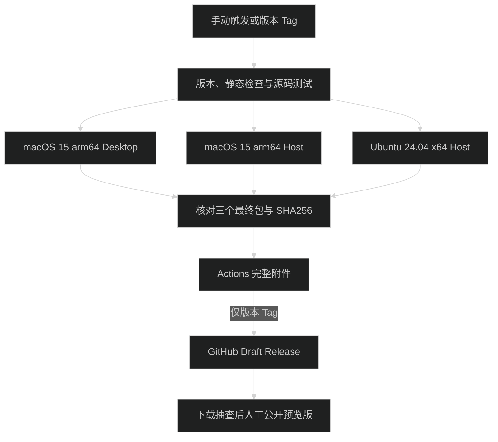

# 版本发布

本文说明当前发布配置，不表示远程 workflow、Linux 或从 GitHub 下载后的首次打开已经通过本次验收。用户安装步骤见[快速开始](getting-started.md#下载使用)。

## 平台与附件

首版应用版本为 `0.1.0-beta.1`，Tag 为 `v0.1.0-beta.1`，在 GitHub 标记 Pre-release。一个版本包含以下四个附件：

| 附件                                           | 用途与验收基线                        |
| ---------------------------------------------- | ------------------------------------- |
| `pi-meme-desktop-0.1.0-beta.1-macos-arm64.zip` | macOS 15 arm64 Desktop，包含本机 Host |
| `pi-meme-host-0.1.0-beta.1-macos-arm64.tar.gz` | macOS 15 arm64 独立 Host 与 Web       |
| `pi-meme-host-0.1.0-beta.1-linux-x64.tar.gz`   | Ubuntu 24.04 x64 独立 Host 与 Web     |
| `SHA256SUMS`                                   | 三个安装包的 SHA256                   |

Web 随 Host 提供，不单独发布。首发不提供 Intel Mac、Linux arm64、Alpine/musl、Windows、DMG、Docker、Homebrew 或 npm 分发，不自动注册 systemd/launchd，也没有自动更新。其他 macOS 版本与 Linux 发行版未作为首发验收平台。

Desktop 使用 ad-hoc 签名，没有 Developer ID 公证。`codesign --verify` 检查签名完整性，不代表 Gatekeeper 会接受网络下载的应用。不要把 `spctl` 拒绝未公证应用当作已实现公证，也不要让用户关闭系统 Gatekeeper。

## 版本与产物来源

[Desktop package.json](../apps/desktop/package.json) 和 [Server package.json](../apps/server/package.json) 的 `version` 必须相同，Tag 必须为 `v<version>`。内部私有包不随应用统一改版。版本检查入口：

```bash
node --import tsx scripts/release.mts check
```

[release.mts](../scripts/release.mts) 为产物记录版本、当前 Git commit、平台和架构。Host 另记录 Node 版本，Desktop 记录 Electron 版本。GitHub 构建始终 checkout 触发事件的 commit，汇总时逐个核对 archive 内的元数据，不只检查文件名。版本不一致、遗漏平台、额外文件或无效产物都会失败。

Node.js 固定 `24.14.0`，pnpm 固定 `10.29.1`。安装使用 `--frozen-lockfile`；构建不跨平台复用 `node_modules` 或原生构建结果。Desktop 与 macOS Host 使用独立 job，防止 Electron ABI 污染 Node 的 PTY。

## Host 独立包

在对应的 macOS arm64 或 Linux x64 原生机器、仓库根目录执行：

```bash
pnpm install --frozen-lockfile --registry=https://registry.npmjs.org
pnpm package:host
```

脚本会构建 Web 和 Server，然后通过 `pnpm deploy --prod --frozen-lockfile` 从共享锁文件生成独立部署锁文件，并按锁定版本安装生产依赖。`pnpm-workspace.yaml` 启用 `injectWorkspacePackages`，在 `build` 后通过 `syncInjectedDepsAfterScripts` 同步注入副本；pnpm 在依赖图一致时仍可去重为工作区软链接。新增源码文件或调整依赖后应重新执行 `pnpm install`，再构建。

部署沿用仓库既有的 hoisted 布局，以适配 SSR 外部导入和 Pi SDK 动态查找；发布安装与部署仅通过命令参数或 workflow 环境指定 `https://registry.npmjs.org`，不改全局 registry。不使用会重新解析依赖的 legacy 部署，也不直接复用为 Electron 定制的 `copy-pi-runtime.mjs`。

部署后复用 [prepare-node-pty.mjs](../scripts/prepare-node-pty.mjs)，为 macOS 的 PTY `spawn-helper` 恢复执行权限，再生成最终归档。

Node 运行时从 `https://nodejs.org/dist/v24.14.0/` 下载，按同一官方版本的 `SHASUMS256.txt` 核对后解压，只携带 `bin/node` 与官方 `LICENSE`。打包脚本拒绝非目标平台或错误 Node 版本，拒绝失效、绝对或越界软链接，不回退为让用户在线安装依赖。

```text
pi-meme-host/
├── bin/pi-meme-host
├── runtime/
│   ├── bin/node
│   └── LICENSE
├── apps/
│   ├── server/
│   │   ├── package.json
│   │   ├── dist/
│   │   └── node_modules/
│   └── web/dist/
├── release.json
├── README.md
├── LICENSE
├── THIRD_PARTY_NOTICES.md
└── THIRD_PARTY_LICENSES.txt
```

启动脚本按自身位置定位目录，不依赖调用者工作目录；将包内 Node 加入子进程 PATH，再用 `exec` 启动 Server，保留 SIGINT/SIGTERM。默认数据目录与安装目录分离，远程部署继续使用现有环境变量与 TLS 规则。打包脚本见 [package-host.mts](../scripts/package-host.mts)，包内使用说明见 [Host README](../apps/server/README.md)。

## 本机产物验收

以下是明确的发布验收命令，不是普通代码任务的默认检查。测试只使用临时数据和假模型，不读取真实模型凭据或会话。

### Host

以 macOS 包为例，Linux 将文件名换为 `linux-x64`。从仓库根目录运行，解压位置必须在仓库外，示例还保留路径中的空格：

```bash
pnpm package:host
bundle_dir=$(mktemp -d "${TMPDIR:-/tmp}/pi-meme Host.XXXXXX")
tar -xzf out/release/pi-meme-host-0.1.0-beta.1-macos-arm64.tar.gz -C "$bundle_dir"
PI_MEME_HOST_BUNDLE_ROOT="$bundle_dir/pi-meme-host" pnpm test \
  --file apps/server/tests/dist-smoke.artifact.test.ts \
  --file apps/server/tests/restricted-dist.artifact.test.ts
```

[server-artifact.ts](../tests/fixtures/server-artifact.ts) 验证版本、commit、平台、包内 Node、许可与软链接。子进程的 HOME 为临时目录，PATH 不带开发环境的 Node，不传 NODE_PATH/NODE_OPTIONS。统一测试入口看到显式包路径后不重新构建 Server。

测试检查静态页面与脚本、未认证请求拒绝、原生 PTY、Worker、JSONL、插件、MCP、codemode、子代理、计划、默认受限权限、只读与重启恢复，以及 SIGTERM 正常退出。Linux 必须真实通过 bubblewrap 探测，不能以跳过或完全权限绕过。

### Desktop

在 macOS arm64、Node.js 24.14.0 下执行：

```bash
pnpm test \
  --file apps/desktop/tests/package-runtime.artifact.test.ts \
  --file apps/desktop/tests/package-signing.artifact.test.ts
pnpm make --skip-package --arch arm64
node --import tsx scripts/release.mts desktop
```

测试入口只打包一次。Make 必须用 `--skip-package`，把已验收的应用压缩成 ZIP。[release.mts](../scripts/release.mts) 将 ZIP 复制到 `out/release/` 后解压到临时目录，再检查 commit、版本、固定 bundle ID、许可文件与完整签名。

Forge 在 `packageAfterExtract` 从本次解压的 Electron 发行包取原始 `LICENSE`，另存为 `Contents/Resources/ELECTRON_LICENSE`，并携带完整的 `LICENSES.chromium.html`，不依赖本机已经存在 `node_modules/electron/dist`。这样只压缩 `.app` 时也不会遗漏发行根目录中的许可。[签名产物测试](../apps/desktop/tests/package-signing.artifact.test.ts)逐字节哈希对照本次 Packager 产物目录中的原始 Electron 发行文件。

构建成功仍需检查真实 `.app` 和 ZIP，不能只看 Forge 退出码。不要通过重新打包、重签名或修改 Fuse 来修补待上传的已验收应用。应用 bundle ID 固定为 `io.github.xidongdong153.pi-meme`。

### 汇总

只有来自同一 commit 的三个平台包齐全时，才运行：

```bash
node --import tsx scripts/release.mts checksums
```

它严格检查 `out/release/` 仅有三个预期包（可已有旧的 `SHA256SUMS`），核对内部元数据后生成 `SHA256SUMS` 和 `out/release-notes.md`。本机只有两个 macOS 包时不应伪造 Linux 包来通过汇总。

## GitHub workflow

[release.yml](../.github/workflows/release.yml) 有两个入口：

- `workflow_dispatch`：执行完整构建与验收，仅上传 Actions artifacts，不创建 Release。
- 推送 `v*` Tag：执行同样的检查，成功后创建或更新同一 Tag、同一 commit 的 Draft Release；不会自动公开。



Linux job 复用[沙箱准备 action](../.github/actions/setup-linux-sandbox/action.yml)，在临时 runner 上为 `/usr/bin/bwrap` 加载定向 AppArmor user namespace 许可并实际探测，不关闭 AppArmor、不更改全局 sysctl，不把测试切换成完全权限。该 action 不属于用户 Host 安装步骤。

只有发布 job 有 `contents: write`，使用 GitHub 自带 `GITHUB_TOKEN`，不需要个人 PAT 或 Apple 凭据。其他 job 只读；发布 job 不执行依赖安装或构建脚本。平台 job 不缓存原生构建结果。Linux 的版本检查 job 执行全仓静态检查和源码测试，平台 job 运行直接对应的产物验收；不会用本机结果代替另一平台。

汇总的 `release-complete` artifact 包含四个附件和 Release Notes，保留七天。只有所有平台成功才会进入汇总与发布。并发按 ref 排队；重跑可覆盖 Actions artifacts，但公开 Release 附件不可覆盖。

草稿正文中的 `pi-meme-release-commit` 标记绑定本次 commit。重跑若发现草稿没有匹配标记、Release 已公开、Tag 被移动或附件列表异常，流程失败，不删除或覆盖已公开内容。上传中断可能留下不完整草稿，不能手动公开它；先排除失败原因并重新运行。已有草稿多出的附件需要维护者核对后手动处理。

## 第一次发布

1. 审核并提交、推送本方案涉及的代码与文档。workflow 文件进入 GitHub 后才能使用 Actions；Agent 不自动执行提交、推送或 Tag。
2. 在 Actions 的“构建发布包”中手动运行目标分支，确认三个平台 job 与汇总成功，下载 `release-complete` 做抽查。
3. 核对 Desktop、Server 版本均为 `0.1.0-beta.1`，确认准备发布的 commit。由维护者执行：

   ```bash
   git tag v0.1.0-beta.1
   git push origin v0.1.0-beta.1
   ```

4. 等待 Tag workflow 创建 Draft Release。失败时停在失败步骤，修复后使用新版本和新 Tag，不移动已公开 Tag。
5. 从草稿重新下载附件并校验 SHA256。在非构建环境确认 macOS 首次打开，抽查 Host 部署与重启。
6. 将实际环境、结果和已知问题补入 Release Notes，完成其中的人工清单，再点击 Publish release，保留 Pre-release 标记。

预览版下载入口用 [Releases 页面](https://github.com/xidongdong-153/Pi-meme/releases) 或明确的 Tag 地址，不依赖 `/releases/latest`。下一版本重复同一流程，不通过 `pnpm publish` 发布 npm 包。

## 许可与升级

自有代码见根 [LICENSE](../LICENSE)，第三方约束见 [THIRD_PARTY_NOTICES.md](../THIRD_PARTY_NOTICES.md)。发布时从实际安装目录收集第三方声明与许可文件，生成 `THIRD_PARTY_LICENSES.txt`；Electron、Node 及依赖包的原有许可仍随运行时保留。React Bits 衍生组件和 GSAP 不应被误标为应用的 MIT 许可。

Host 与 Desktop 手动升级，不删除默认的 `~/.pi-meme` 或指定数据目录。备份可能包含访问令牌和模型凭据，不上传为附件、测试报告或 Issue。数据格式变化后的降级不作保证，详见[升级](getting-started.md#升级)。
