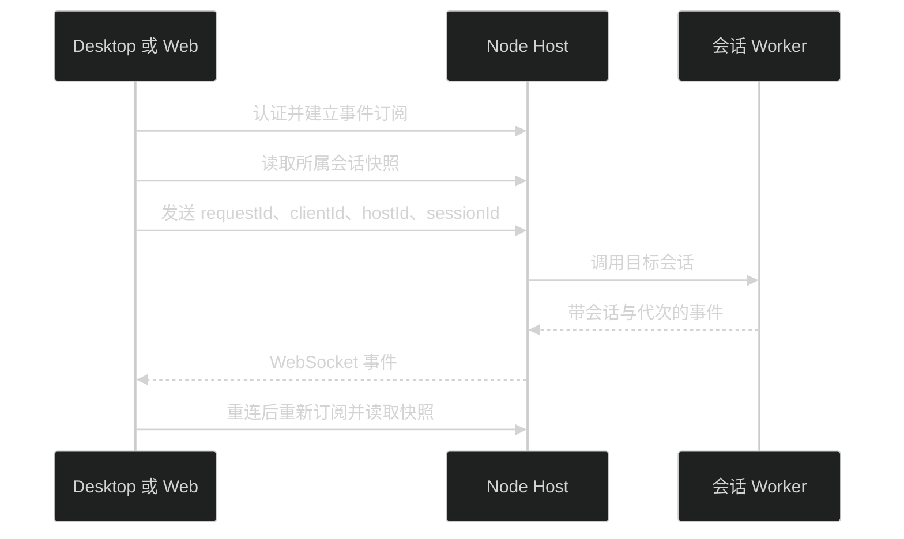

# 独立 Host 与 Remote

Desktop 和 Web 使用同一套 `app-ui`，经 HTTP/WebSocket 操作 Node Host。文件、模型配置、会话和插件存放在 Host 机器；Electron 只负责窗口及本机文件操作。

## 本机 Web

```bash
pnpm install
pnpm build:web
pnpm start:server
```

默认地址为 `http://127.0.0.1:31415`。终端显示 Host 地址和本次访问令牌，在 Web 登录页输入令牌。未指定 `PI_MEME_TOKEN` 时每次启动生成新令牌。

开发界面可另开终端运行 `pnpm start:web`。Vite 的 `/api` 代理指向本机 Host，可用 `PI_MEME_HOST_URL` 修改目标。

## Remote Host

监听非 loopback 地址必须配置 HTTPS 证书与私钥：

```bash
PI_MEME_HOST=0.0.0.0 \
PI_MEME_PORT=31415 \
PI_MEME_DATA_ROOT=/absolute/path/pi-meme-data \
PI_MEME_TLS_CERT=/absolute/path/fullchain.pem \
PI_MEME_TLS_KEY=/absolute/path/private-key.pem \
PI_MEME_TOKEN=your-access-token \
pnpm start:server
```

浏览器访问对应 HTTPS 地址并登录。Desktop 可在连接入口选择 Remote Host，也可用 `PI_MEME_REMOTE_HOST` 和 `PI_MEME_TOKEN` 启动。Remote 的目录选择查询 Host 文件系统；浏览器不能调用本机 Finder 或编辑器。

当前系统凭据存储和受限沙箱使用 macOS 钥匙串与 `sandbox-exec`。Host 代码不依赖 Electron，但这两项平台能力仍需要 macOS；缺失时会明确拒绝，不切换成明文存储或完全权限。

## 配置与认证

| 环境变量            | 用途              | 默认值           |
| ------------------- | ----------------- | ---------------- |
| `PI_MEME_DATA_ROOT` | Host 唯一写入目录 | `~/.pi-meme`     |
| `PI_MEME_HOST`      | 监听地址          | `127.0.0.1`      |
| `PI_MEME_PORT`      | 监听端口          | `31415`          |
| `PI_MEME_TOKEN`     | 登录令牌          | 每次启动随机生成 |
| `PI_MEME_WEB_ROOT`  | Web 构建目录      | `apps/web/dist`  |
| `PI_MEME_TLS_CERT`  | HTTPS 证书路径    | 未配置           |
| `PI_MEME_TLS_KEY`   | HTTPS 私钥路径    | 未配置           |

认证后使用 HttpOnly、SameSite Cookie，Remote HTTPS Cookie 带 Secure。HTTP 操作、事件 WebSocket 和插件资源均要求认证并检查来源。令牌不放在资源 URL 或事件 URL 里。Desktop 使用一次性登录票据建立浏览器会话。

同一数据目录只允许一个 Host 写入，通过带心跳的目录锁保证。Desktop 本地 Host 和独立 Server 想同时运行时，给其中一个配置不同的 `PI_MEME_DATA_ROOT`。

## 连接与恢复



Host 为客户端保留会话选择，操作始终携带目标会话身份。切换页面或其他客户端选择不会改变已发送消息的执行目标。客户端先读取连接状态；事件订阅建立后补读会话快照，缓冲读取期间的事件，并过滤旧代次与旧序号。

短暂网络断连会自动重连并补读快照，不重放已发送的 prompt。Host 进程重启会清除内存中的认证会话，原 Cookie 随之失效，需要通过“设置 → Host 连接 → 连接其他 Host”重新登录；登录后可从最近列表打开已保存会话。

扩展审批只接收一个有效回答；成功、取消或超时后，各客户端移除对应弹窗。Web 与 Desktop 共用这套协议。

Remote 安装插件使用上传 `.pim`，目录安装指向 Host 机器上的目录。插件安装、重新加载、停用和卸载的行为见 [插件文档](plugins.md)。

运行 `pnpm test:server` 验证独立 Server 构建产物。命令先构建，再用临时目录、内存凭据和假模型启动 `dist/main.js`，实际执行 Worker、JSONL、外部 Agent 工具、MCP、SubAgent 与 codemode，不读取真实配置。
