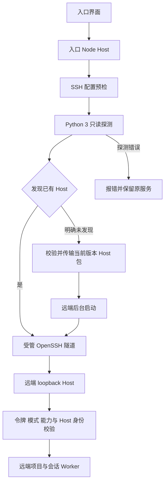
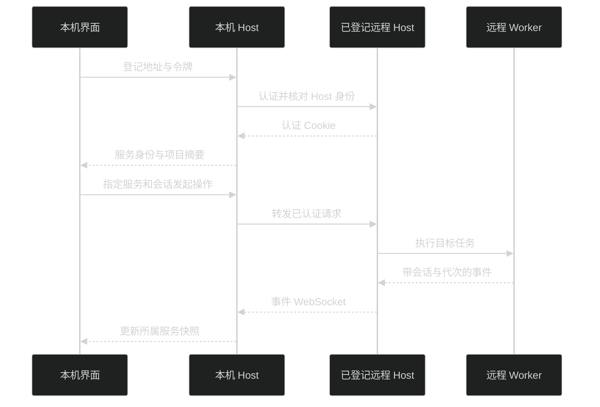

# 独立 Host 与 Remote

工作区文件、模型、MCP、插件与 Pi 会话存放在执行它们的 Host 机器。Desktop 和 Web 共用界面与协议，浏览器不执行 Host 上的文件工具。架构见 [进程与调用](architecture.md#进程与调用)，正式控制接口见 [HostApi v2](host-api.md)。

远程设置支持 HTTPS 直连和 SSH 隧道；SSH 仍传输已有 HTTP/WebSocket 协议，不提供远程桌面或终端。下文 SSH 说明对应当前源码实现，不代表已完成真实 SSH、WSL/Tailscale 或发布包联通验收。

## 本机启动

下载包、源码开发、构建后的 Server 与[Linux/WSL2 环境](getting-started.md#linux-与-wsl-环境)统一见[快速开始](getting-started.md)。同目录、同端口的 Desktop/Server 会[复用 Host](getting-started.md#desktop-与-server-共享-host)；创建方负责停机，修改创建参数前先停止管理方。

本机共享入口通过 `GET /api/status` 校验产品、运行协议、Host 身份和真实目录。状态仅允许本机来源读取，不返回凭据。实现见 [local-host.ts](../packages/host/src/local-host.ts) 与[运行契约](../packages/contracts/src/host-runtime.ts)。

## 部署 HTTPS 远程 Host

非 loopback 监听必须同时配置 HTTPS 证书与私钥。使用普通用户，在解压目录 `pi-meme-host` 的父目录运行；示例路径和令牌需替换为部署环境值：

```bash
PI_MEME_HOST=0.0.0.0 \
PI_MEME_PORT=3185 \
PI_MEME_DATA_ROOT=/absolute/path/pi-meme-data \
PI_MEME_TLS_CERT=/absolute/path/fullchain.pem \
PI_MEME_TLS_KEY=/absolute/path/private-key.pem \
PI_MEME_TOKEN=replace-with-your-access-token \
./pi-meme-host/bin/pi-meme-host
```

浏览器访问证书对应的 HTTPS 地址并登录；独立包已经包含页面。Desktop 也可在远程设置中登记这个地址和令牌。不额外放宽 Origin、认证或 HTTPS 规则供反向代理使用。

源码部署时先在仓库根目录执行 `pnpm build:web` 和 `pnpm build:server`，再将最后一行换成 `node apps/server/dist/main.js`；`pnpm start:server` 是默认隔离的开发入口，不用于正式部署。源码构建产物仍依赖仓库的 `node_modules`，不能只压缩 `dist` 当作独立包。升级时停止旧管理方并备份数据目录，见[升级](getting-started.md#升级)。

监听检查见 [server.ts](../packages/host/src/server.ts)，证书读取与环境变量见 [Server main](../apps/server/src/main.ts)。macOS 受限执行使用 `sandbox-exec`，Linux/WSL2 使用 bubblewrap；平台隔离由 Host 决定，见 [权限与沙箱](configuration.md#权限与沙箱)。

## 通过 SSH 自动连接

SSH 由入口 Node Host 发起，读取该用户的 SSH 配置、agent 和 `known_hosts`，不是浏览器所在电脑的文件。先确认系统 `ssh <目标>` 已能非交互登录，远端可运行 Python 3。应用优先只读探测并连接已有 Host；只有明确未发现时才安装并启动当前发行版本的 Host 包。不需要填写 Host 业务端口或令牌，也不需要手工执行远端启动命令。

### 设置步骤

1. 进入已认证的入口 Host 本机页面，打开“设置 → 系统 → 远程”。默认显示 SSH；普通远程网络页面只能查看已登记服务。
2. 点击“添加”，从入口用户的 `~/.ssh/config` 勾选具体别名，再点击“添加（数量）”。发现列表只读取配置，不执行连接或安装。
3. 没有候选时点击“手动添加”。填写主机、IP、`user@host` 或 SSH 别名，名称可留空；SSH 端口留空时沿用系统配置。身份方式默认使用配置和 agent，也可指定入口 Host 上的身份文件路径，不复制私钥。
4. 添加后自动保持连接，先检查 SSH 配置并探测已有 Host；未发现时才显示准备环境和启动状态。连接失败保留记录，可在该行重试；无需再次保存或配置 Host。
5. “已连接”后，从输入框工作位置选择远程机器和项目。目录查询在目标 Host 执行。新环境没有模型时，进入该远程环境的模型设置，不自动复制本机凭据。

启用时只能改显示名称。修改主机、SSH 端口或身份文件前先暂停；修改资料不清除已确认 Host 身份。连接另一台 Host 时移除旧登记后重新添加。

### 已有 Host 探测

SSH 配置预检通过后，入口经 SSH 标准输入发送固定 Python 3 脚本，脚本不写远端文件。先检查 `~/.local/state/pi-meme/ssh-host` 中运行描述记录的端口，再检查默认 `127.0.0.1:3185`，不扫描其他端口、进程、NVM 或 systemd。自定义端口的 Host 没有运行描述时不能自动发现。

探测通过 `/api/status` 校验产品、运行协议、Host/实例身份，以及是否使用远端 `~/.pi-meme` 的真实数据目录；匹配后从该目录的 `credentials/auth.json` 读取 `host:token`。随后建立既有 SSH 隧道并认证，要求 Host 使用 `token-required` 且提供 `sshTunnelAuthV1` 能力，并核对已保存的 Host 身份。令牌只经受保护的 SSH 通道和入口凭据存储传递，不返回界面。

复用不要求两端发行版本同号，不区分 Host 由 systemd、源码入口还是独立包启动；不下载发行包，不调用 `ssh-bootstrap`，不检查 Node、Git、bash、tar 或 bubblewrap 等安装依赖，也不停止或重启已有服务。源码开发入口没有发行版本时仍可连接符合上述条件的已有 Host。

Python 3 缺失、运行描述损坏、目录或凭据权限错误、协议或身份不匹配、隧道认证失败都会明确失败，不转入安装。未找到端点但 `~/.pi-meme/host.lock` 目录的 mtime 距当前不超过 30 秒时，同样保守报错，避免在 Host 启动期间创建第二个实例；探测不会删除锁。只有明确未发现运行中的 Host 才进入下面的安装流程。

### 安装与生命周期

未发现已有 Host 时，入口下载当前发行版本的 Host 包和 `SHA256SUMS`，校验并检查归档路径、软链接和平台后，经 SSH 传输。远端不需要访问下载站点。没有匹配发行包时明确失败，不改用其他版本；未注入发行版本的源码开发 Host 不能自动下载安装。

应用安装位于远端 `~/.local/share/pi-meme/host/<版本>/<平台>`，数据固定在 `~/.pi-meme`，运行描述位于 `~/.local/state/pi-meme/ssh-host`。新建 Host 的业务端口只监听 loopback，自动分配并强制令牌认证。

安装路径要求远端有 Git、bash、tar；Linux 还需实际可用的 bubblewrap，不需要预装 Node。当前包基线为 macOS 15 arm64、Ubuntu 24.04 x64。应用不使用 sudo 安装系统依赖，不修改系统权限，不注册 systemd/launchd，不同步项目目录；发现冲突时明确失败，不接管或停止已有任务。

应用新建的 Host 作为独立后台进程运行。暂停、断线、入口退出或移除连接只清理入口连接，不停止远端 Host 或任务。已有 systemd 服务继续由原 systemd 管理。机器重启后，应用新建的 Host 在下次连接时重新启动，不承诺开机即在线；复用的服务仍遵循原管理方的启动规则。睡眠、关闭 WSL 或系统回收用户进程仍会中断运行。

### SSH 配置和非交互限制

- 配置发现只提取具体 `Host` 名称，过滤通配符和否定模式，递归读取 `Include` 并限制深度、文件数和累计大小。`Host`/`Match` 条件内的内容也只是候选，不求值条件，不代表该别名此刻一定生效。
- 发现列表不运行 `ssh -G`，也不逐一探测主机。用户启用某条连接后，才由系统 OpenSSH 做该目标的有效配置预检；有效配置包含额外 `LocalForward`、`RemoteForward` 或 `DynamicForward` 时拒绝连接，需使用不含额外转发的别名。
- SSH 配置属于入口 Host 用户信任的配置。连接预检和建通可能执行其中的 `Match exec`、`ProxyCommand` 等命令；不要导入不可信 SSH 配置。应用禁止本次连接的 `LocalCommand`、`RemoteCommand`、agent/X11 转发和共享 ControlMaster，不因此把其余 SSH 配置当作安全沙箱。
- 首期采用非交互模式和严格主机指纹校验，不在应用内询问 SSH 密码、密钥口令或交互式 MFA，不自动接受未知主机指纹。密钥/agent 不可用、指纹变化时先在入口 Host 终端处理，再重试。Desktop 的 PATH 探测不会补导入 agent 环境；已运行 Host 使用其启动时可见的 agent。
- 隧道只把入口 Host 的临时 `127.0.0.1` 端口转发至远端 `127.0.0.1:<Host端口>`。临时端口不作为连接或会话身份，不提供任意端口转发。
- 若目标是 WSL，先确认 SSH 登录进入的是 WSL Linux 还是 Windows；Windows SSH 的 loopback 不保证指向 WSL Host。Tailscale 只改变可达网络，不代替 SSH、Host 认证或平台依赖。

实现见 [配置发现](../packages/host/src/ssh-config.ts)、[隧道进程](../packages/host/src/ssh-tunnels.ts)、[连接状态](../packages/host/src/ssh-connections.ts) 与 [SSH 契约](../packages/contracts/src/ssh-connections.ts)。



### 本机管理资格

SSH 配置读取、保存、启停、重试和移除要求已认证且通过入口 Host 的本机来源检查；服务端强制检查，不以是否 Electron 判断。应用自身的远程代理不转发 SSH 管理请求，也不能用通用重试/移除方法绕过。

这里的“本机”是 loopback TCP 对端与 Host 地址边界，不是物理在场证明。用户主动用外部 SSH 将入口 Host 的 loopback 转发给自己，再携带有效认证访问，仍会被视为本机来源。`token-required` 只改变登录条件，不改变这个来源分类。这是可信单用户 Host 的管理入口限制，不提供多租户或同账号恶意进程隔离。

## 运行参数

| 环境变量                               | 作用范围                      | 用途与默认值                                                                                                                        |
| -------------------------------------- | ----------------------------- | ----------------------------------------------------------------------------------------------------------------------------------- |
| `PI_MEME_DATA_ROOT`                    | Host                          | 数据根目录，构建 App、构建后的 Server 和独立包默认 `~/.pi-meme`；Desktop 与 Server 开发入口默认 `~/.pi-meme-dev`                    |
| `PI_MEME_HOST`                         | 独立 Server                   | 监听地址，默认 `127.0.0.1`                                                                                                          |
| `PI_MEME_PORT`                         | Desktop、Server、Web 开发代理 | 构建 App、构建后的 Server 和独立包默认 `3185`；Desktop、Server 开发入口及 Web 开发代理默认 `3180`；`0` 自动分配端口，不参与自动复用 |
| `PI_MEME_TOKEN`                        | 独立 Server                   | 登录令牌；未设置时读取 `credentials/auth.json`，首次生成（数据布局详见 [数据目录与存储](storage.md)）                               |
| `PI_MEME_AUTH_MODE`                    | 独立 Server                   | 仅接受 `token-required`，关闭本机自动登录；SSH 认证模式由自动启动入口强制设置；手工独立 Server 的环境变量不用于配置 SSH             |
| `PI_MEME_WEB_ROOT`                     | 独立 Server                   | 页面目录，默认应用相邻的 `apps/web/dist`                                                                                            |
| `PI_MEME_TLS_CERT` / `PI_MEME_TLS_KEY` | 独立 Server                   | HTTPS 证书与私钥文件路径，必须同时提供                                                                                              |
| `PI_MEME_HOST_URL`                     | 独立 Web 开发服务器           | `/api` 代理目标，优先于 `PI_MEME_PORT`；Forge Renderer 不使用此覆盖                                                                 |
| `PI_MEME_REMOTE_HOST`                  | Desktop                       | 启动时登记指定远程服务；登录令牌来自 `PI_MEME_TOKEN` 或已保存记录                                                                   |

构建 App 未显式设置 `PI_MEME_PORT` 时，默认端口冲突会自动改用系统分配的空闲端口，界面使用实际 Host 地址。Server、开发入口和显式指定端口的 Desktop 保留固定端口。

Server 参数来自 [main.ts](../apps/server/src/main.ts)，开发默认值来自 [dev.ts](../apps/server/src/dev.ts)，开发代理来自 [Vite 配置](../apps/web/vite.config.ts)，Desktop 登记来自 [main.ts](../apps/desktop/src/main/main.ts)。测试凭据与 Worker 路径覆盖属于开发接线，不是日常部署所需参数。

## 在界面登记远程服务

进入“设置 → 系统 → 远程 → HTTPS”，点击“配置远程服务”，填写 HTTPS 地址与访问令牌。登记后在工作位置中选择远程项目；每个项目和会话使用所属 Host 的目录、配置与运行状态。入口见 [设置导航](../packages/app-ui/src/settings/settings-page.tsx) 与 [RemoteSettings](../packages/app-ui/src/shell/remote-settings.tsx)。

入口 Node Host 保存远程地址、Host 身份与令牌，分别维护各上游的内存 Cookie。Renderer 不保存远程令牌或 Cookie；HTTP、事件 WebSocket、控制接口和插件资源经已登记服务代理，页面保留本机 origin。代理不接受任意临时上游 URL、不跟随重定向、不修改远程 CORS。



服务断线后保留 `cache/remote-services.json` 中的项目与会话摘要，可在远程页重试。移除服务只删除本机登记、凭据和摘要，不删除远程数据。Remote 目录选择查询远程 Host；上传读取当前电脑文件，插件目录安装则填写远程 Host 路径。实现见 [remote-services.ts](../packages/host/src/remote-services.ts)。

## 会话来源、暂停与移除

本地和远程继续共用“置顶 / 项目 / 最近”列表，不按 SSH 单独分组。HTTPS 和 SSH 远程项目使用清晰的文件夹地球角标并常驻显示连接名称，远程会话行使用固定地球标记；工作位置和搜索结果显示所属连接，避免同名项目混淆。远程项目详情显示连接名称、HTTPS/SSH、聊天数、状态和路径；可复制路径，不能直接在本机 Finder 打开远程目录。

连接断开后仍可显示项目/会话摘要以及当前页面已加载的内存内容，但没有任意会话 JSONL 正文的离线副本。断线后的计数和运行状态只是上次同步快照，不能据此确认任务当前是否仍在运行。

- 关闭 SSH 开关会暂停入口隧道和自动重连，保留登记、凭据、摘要及当前页面草稿；不切回本地、不停止远端 Host 或任务。暂停时发送、远程写入和打开其他远端会话需要先恢复连接。
- 网络中断可退避重连；SSH 指纹、认证、Host 身份和兼容问题进入“需要处理”，处理后再手动重试。恢复只补读状态，不重发消息。
- 移除删除入口保存的连接、令牌和摘要，不删除远端项目、会话，不停止任务。移除 SSH 前，界面检查未保存文件/指令/插件页、草稿附件、消息编辑及正在提交的操作，未处理时阻止移除。当前服务被移除后才切回本地。
- 新会话属于当前工作位置，断线不会自动改成本地。跨服务选择沿用确认流程，已保存在另一 Host 的文件附件不能直接随草稿跨服务发送。

SSH 配置位于 `config/ssh-connections.json`；令牌在凭据存储中使用 `ssh-host:<连接ID>`，摘要在 `cache/remote-services.json`。配置和凭据不是缓存，清缓存不会移除连接。详见 [存储](storage.md#ssh-连接资料与摘要)。

## 认证与连接恢复

认证入口是 `/api/auth`。Cookie 名按 Host 身份区分，避免同一 `127.0.0.1` 下不同端口的登录互相覆盖；Cookie 为 HttpOnly、SameSite=Strict，HTTPS 下带 Secure。HTTP 操作、WebSocket 和插件资源共用认证与来源检查，令牌不放在资源或事件 URL 中。

Desktop 创建的 Host 和未设置认证模式的独立 Server，只监听 loopback 时默认启用本机自动登录，即使设置了 `PI_MEME_TOKEN`，本机来源仍可免填令牌；来源地址、Host 与 Origin 必须满足本机检查。独立 Server 显式设置 `PI_MEME_AUTH_MODE=token-required` 后不再免登录。非 loopback 监听要求令牌。Vite 和正式 Desktop 的同源代理保留原始 Host、Origin 和 Cookie，不放宽 CORS，不跟随上游重定向。

Desktop 使用内存浏览器会话；正式界面由随包资源提供，不依赖已运行 Server 的 Web 构建。开发入口首次认证最多等待本机 Host 就绪 30 秒，超时返回 503 并提示启动 Host，不作为令牌错误处理。状态探测可以重试，业务写请求不会因网络失败自动重放。长期凭据的落盘、钥匙串导入与认证隔离见 [配置与安全](configuration.md#凭据)。

| WebSocket 升级失败                    | HTTP 状态 |
| ------------------------------------- | --------- |
| 来源无效                              | 403       |
| 未认证                                | 401       |
| 事件路径不存在                        | 404       |
| 已认证但 clientId 缺失或超过 128 字符 | 400       |

连接建立后，控制订阅参数无效以 1008 关闭，订阅或代理失败以 1011 关闭。具体顺序与断言见 [transport-app.ts](../packages/host/src/transport-app.ts) 和 [transport.integration.test.ts](../packages/host/tests/transport.integration.test.ts)。

短暂断线自动重连并补读快照，客户端缓冲快照读取期间的事件，过滤旧序号与代次；不重放 prompt。Host 重启使内存 Cookie 失效，本机客户端重新认证，代理用已保存令牌恢复上游认证。代理只对明确 401 的未执行请求续期并重试一次，保留原 requestId；网络失败不重发消息。

直接访问远程地址的浏览器使用该地址自己的登录页。已登记令牌失效时在远程页重新配置服务。正式 API 的幂等回执与事件补读有独立规则，见 [HostApi v2](host-api.md)。

## 排错与验证

| 现象                                      | 检查位置                                                                                           |
| ----------------------------------------- | -------------------------------------------------------------------------------------------------- |
| 解压后提示原生模块或运行时不可用          | 核对下载平台、CPU 架构与 `release.json`；不要从源码目录单独复制 `dist` 或跨平台复用 `node_modules` |
| 启动提示已有 Host、目录不一致或协议不兼容 | 核对两个入口的目录和端口；停止旧版本 Host，或为独立实例指定另一目录和端口                          |
| `/api/auth` 返回 503 或代理连接被拒绝     | 确认管理方仍在运行、`PI_MEME_PORT` 与代理目标一致；首次启动等待最多 30 秒                          |
| 非本机监听被拒绝                          | 同时设置 TLS 证书与私钥，核对文件路径和读取权限                                                    |
| 3181 被占用                               | 停止占用进程后重启；Vite 的 `strictPort` 不会换端口                                                |
| WSL 内可访问、Windows 浏览器失败          | 先确认 WSL 服务，再检查 localhost 转发、端口和防火墙，不放宽认证                                   |
| 页面能打开，WebSocket 失败                | 查看升级 HTTP 状态、Origin、Cookie、clientId 及代理是否支持 WebSocket                              |
| 远程身份变化                              | 核对所连 Host 数据目录与持久 host-id，重新确认连接目标                                             |
| 受限任务无法启动                          | 查看 `restrictedAccessReason`；安装平台依赖后重启 Host，不切换权限绕过                             |
| SSH 提示 Host 身份、协议或认证错误        | 核对远端 `~/.pi-meme`、Host 身份、`token-required` 与 `sshTunnelAuthV1`；不会停止原服务或转入安装  |
| SSH 指纹或身份验证失败                    | 在入口 Host 的终端核实 `known_hosts`、密钥与 agent；应用不会弹出口令输入或自动接受指纹             |
| SSH 预检报告额外转发                      | 为该连接使用不含 `LocalForward`、`RemoteForward`、`DynamicForward` 的 SSH 别名                     |
| SSH 已有 Host 探测失败                    | 检查远端 Python 3、运行描述与凭据权限；新鲜 `host.lock` 无端点时等待原 Host 就绪后重试，不删除锁   |
| SSH 找不到自定义端口的 Host               | 自动发现只检查运行描述端口与 `3185`；没有描述的自定义端口不在发现范围内                            |
| SSH 安装失败或新建 Host 不可用            | 检查当前发行资产、远端平台、安装依赖、目录权限和已有 Host 冲突                                     |
| SSH 管理按钮不可用                        | 确认访问的是已认证的入口 Host 本机来源，并确认该 Host 的 PATH 能找到系统 OpenSSH                   |

Windows 浏览器访问 WSL 时，先检查 WSL 内服务，再检查 localhost 转发、端口和防火墙，不放宽认证。平台验收需分别确认本机登录、Cookie、RPC、事件 WebSocket、插件资源与 Vite 热更新；参考[WSL 网络说明](https://learn.microsoft.com/en-us/windows/wsl/networking#accessing-linux-networking-apps-from-windows-localhost)。

源码选测与平台条件见[测试](testing.md)，从独立包启动的验证步骤见[Host 产物验收](releasing.md#host)。
