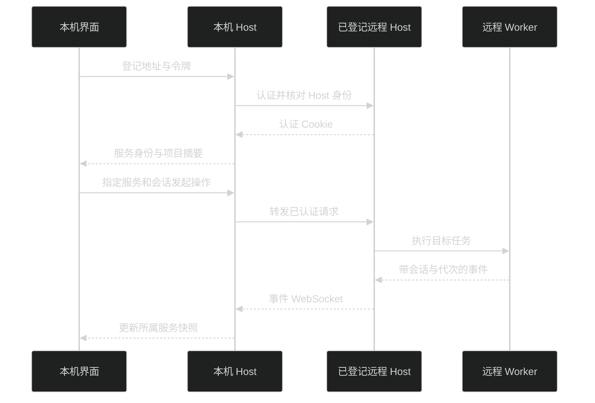

# 独立 Host 与 Remote

工作区文件、模型、MCP、插件与 Pi 会话存放在执行它们的 Host 机器。Desktop 和 Web 共用界面与协议，浏览器不执行 Host 上的文件工具。架构见 [进程与调用](architecture.md#进程与调用)，正式控制接口见 [HostApi v2](host-api.md)。

## 本机启动

优先下载与机器匹配的 Host 独立包，按[快速开始](getting-started.md#安装独立-host)完成校验与解压。在解压目录的父目录运行：

```bash
./pi-meme-host/bin/pi-meme-host
```

独立包已包含 Web 和 Node.js，不需要 pnpm。首发目标为 macOS 15 arm64、Ubuntu 24.04 x64，不自动安装系统服务；包内说明见 [Host README](../apps/server/README.md)。正式源码部署在仓库根目录执行：

```bash
pnpm build:web
pnpm build:server
node apps/server/dist/main.js
```

打开 [本机 Host](http://127.0.0.1:31415)，本机来源自动登录。源码开发则在两个终端分别执行 `pnpm start:server` 和 `pnpm start:web`，无需额外环境变量，访问 [开发界面](http://127.0.0.1:5173)，默认代理到 `31416`。完整安装、双终端与构建产物用法见 [快速开始](getting-started.md)。

构建 App、构建后的 Server 和 Host 独立包默认使用 `~/.pi-meme` 和端口 `31415`；`pnpm start` 的 Desktop 开发版和 `pnpm start:server` 默认使用 `~/.pi-meme-dev` 和端口 `31416`。同一目录只允许一个 Host 写入。Desktop 和 Server 的目录、端口一致时复用同一个运行实例；创建方负责停机。先运行 `pnpm start` 时可直接打开 5173，不再运行第二个 Vite 或 Server。不同目录不能复用同一端口；多套独立 Host 必须同时区分目录和端口，显式覆盖时不要将开发环境指向正式环境。

本机共享入口通过 `GET /api/status` 校验产品、运行协议、Host 身份和真实目录。状态仅允许本机来源读取，不返回令牌、Cookie 或远程密钥。Server 入口发现兼容 Host 后打印复用结果并成功退出；显式设置令牌、TLS 或 Web 根目录时不能静默应用到已有 Host，需先停止管理方。实现见 [local-host.ts](../packages/host/src/local-host.ts) 与 [运行契约](../packages/contracts/src/host-runtime.ts)。

## 部署远程 Host

非 loopback 监听必须同时配置 HTTPS 证书与私钥。使用普通用户，在解压目录 `pi-meme-host` 的父目录运行；示例路径和令牌需替换为部署环境值：

```bash
PI_MEME_HOST=0.0.0.0 \
PI_MEME_PORT=31415 \
PI_MEME_DATA_ROOT=/absolute/path/pi-meme-data \
PI_MEME_TLS_CERT=/absolute/path/fullchain.pem \
PI_MEME_TLS_KEY=/absolute/path/private-key.pem \
PI_MEME_TOKEN=replace-with-your-access-token \
./pi-meme-host/bin/pi-meme-host
```

浏览器访问证书对应的 HTTPS 地址并登录；独立包已经包含页面。Desktop 也可在远程设置中登记这个地址和令牌。不额外放宽 Origin、认证或 HTTPS 规则供反向代理使用。

源码部署时先在仓库根目录执行 `pnpm build:web` 和 `pnpm build:server`，再将最后一行换成 `node apps/server/dist/main.js`；`pnpm start:server` 是默认隔离的开发入口，不用于正式部署。源码构建产物仍依赖仓库的 `node_modules`，不能只压缩 `dist` 当作独立包。升级时停止旧管理方并备份数据目录，见[升级](getting-started.md#升级)。

监听检查见 [server.ts](../packages/host/src/server.ts)，证书读取与环境变量见 [Server main](../apps/server/src/main.ts)。macOS 受限执行使用 `sandbox-exec`，Linux/WSL2 使用 bubblewrap；平台隔离由 Host 决定，见 [权限与沙箱](configuration.md#权限与沙箱)。

## 运行参数

| 环境变量                               | 作用范围                      | 用途与默认值                                                                                                                          |
| -------------------------------------- | ----------------------------- | ------------------------------------------------------------------------------------------------------------------------------------- |
| `PI_MEME_DATA_ROOT`                    | Host                          | 数据根目录，构建 App、构建后的 Server 和独立包默认 `~/.pi-meme`；Desktop 与 Server 开发入口默认 `~/.pi-meme-dev`                      |
| `PI_MEME_HOST`                         | 独立 Server                   | 监听地址，默认 `127.0.0.1`                                                                                                            |
| `PI_MEME_PORT`                         | Desktop、Server、Web 开发代理 | 构建 App、构建后的 Server 和独立包默认 `31415`；Desktop、Server 开发入口及 Web 开发代理默认 `31416`；`0` 用于隔离测试，不参与自动复用 |
| `PI_MEME_TOKEN`                        | 独立 Server                   | 登录令牌；未设置时读取 `auth.json`，首次生成                                                                                          |
| `PI_MEME_WEB_ROOT`                     | 独立 Server                   | 页面目录，默认应用相邻的 `apps/web/dist`                                                                                              |
| `PI_MEME_TLS_CERT` / `PI_MEME_TLS_KEY` | 独立 Server                   | HTTPS 证书与私钥文件路径，必须同时提供                                                                                                |
| `PI_MEME_HOST_URL`                     | 独立 Web 开发服务器           | `/api` 代理目标，优先于 `PI_MEME_PORT`；Forge Renderer 不使用此覆盖                                                                   |
| `PI_MEME_REMOTE_HOST`                  | Desktop                       | 启动时登记指定远程服务；登录令牌来自 `PI_MEME_TOKEN` 或已保存记录                                                                     |

Server 参数来自 [main.ts](../apps/server/src/main.ts)，开发默认值来自 [dev.ts](../apps/server/src/dev.ts)，开发代理来自 [Vite 配置](../apps/web/vite.config.ts)，Desktop 登记来自 [main.ts](../apps/desktop/src/main/main.ts)。测试凭据与 Worker 路径覆盖属于开发接线，不是日常部署所需参数。

## 在界面登记远程服务

进入“设置 → 系统 → 远程”，点击“配置远程服务”，填写 HTTPS 地址与访问令牌。登记后在工作位置中选择远程项目；每个项目和会话使用所属 Host 的目录、配置与运行状态。入口见 [设置导航](../packages/app-ui/src/settings/settings-page.tsx) 与 [RemoteSettings](../packages/app-ui/src/shell/remote-settings.tsx)。

本机 Node Host 保存远程地址、Host 身份与令牌，分别维护各上游的内存 Cookie。Renderer 不保存远程令牌或 Cookie；HTTP、事件 WebSocket、控制接口和插件资源经已登记服务代理，页面保留本机 origin。代理不接受任意临时上游 URL、不跟随重定向、不修改远程 CORS。



服务断线后保留 `remote-services.json` 中的项目与会话摘要，可在远程页重试。移除服务只删除本机登记、凭据和摘要，不删除远程数据。Remote 目录选择查询远程 Host；上传读取当前电脑文件，插件目录安装则填写远程 Host 路径。实现见 [remote-services.ts](../packages/host/src/remote-services.ts)。

## 认证与连接恢复

认证入口是 `/api/auth`。Cookie 名按 Host 身份区分，避免同一 `127.0.0.1` 下不同端口的登录互相覆盖；Cookie 为 HttpOnly、SameSite=Strict，HTTPS 下带 Secure。HTTP 操作、WebSocket 和插件资源共用认证与来源检查，令牌不放在资源或事件 URL 中。

Desktop 创建的 Host 和独立 Server 只监听 loopback 时均启用本机自动登录，即使设置了 `PI_MEME_TOKEN`，本机来源仍可免填令牌；来源地址、Host 与 Origin 必须满足本机检查。非 loopback 监听要求令牌。Vite 和正式 Desktop 的同源代理保留原始 Host、Origin 和 Cookie，不放宽 CORS，不跟随上游重定向。

Desktop 使用内存浏览器会话；正式界面由随包资源提供，不依赖已运行 Server 的 Web 构建。开发入口首次认证最多等待本机 Host 就绪 30 秒，超时返回 503 并提示启动 Host，不作为令牌错误处理。状态探测可以重试，业务写请求不会因网络失败自动重放。长期凭据的落盘、钥匙串导入与认证隔离见 [配置与安全](configuration.md#凭据)。

| WebSocket 升级失败                    | HTTP 状态 |
| ------------------------------------- | --------- |
| 来源无效                              | 403       |
| 未认证                                | 401       |
| 事件路径不存在                        | 404       |
| 已认证但 clientId 缺失或超过 128 字符 | 400       |

连接建立后，控制订阅参数无效以 1008 关闭，订阅或代理失败以 1011 关闭。具体顺序与断言见 [transport-app.ts](../packages/host/src/transport-app.ts) 和 [transport.integration.test.ts](../packages/host/tests/transport.integration.test.ts)。

短暂断线自动重连并补读快照，客户端缓冲快照读取期间的事件，过滤旧序号与代次；不重放 prompt。Host 重启使内存 Cookie 失效，本机客户端重新认证，代理用已保存令牌恢复上游认证。代理只对明确 401 的未执行请求续期并重试一次，保留原 requestId；网络失败不重发消息。

直接访问远程地址的浏览器使用该地址自己的登录页。已登记令牌失效时在远程页重新配置服务。正式 API 的幂等回执与事件补读有独立规则，见 [HostApi v2](host-api.md)。

## 排错与验证

| 现象                                      | 检查位置                                                                                           |
| ----------------------------------------- | -------------------------------------------------------------------------------------------------- |
| 解压后提示原生模块或运行时不可用          | 核对下载平台、CPU 架构与 `release.json`；不要从源码目录单独复制 `dist` 或跨平台复用 `node_modules` |
| 启动提示已有 Host、目录不一致或协议不兼容 | 核对两个入口的目录和端口；停止旧版本 Host，或为独立实例指定另一目录和端口                          |
| `/api/auth` 返回 503 或代理连接被拒绝     | 确认管理方仍在运行、`PI_MEME_PORT` 与代理目标一致；首次启动等待最多 30 秒                          |
| 非本机监听被拒绝                          | 同时设置 TLS 证书与私钥，核对文件路径和读取权限                                                    |
| 5173 被占用                               | 停止占用进程后重启；Vite 的 `strictPort` 不会换端口                                                |
| WSL 内可访问、Windows 浏览器失败          | 先确认 WSL 服务，再检查 localhost 转发、端口和防火墙，不放宽认证                                   |
| 页面能打开，WebSocket 失败                | 查看升级 HTTP 状态、Origin、Cookie、clientId 及代理是否支持 WebSocket                              |
| 远程身份变化                              | 核对所连 Host 数据目录与持久 host-id，重新确认连接目标                                             |
| 受限任务无法启动                          | 查看 `restrictedAccessReason`；安装平台依赖后重启 Host，不切换权限绕过                             |

`pnpm test --all --layer artifact --target server` 从实际构建产物启动临时 Host，使用内存凭据和假模型验证静态 Worker、JSONL、外部 Agent、MCP、codemode、持续子代理、计划与默认受限权限。平台运行与测试入口见 [开发与验证](development.md) 和 [Linux 与 WSL](linux-wsl.md)。这些是验证命令说明，不表示本次文档整理运行过应用验收。
