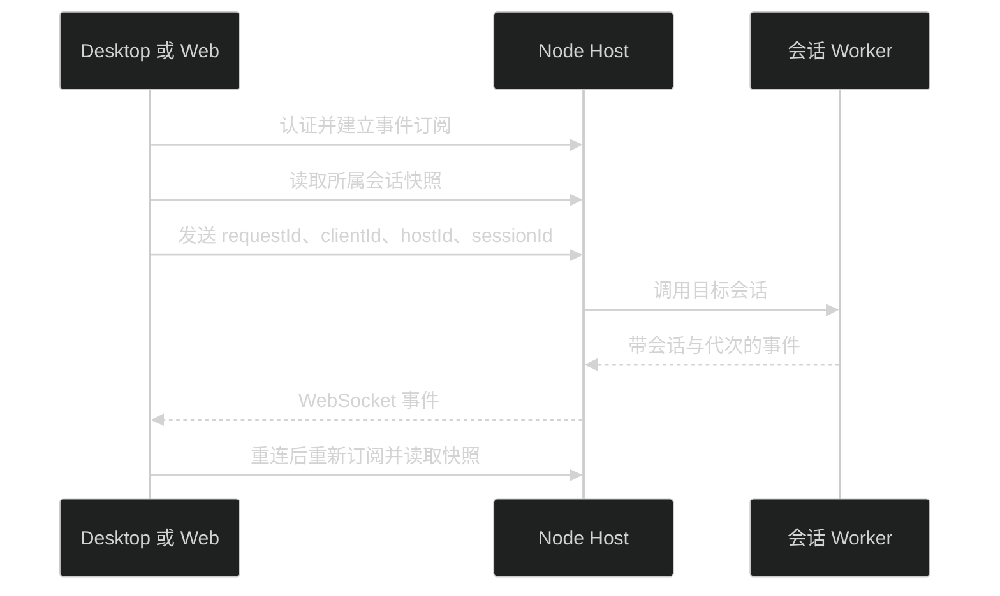

# 独立 Host 与 Remote

Desktop 和 Web 使用同一套 `app-ui`，经 HTTP/WebSocket 操作 Node Host。文件、模型配置、会话和插件存放在 Host 机器；Electron 只负责窗口及本机文件操作。

## 本机 Web

```bash
pnpm install
pnpm build:web
pnpm start:server
```

默认地址为 `http://127.0.0.1:31415`。本机 Web 自动登录，无需输入访问令牌。Host 令牌保存到数据目录的 `auth.json`；未指定 `PI_MEME_TOKEN` 时读取已有令牌，首次启动才生成。

开发界面可另开终端运行 `pnpm start:web`。Vite 的 `/api` 代理指向本机 Host，可用 `PI_MEME_HOST_URL` 修改目标。

## Remote Host

监听非 loopback 地址必须配置 HTTPS 证书与私钥：

```bash
PI_MEME_HOST=0.0.0.0 \
PI_MEME_PORT=31415 \
PI_MEME_DATA_ROOT=/absolute/path/pi-meme-data \
PI_MEME_TLS_CERT=/absolute/path/fullchain.pem \
PI_MEME_TLS_KEY=/absolute/path/private-key.pem \
PI_MEME_TOKEN=your-access-token \
pnpm start:server
```

浏览器访问对应 HTTPS 地址并登录。Desktop 可在“设置 → 更多 → Host 连接”连接 Remote Host。认证和页面加载成功后，本地 Host 将地址、Host 身份和令牌保存到本机 `auth.json`，之后可从已保存列表连接或移除。每次启动默认进入本机；显式 `PI_MEME_REMOTE_HOST` 覆盖默认目标，令牌来自 `PI_MEME_TOKEN` 或已保存记录。Remote 的目录选择查询 Host 文件系统；浏览器不能调用本机 Finder 或编辑器。

凭据使用文件存储，不依赖 macOS 钥匙串。旧凭据仅在主动导入时读取钥匙串，可能出现一次系统密码弹窗。受限沙箱仍使用 macOS `sandbox-exec`；缺失时会明确拒绝受限任务，不切换成完全权限。

## 配置与认证

| 环境变量            | 用途              | 默认值                           |
| ------------------- | ----------------- | -------------------------------- |
| `PI_MEME_DATA_ROOT` | Host 唯一写入目录 | `~/.pi-meme`                     |
| `PI_MEME_HOST`      | 监听地址          | `127.0.0.1`                      |
| `PI_MEME_PORT`      | 监听端口          | `31415`                          |
| `PI_MEME_TOKEN`     | 登录令牌          | `auth.json` 已保存令牌，首次生成 |
| `PI_MEME_WEB_ROOT`  | Web 构建目录      | `apps/web/dist`                  |
| `PI_MEME_TLS_CERT`  | HTTPS 证书路径    | 未配置                           |
| `PI_MEME_TLS_KEY`   | HTTPS 私钥路径    | 未配置                           |

认证后使用 HttpOnly、SameSite Cookie，Remote HTTPS Cookie 带 Secure。HTTP 操作、事件 WebSocket 和插件资源均要求认证并检查来源。令牌不放在资源 URL 或事件 URL 里。Desktop 使用一次性登录票据建立浏览器会话。独立 Server 仅监听 loopback 时允许本机自动登录，即使配置了 `PI_MEME_TOKEN` 也不要求本机输入令牌；请求来源、Host 和 Origin 必须匹配本机。开发代理保留原始 Host 和 Origin。非 loopback 监听始终要求令牌。

同一数据目录只允许一个 Host 写入，通过带心跳的目录锁保证。Desktop 本地 Host 和独立 Server 想同时运行时，给其中一个配置不同的 `PI_MEME_DATA_ROOT`。

## 连接与恢复



Host 为客户端保留会话选择，操作始终携带目标会话身份。切换页面或其他客户端选择不会改变已发送消息的执行目标。客户端先读取连接状态；事件订阅建立后补读会话快照，缓冲读取期间的事件，并过滤旧代次与旧序号。

短暂网络断连会自动重连并补读快照，不重放已发送的 prompt。Host 进程重启会清除内存中的认证会话，原 Cookie 随之失效，本机客户端自动重新认证，Desktop 远程连接使用已保存令牌恢复认证；远程令牌失效或普通远程浏览器没有有效 Cookie 时，再通过“设置 → 更多 → Host 连接 → 连接其他 Host”更新登录。仅明确返回 401 的未执行请求重试一次，网络失败不重发消息。登录后可从最近列表打开已保存会话。

扩展审批只接收一个有效回答；成功、取消或超时后，各客户端移除对应弹窗。Web 与 Desktop 共用这套协议。

Remote 安装插件使用上传 `.pim`，目录安装指向 Host 机器上的目录。插件安装、重新加载、停用和卸载的行为见 [插件文档](plugins.md)。

运行 `pnpm test:server` 验证独立 Server 构建产物。命令先构建，再用临时目录、内存凭据和假模型启动 `dist/main.js`，实际执行静态 Worker、JSONL、外部 Agent 工具、MCP、codemode、子代理 spawn/wait/followup，以及计划保存，不读取真实配置。

## 内置能力与协作

内置模块随 Host 构建，不从用户安装目录加载。插件页面只列外部包；外部恢复失败在开发者页面显示诊断，基础聊天继续可用。

子代理与父任务都在 Host 机器执行，共享所属工作区。界面通过 `pi:agents` 读取任务树，列表只显示名称、状态、时长与层级缩进；`pi:agent-snapshot` 按来源边界只读取子任务自己的完整只读对话与 followup，模型默认继承的安全父背景不显示在详情中，不改变根会话选择。主会话只显示简短完成阶段，内部报告与续跑控制消息不进入普通对话或会话树；自动续跑不新增用户输入或改写草稿。断线后补读快照；停止父任务会取消后代及未启动的后续任务。

规划模式、子任务的权限继承和计划文件保存与 Desktop 相同。计划保存在 Host 的 `plans/<sessionId>/<id>.md`；浏览器复制或导出只下载已有文档，不执行计划。MCP 旧总开关为 false 时，逐服务明确授权后才连接。
