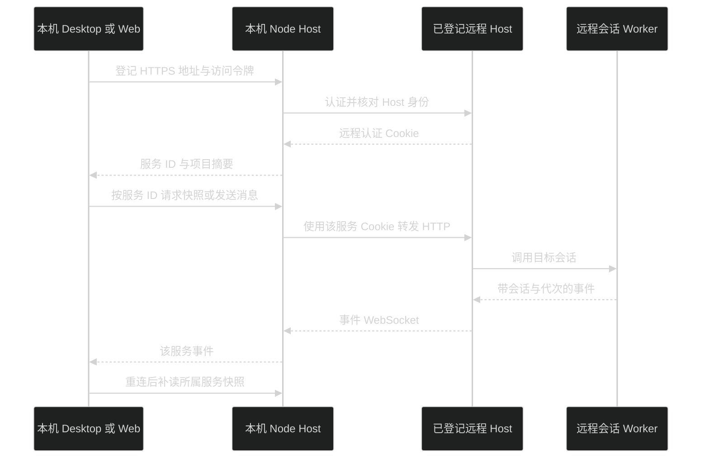
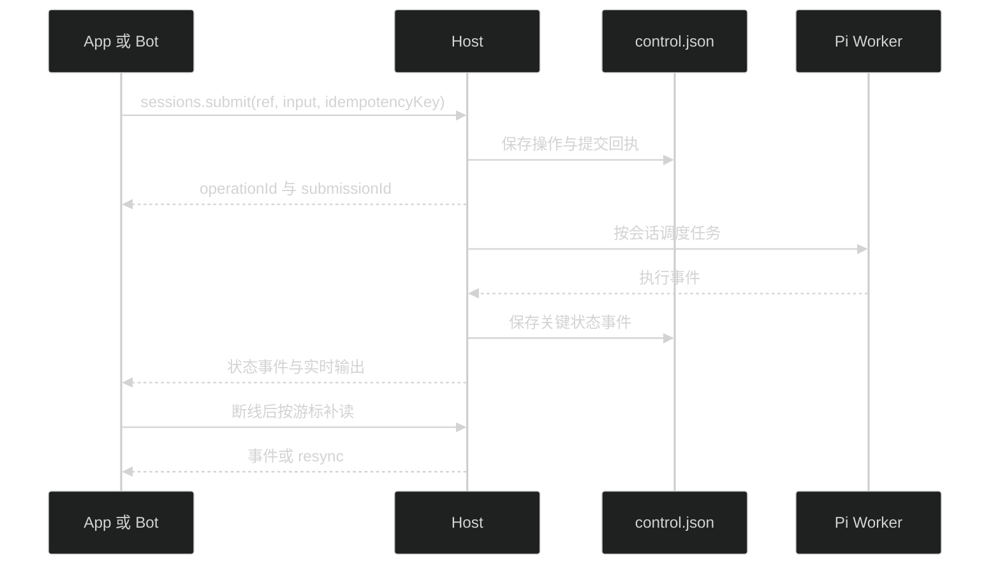

# 独立 Host 与 Remote

Desktop 和 Web 使用同一套 `app-ui`，经 HTTP/WebSocket 操作 Node Host。文件、模型配置、会话和插件存放在 Host 机器；Electron 只负责窗口及本机文件操作。

## 本机 Web

```bash
pnpm install
pnpm build:web
pnpm start:server
```

默认地址为 `http://127.0.0.1:31415`。本机 Web 自动登录，无需输入访问令牌。Host 令牌保存到数据目录的 `auth.json`；未指定 `PI_MEME_TOKEN` 时读取已有令牌，首次启动才生成。

开发界面可另开终端运行 `pnpm start:web`，固定监听 `127.0.0.1:5173`，端口占用时直接报错。Vite 的 `/api` 代理指向本机 Host，可用 `PI_MEME_HOST_URL` 修改目标。

WSL2 中的 Host 和 Vite 都保留 loopback 监听。Windows 浏览器使用上述 localhost 地址，不要求填写 WSL IP。Cookie、RPC、事件和插件资源继续经过同源代理，不放宽 Host/Origin 校验。连接失败时先检查 WSL 内服务，再检查 Windows localhost 转发、端口占用和防火墙；详细步骤见 [Linux 与 WSL](linux-wsl.md)。

## Remote Host

监听非 loopback 地址必须配置 HTTPS 证书与私钥：

```bash
PI_MEME_HOST=0.0.0.0 \
PI_MEME_PORT=31415 \
PI_MEME_DATA_ROOT=/absolute/path/pi-meme-data \
PI_MEME_TLS_CERT=/absolute/path/fullchain.pem \
PI_MEME_TLS_KEY=/absolute/path/private-key.pem \
PI_MEME_TOKEN=your-access-token \
pnpm start:server
```

浏览器访问对应 HTTPS 地址并登录。Desktop 和本机 Web 可在“设置 → 更多 → 远程服务”登记多台 Remote Host。本机页面同时保留本机与远程项目，每个项目和会话使用所属服务的目录、模型、插件与运行状态。只有项目位置绑定服务；外观和远程服务登记保存在本机。Remote 的目录选择查询所属 Host 文件系统；浏览器不能调用本机 Finder 或编辑器。

登记成功后，本机 Node Host 将地址、Host 身份和令牌保存到本机 `auth.json`，为每台远程服务分别维护内存 Cookie。Renderer 不保存远程令牌或 Cookie，HTTP、事件 WebSocket 和插件资源统一经过本机 Host 的已登记服务代理，页面始终保持本机 origin。代理不接受临时上游 URL，不跟随上游重定向，也不修改远程 CORS。

服务断线后保留本机 `remote-services.json` 中的项目与会话摘要，可在远程服务页重试。移除服务只删除本机登记、凭据和摘要，不删除远程项目、会话或配置。已有远程连接记录启动时自动读取。显式 `PI_MEME_REMOTE_HOST` 在启动时登记远程服务，令牌来自 `PI_MEME_TOKEN` 或已保存记录；登记失败仍进入本机界面。

凭据使用文件存储，不依赖 macOS 钥匙串。旧凭据仅在主动导入时读取钥匙串，可能出现一次系统密码弹窗。macOS 受限沙箱使用 `sandbox-exec`，Linux/WSL2 使用 `/usr/bin/bwrap`。Host 启动探测实际隔离能力并通过快照返回原因；缺失或失效时拒绝受限任务，不切换成完全权限。浏览器所在平台不参与沙箱选择。Linux 不提供旧 macOS 钥匙串导入。

## 配置与认证

| 环境变量            | 用途              | 默认值                           |
| ------------------- | ----------------- | -------------------------------- |
| `PI_MEME_DATA_ROOT` | Host 唯一写入目录 | `~/.pi-meme`                     |
| `PI_MEME_HOST`      | 监听地址          | `127.0.0.1`                      |
| `PI_MEME_PORT`      | 监听端口          | `31415`                          |
| `PI_MEME_TOKEN`     | 登录令牌          | `auth.json` 已保存令牌，首次生成 |
| `PI_MEME_WEB_ROOT`  | Web 构建目录      | `apps/web/dist`                  |
| `PI_MEME_TLS_CERT`  | HTTPS 证书路径    | 未配置                           |
| `PI_MEME_TLS_KEY`   | HTTPS 私钥路径    | 未配置                           |

认证后使用 HttpOnly、SameSite Cookie，Remote HTTPS Cookie 带 Secure。HTTP 操作、事件 WebSocket 和插件资源均要求认证并检查来源。令牌不放在资源 URL 或事件 URL 里。Desktop 使用一次性登录票据建立浏览器会话。独立 Server 仅监听 loopback 时允许本机自动登录，即使配置了 `PI_MEME_TOKEN` 也不要求本机输入令牌；请求来源、Host 和 Origin 必须匹配本机。开发代理保留原始 Host 和 Origin。非 loopback 监听始终要求令牌。

同一数据目录只允许一个 Host 写入，通过带心跳的目录锁保证。Desktop 本地 Host 和独立 Server 想同时运行时，给其中一个配置不同的 `PI_MEME_DATA_ROOT`。

## 连接与恢复



Host 为客户端保留会话选择，操作始终携带目标会话身份。切换页面或其他客户端选择不会改变已发送消息的执行目标。客户端先读取连接状态；事件订阅建立后补读会话快照，缓冲读取期间的事件，并过滤旧代次与旧序号。

短暂网络断连会自动重连并补读快照，不重放已发送的 prompt。Host 进程重启会清除内存中的认证会话，原 Cookie 随之失效，本机客户端自动重新认证，本机代理使用已保存令牌恢复远程认证；远程令牌失效时，在“设置 → 更多 → 远程服务”更新登录。直接访问远程地址的浏览器仍使用该地址的登录页面。代理仅对明确返回 401 的未执行请求重试一次，保持同一 requestId；网络失败不重发消息。登录后可从最近列表打开已保存会话。

扩展审批只接收一个有效回答；成功、取消或超时后，各客户端移除对应弹窗。Web 与 Desktop 共用这套协议。

Remote 安装插件使用上传 `.pim`，目录安装指向 Host 机器上的目录。插件安装、重新加载、停用和卸载的行为见 [插件文档](plugins.md)。

运行 `pnpm test:server` 验证独立 Server 构建产物。命令先构建，再用临时目录、内存凭据和假模型启动 `dist/main.js`，实际执行静态 Worker、JSONL、外部 Agent 工具、MCP、codemode、子代理 spawn/wait/followup，以及计划保存，不读取真实配置。

## 内置能力与协作

内置模块随 Host 构建，不从用户安装目录加载。技能页和插件页分别管理技能与 App 插件；资源位于所属 Host 的数据根。技能上传、插件安装和使用策略见[技能与扩展管理](skills-and-extensions.md)。外部插件恢复失败在开发者页面显示诊断，基础聊天继续可用。

子代理与父任务都在 Host 机器执行，共享所属工作区。界面通过 `pi:agents` 读取任务树，列表只显示名称、状态、时长与层级缩进；`pi:agent-snapshot` 按来源边界只读取子任务自己的完整只读对话与 followup，模型默认继承的安全父背景不显示在详情中，不改变根会话选择。主会话只显示简短完成阶段，内部报告与续跑控制消息不进入普通对话或会话树；自动续跑不新增用户输入或改写草稿。断线后补读快照；停止父任务会取消后代及未启动的后续任务。

规划模式、子任务的权限继承和计划文件保存与 Desktop 相同。计划保存在 Host 的 `plans/<sessionId>/<id>.md`；浏览器复制或导出只下载已有文档，不执行计划。MCP 旧总开关为 false 时，逐服务明确授权后才连接。

## 显式目标控制 API v2

外部 App 与未来的 Bot 使用 `packages/contracts/src/app-host.ts` 中的 HostApi。现有 `/api/rpc` 保留给内置界面；插件不接收 DesktopBridge。



`ProjectRef` 是 `{ hostId, projectId }`，`SessionRef` 是 `{ hostId, sessionId }`。这两个 ID 保存在 Host 的 `control.json`，不依赖窗口当前选择；会话首次写入 JSONL 后补充文件路径。内部运行时 sessionKey 由界面桥解析，不作为公开持久身份。

HTTP 控制入口为 `POST /api/control`：

```json
{
  "apiVersion": 2,
  "hostId": "目标 Host ID",
  "clientId": "durable-bot",
  "method": "sessions.submit",
  "args": [
    { "hostId": "目标 Host ID", "sessionId": "目标会话 ID" },
    { "delivery": "start", "text": "检查项目状态" }
  ],
  "idempotencyKey": "外部平台消息 ID"
}
```

写操作必须携带 1–128 字符的幂等键。日志保存请求摘要，不保存终端输入正文。同一 `clientId + idempotencyKey` 和相同请求返回原结果；同键不同内容返回 `idempotency-conflict`。客户端断线后继续用同键查询或重试，不生成新键重复投递。回执只说明受理和执行状态，不保证工具副作用恰好执行一次。

| 接口组         | 当前操作                                                                           |
| -------------- | ---------------------------------------------------------------------------------- |
| `capabilities` | Host 身份、API 版本、可用功能                                                      |
| `plugins`      | 读取、保存新会话默认 Agent 插件                                                    |
| `projects`     | 列表、注册、读取                                                                   |
| `sessions`     | 新建、列表、读取、快照、历史分页、配置、提交、暂停、继续、停止、回执、撤销排队提交 |
| `files`        | 工作区目录和文本预览                                                               |
| `terminal`     | 新建、附着、输入、调整尺寸、关闭                                                   |
| `git`          | 环境、状态、Diff                                                                   |
| `interaction`  | 回答根会话或所属子代理的待答请求                                                   |
| `agents`       | 列表、快照、停止                                                                   |
| `plans`        | 会话计划文档列表                                                                   |
| `events`       | 游标补读、过滤订阅                                                                 |

`delivery` 为 `start/queue/steer`。运行中拒绝 `start`；`queue` 等上一任务结束，`steer` 投递给当前运行。回执状态包括 `accepted/queued/running/completed/failed/cancelled/interrupted`。`cancelSubmission` 只撤销排队提交；停止会话会中断运行并撤销尚未投递的队列。`operationId` 查回执，`submissionId` 标识一次提交；`runId` 在运行事件建立关联后提供，steer 与当前运行关联。

`history` 使用 `offset/limit`，默认 100 条、最大 500 条，返回 `totalMessages/nextOffset`。`snapshot` 返回 `controlCursor`：可从该游标订阅读取快照期间发生的事件，重复事件由客户端投影处理。

事件入口 `/api/control/events?clientId=...&subscription=...` 使用 WebSocket。`subscription` 是 JSON，支持 `projectId/sessionId/terminalId/after`。游标为 `{ journalEpoch, seq }`；日志保留最近 4096 条关键事件，过期、跨 epoch 或超前游标返回 `resync`，客户端重新读取快照。事件含 Host、项目、会话、时间、eventId 和序号；运行事件带 Agent 与 run 关联。

token 与终端输出标记 `stream: live`，不写控制日志，也不推进补读游标。会话正文仍以 Pi JSONL 为准。断线后通过历史、快照和 `terminal.attach` 恢复当前内容；不能依靠事件日志恢复全部 token 或已超出终端缓冲的输出。

Host 退出或重启会把未完成提交标记为 `interrupted`，不自动重放任务。`outcomeUncertain` 表示关闭前已开始投递；未投递队列为 `false`。重启不会恢复 PTY 进程。

Node 客户端在 `@pi-meme/client/node-host-client`，不依赖 Electron 或浏览器全局状态。WebSocket 由调用应用注入，例如使用 `ws`：

```ts
import WebSocket from 'ws'
import { createNodeHostClient } from '@pi-meme/client/node-host-client'

const host = await createNodeHostClient({
  url: process.env.PI_HOST_URL!,
  token: process.env.PI_HOST_TOKEN!,
  clientId: 'durable-bot',
  webSocket: (url, headers) => new WebSocket(url, { headers }),
})
const capabilities = await host.capabilities()
const projects = await host.projects.list()
const session = await host.sessions.create({ project: projects[0] }, { idempotencyKey: 'create-task-42' })
const receipt = await host.sessions.submit(
  session,
  { delivery: 'start', text: '检查项目状态' },
  { idempotencyKey: 'platform-message-42' },
)
const current = await host.sessions.receipt(receipt.operationId)
console.log(capabilities.hostId, current.status)
host.dispose()
```

客户端处理 Cookie 登录、401 续期、事件重连与序号去重。远程地址要求 HTTPS；本机回环地址允许 HTTP。已有多 Host 代理也转发 `/api/control` 与控制事件。

后续 `apps/pi-durable` 可以保存平台消息与 Host 提交的关联，用长期会话接收任务、查询状态和子代理进度。飞书、微信、QQ、Telegram、Discord SDK 由该 App 接入；当前尚未添加 Pi Durable 依赖、平台 SDK 或自动审批。Bot 使用已授权 Host 凭据，通讯平台成员白名单由 Bot 自己维护。
