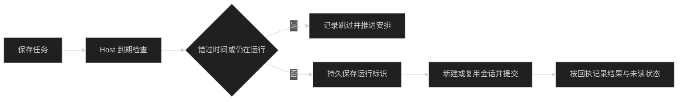

# 定时任务

点击左侧时钟图标进入定时任务页面。页面按执行 Host 切换任务列表；任务由所属 Host 保存和执行，与当前打开的聊天无关。Desktop 和 Web 使用同一页面与接口。

## 创建与管理

点击「新建任务」，填写名称、执行说明和重复规则。也可从项目周报、待办回顾、依赖检查或每日提醒模板开始。模板只预填表单，保存安排时不调用模型。

「高级」设置执行项目、时区、会话模式、模型、思考强度、访问权限、Agent 插件及通知。默认每天 09:00，使用创建端时区，每次开启新聊天，完成后在应用内提醒。保存前显示下一次执行时间。模型、权限和插件配置保存在任务中，后续运行使用该配置，不跟随界面当前聊天变化。

创建后不能更改执行 Host 或项目。需要改变位置时，在目标 Host 创建另一个任务。没有关联项目的任务使用 Host 的独立工作目录。

任务详情显示执行说明、安排和运行记录。展开运行记录会将该次结果标记已读；「打开聊天」可查看模型回复和工具记录，并继续交流。模型正文仍由 Pi JSONL 保存，调度文件只保存配置、状态和会话引用。

- 「立即运行」不会改变原有周期，已暂停或已结束的任务也可手动运行。
- 「暂停」只停止后续调度，不停止当前运行。编辑只影响下一次执行。
- 「停止本次运行」沿用会话停止接口。运行期间禁止删除任务。
- 删除任务会移除安排和运行记录，已生成的聊天保留。
- 关闭「每次运行时都开启新聊天」后，任务复用自己的专属聊天。聊天正在使用时跳过本次，不追加排队消息；聊天被删除后任务暂停，可先重新建立专属聊天，再恢复安排。

## 时间与恢复

| 规则     | 行为                                                                              |
| -------- | --------------------------------------------------------------------------------- |
| 单次     | 在选定日期和时间执行，结束后不再自动调度                                          |
| 每天     | 按任务时区每天执行一次                                                            |
| 工作日   | 周一至周五，不包含节假日调整                                                      |
| 每周     | 在选择的一个或多个星期执行                                                        |
| 固定间隔 | 每隔正整数分钟或小时执行，最小 1 分钟；从保存的起始时间计算，首次在一个间隔后运行 |

时间戳以 UTC 保存，日历规则使用任务保存的 IANA 时区。修改电脑或 Host 的系统时区不会改变已有任务。夏令时不存在的本地时间跳过，重复的本地时间只运行第一次。

同一任务最多有一次活跃运行。正常调度允许 30 秒延迟，超过则跳过；Host 启动时不补跑过去的安排。长时间离线合并记录错过次数。过期单次任务显示已结束，仍可手动运行。

调度需要 Host 保持运行。关闭任务页面不影响执行；退出所属 Host 或电脑休眠后无法执行。没有系统通知、后台守护进程或自动唤醒电脑。通知可选每次完成、仅失败或关闭；断线恢复未读状态，不集中弹出历史提醒。

Host 在会话控制与插件恢复后启动调度。先保存运行记录，再使用固定幂等键创建会话和提交。重启时核对回执，将未完成执行标记中断，不自动重发结果不确定的请求。缺失项目、模型、凭据或插件时记录具体原因，不更换执行目标。

## 存储与接口

任务存储在数据根下的 `state/modules/%40pi-meme%2Fschedules/schedules.json`，包含版本、任务和运行记录，使用临时文件写入后原子替换。数据目录的唯一写入者仍是所属 Host。

`capabilities().features` 包含 `schedules` 时使用 `host.schedules`：

| 接口                                                             | 参数                                                              |
| ---------------------------------------------------------------- | ----------------------------------------------------------------- |
| `list`                                                           | 无                                                                |
| `get`                                                            | `ScheduledTaskRef`                                                |
| `create`                                                         | `ScheduledTaskInput, MutationOptions`                             |
| `update`                                                         | `ScheduledTaskRef, ScheduledTaskInput, MutationOptions`           |
| `pause`、`resume`、`delete`、`runNow`、`stopRun`、`resetSession` | `ScheduledTaskRef, MutationOptions`                               |
| `runs`                                                           | `ScheduledTaskRef, { offset?, limit? }?`；默认 50 条，上限 200 条 |
| `markRead`                                                       | `ScheduledTaskRef, runId, MutationOptions`                        |

任务引用为 `{ hostId, taskId }`，跨 Host 引用会被拒绝。写操作使用现有 `idempotencyKey`。`schedule` 控制事件携带 `taskId`，客户端收到后重新读取任务；断线后通过快照恢复。旧 Host 不支持时，页面明确提示需要更新 Host。

类型定义见 [schedules.ts](../packages/contracts/src/schedules.ts)，HostApi 接线见 [app-control.ts](../packages/host/src/app-control.ts)。
