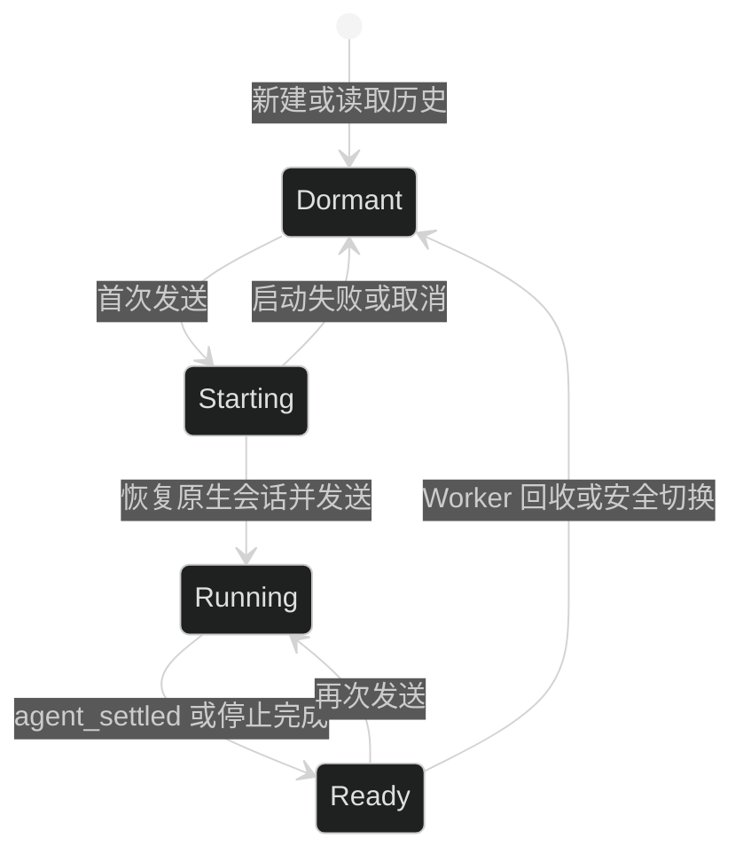
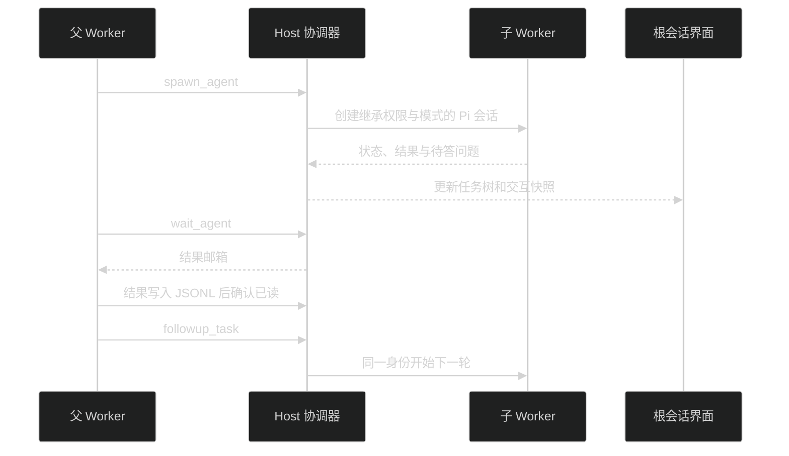
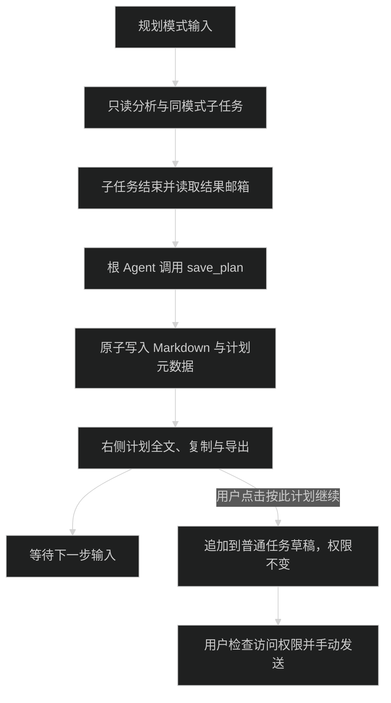

# 会话与协作

Desktop 和 Web 使用同一 Host 会话实现。Pi SDK 负责原生 JSONL、恢复、分支、编辑版本与压缩；内置历史模块只索引、查询、导出和展示，不提供任意存储替换。源码入口是 [会话池](../packages/pi-runtime/src/session-pool.ts)、[SDK 会话](../packages/pi-runtime/src/sdk/session.ts) 和 [历史模块](../packages/history/src/)。

## 会话与 Worker 生命周期

正式控制接口创建会话时立即保存稳定 `SessionRef`，首次写入 Pi JSONL 后再绑定文件路径；空会话也有独立身份。内部 `sessionKey` 是当前进程的映射，不能代替持久目标。协议见 [HostApi v2](host-api.md)。

新建会话、选择历史或切换页面先读取本地投影，首次发送才创建或恢复所属 Worker。每个执行会话持有独立 Worker，切换到其他会话不改变已发送消息的执行目标。

图中状态描述 Worker 生命周期，不是公开 `AppSession.status` 的枚举。`agent_end` 不表示已经空闲，`agent_settled` 才结束执行。旧 Worker 事件按 generation 隔离，过期启动结果释放；停止响应和结束事件只处理一次。

Worker 创建时固定技能资源快照与外部插件代次。资源变更发布新修订后，相关任务和未答交互结束才退役旧 Worker；新一轮读取新修订。纯 Agent 插件版本可共存，共享 Server 组切换需等待所属调用和租约释放，详见 [插件生命周期](plugins.md#释放与更新)。

模型配置修改保留空闲检查、恢复状态捕获、写文件、重连和恢复顺序。失败保留会话身份、正文和已保存配置；原模型已不存在时要求重新选择，模型与命令缓存随重连失效。回归入口见 [session-mutations.test.ts](../packages/pi-runtime/tests/session-mutations.test.ts) 与 [model-reconnect.test.ts](../apps/desktop/tests/model-reconnect.test.ts)。

## 输入、插话与队列

每条输入保存自己的 `mode`，包含发送、插话、排队、撤回和失败重试；后续队列项不跟随界面当前的规划开关变化。结构见 [QueuedInput](../packages/contracts/src/plan.ts)，输入实现见 [composer](../packages/chat/src/ui/composer/)。

正式 API 的投递方式是 `start`、`queue`、`steer`；运行中拒绝 `start`，队列与回执规则见 [HostApi 提交](host-api.md#提交与回执)。网络断线只恢复连接和快照，不自动重发 prompt。Host 重启将未完成提交标记为中断，不重放模型调用。

## 草稿与历史搜索

Desktop 和 Web 将文字草稿、已选技能引用和队列模式保存到当前界面的 `localStorage`，按 Host 与正式会话 ID 隔离。刷新页面后恢复；发送请求尚未确认时保留原草稿，成功后清理，等待期间输入的新草稿不被清理。实现见 [composer-drafts.ts](../packages/app-ui/src/session/composer-drafts.ts)。

图片只保留在窗口内，不写入 `localStorage`；存在未保存图片、浏览器禁用存储或空间不足时，离开页面会要求确认。草稿是未加密的浏览器本地数据，不跨设备同步；清理网站数据也会清理草稿。

侧栏搜索可按服务和项目筛选。标题即时匹配，正文输入停顿 250ms 后在所属 Host 检索，只返回命中摘要，不把完整历史传到界面。每次请求最多 100 个会话，每个请求最多并行读取 4 个文件；界面分批请求，结果每次展开 100 条。

正文搜索包含会话文件中保存的用户与助手消息及分支正文，不搜索思考、工具输出和图片。打开结果进入该会话，不自动切换到命中的旧分支。单个 Host 搜索失败时保留其他 Host 的结果并显示错误；关闭搜索或更改查询后不再采用旧响应。入口见 [历史检索](../packages/history/src/server/session-search.ts) 和 [搜索窗口](../packages/workspace/src/ui/sidebar/session-search-dialog.tsx)。

## 持续子代理

子代理由 [coordinator.ts](../packages/subagents/src/server/coordinator.ts) 管理身份、父子树、容量、邮箱与调度。[Host 协作桥](../packages/host/src/collaboration-bridge.ts) 校验真实 Worker 身份，不接受客户端伪造工具调用。每个子任务有独立 Worker 和 Pi JSONL，共享父任务工作目录。

| 工具              | 行为                                                           |
| ----------------- | -------------------------------------------------------------- |
| `spawn_agent`     | 创建子身份与首次任务；`task_name` 用职责明确的 snake_case 短名 |
| `send_message`    | 投递邮箱消息；目标空闲时不自动启动新一轮                       |
| `followup_task`   | 保留 agentId 和 JSONL；空闲时开启新 runId，运行中按顺序排队    |
| `interrupt_agent` | 中断目标任务，保留身份供后续使用                               |
| `list_agents`     | 查询任务树与状态，不消费邮箱                                   |
| `wait_agent`      | 等待并读取消息与结果；结果写入 Pi JSONL 后确认已读             |

工具参数见 [Agent 入口](../packages/subagents/src/agent/entry.ts) 和 [协作契约](../packages/contracts/src/collaboration.ts)。当前上限为 4 个活动子 Agent、两层后代、16 个子身份；等待子任务仍占活动容量。旧角色定义与启用字段保留兼容，不是使用协作工具的前提。

子任务继承父模型、思考等级、访问权限、任务模式、外部 Agent 选择和资源快照。默认 `fork_turns=all` 从最新闭合历史取安全分支，父历史只作为模型背景，委派消息指定当前子任务；`none` 使用新上下文。分支与来源边界见 [safe-session-fork.ts](../packages/pi-runtime/src/safe-session-fork.ts) 和 [agent-conversation.ts](../packages/pi-runtime/src/agent-conversation.ts)。

每轮根任务更新 `rootTaskId/epoch`，事件还携带 runId 和执行代次。普通来源消息也在安全边界写入 JSONL 后按 messageId 确认；进入投递队列不等于落盘或已读。每个父子 Worker 分别持有外部插件租约。主任务停止和 Host 退出取消后代及未启动任务；插件切换等待相关执行与租约，不为切换取消任务。

协作身份、邮箱和计划元数据保存到 `collaboration.json`，子会话继续保存在 `sessions/` 下。Host 重启恢复身份与历史，将原未完成任务记为中断，不自行续跑。

## 子代理的界面与交互

主会话只显示子任务完成等简短阶段，普通对话和会话树过滤内部报告、身份及控制消息。自动续跑使用隐藏 custom message，不新增用户 JSONL 节点或改写草稿。子身份也从普通最近会话与项目计数中排除。

[右侧子代理面板](../packages/app-ui/src/panels/subagents-panel.tsx) 按已开启与已结束分组，后代按层级缩进。详情按持久 `conversationOrigin` 边界展示子任务自己的消息、思考、工具、错误与后续轮次，不展示模型继承的父历史，不改变根会话选择，也不提供编辑、分支或输入。

旧子会话通过原生 header 的 `parentSession` 和共同 entry IDs 恢复边界；无法确认时明确报错，不猜测裁剪或改写 JSONL。子任务提问进入根快照，回答按实际源 sessionKey、agentId 和执行代次处理，避免误答其他子任务。覆盖测试见 [agent-conversation.test.ts](../packages/pi-runtime/tests/agent-conversation.test.ts) 与 [collaboration-integration.test.ts](../packages/host/tests/collaboration-integration.test.ts)。

## 规划模式与计划文件

输入 `/plan`、`/计划` 或 `/计划模式` 激活输入区的规划标记。纯命令只切换模式，带正文时发送计划任务；关闭标记返回 default。解析规则见 [normalizePlanMessage](../packages/contracts/src/plan.ts)。

规划模式只允许 `read`、`grep`、`find`、`ls`、六个协作工具、`request_user_input` 和 `save_plan`。[plan-mode.ts](../packages/pi-runtime/src/extensions/plan-mode.ts) 同时过滤可用工具并检查实际调用；bash、edit、write、codemode、MCP、外部工具与嵌套越权均被拒绝。子代理继承规划模式，不能向仍在默认模式运行的子任务派发消息来绕过限制。

只有规划模式根 Agent 可保存计划，子任务或其队列未结束、结果未读时拒绝保存。同一轮再次保存更新同一计划的修订。正文在 `plans/<sessionId>/<id>.md`，目录中的 sessionId 来自 Pi 原生会话；元数据在 `collaboration.json`。失败恢复上一版正文和元数据，成功后发出 `plan_saved`。

[计划面板](../packages/app-ui/src/panels/plan-panel.tsx) 展示完整只读 Markdown，可切换文档、复制和导出。保存计划不会自动执行，也不会自动关闭规划标记。“按此计划继续”把当前文档的标题、修订和完整正文追加到已有草稿，切回普通任务模式，不修改访问权限、不自动发送；运行、切换或编辑消息期间禁用该按钮。实现与验证见 [coordinator.ts](../packages/subagents/src/server/coordinator.ts)、[plan-mode.test.ts](../packages/pi-runtime/tests/plan-mode.test.ts) 和 [coordinator.test.ts](../packages/subagents/tests/coordinator.test.ts)。
