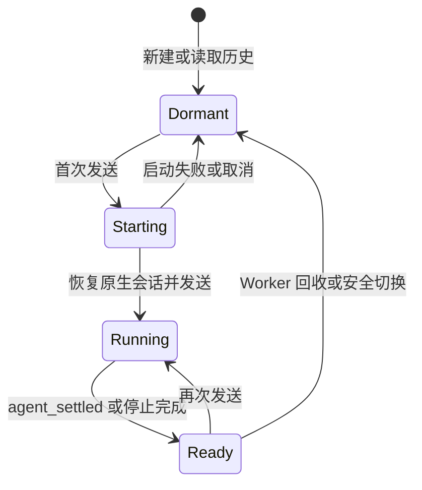
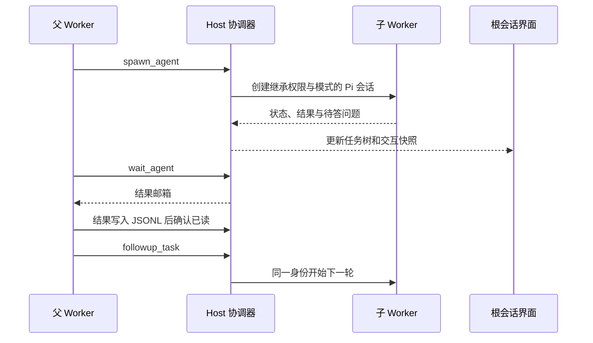
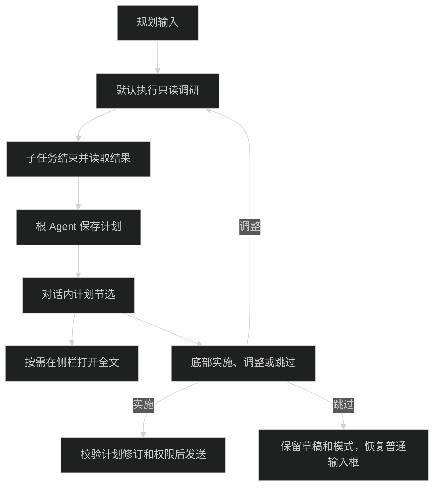
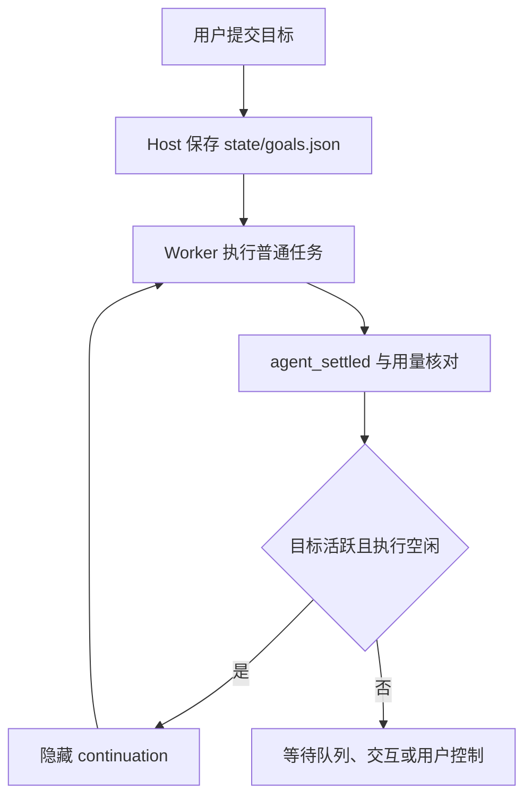

# 会话与协作

Desktop 和 Web 使用同一 Host 会话实现。Pi SDK 负责原生 JSONL、恢复、分支与压缩；内置历史模块只索引、查询、导出和展示，不提供任意存储替换。源码入口是 [会话池](../packages/pi-runtime/src/session-pool.ts)、[SDK 会话](../packages/pi-runtime/src/sdk/session.ts) 和 [历史模块](../packages/history/src/)。

## 会话与 Worker 生命周期

正式控制接口创建会话时立即保存稳定 `SessionRef`，首次写入 Pi JSONL 后再绑定文件路径；空会话也有独立身份。内部 `sessionKey` 是当前进程的映射，不能代替持久目标。协议见 [HostApi v2](host-api.md)。

新建会话、选择历史或切换页面先读取本地投影，首次发送才创建或恢复所属 Worker。每个执行会话持有独立 Worker，切换到其他会话不改变已发送消息的执行目标。

界面保留最近 20 个会话的视图缓存，切回时先显示已有正文、草稿和滚动位置，再校验 Host 快照。新建时立即显示空白草稿并允许输入文字；Host 确认正式身份前禁止发送和配置写入，创建失败保留草稿供重试。切换完成的快照同时返回正式会话身份，界面无需再请求解析一次。

界面首屏请求最近 60 条消息，页首向前扩展至完整用户轮次。更早记录使用原生 entry ID 分页读取；刷新保留已展开的起点，起点被历史编辑移除后回到最近记录。不带分页参数的内部快照和正式 HostApi 仍返回完整投影。单会话身份解析不扫描全部历史；命令按资源修订复用，资源变更后失效，插件策略读取不等待纯技能扫描。

主聊天区域保留最近 3 个会话的实际面板。切换到已缓存会话时可以立即阅读、滚动和复制；Host 确认前不能发送、编辑或分叉。同步失败保留缓存正文，点击“重试同步”重新确认；已删除会话不再保留。隐藏面板通过 React `Activity` 停止订阅、滚动观察和计时器，输入框与 Host 事件订阅仍只有一套。

原生历史的消息偏移和有效分支映射保存在 `cache/session-history/`，消息正文仍从原始 JSONL 按页读取。首次打开需要建立索引；文件未变化时可跨 Host 重启复用。Host 已确认的普通追加可以更新索引尾部；分支、编辑、压缩、文件替换或旧版格式不满足增量条件时重新投影或走完整读取。索引可以删除和重建，不改写原生历史。后台预取只保留一个待执行任务，点击读取优先。

界面读取使用 `SessionWindow.details = 'deferred'`，先返回消息窗口、必要状态和当前页的模型变化；会话树与附件目录在打开对应面板时读取完整快照。`historyRevision` 防止迟到详情覆盖已变化的历史，`historyDetails` 区分完整详情和省略详情。Worker 在返回窗口快照前完成消息分页，分页结果不覆盖 Host 的完整历史副本。

Worker 在 Host 分配事件序号前，以最多 16ms 合并同一内容块的文本、思考和工具参数增量；达到 32KiB、内容块切换或出现语义事件时立即提交。前端可见会话按帧更新，后台已缓存会话每 250ms 合并更新，消息完成和交互边界立即提交。暂停、权限、错误和工具执行结果不合并。

浏览器 Network 中普通 `/api/rpc` 响应的 `Server-Timing` 包含 `host`（Host 处理）与 `serialize`（JSON 序列化）耗时，单位为毫秒；不包含网络传输、压缩或界面渲染时间。

图中状态描述 Worker 生命周期，不是公开 `AppSession.status` 的枚举。`agent_end` 不表示已经空闲，`agent_settled` 才结束执行。旧 Worker 事件按 generation 隔离，过期启动结果释放；停止响应和结束事件只处理一次。

Worker 创建时固定技能资源快照与外部插件代次。资源变更发布新修订后，相关任务和未答交互结束才退役旧 Worker；新一轮读取新修订。纯 Agent 插件版本可共存，共享 Server 组切换需等待所属调用和租约释放，详见 [插件生命周期](plugins.md#释放与更新)。

模型配置修改保留空闲检查、恢复状态捕获、写文件、重连和恢复顺序。失败保留会话身份、正文和已保存配置。打开历史会话或重连时，原模型不可用则使用默认模型；默认模型也不可用时选择其他可用模型。思考强度使用该模型的设置或全局默认值，并按模型支持的档位调整。没有可用模型时需要先配置模型。模型与命令缓存随重连失效。回归入口见 [session-configuration.integration.test.ts](../packages/pi-runtime/tests/session-configuration.integration.test.ts) 与 [model-reconnect.integration.test.ts](../apps/desktop/tests/model-reconnect.integration.test.ts)。

## 当前活动：项目服务

Agent 通过内置 `manage_service` 工具启动常驻项目服务，例如 `pnpm run start:web`。工具提供 `start`、`list`、`logs`、`stop`；构建、测试等短命令仍使用 `bash`。启动命令须前台运行，不使用 `&`、`nohup` 或自行脱离进程组的 daemon；不接管已有 PID。

服务归属正式根会话，子 Agent 启动的服务也显示在根会话，并标明来源。Host 从真实 Worker 校验来源、权限和任务模式，受限服务仍使用原工作区的沙箱授权。规划模式不能调用该工具。

右侧工具目录在有启动中、运行中或停止中服务时显示“活动”及数量。面板可复制命令、查看只读日志和直接停止服务；停止调用 Host 控制接口，不发送聊天消息或启动模型轮次。最后一个服务结束后入口隐藏，已经打开的标签保留结果；关闭、切换或刷新后不恢复空标签。

Agent 本轮结束、停止响应、Worker 回收、切换会话、关闭工具标签和刷新页面都不停止已移交 Host 的服务。用户明确停止或 Host 正常退出才清理；删除会话前先停止所属服务，失败则不删除。应用内切换 Git 分支、维护存储或降低相关权限前，需要先处理活动服务。新分叉不继承旧会话的服务。

停止先请求进程组退出，超时后强制清理；确认清理完成才显示已停止。进程存活只表示“运行中”，不代表 HTTP 已就绪。断线保留最后快照并标记状态待确认，重连后重新读取。远程 Host 的回环地址只能代表 Host 本机，不提供端口转发。

运行记录和日志保留在 Host 内存，不在重启后恢复服务。日志尾部有大小上限，不持续发送给模型。Host 被强制终止、系统崩溃或程序主动脱离管理时，不保证所有平台都没有残留进程，也不会按保存的旧 PID 盲目终止其他进程。第一版受管执行支持 macOS 和 Linux/WSL，未支持的平台明确拒绝启动。

实现见 [活动服务](../packages/activities/src/server/service.ts)、[Agent 工具](../packages/activities/src/agent/entry.ts)、[活动面板](../packages/activities/src/ui/activity-panel.tsx) 和 [活动契约](../packages/contracts/src/service-activity.ts)。

## 对话中的正文与活动

聊天按正文分段显示，同一段内连续发生的思考和工具调用合并为一条活动摘要。顶部计时是整轮工作过程的折叠开关，包含中间正文、思考和工具调用。运行时展开，整轮结束时自动收起，最终回复保留在外面；历史轮次默认收起，可手动展开查看。分段使用现有轮次数据，不修改 Pi JSONL。

每条活动摘要默认折叠。展开区高度最多为 256px，且不超过窗口高度的 40%，思考、工具输出和 diff 共用该区域滚动。流式更新保留手动选择；总开关收起时保留各活动的展开状态，再次展开可继续查看。查看过程或活动时暂停主消息流的自动跟随，可用回到底部按钮恢复。

总开关与父活动组使用 240ms 的高度和透明度过渡，收起时保留已展开的内容节点。各层箭头仅在悬停或键盘聚焦时显示，不改变行宽。当前运行的父活动摘要复用思考文字从左到右的扫光，以重复光带连续循环，图标复用思考呼吸动画，暂停、等待回答和完成后停止；减少动态效果设置会关闭动画。

助手消息的复制和分叉操作只出现在每条用户输入对应的最终回复下方，整轮结束后显示。子代理状态切开的中间正文和正在生成的正文均不显示消息操作；查看后续运行时，历史轮次的最终回复仍保留操作。

父摘要显示累计活动，图标与颜色不随单次工具开始或结束切换，不另加处理状态行。提问工具显示等待回答，失败调用在折叠时保留失败标记。点击含失败的摘要会展开对应工具详情。耗时仍按整轮统计并扣除暂停区间。实现见 [活动分段](../packages/chat/src/ui/model/activity-summary.ts)、[轮次渲染](../packages/chat/src/ui/conversation/assistant-turn.tsx) 和 [活动详情](../packages/chat/src/ui/conversation/activity-group.tsx)。

## 本轮文件变更

运行中，输入框上方显示本轮文件数和新增、删除行数；悬停或聚焦后显示文件列表。结束后，回复下方保留变更卡片，默认列出 3 个文件；“查看变更”打开右侧变更面板，点击文件可直接查看该文件的差异。活动中的编辑和创建条目显示行数，悬停时以红绿区分；新建文件尾部显示蓝点，覆盖已有文件显示“已编辑”。成功且有差异记录的条目可点击或通过 Enter、空格展开，显示文件名、增删统计、行号、语法高亮和复制 Diff 按钮；长内容在 256px 高度内滚动。

只记录本会话的 `edit`、`write`，包括 codemode 内的嵌套调用，不包含命令、子代理或其他工具产生的修改。记录按原生用户消息 entry ID 归属，同一文件显示本轮首次修改前与最后写入后的净差异。快照保存在会话 JSONL 旁的 `<会话文件>.changes/`，不加入模型上下文，删除会话时一并清理。旧会话没有保存的快照无法补建；新分叉不复制源会话的撤销记录。

“撤销”恢复本轮首次修改前的内容，新建文件会被删除，不修改 Git 暂存区。只读权限和运行中的任务不能撤销；文件存在后续修改、路径变化，或本轮两次写入之间被其他操作修改时，拒绝整轮撤销。撤销结果保存在 Host，重新打开会话后仍显示已撤销。

## 输入、插话与队列

每条输入保存自己的 `mode`，包含发送、插话、排队、撤回和失败重试；后续队列项不跟随界面当前的规划开关变化。结构见 [QueuedInput](../packages/contracts/src/plan.ts)，输入实现见 [composer](../packages/chat/src/ui/composer/)。

正式 API 的投递方式是 `start`、`queue`、`steer`；运行中拒绝 `start`，队列与回执规则见 [HostApi 提交](host-api.md#提交与回执)。网络断线只恢复连接和快照，不自动重发 prompt。Host 重启将未完成提交标记为中断，不重放模型调用。

模型连接失败且自动重试结束后，输入框为空、没有附件或技能引用时，右下角显示“恢复当前任务”；错误行不增加操作。恢复请求等待期间不能重复提交，空输入按 Enter 不恢复。有草稿时仍显示发送，恢复不清空草稿。存在未结束 Goal 时仍使用目标状态条的恢复，普通恢复入口隐藏，Host 也拒绝该操作，避免绕过目标暂停和用量限制。

恢复只接受当前分支最新可重试错误的原生 entry ID，通过内部 `pi:recover` 控制接口继续原会话，不新增用户消息、不重发原始任务。Pi `context_edit` 省略尾部失败助手消息，保留此前成功回复和工具结果；聊天与会话树隐藏已省略的错误，原始 JSONL 记录保留用于记账。重新打开会话仍采用省略后的上下文。恢复沿用失败轮次的任务模式和当前访问权限，不修改输入框的模式选择。中断中的文本可能重新生成，执行结果不确定的外部操作仍需先核对。

实现见 [恢复判定](../packages/pi-runtime/src/sdk/recovery.ts)、[SDK 会话](../packages/pi-runtime/src/sdk/session.ts) 和 [输入框按钮](../packages/chat/src/ui/composer/composer-toolbar.tsx)；持久化回归见 [session-recovery.integration.test.ts](../packages/pi-runtime/tests/session-recovery.integration.test.ts)。

## 编辑用户消息

点击用户消息的“编辑”后重新发送，会覆盖这条输入，并删除它原来的回复及后续对话，再从编辑位置生成回复。原会话身份和编辑位置之前的上下文保持不变，不保留可切换的消息版本。取消编辑不修改会话记录。运行中和暂停后也可进入编辑；进入或取消编辑不停止原任务。编辑框底部可选择模型与思考强度，发送时先停止旧执行及子任务，再按所选配置重发；成功后后续消息沿用该配置。未投递的旧队列移入当前窗口的待恢复列表，不自动发送。“从这段回复新建会话”仍用于创建独立会话，不属于消息编辑。

点击“停止当前任务”后，未执行队列保留。主输入框调整的模型或思考强度先暂存；清空输入后点击“继续当前任务”，按所选配置继续已有对话，保留历史，不重新覆盖原用户消息。有草稿时发送新的消息。需要替换原输入时，使用消息的“编辑”入口；覆盖只修改对话历史，不撤销工具已经产生的文件修改。

实现见 [SDK 会话](../packages/pi-runtime/src/sdk/session.ts) 与 [聊天输入状态](../packages/chat/src/ui/use-chat-session.ts)，持久化验证见 [session-branch.integration.test.ts](../packages/pi-runtime/tests/session-branch.integration.test.ts)。

## 草稿与历史搜索

Desktop 和 Web 将文字草稿、已选技能引用和队列模式保存到当前界面的 `localStorage`，按 Host 与正式会话 ID 隔离。刷新页面后恢复；发送请求尚未确认时保留原草稿，成功后清理，等待期间输入的新草稿不被清理。实现见 [composer-drafts.ts](../packages/app-ui/src/session/composer-drafts.ts)。

图片只保留在窗口内，不写入 `localStorage`；存在未保存图片、浏览器禁用存储或空间不足时，离开页面会要求确认。草稿是未加密的浏览器本地数据，不跨设备同步；清理网站数据也会清理草稿。

侧栏搜索可按服务和项目筛选。标题即时匹配，正文输入停顿 250ms 后在所属 Host 检索，只返回命中摘要，不把完整历史传到界面。每次请求最多 100 个会话，每个请求最多并行读取 4 个文件；界面分批请求，结果每次展开 100 条。

正文搜索包含会话文件中保存的用户与助手消息及分支正文，不搜索思考、工具输出和图片。打开结果进入该会话，不自动切换到命中的旧分支。单个 Host 搜索失败时保留其他 Host 的结果并显示错误；关闭搜索或更改查询后不再采用旧响应。入口见 [历史检索](../packages/history/src/server/session-search.ts) 和 [搜索窗口](../packages/workspace/src/ui/sidebar/session-search-dialog.tsx)。

## 侧边临时聊天

右侧工具列表提供“侧边聊天”入口。首次打开时，临时聊天绑定当前会话的项目或 Worktree，并继承模型、思考强度、Agent 插件选择和访问权限。它使用独立消息上下文，之后切换主会话不会改变已绑定的目标；侧边聊天不进入历史、最近会话或搜索。

收起右侧栏、切换工具或切换主会话不会删除侧边聊天，也不会中断后台执行。关闭侧边聊天标签时，Host 停止所属任务并清理临时数据；关闭失败时标签保留，界面允许重试。

客户端在断线宽限期内重连可以恢复临时会话；超过宽限期后 Host 清理该会话。Host 启动时清理上次运行遗留的临时会话目录。

## 持续子代理

子代理由 [coordinator.ts](../packages/subagents/src/server/coordinator.ts) 管理身份、父子树、容量、邮箱与调度。[Host 协作桥](../packages/host/src/collaboration-bridge.ts) 校验真实 Worker 身份，不接受客户端伪造工具调用。每个子任务有独立 Worker 和 Pi JSONL，共享父任务工作目录。

| 工具              | 行为                                                                 |
| ----------------- | -------------------------------------------------------------------- |
| `spawn_agent`     | 创建子身份与首次任务；`task_name` 用职责明确的 snake_case 短名       |
| `send_message`    | 投递阶段反馈；等待反馈的原任务在原会话继续，已结束任务只保存到邮箱   |
| `followup_task`   | 保留 agentId 和 JSONL；空闲时开启新 runId，运行中按顺序排队          |
| `interrupt_agent` | 中断目标任务，保留身份供后续使用                                     |
| `list_agents`     | 查询任务树与状态，不消费邮箱                                         |
| `wait_agent`      | 等待并读取消息与结果；结果写入 Pi JSONL 后确认已读                   |
| `finish_agent`    | 子代理确认整个委派任务完成后提交最终报告；回复结束后向委派方交付结果 |

工具参数见 [Agent 入口](../packages/subagents/src/agent/entry.ts) 和 [协作契约](../packages/contracts/src/collaboration.ts)。当前上限为 4 个活动子 Agent、仅一层子代理、16 个子身份；等待子任务仍占活动容量。旧角色定义与启用字段保留兼容，不是使用协作工具的前提。

同一任务内使用 `send_message` 反馈、`wait_agent` 等待，收到消息后继续执行；多轮协作保留原 task、runId 和原生会话。普通回复只结束本次模型输出，子任务继续等待反馈；未主动向委派方发送的阶段正文会自动反馈一次。只有调用 `finish_agent` 且本次回复结束，才标记任务完成并提交最终结果。需要验收的任务先等待确认；仍有未读反馈或活动下级任务时拒绝完成。`followup_task` 用于派发下一项任务。

发送和等待均支持 agentId、完整 taskPath、下级或同级任务短名；短名重合时优先下级，跨层使用完整路径。子代理可等待委派方或主代理的消息，祖先任务结束不会代替消息唤醒。等待超时不完成任务；暂停期间保存反馈，恢复后继续原任务。停止和中断后的迟到消息不会重新启动任务。

同一条反馈只通过等待结果或普通消息投递接收一次。已经开始普通投递的反馈不再复制到 `wait_agent.messages`，等待结果的 `notifiedBy` 记录发送方；正文随普通消息写入原会话。历史中的等待结果也参与消息去重。

在“设置 → Agent → 子代理”配置默认模型和默认思考强度，选择后自动保存到当前 Host。两项独立设置，未配置时继承主会话派发任务时的值；用户明确指定的单次配置优先于默认值。设置仅影响之后新建或续派的任务，运行中及已排队任务保留原配置；发送反馈不会切换模型。指定模型不可用时拒绝派发，不自动回退。只有主会话可以创建和续派一级子代理；旧多层记录保留读取、中断和清理能力，不能续派二级任务。

子任务继承主会话的访问权限、任务模式、外部 Agent 选择和资源快照。默认 `fork_turns=all` 从最新闭合历史取安全分支，父历史只作为模型背景，委派消息指定当前子任务；`none` 使用新上下文。分支与来源边界见 [safe-session-fork.ts](../packages/pi-runtime/src/safe-session-fork.ts) 和 [agent-conversation.ts](../packages/pi-runtime/src/agent-conversation.ts)。

每轮根任务更新 `rootTaskId/epoch`，事件还携带 runId 和执行代次。普通来源消息也在安全边界写入 JSONL 后按 messageId 确认；进入投递队列不等于落盘或已读。每个父子 Worker 分别持有外部插件租约。主任务停止和 Host 退出取消后代及未启动任务；插件切换等待相关执行与租约，不为切换取消任务。

协作身份、邮箱和计划元数据按根分片保存到 `state/collaboration/`（旧版本为 `collaboration.json`），子会话继续保存在 `data/sessions/` 下。Host 重启恢复身份与历史，将原未完成任务记为中断，不自行续跑。

从一段回复新建会话时，只复制这段记录里出现过的已结束子代理：新身份、新会话文件，任务路径保持不变，原会话继续使用原来的子代理。复制进来的那次运行不再在主对话合成第二条状态。子代理仍在运行或排队时不能新建。活动服务不随分叉继承。

## 子代理的界面与交互

主会话只显示子任务完成等简短阶段，普通对话和会话树过滤内部报告、身份及控制消息。自动续跑使用隐藏 custom message，不新增用户 JSONL 节点或改写草稿。子身份也从普通最近会话与项目计数中排除。

[右侧子代理面板](../packages/app-ui/src/panels/subagents-panel.tsx) 按已开启与已结束分组，后代按层级缩进。详情按持久 `conversationOrigin` 边界展示子任务自己的消息、思考、工具、错误与后续轮次，不展示模型继承的父历史，不改变根会话选择，也不提供编辑、分支或输入。

旧子会话通过原生 header 的 `parentSession` 和共同 entry IDs 恢复边界；无法确认时明确报错，不猜测裁剪或改写 JSONL。子任务提问进入根快照，回答按实际源 sessionKey、agentId 和执行代次处理，避免误答其他子任务。覆盖测试见 [agent-conversation.unit.test.ts](../packages/pi-runtime/tests/agent-conversation.unit.test.ts) 与 [collaboration-integration.integration.test.ts](../packages/host/tests/collaboration-integration.integration.test.ts)。

## 规划模式与计划文件

输入 `/plan`、`/计划` 或 `/计划模式` 激活输入区的计划标记。纯命令只切换后续输入的模式，带正文时发送计划任务；关闭标记返回执行模式。切换不改变正在运行的轮次。解析规则见 [normalizePlanMessage](../packages/contracts/src/plan.ts)。

规划模式保留读取、搜索、协作、提问与保存计划，命令和可用的 MCP 调研工具默认执行，无需逐次确认。已知写入命令被拒绝。codemode 可编排可用工具，每个嵌套调用仍经过实际准入检查，不能直接使用模型调用入口。实现见 [plan-mode.ts](../packages/pi-runtime/src/extensions/plan-mode.ts)。

MCP 查询和通用脚本工具不再要求单次或本轮调研授权。明确声明破坏性写入、且未声明只读的工具在 Plan 中隐藏并拒绝执行。工具是否可用仍由 Host 注册信息决定；SDK 3 受限插件继续检查已有的安装、选择和能力授权。

Plan 始终使用只读沙箱，即使会话选择完全权限。命令与本地 MCP 进程不能修改业务文件；临时输出使用沙箱临时目录。MCP 的 HTTP 查询仍依赖用户信任的外部接口语义，本地沙箱不保证远端只读。可信 App 插件仍不导入，SDK 3 受限只读插件继续按已有授权执行。子代理继承父级上限，不能向普通模式子任务派发消息绕过限制。权限边界见 [插件执行与授权](configuration.md#插件执行与授权)。

只有规划模式根 Agent 可保存计划，子任务或其队列未结束、结果未读时拒绝保存。每个会话只维护一份当前方案，普通输入和“调整要求”都更新该方案。需要独立方案时新建会话。界面不显示版本号，内部修订用于拒绝过期引用。

正文在 `data/plans/<sessionId>/<id>.md`，当前状态和候选元数据在 `state/collaboration/plans.json`。成功的 `save_plan` 原生工具结果包含完整方案检查点。候选写入后，必须等原生结果落盘才发布 `plan_state_changed`；未确认的候选不能实施。刷新和重启沿当前原生分支恢复最后一次成功保存的方案，压缩后的模型消息不是恢复依据。旧索引中的孤立文件继续保留，但不展示、不实施。分叉继承分叉点之前的方案内容，并使用新会话自己的文档身份。

保存后不自动打开侧栏。唯一卡片位于最新保存方案的回复处，只显示节选，提供保存 Markdown、复制全文和侧栏打开。卡片、侧栏和实施读取同一份当前正文。底部“实施此计划？”复用模型与思考强度选项；Host 校验计划归属和内部修订，读取实际保存的正文，不信任客户端提交的计划正文。

进入历史消息编辑时，临时隐藏编辑点之后的方案并隐藏实施入口；取消编辑恢复原展示。新用户消息落盘且历史替换提交后，恢复编辑点之前最后一份有效方案；此前没有方案则清空。提交前失败恢复原历史和方案，提交后模型失败不恢复已被撤销的内容。编辑时同时移除该消息自己的隐藏计划上下文。所有窗口接收完整替换状态，清空后的迟到事件不能重新添加旧方案。

实施保留已有草稿，不自动附带未发送内容；沿用执行权限，只读权限需要先选择允许修改的权限。跳过或关闭仅恢复普通输入框，不发送消息、不切换模式，同一内部修订不重复询问；方案更新或回退后可重新确认。调整文字随会话草稿保存，临时隐藏、刷新及提交失败不会丢失。正在调研、切换、编辑或等待交互时不提供实施操作。实现见 [plan-decision.tsx](../packages/app-ui/src/panels/plan-decision.tsx)，定向验证见 [plan-mode.integration.test.ts](../packages/pi-runtime/tests/plan-mode.integration.test.ts) 和 [agent-plans.integration.test.ts](../packages/subagents/tests/agent-plans.integration.test.ts)。

## 持久目标 Goal

在输入框选择 `/goal`、`/目标` 或 `/目标模式`，填写目标后发送。纯命令只打开目标标记或已有目标详情，不创建目标或调用模型；`/goal <正文>` 直接创建并执行。图片和技能使用现有附件入口。创建标记与 Plan 一样，悬停或键盘聚焦时显示关闭按钮，点击取消创建并保留草稿，不弹出说明窗口。

已有目标显示在输入框上方的独立状态条，包含状态、目标摘要、用量和累计执行时间；右侧可以清除、暂停或恢复、展开详情。新目标仅从主输入框的 `/` 菜单创建。会话运行或已有未完成目标时不能创建新目标。

Goal 绑定正式 `SessionRef`，每个会话只有一个当前目标；未完成目标需要编辑或清除后才能替换。它独立于 `TaskMode`，执行使用普通模式。Desktop 和 Web 共用 Host 调度；切换聊天或关闭 Web 页面不会停止已开始的目标，Host 退出会停止执行。

| 命令           | 行为                             |
| -------------- | -------------------------------- |
| `/goal pause`  | 暂停目标并停止当前轮和后代任务   |
| `/goal resume` | 检查执行条件后恢复目标           |
| `/goal edit`   | 暂停后打开目标正文编辑           |
| `/goal clear`  | 停止并清除当前目标，保留会话记录 |

详情显示状态、累计 Token、累计执行时间、最近进展和停止原因。编辑目标保留已用 Token 与执行时间。进入 Plan、停止会话或提交历史消息编辑时暂停目标；退出 Plan 和新分支均不自动启动目标。Host 重启核对原生会话中的用量后保留暂停状态，需要手动恢复。

状态为 `active`、`paused`、`blocked`、`usage_limited`、`complete`。用户队列、待答交互、重试和子代理协作唤醒优先于 Goal 续跑。同一真实阻塞连续三轮才进入 `blocked`；连续三轮没有实质执行也会停止并显示原因。

执行持久目标的根 Agent 可按需通过 `get_goal` 刷新状态，并通过 `update_goal` 记录进展或提交完成证据；已有目标快照时不必每轮读取。普通对话、子代理和非执行状态不提供目标工具，过期目标提示不会进入下一轮模型上下文。完成前需要逐项核对原目标，Host 同时检查子任务、未读结果、交互、工具和用户队列。

目标元数据保存在数据目录的 `state/goals.json`，图片与执行正文由 Pi JSONL 保存；首轮输入尚未成功写入原生会话时，目标存储暂存输入，恢复后重试首轮，确认原生记录后移除暂存。用量沿用 Pi 的 `totalTokens`，包括缓存、目标所属子代理、上下文压缩和有用量的失败调用；按原生记录去重。服务商未提供有效用量时，标记统计不完整；已知用量继续累计。

实现入口是 [目标服务](../packages/goals/src/server/service.ts)、[目标工具](../packages/goals/src/agent/entry.ts) 和 [目标详情](../packages/goals/src/ui/goal-control.tsx)。
