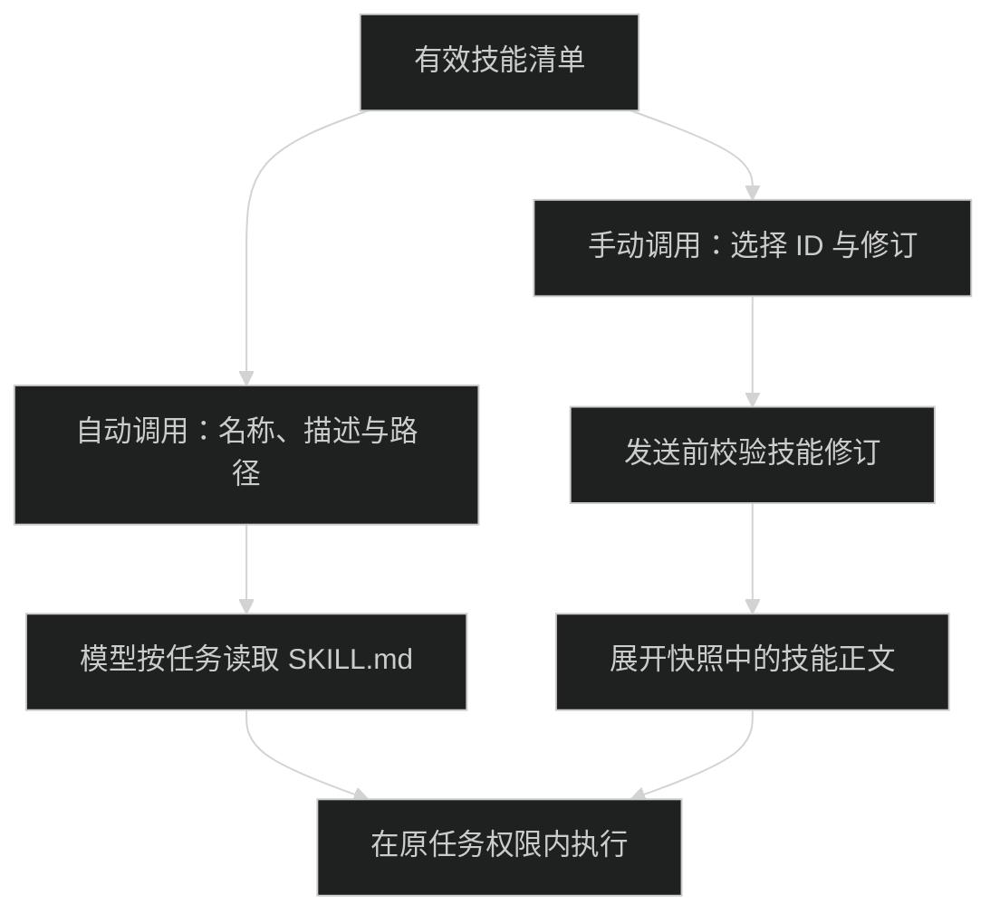

# 技能与 App 资源

技能由 Host 统一扫描与管理，裸 Pi 扩展不在支持范围。配置与凭据见 [配置与安全](configuration.md)，插件开发见 [App 插件](plugins.md)。

设置 Agent 区有“模型、指令、技能、插件、MCP”五个独立入口。技能页和插件页各自用“个人 / 系统”分类，不在同一页混合类型。个人技能来自当前设备、当前项目或已安装插件；系统技能随应用提供。个人插件是用户安装的 App 插件；系统插件是应用自带工具。AI 模型配置位于 Agent 区的模型页。目录查询不需要启动模型；用于当前聊天时，技能必须进入当前会话的有效清单。

“添加 → 创建技能”和“添加 → 创建插件”关闭设置，把系统技能 Skill Creator、Plugin Creator 插入当前对话。创建插件时草稿为“帮我创建一个插件”。技能尚未进入当前会话命令列表时留在设置页并提示，不发送消息。

Desktop 和 Web 都通过 Host RPC 管理资源。连接远程 Host 时，所有导入、保存和策略修改写入远程 Host 数据根；从 Host 目录导入时填写远程路径，上传文件则读取当前电脑上的文件。

页面用“设备”指当前连接的执行服务，不展示连接地址和项目路径。需要查找源文件或运行副本时，在详情中展开“文件信息”。

## 目录与类型

Host 数据根默认为 `~/.pi-meme`，可用 `PI_MEME_DATA_ROOT` 修改：

```text
~/.pi-meme/
├── skills/                      # 可编辑的用户技能
├── builtin-resources/skills/    # 应用内置技能
├── resources/
│   ├── state.json               # 导入记录与 Host 默认策略
│   └── snapshots/               # 按内容哈希保存的完整资源修订
├── workspaces/<cwd-hash>/
│   └── resources.json           # 项目覆盖策略
└── plugins/                     # App 插件代码快照与安装清单
```

项目资源只读取当前工作目录的 `.agents/skills/`。这些文件不由管理页直接修改；项目策略保存到所属 Host。裸 Pi 扩展、原生 Pi 包、Host `extensions/` 和项目 `.agents/extensions/` 不再装配；旧文件不自动转换成 App 插件。应用不读取本机 Pi CLI、Codex、Claude 或 Gemini 的全局技能目录。

| 类型        | 管理内容                              | 执行方式                                            |
| ----------- | ------------------------------------- | --------------------------------------------------- |
| AI 模型配置 | 服务商、模型、协议、地址与凭据        | Host 保存配置与凭据，Worker 调用模型                |
| 技能        | `SKILL.md` 与脚本、引用、素材目录     | 按描述自动选择，或用户显式调用；正文按需读取        |
| App 插件    | App SDK 3 manifest、构建目录或 `.pim` | 可信/受限 Server 与 Agent、UI、包内技能、主题和素材 |
| MCP         | 服务配置、授权与连接状态              | 内置 MCP 客户端连接明确授权的服务                   |

模型配置与 MCP 通过各自设置页管理，文件与授权规则见 [配置与安全](configuration.md)。App Server 由 Host 全局管理，不为每个项目另建实例。

资源扫描、冲突与快照由 [ResourceStore](../packages/resources/src/server/resource-store.ts) 管理。系统技能源码在 [pi/skills](../pi/skills/)，目前包括 [skill-creator](../pi/skills/skill-creator/) 和 [plugin-creator](../pi/skills/plugin-creator/)。Desktop 与 Server 构建携带这些目录，Host 启动复制到 `builtin-resources/skills/`，不改用户技能目录；见 [install-builtin-skills.ts](../packages/resources/src/server/install-builtin-skills.ts)。缺少 Skill Creator 时 Host 拒绝启动。

## 导入与编辑

导入、ZIP 解包和路径校验见 [resource-files.ts](../packages/resources/src/server/resource-files.ts)。技能导入接受 `SKILL.md`、完整技能目录或自包含 ZIP；App 插件使用构建目录或 `.pim` 安装。ZIP 支持普通存储和 Deflate，不支持加密、软链接、分卷和 ZIP64。上传和解压内容上限均为 32 MiB；目录与文件列表不能越过包根。导入只保存已有文件，不安装 npm 依赖、不执行安装脚本，也不执行构建。

一个技能的可移植形式是：

```text
review/
├── SKILL.md
├── scripts/
└── references/
```

```markdown
---
name: review
description: 检查代码修改，列出可复现的问题和对应位置。
---

读取 references/checks.md，再检查当前修改。运行脚本时，以本技能目录为相对路径起点。
```

用户技能名称使用 1 至 64 位小写字母、数字和连字符，`description` 不能为空。可添加 `display-name` 和 `short-description`，分别用于列表名称和简短说明。需要脚本、引用或素材时上传整个技能目录，单个 `SKILL.md` 不会补齐缺失的文件。

导入保留技能的完整目录和相对引用。更新同一个导入来源会发布新修订。相同安装名称来自另一个来源时，导入被拒绝，避免覆盖现有资源。Web 可在详情中上传新文件或文件夹，携带原修订校验后替换完整资源；更新技能目录时，辅助文件也必须包含在更新内容中。

管理页只编辑 Host 散装技能的 `SKILL.md`，辅助文件保留。保存携带读取时的 `revision`，其他客户端已更新时必须重新读取。项目、内置和 App 附带技能只读，可以“复制为用户技能”后编辑。App 附带技能、主题和素材随整个 App 插件卸载，资源管理接口不能拆掉插件内文件。

## 默认策略与项目覆盖

Host 默认策略控制资源启停；当前项目可以覆盖启用状态和技能调用方式。项目设置写入 `workspaces/<cwd-hash>/resources.json`，不写项目 `.agents`。App 的项目策略控制当前项目的资源和 UI 可用性；实际 Agent 选择保存在会话 `configuration.agentPlugins`。新会话默认列表在 Host 的 `settings.json.defaultAgentPlugins`，初始为空；修改默认只影响后续会话。运行中拒绝修改会话选择，Host Server 生命周期仍由 App 插件全局启停控制。

技能默认允许自动调用；“仅手动调用”保留显式选择入口，但不把技能加入模型自动选择列表。`disable-model-invocation: true` frontmatter 也可设置手动默认值。技能目录中的 `agents/openai.yaml` 支持 `interface.display_name`、`interface.short_description` 和 `policy.allow_implicit_invocation`；后者为 `false` 时默认仅手动，为 `true` 时不会覆盖 frontmatter 的手动限制，Host/项目显式策略优先。无效 YAML 或调用策略会显示诊断并默认仅手动；禁用的技能不进入有效快照。

同名散装技能保留内置项优先，其次项目项，再其次 Host 项；停用内置技能后仍保留其名称，外部同名技能不会顶替，被覆盖项在清单中标记 `shadowedBy`。同一作用域存在多个启用的同名技能时，全部显示冲突诊断并退出有效快照；停用重复项可解除冲突。App 附带技能的名称带插件名前缀，例如 `@local/review-tools:review`。

## 聊天中的技能

Pi 使用逐步加载：先把可自动调用技能的名称、描述和路径放入系统提示词，任务匹配后由模型读取 `SKILL.md`。脚本、引用和素材仍由技能正文按任务需要引用，不把所有文件提前放入上下文。

输入 `$` 打开技能专用列表；输入 `/` 打开统一列表，顶部保留命令，下方按“技能”“插件”分组。两种入口选择技能都插入相同的行内图标与名称。“用于当前聊天”只选择技能并返回输入框，不自动发送。选中项携带 `id`、`revision` 和 `name`；发送时校验当前会话清单，把对应快照中的正文展开成 `<skill>` 内容。资源已删除或修订改变时要求重新选择，不静默替换成同名技能。

`/` 中的插件仅指具有 Agent 入口的 App 插件，不包含纯主题、UI 或 Server 插件；Plugin Creator 仍属于技能。插件选择保存为会话配置，并在本条草稿中以图标与名称显示；删除未发送引用取消选择。发送后清空输入框引用，但会话配置保留，后续消息继续使用插件，不重新显示旧引用。待发送引用 ID 随草稿保存，失败时恢复，不进入消息正文或技能引用数组。运行中不能增删插件，权限限制不变。

显式展开见 [skill-prompt.ts](../packages/pi-runtime/src/skill-prompt.ts)，Pi 资源适配见 [resource-loader.ts](../packages/pi-runtime/src/sdk/resource-loader.ts)。正文、描述发现和运行时加载使用 Pi，不读取其他 Agent 配置，也不授予新的权限。



Pi JSONL 记录本轮资源快照 ID、技能修订。显式展开的技能保存 `explicit` 使用记录，成功读取有效 `SKILL.md` 保存 `implicit-read` 记录；部分读取会标记 `partial`。历史或压缩之后仍能查询已使用资源，必要时模型重新读取正文，不把“曾使用”当成“正文一直在上下文中”。

Worker 创建时固定资源快照，子代理继承父快照。安装、编辑和策略修改发布新修订；已运行任务继续使用原修订，相关执行和未答交互结束后退役旧 Worker，下一轮取得新版本。App Agent 代次也继承父租约，更新期间不让子任务混用新 Agent 与旧资源。

## Host 接口

类型见 [resources.ts](../packages/contracts/src/resources.ts)，客户端见 [resource-client.ts](../packages/client/src/resource-client.ts)，处理函数见 [entry.ts](../packages/resources/src/server/entry.ts)。以下为内置界面的 `/api/rpc` 方法，不是正式 HostApi v2 的方法；外部 App 对系统目标的操作使用 [HostApi](host-api.md)。

| 方法                   | 参数                                 | 结果                                          |
| ---------------------- | ------------------------------------ | --------------------------------------------- |
| `resources:catalog`    | 可选 `cwd`                           | `ResourceCatalog`，含所有来源、覆盖标记和诊断 |
| `resources:detail`     | `id`、可选 `cwd`                     | 单个 `ResourceItem`                           |
| `resources:refresh`    | 可选 `cwd`                           | 重新扫描后的目录与新代次                      |
| `resources:import`     | `ResourceImportInput`、可选 `cwd`    | 导入后的目录                                  |
| `resources:remove`     | `id`、可选 `cwd`                     | 删除 Host 用户技能后的目录                    |
| `resources:read-skill` | `id`、可选 `cwd`                     | `{ item, content }`                           |
| `resources:save-skill` | `ResourceSkillSaveInput`、可选 `cwd` | 保存后的目录                                  |
| `resources:set-policy` | `ResourcePolicyInput`                | 更新策略后的目录                              |

`ResourceImportInput` 必须恰好提供一种输入：Host `path`、单文件 `content`、ZIP `archiveBase64` 或 `files` 列表。`files` 每项含包内 `path`、`content` 和可选 `encoding: 'utf8' | 'base64'`；`kind` 只接受 `skill`。App `.pim` 仍使用 `plugins:install-package`，已构建 App 目录由 Host 转给插件安装接口。

显式更新额外传 `replace: { id, revision }`。它只接受 Host 用户技能，校验名称、入口和修订，保持原安装身份。校验或发布失败保留原版本。

新建技能传 `name`、`content`；修改现有技能传 `id`、读取时的 `revision`、`content`。策略传 `id`、`scope: 'host' | 'project'` 与可选 `enabled`、`invocation: 'automatic' | 'manual'`，项目策略需要 `cwd`。内置资源身份和文件受保护；内置技能允许 Host/项目启停和自动/手动调用策略。项目策略传 `reset: true` 清除覆盖，恢复 Host 默认。

## App 主题与图形能力

App SDK 3 的 `resources` 只接受 `skills`、`themes` 和 `assets`。主题用 JSON 描述颜色、字体和可选背景；背景图片必须位于插件包内，并在 `assets` 中声明。Host 为启用插件加载主题，图片通过认证资源 URL 提供。停用或卸载撤销主题并恢复可用的内置主题；不执行主题 JavaScript 或任意 CSS。

App UI 面板仍只允许 `right`；六类 render 贡献槽、正文来源代次校验、输入框 API、统一消息动作与插件业务页见 [App 插件](plugins.md#ui-面板与贡献)。页面可新增自己的活动栏入口与中央业务内容，但不能替换内置导航或聊天。AppAgent 通过 `context.interaction.request` 提问，不直接使用 Pi UI 或 TUI 组件。

`read-only`、`workspace-write`、`full-access` 三档权限保持不变。技能在原任务权限内读取和执行。MCP 仍只在完全权限普通任务中装配；SDK 3 外部 AppAgent 则按所选入口和授权决定：Plan 与受限权限仅加载获准的受限入口，可信入口仅在完全权限普通任务中加载。未选择或不可用的插件不会隐式启用。可信 Server 仍是 Host 代码，不因 Agent 权限而受限；受限 Server 使用独立进程内的窄接口，不能回退可信 Server。执行矩阵与实际平台边界见 [插件执行与授权](configuration.md#插件执行与授权)。

验证入口：[resources.integration.test.ts](../packages/host/tests/resources.integration.test.ts)、[resource-lifecycle.integration.test.ts](../packages/host/tests/resource-lifecycle.integration.test.ts)、[resource-snapshot.integration.test.ts](../packages/pi-runtime/tests/resource-snapshot.integration.test.ts)。
