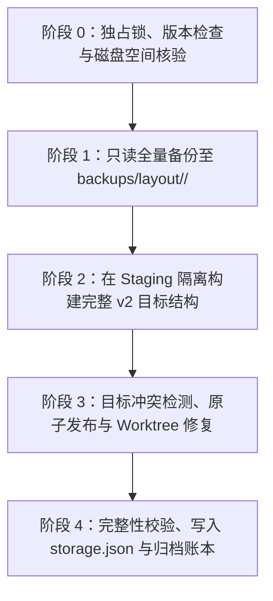

# 数据目录与存储维护

Host 的应用配置、持久状态、执行数据与内部管理的工作区文件保存在其数据根目录（默认 `~/.pi-meme`，开发版默认 `~/.pi-meme-dev`）。数据根由 Host 独占写入，使用 `storage.json` 标识规范化布局版本。

外部项目的工作区文件保留在用户本机的项目目录中，数据根仅保存外部项目的配置覆盖（`config/workspaces/<cwd-hash>/`）与原生会话记录（`data/sessions/<cwd-hash>/`）；只有无外部项目的独立会话目录（`workspaces/standalone/<id>`）与应用创建的 Git Worktree 检出目录（`workspaces/worktrees/<id>`）才位于数据根内部。

## 布局概览与版本

自版本 2 起，Host 数据目录采用严格分类的层级结构，根目录仅保留身份、版本与锁文件，业务数据分流到对应子目录：

```text
~/.pi-meme/
├── storage.json                         # 布局清单（format: 'pi-meme-data', version: 2）
├── host-id                              # 持久 Host 身份
├── host.lock                            # 唯一写入锁
├── config/
│   ├── app.json                         # 应用偏好与新会话默认值（原 settings.json）
│   ├── ssh-connections.json             # SSH 连接资料与已确认 Host 身份，不含令牌
│   ├── profile/                         # 用户资料与头像图片
│   ├── agent/                           # Pi SDK 设置、模型、MCP、指令与子代理
│   │   ├── settings.json
│   │   ├── models.json
│   │   ├── mcp.json
│   │   ├── device-id
│   │   ├── AGENTS.md
│   │   ├── SYSTEM.md
│   │   ├── APPEND_SYSTEM.md
│   │   └── subagents/
│   └── workspaces/<cwd-hash>/            # 工作区覆盖配置（mcp-overrides.json, resources.json）
├── credentials/
│   └── auth.json                        # 凭据存储（权限 0600）
├── state/
│   ├── projects.json                    # 项目与 Worktree 登记
│   ├── goals.json                       # 目标持久化状态
│   ├── agent-permissions.json           # 会话权限映射
│   ├── resources.json                   # 资源导入记录与策略
│   ├── plugins.json                     # 已安装插件清单（版本化 envelope）
│   ├── requests.jsonl                   # RPC 请求接纳追加日志（永久防重放）
│   ├── control/                         # 控制状态（snapshot.json, events.jsonl, operations.jsonl）
│   ├── collaboration/                   # 协作根分片（roots/<rootAgentId>.json, plans.json）
│   ├── modules/<encoded-plugin-id>/     # 内置服务模块私有数据
│   └── maintenance/                     # 维护账本与升级历史报告
├── data/
│   ├── sessions/<cwd-hash>/*.jsonl      # Pi 原生执行会话分支
│   ├── plans/<sessionId>/<planId>.md    # 计划 Markdown 正文
│   └── attachments/upload-*/            # 聊天上传附件
├── resources/
│   ├── skills/                          # 用户技能
│   ├── themes/                          # 用户主题
│   ├── builtin/skills/                  # 应用随包内置技能
│   └── snapshots/                       # 历史资源修订内容快照
├── plugins/
│   ├── packages/                        # 已安装外部插件代码快照
│   └── data/<encoded-plugin-id>/        # 外部插件持久私有数据
├── workspaces/
│   ├── standalone/<id>/                 # 无外部项目会话的真实工作目录
│   └── worktrees/<id>/                  # 应用创建的 Git Worktree 检出目录
├── cache/
│   ├── sessions.json                    # 会话索引缓存（可重建）
│   └── remote-services.json             # 远程服务摘要缓存（可重建）
├── logs/
│   └── mcp.log                          # MCP 运行日志
└── backups/                             # 仅在升级或迁移维护时创建
    ├── layout/<job-id>/                 # 升级前历史数据与元数据完整副本
    └── legacy/<job-id>/                 # 归档的历史遗留未引用目录
```

### 目录与文件职责清单

| 相对路径                       | 用途                                     | 读写者                                                    | 可否重建           | 回收规则                                                |
| ------------------------------ | ---------------------------------------- | --------------------------------------------------------- | ------------------ | ------------------------------------------------------- |
| `storage.json`                 | 布局版本元数据                           | Host 启动引导                                             | 否（关键标记）     | 永久保留                                                |
| `host-id`                      | Host 唯一持久 UUID                       | Host 启动引导                                             | 否（决定身份）     | 永久保留                                                |
| `host.lock`                    | 数据根互斥锁                             | `lockDataRoot`                                            | 是（运行时持有）   | 退出释放                                                |
| `config/app.json`              | 应用偏好设置                             | `SettingsStore`                                           | 否                 | 永久保留                                                |
| `config/ssh-connections.json`  | SSH 连接资料、启用状态与已确认 Host 身份 | `SshConnections`                                          | 否                 | 仅在保存、启停或移除连接时更新，不属于缓存              |
| `config/profile/`              | 用户个人资料与头像                       | `SettingsStore`                                           | 否                 | 永久保留                                                |
| `config/agent/`                | Pi SDK 运行时配置与指令                  | `ModelConfigStore`, `McpConfigStore`, `InstructionsStore` | 否                 | 永久保留                                                |
| `config/workspaces/`           | 针对特定 cwd 哈希的 MCP 与资源覆盖       | `McpConfigStore`, `ResourceStore`                         | 否                 | 永久保留（与工作区 cwd 哈希绑定，项目移除时不清理覆盖） |
| `credentials/auth.json`        | 连接与服务凭据（0600）                   | `FileCredentialStore`                                     | 否（敏感凭据）     | 永久保留                                                |
| `state/projects.json`          | 登记项目与活动 Worktree                  | `ProjectStore`                                            | 否                 | 显式移除项目时更新                                      |
| `state/goals.json`             | 目标执行与续跑状态                       | `GoalService`                                             | 否                 | 目标清除或会话成功删除时清理                            |
| `state/agent-permissions.json` | 会话文件权限映射                         | `AgentAccessStore`                                        | 否                 | 会话成功删除时级联清理                                  |
| `state/resources.json`         | 技能策略与导入记录                       | `ResourceStore`                                           | 否                 | 永久保留                                                |
| `state/plugins.json`           | 插件安装记录与代次高水位                 | `PluginManager`                                           | 否                 | 卸载插件时更新                                          |
| `state/requests.jsonl`         | 请求去重日志                             | `RequestRegistry`                                         | 否（防重放）       | 永久追加，不加 TTL                                      |
| `state/control/`               | 快照与操作、事件日志                     | `ControlStore`                                            | 否                 | 事件保留 4096 条窗口，快照增量压缩                      |
| `state/collaboration/`         | 子代理根分片与计划索引                   | `Coordinator`                                             | 否                 | 依 rootAgentId 分片保存，不自动删除历史                 |
| `state/modules/`               | 内置服务模块持久数据                     | 内置模块（如 activities 等）                              | 否（服务数据）     | 依各内置模块业务规则管理                                |
| `data/sessions/`               | Pi 原生 JSONL 会话历史                   | Pi Worker, `SessionPool`                                  | 否（用户历史）     | 用户显式删除会话时物理删除                              |
| `data/plans/`                  | 计划正文 Markdown                        | `Coordinator`                                             | 否（用户成果）     | 永久保留                                                |
| `data/attachments/`            | 消息上传文件                             | `chat-attachments`                                        | 否（用户文件）     | 永久保留，失败上传自动删除                              |
| `resources/`                   | 技能、主题与历史快照                     | `ResourceStore`                                           | 否                 | 具有历史内容引用语义，不自动批量删除                    |
| `plugins/packages/`            | 外部插件解压代码                         | `PluginManager`                                           | 是（可重新安装）   | 插件卸载且无活动租约后修剪                              |
| `plugins/data/`                | 外部插件持久私有数据                     | 已安装外部 App 插件                                       | 否（插件私有资产） | 插件卸载默认保留，不自动删除                            |
| `workspaces/standalone/`       | 独立会话的工作目录                       | Host 进程与会话 Worker                                    | 否（用户代码）     | 仅在无任何会话引用的空目录可安全回收                    |
| `workspaces/worktrees/`        | Git Worktree 检出目录                    | `GitService`                                              | 否（工作树）       | 显式关闭/删除 Worktree 时清理                           |
| `cache/`                       | 会话索引与远程连接摘要                   | `SessionService`, `RemoteServices`                        | 是                 | 缓存清理时安全清空                                      |
| `logs/mcp.log`                 | MCP 服务运行日志                         | `McpConfigStore`                                          | 是                 | 正常日志输出                                            |
| `backups/`                     | 升级历史与旧内容归档                     | `upgradeStorageLayout`                                    | 否（恢复备份）     | 用户手动管理，不自动删除                                |

## SSH 连接资料与摘要

SSH 资料属于发起连接的入口 Host，不属于远端 Host，也不存放在浏览器本地配置中。路径通过 [storage-paths.ts](../packages/contracts/src/storage-paths.ts) 定义，实现见 [ssh-connections.ts](../packages/host/src/ssh-connections.ts)。

| 保存位置                                          | 内容与用途                                                                                                          | 不包含                                         |
| ------------------------------------------------- | ------------------------------------------------------------------------------------------------------------------- | ---------------------------------------------- |
| `config/ssh-connections.json`                     | JSON 数组；稳定 24 位十六进制连接 ID、名称、目标、可选 SSH 端口与身份文件路径、`enabled`、首次验证后保存的 `hostId` | Host 令牌、私钥内容、临时转发端口、PID、Cookie |
| `credentials/auth.json` 的 `ssh-host:<连接ID>` 键 | 自动准备生成的 Host 访问令牌；通过现有凭据存储写入                                                                  | SSH 私钥副本或 SSH 密码                        |
| `cache/remote-services.json`                      | 已验证远程服务的项目和会话摘要，用于断线时显示列表                                                                  | 会话 JSONL 正文离线副本或唯一连接配置          |
| 入口 Host 内存                                    | 当前受管进程、临时 loopback 地址、Cookie、重试计时与运行阶段                                                        | 可跨重启复用的隧道进程                         |

新添加的连接默认启用，自动准备 Host 后才发布可执行目标。连接 ID 不随业务端口或临时本地端口变化。首次尚未验证的资料只在 SSH 设置页显示，不创建假 Host 身份；验证成功后，持久 `hostId` 用于防止旧项目/会话摘要指向另一 Host。

配置文件通过临时文件加原子替换保存；读取或结构校验失败会保留原文件并报错，不自动改成空列表。令牌保存在权限为 `0600` 的凭据文件中，文件权限不等于加密；备份必须按敏感数据处理。SSH 配置与私钥仍由系统管理，身份文件字段只引用入口机器的绝对路径或 `~/` 路径。迁移数据根不会移动或复制外部身份文件，也不把其中的路径自动改成远端路径。

暂停保留配置、令牌和摘要，将 `enabled` 设为关闭并停止入口隧道；远端任务与数据不变。入口 Host 重启只尝试恢复已启用连接，暂停连接不会被读取列表或业务请求隐式唤醒。移除删除入口连接资料、对应令牌和摘要，不删除远端会话或项目；界面移除当前 SSH 服务前会检查未保存内容。使用步骤与会话行为见 [Remote](remote.md#会话来源暂停与移除)。

清理 `cache/remote-services.json` 不会删除 `config/ssh-connections.json` 或 `ssh-host:<连接ID>` 凭据。清理后列表摘要需在成功连接后重新读取；尚未连接时不能从缓存恢复正文。

自动部署的包缓存位于入口 `cache/ssh-host-packages/`，按固定版本和平台存放校验后的归档。远端应用包位于 `~/.local/share/pi-meme/host/<版本>/<平台>`，数据使用远端 `~/.pi-meme`。远端运行描述单独位于 `~/.local/state/pi-meme/ssh-host`，目录 `0700`，文件 `0600`；只保存 PID、端口、Host/实例身份与版本，不保存令牌。下次 SSH 引导核实实例身份后，从现有 `credentials/auth.json` 读取 `host:token`，通过 SSH 私有输出返回入口，不新增凭据副本或控制协议。

## 启动引导与就地升级

Host 在取得 `host.lock` 独占写入锁后，在业务模块加载前调用 `assertStorageLayout(root)`：

1. **空目录**：自动写入 `storage.json`（版本 2），完成新数据根初始化。
2. **当前版本（版本 2）**：校验清单格式与版本通过后直接进入业务初始化。
3. **旧版数据根（版本 1）**：检测到旧版文件（如根下 `settings.json`、`auth.json`、`projects.json` 等）且缺少 `storage.json` 时，自动进入就地升级流程。
4. **中断任务**：检测到根下存在未完成的任务账本 `.storage-layout-upgrade-<jobId>.json` 时，调用 `resumeStorageLayoutUpgrade(root, jobId)` 自动重入恢复。
5. **外来未知目录**：目录包含非空未知文件且无任何 pi-meme 特征时，明确报错拒绝启动，防止误改无关文件。
6. **更高版本**：检测到 `version > 2` 时明确报错阻止启动，要求升级客户端。

## 就地升级流程与可重入账本

升级执行器位于 `packages/host/src/storage/upgrade.ts`。升级全程在持有 `host.lock` 下进行，采用基于只读备份与隔离 Staging 的状态机发布架构，账本记录于 `.storage-layout-upgrade-<jobId>.json`：



### 阶段执行细节

- **阶段 1：preparing（只读备份与哈希固化）**：
  - 递归盘点属于旧版数据根的所有受管单文件与受管目录（包括 `pi`、`sessions`、`workspaces`、`attachments`、`plans`、`profile`、`requests` 等全部子文件与点文件）；
  - 严格核验可用磁盘空间（需容纳备份全量文件、两倍余量及 16 MiB 基础缓冲）；
  - 将全部源文件以只读方式复制至 `backups/layout/<jobId>/`，逐文件严格比对源与副本的 SHA-256 哈希，生成 `backup-manifest.json`；
  - 状态推进至 `staged` 并持久化账本。
- **阶段 2：staged（Staging 隔离构建与路径重写）**：
  - 在隔离目录 `.upgrade-staging-<jobId>` 中构建全新的完整 v2 目录；
  - 统一从不可变备份源（`backups/layout/<jobId>/`）读取数据，阻断从活动根读空数据的隐患；
  - 将 `plugins/installed.json` 解析为版本化 envelope 写入 `state/plugins.json`（损坏时 fail-closed 中止，不写空覆盖）；
  - 转换旧 `control.json` 生成 `state/control/snapshot.json`、`events.jsonl`、`operations.jsonl` 并精准重写内部实体路径；
  - 将单文件追加去重日志生成为 `state/requests.jsonl`；
  - 将旧 `collaboration.json` 转换为分片存储 `state/collaboration/roots/<rootAgentId>.json` 与 `state/collaboration/plans.json`；
  - 建立真实工作目录变迁映射（`standalone-workspaces` 变更为 `workspaces/standalone`，`worktrees` 变更为 `workspaces/worktrees`），重算真实 cwd 的 SHA-256 哈希；
  - 重写 `projects.json`、`agent-permissions.json`、`resources.json`（含工作区技能的 owner 身份前缀）；
  - 逐行遍历 `data/sessions/` 下的 JSONL 会话，重写会话首行、技能调用、多模态数组及 context_edit 中的正式附件引用尾块；
  - 预计算 Staging 目录下全部待发布文件的 SHA-256 哈希清单，推进状态至 `publishing`。
- **阶段 3：publishing（冲突检测、原子移位与 Worktree 修复）**：
  - **冲突检测与来源核验**：检查根目录下所有待发布目标，若已存在非本次升级匹配的常规文件、非常规文件、目录或符号链接，一律判定为发布冲突并立即中止，保护已有内容；发布前核验来源清单与目录指纹，若来源被外部修改或新增文件时立即停止发布；
  - 搬迁真实用户工作区目录（`standalone-workspaces` 至 `workspaces/standalone`，`worktrees` 至 `workspaces/worktrees`，大目录直接重命名避免大文件复制）；
  - 归档历史未引用文件（旧 `builtin-*` 插件、`validation-sources`、`validation-results`、`extensions`、`secure/credentials.bin`）至 `backups/legacy/<jobId>/`；
  - 仅将明确转换/替换的旧源原件移入 `backups/layout/<jobId>/originals/`；`resources/snapshots` 等保持原位；仅清理确定空的旧目录；
  - 将 Staging 目录中的所有生成文件原子发布（`rename`）至根目录对应位置，并校验哈希；
  - 针对所有登记的 Worktree 调用 `git worktree repair` 并验证工作树顶层路径；
  - 推进状态至 `verified`。
- **阶段 4：verified / committed（完整性校验与提交）**：
  - 校验 `host-id`、`config/app.json`、`state/projects.json`、`state/control/snapshot.json`、`state/plugins.json` 等元数据完整性；
  - 确保 `credentials/auth.json` 权限为 0600；
  - 原子写入根清单 `storage.json`（`version: 2`）；
  - 账本状态标记为 `committed` 并归档至 `state/maintenance/layout-upgrade-<jobId>.json`；
  - 清理临时 Staging 目录与根下临时账本文件。

## 换根迁移维护

从桌面“设置 → 常规 → 存储 → 更改目录”迁移整个数据目录至新路径时，执行器位于 `packages/host/src/storage/migrate.ts` 与 `relocate.ts`：

- **离线安全保证**：正常关闭 Host，取得源与目标目录双重排他锁；
- **全量哈希复制**：将源目录文件复制到目标目录，严格校验目标可用空间（所需容量加 16 MiB 余量）与逐文件 SHA-256 哈希；
- **新布局路径重写**：调用 `relocateStorage`，全面改写新根目录下的配置、会话定位、多模态附件尾块引用、Control Journal 与 Git Worktree 登记；
- **提交与保护标记**：提交失败自动回滚 Worktree 并清理标记；成功提交后，源目录留下 `.pi-meme-relocated.json`（标记为 `status: 'moved'`，阻止旧 Host 误启动），目标目录的 `.pi-meme-storage-job.json` 推进为 `stage: 'committed'` 作为已提交保护标记，避免在换根后被误当成未完成任务。

## 缓存清理与会话删除生命周期

### 缓存清理白名单与保护边界

从“设置 → 常规 → 缓存”执行清理时，由 `packages/host/src/storage/cache.ts` 执行：

1. **清理白名单**：
   - Host 数据目录：
     - `cache/sessions.json` 及 `.tmp`
     - `cache/remote-services.json` 及 `.tmp`
   - Electron 固定 `userData`：存在的 `Cache`、`Code Cache`、`GPUCache`、`DawnCache`、`ShaderCache`、`GrShaderCache`、`GraphiteDawnCache`。
2. **清理时的资产保护范围**：
   - 执行缓存清理时，绝不误伤用户资产：会话历史（`data/sessions/`）、计划正文（`data/plans/`）、用户附件（`data/attachments/`）、凭据（`credentials/auth.json`）、SSH 连接资料（`config/ssh-connections.json`）、技能、外部插件私有数据（`plugins/data/`）、去重与控制日志（`state/requests.jsonl`、`state/control/`）以及仍被引用的工作目录。
3. **符号链接保护**：检查到缓存中包含符号链接或特殊文件时立即中止清理，绝不沿链接删除外部文件。

### 会话删除生命周期

用户在界面主动删除会话并不受缓存清理保护限制。会话删除由 `packages/host/src/session-cleanup.ts` 管理生命周期：

- **两阶段持久意向**：在物理删除会话 JSONL 之前，必须先在 `state/maintenance/pending-cleanup-<id>.json` 持久化 `prepared` 意向记录；
- **权威会话映射**：通过 `ControlStore` 权威反查会话 ID，禁止猜测文件名；
- **成功删除驱动**：物理删除完成后记录 `deleted` 阶段，仅依据实际成功的路径与 Key，幂等级联清理 `state/agent-permissions.json`、`state/goals.json` 以及协作分片；
- **断点自愈**：启动恢复时通过 `stat` 严格核实物理已确认删除（ENOENT）的文件，未确认物理删除项不予清理，损坏账本 fail-closed 保留并报警；
- **独立目录保守清理**：独立会话工作目录（`workspaces/standalone/<id>`）在无任何会话与项目引用且物理为空时才通过非递归 `rmdir` 安全回收；缺失引用检查器时严格保守跳过。

### 启动临时文件扫尾

为防止进程异常中断后遗留原子写入碎片，Host 在独占持锁启动引导阶段（`assertStorageLayout` 完成后、业务 Store 与 Worker 启动前）由 `packages/host/src/storage/cleanup-temporary-files.ts` 执行保守扫尾：

1. **精确所有权白名单**：
   - 绝不执行模糊全盘扫描（不扫通配 `*.tmp`），不触碰外部插件私有数据（`plugins/data/`）、真实工作目录（`workspaces/`）或正在维护的 staging 目录；
   - 未能证明唯一确定归属的临时文件（如 `.instruction-<uuid>.tmp` 无法区分属于 `AGENTS.md` 还是 `SYSTEM.md`）不纳入自动清理范围，避免误删；
   - 仅匹配本应用已知 Store 生成的 6 类确定归属原子写残留：
     - Control 与 Requests 固定临时文件：`state/control/{snapshot.json,events.jsonl,operations.jsonl}.tmp`、`state/requests.jsonl.tmp`；
     - 凭据临时文件：`credentials/auth.json.<uuid>.tmp`；
     - 目标服务临时文件：`state/goals.json.<uuid>.tmp`；
     - 协作计划索引临时文件：`state/collaboration/plans.json.<uuid>.tmp`；
     - 协作根分片临时文件：`state/collaboration/roots/<rootAgentId>.json.<uuid>.tmp`；
     - 计划正文临时文件：`data/plans/<sessionId>/<documentId>.md.<uuid>.tmp`。
2. **正式文件结构校验前置判定**：
   - 仅在对应正式目标文件存在且通过各模块结构校验（Snapshot/Events/Operations 复用 Control 权威校验器，Collaboration 复用 Plans 索引与 RootPartition 分片校验器，Goals 验证版本号与目标字典，凭据验证键值结构）时，才清理对应临时文件残骸；
   - 若正式目标文件缺失（`target_missing`）或结构校验不通过（`target_corrupted`），一律保留临时文件作为恢复候选并在报告中记录，绝不自动丢弃或盲目覆盖。
3. **符号链接防护与维护互斥**：
   - 采用 `physicalPath` 逐段核验物理路径，严防符号链接逃逸与跨目录穿越；检测到符号链接项标记为 `symlink_detected` 并安全跳过，绝不沿链接删除；
   - 启动前权威检测维护状态：若存在源根重定向标记（`.pi-meme-relocated.json`）、未提交的维护账本（`.pi-meme-storage-job.json` 且阶段非 `committed`）或升级中标记（`.storage-layout-upgrade-*.json`），完整跳过启动临时文件清理。
