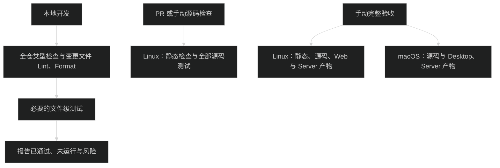

# 测试

从仓库根目录运行。Node.js 使用 24.14.0，pnpm 使用 10.29.1。

日常开发优先选择直接相关的测试文件，需要时缩到用例；确需跨包验证时才扩大到业务功能。`sessions` 会同时选择 contracts、client、Host、运行时和 UI 中的会话测试，不是局部会话改动的必跑范围。无参数 `pnpm test` 显示帮助并返回非零状态，不执行测试。



## 入口

```bash
pnpm test --file packages/contracts/tests/plan-message.unit.test.ts
pnpm test --file packages/contracts/tests/plan-message.unit.test.ts --name 中文
pnpm test --file packages/contracts/tests/plan-message.unit.test.ts --list
pnpm test --list
pnpm test --feature core --list
pnpm test --feature core
pnpm check
pnpm test:source
pnpm test:web
pnpm test --feature sessions --list
pnpm test --feature sessions
pnpm test --feature sessions --feature chat --layer unit,component
pnpm test --feature plugins --layer integration
pnpm test --all --list
```

`--list` 只列清单。`--feature` 和 `--file` 支持重复指定；`--all` 与它们互斥。`--name` 接受正则表达式，必须同时指定文件。未知功能、无匹配测试和显式选择不支持的平台都会失败。

使用 `--feature` 时默认运行 unit、component、integration，不构建应用、不启动 Electron、不收集覆盖率。`--file` 按所选文件的层次运行，选择 E2E 或产物文件仍会触发必要构建；日常应选择相关源码测试。

## 主线与专项

`pnpm test --feature core` 显式运行以下八个源码测试文件，不启动浏览器或 Electron，不构建应用。局部修改仍优先 `--file`；修改公共执行链路、需要跨包确认主线时再选 `core`。它不代替对应功能的风险回归，也不表示发布验收通过。

| 文件                                                                                                          | 验证行为                                            |
| ------------------------------------------------------------------------------------------------------------- | --------------------------------------------------- |
| [chat.unit.test.ts](../packages/chat/tests/chat.unit.test.ts)                                                 | 流式消息、最终结果、快照与重复事件合并              |
| [composer-submit.component.test.tsx](../packages/chat/tests/composer-submit.component.test.tsx)               | 提交守卫、草稿保护、失败与迟到响应                  |
| [client-auth.unit.test.ts](../packages/client/tests/client-auth.unit.test.ts)                                 | 认证、上传、暂停与重连不重发                        |
| [client-sessions.unit.test.ts](../packages/client/tests/client-sessions.unit.test.ts)                         | 显式会话目标、快速切换与后台事件隔离                |
| [host-transport.integration.test.ts](../packages/host/tests/host-transport.integration.test.ts)               | 真实 Host 认证、数据目录写锁、关闭与连接回收        |
| [app-control-core.integration.test.ts](../packages/host/tests/app-control-core.integration.test.ts)           | 稳定引用、幂等提交、历史恢复与重启不重放            |
| [pause-queue-core.integration.test.ts](../packages/pi-runtime/tests/pause-queue-core.integration.test.ts)     | 重开停止会话、暂停恢复同一请求、FIFO 与队列编辑归属 |
| [sdk-access-sandbox.integration.test.ts](../packages/pi-runtime/tests/sdk-access-sandbox.integration.test.ts) | 项目内写入、只读与越界拒绝、实际沙箱后端及进程回收  |

沙箱主线需要当前平台的真实后端；Linux 的准备条件见下文。平台不支持而跳过的用例不算该平台验收通过。

Host 与队列主线从各自专项文件中独立登记，共用所属包内的 `app-control-fixture.ts`、`pause-queue-fixture.ts`；同一用例只保留一份。原有 `chat`、`sessions` 选择仍包含这些主线文件，多个功能同时选择时按文件去重：

```bash
pnpm test --feature core --feature chat
```

存储迁移、删除、凭据、认证、权限、沙箱、插件代次与资源租约的风险用例保留在所属功能。修改这些行为时，运行直接相关文件；修改共享 fixture 时，运行引用该 fixture 的全部测试文件。不要用 `core` 通过代替这些专项检查。

## 覆盖分工

| 范围       | 自动验证保留的内容                                                 | 不单独维护的断言                                                               |
| ---------- | ------------------------------------------------------------------ | ------------------------------------------------------------------------------ |
| 设置与导航 | 未保存确认、保存期间禁止离开、实际导航、异步资料不覆盖草稿         | 骨架屏分类枚举、圆角、流光延迟、保存中提示文案、历史字段删除、每个普通菜单回调 |
| 聊天展示   | 消息顺序、正文完整、只读边界、展开与复制交互                       | 趣味文案、字号、边框、图标 class、扫光效果、图标节点位置、重复的初始折叠结构   |
| 面板拖拽   | 单元测试验证阻尼和数值边界；组件验证收起接线、草稿、实例与焦点保留 | 组件层重复计算同一阻尼数值，圆角、边距和动画 class                             |
| 错误展示   | JSON 原因解析、完整详情、关闭与设置操作、异常回退                  | Toast 坐标、颜色、动画 class；重复的空消息与卡片顺序检查集中在错误组件测试     |
| 生成指标   | 时长边界计算、估算与实际值、订阅和计时器释放                       | 每种时长重复挂载卡片、说明图标的悬停位置                                       |
| 代码高亮   | 并发加载复用实例、代表语言及别名、明暗主题                         | 逐个枚举第三方支持的全部语言                                                   |

设置导航与未保存保护在 [settings-navigation.component.test.tsx](../packages/app-ui/tests/settings-navigation.component.test.tsx)。普通文案与样式修改做针对性人工检查，不要求新增展示断言。多服务侧栏拖拽只保留一类拖拽起点，仍验证置顶与普通列表的服务标识、排序结果、偏好未就绪禁用和操作按钮不误触。

Web E2E 保留 3 个文件、4 个用例：聊天与刷新恢复、停止后继续、编辑与分叉、指令保存与重新读取。设置导航、浏览器存储维护入口不可用及聊天草稿保留合并到指令保存流程，不再单独遍历技能、插件和 MCP 页面。

不维护桌面 UI 自动化：Desktop E2E、专用 fixture 和通过 Playwright 操作 `.app` 的存储产物测试均已删除。桌面只保留源码测试，以及 [package-runtime.artifact.test.ts](../apps/desktop/tests/package-runtime.artifact.test.ts) 和 [package-signing.artifact.test.ts](../apps/desktop/tests/package-signing.artifact.test.ts) 的进程、协议、资源与签名验收；运行时验收通过调试协议调用客户端和平台 API，不操作 DOM、输入框或技能候选。Server 产物测试保留。

存储风险继续由 [storage-maintenance.integration.test.ts](../packages/host/tests/storage-maintenance.integration.test.ts)、[storage-task.integration.test.ts](../apps/desktop/tests/storage-task.integration.test.ts)、[storage-bootstrap.unit.test.ts](../apps/desktop/tests/storage-bootstrap.unit.test.ts) 和 [storage-ipc.unit.test.ts](../apps/desktop/tests/storage-ipc.unit.test.ts) 验证。真实 `.app` 的迁移入口、重启后界面恢复及缓存清理入口按需人工验收；底层测试通过不代表这些界面流程已验收。

## 日常验证与新增测试

代码任务收尾按顺序执行一轮全仓 `pnpm type-check`、变更文件的 `pnpm exec eslint <路径...>`、`pnpm exec prettier --check <路径...>`，再运行必要的相关用例。前一项通过后再执行下一项，失败修复后重跑受影响的检查。Lint 和 Format 只传本任务修改且仍存在的适用文件，包含新增和暂存文件，排除已有无关改动和已删除路径；Markdown 不传给 ESLint。仅修改文档时检查格式、链接和来源路径，不运行类型检查或应用构建。

例如修改 `packages/contracts/tests/plan-message.unit.test.ts` 时，依次运行；有多个变更文件时把所有适用路径传给 Lint 和 Format：

```bash
pnpm type-check
pnpm exec eslint packages/contracts/tests/plan-message.unit.test.ts
pnpm exec prettier --check packages/contracts/tests/plan-message.unit.test.ts
pnpm test --file packages/contracts/tests/plan-message.unit.test.ts
```

`pnpm check` 依次运行全仓类型检查、Lint、Format 和包边界检查，供 CI 与明确的全仓验收使用。日常任务仍只对变更文件运行 Lint、Format。

类型检查保留各包的独立检查范围，启用 TypeScript `incremental`。首次运行生成各目录的 `.tsbuildinfo`，后续按文件变化重新检查；缓存不提交，删除后会完整重建。CI 通过 [check-code action](../.github/actions/check-code/action.yml) 按平台、架构、锁文件和 tsconfig 缓存检查信息，每次仍执行全部检查命令。缓存不是跳过检查的条件。

`pnpm test:source` 运行全部 unit、component、integration；`pnpm test:web` 只构建 Web 并执行剩余 4 个 Web E2E。测试归所属包，共享假模型和环境在 [tests/fixtures](../tests/fixtures/)，不读取真实凭据或调用真实模型。

普通新功能不强制新增测试，不要求补齐多个层次或满足覆盖率。新增测试用于保护已发生 bug、容易写错且影响用户结果的稳定行为，或数据、凭据与权限边界。文案、CSS、导航排列、内部调用顺序不单独增加测试。同一行为优先在能可靠验证的最便宜层次覆盖，不为层次齐全而重复测试。

修 bug 先用已有用例做最窄复现，必要时补最小回归。会话持久化、存储迁移、凭据、认证和权限改动必须运行对应风险的针对性验证，缺少覆盖时补必要用例，不自动扩大到全仓。没有相关用例的普通功能可以做针对性手工检查，并报告未自动验证的部分。

未经用户明确要求相应验收，Agent 不自动运行全量测试、E2E、打包或产物验收；窗口、preload、IPC、打包接线和测试基础设施改动也不例外。单项验收只选择相应文件或平台，不扩大到整套完整测试。发布前通过明确的验收任务或手动完整 workflow 验证目标平台。

报告分别列出已通过、未运行的检查和剩余风险，不把本地任务完成写成发布验收通过。

## 层次与运行器

| 后缀                   | 运行器                           | 测试边界                                                        |
| ---------------------- | -------------------------------- | --------------------------------------------------------------- |
| `.unit.test.ts`        | Vitest / Node                    | 纯逻辑、状态投影、协议参数和明确的初始渲染契约                  |
| `.component.test.tsx`  | Vitest / jsdom / Testing Library | React 实际挂载、effect、输入、点击、状态更新和回调              |
| `.integration.test.ts` | Vitest / Node                    | 临时文件、真实 Host、Worker、HTTP/WebSocket、SDK 和插件生命周期 |
| `.e2e.spec.ts`         | Playwright                       | Web 的完整流程、焦点和布局                                      |
| `.artifact.test.ts`    | Node 原生测试                    | 构建后的 Server、真实 `.app`、签名和运行时资源                  |

单元与集成测试允许保留 `node:assert/strict` 断言；测试注册和生命周期统一使用 Vitest。不要直接替换 `node:test` 的 import 后保留不兼容的钩子：`after` 对应 `afterAll`，`t.after` 对应 `t.onTestFinished`，动态子测试改为收集阶段的 `describe` 和 `test`。

jsdom 不计算布局；测试环境补 Radix 需要的指针捕获和滚动方法，以及不触发回调的 `ResizeObserver` 订阅接口。需要验证尺寸回调的组件用例自行提供观测数据；真实尺寸、焦点和图片解码由 Web E2E 按需验证；Electron 原生按键及文件对话框按需人工检查。静态 HTML 测试只证明初始结构，不证明交互可用。不要修改 React 私有 dispatcher 来执行 effect。

## 按改动选测

先查找直接覆盖改动的文件。下表是确需跨包扩大范围时的功能索引，不是每次改动的必跑清单；多个功能也只在实际涉及对应行为时选择。

| 改动                           | 先选择的功能              | 需要扩大的条件                                                 |
| ------------------------------ | ------------------------- | -------------------------------------------------------------- |
| 输入框、流式消息、暂停和队列   | `chat`                    | 模式切换加 `plan`；技能引用加 `skills`                         |
| 历史、分支、客户端选择和恢复   | `sessions`                | 跨服务加 `connection`；项目归属加 `workspace`                  |
| 计划文档与规划限制             | `plan`                    | 子任务协作加 `subagents`；权限守卫加 `permissions`             |
| 子代理调度、消息与完成状态     | `subagents`               | 计划落盘加 `plan`                                              |
| 模型配置和凭据                 | `models`                  | 登录、重连和远程凭据加 `connection`                            |
| 插件、DevKit、资源代次         | `plugins`                 | 技能快照加 `skills`；主题加 `settings`                         |
| 技能导入、编辑和调用           | `skills`                  | 插件附带资源加 `plugins`                                       |
| MCP 配置、诊断与连接           | `mcp`                     | 规划模式限制加 `plan`                                          |
| 权限、沙箱和嵌套工具           | `permissions`、`codemode` | 规划限制加 `plan`                                              |
| 工作区、侧栏、Git 和 Worktree  | `workspace`、`git`        | 会话目标加 `sessions`                                          |
| 文件、预览、保存和终端         | `files`、`terminal`       | 工具标签与插件作用域加 `plugins`                               |
| Agent 项目服务与活动面板       | `activities`              | 沙箱权限加 `permissions`；目标与来源加 `sessions`、`subagents` |
| 设置、指令、外观和用量         | `settings`、`usage`       | 凭据加 `models`                                                |
| HTTP/WebSocket、认证与重连     | `connection`              | 目标恢复加 `sessions`                                          |
| Electron 壳、preload、平台 IPC | `desktop`、`connection`   | 先验证相关源码；产物验收需明确要求，桌面交互按需人工检查       |
| 选测入口、清单和框架配置       | `testing`                 | 加受影响文件；用 `--all --list` 核对完整清单                   |

同一文件同时验证多个功能时，可以登记多个功能，选择结果会去重。独立行为较多的大文件按功能拆分，共用所属包内的 fixture。新增文件必须登记到 [catalog.ts](../tests/catalog.ts)；`testing` 功能检查漏登记、重复登记、未知功能和层次后缀。

## 环境、报告与完整验收

Windows 原生基础验证先运行 `pnpm --filter @pi-meme/windows-native build:native`，再分别选择 `packages/windows-native/tests/windows-process.integration.test.ts`、`packages/activities/tests/windows-service.integration.test.ts` 和 `packages/host/tests/windows-ssh.integration.test.ts`。这些测试使用临时目录和测试进程，不读取真实 SSH 密钥；OpenSSH 测试需要 Windows 原生客户端。

PSEC 验证需要满足 [Windows 系统要求](configuration.md#windows-隔离)。选择 `packages/windows-native/tests/windows-plugin-sandbox.integration.test.ts` 验证不带 Node 权限参数的文件、网络、环境与派生进程限制；选择 `packages/pi-runtime/tests/windows-sandbox.integration.test.ts` 验证两档权限、junction、硬链接和后代清理。完整 Plan 与插件接线分别选择 `packages/pi-runtime/tests/plan-mode.integration.test.ts` 和 `packages/host/tests/plugin-restricted-runner.integration.test.ts`。系统能力不足应报错，不能用完全权限替代或把失败记成通过。

Windows 包验收选择 `apps/desktop/tests/windows-runtime.artifact.test.ts`，需要先准备同版本的 Windows ZIP。测试解压到中文空格目录，通过真实包检查固定 Node、Host、Worker、ConPTY、PowerShell 5.1、Plan 强制只读、工作区写入和受限 Agent/Server。它不操作桌面界面，也不代替窗口和编辑器的人工检查。

已经完成打包时，在 PowerShell 中设置测试入口已有的产物变量，避免再次触发 `package`：

```powershell
$env:PI_DESKTOP_PACKAGED_APP = (Resolve-Path 'apps/desktop/out/Pi meme-win32-x64/Pi meme.exe').Path
pnpm test --file apps/desktop/tests/windows-runtime.artifact.test.ts
```

仅在用户明确要求相应验收时运行：

```bash
pnpm test --feature chat --layer e2e --target web
pnpm test --all --layer artifact --target server
pnpm test --all --layer artifact --target desktop
pnpm test:all
```

`test:all` 包含当前平台支持的全部层次与必要构建；macOS 包含桌面产物验收，Linux 只包含源码、Web E2E 和 Server 产物验收。它不代表已验证其他操作系统或 WSL。

E2E 验收前安装浏览器：

```bash
pnpm exec playwright install chromium
```

手动完整验收使用 `pnpm exec playwright install --with-deps chromium` 安装浏览器；Linux 还需安装 bubblewrap，日常 CI 只安装 bubblewrap，不安装浏览器。Web E2E 使用构建后的界面、临时 Host 和本地假模型。不启动桌面 UI 自动化；桌面产物验收直接启动应用可执行文件，通过进程和协议验证，保留正式 Fuse 设置。隔离验收模式使用临时数据目录及随机 Host、前端端口，可与正在运行的正式应用共存。

包含 e2e 或 artifact 的命令会准备相应构建，同次执行每个构建只运行一次。明确设置 `PI_MEME_HOST_BUNDLE_ROOT` 时，Server artifact 从仓库外的独立包启动，不重新构建 Server；设置 `PI_DESKTOP_PACKAGED_APP` 时，Desktop artifact 使用指定 `.app`，不重新打包。不存在或无效的产物会在验收中失败；这两个测试变量不跳过 Web E2E 所需的界面构建。最终发布包的解压与选测步骤见[版本发布](releasing.md)。

修改测试本身后调试已有构建，可以直接用运行器的文件过滤：

```bash
pnpm exec playwright test apps/web/tests/chat.e2e.spec.ts --project web
pnpm exec vitest run packages/contracts/tests/plan-message.unit.test.ts
```

每次统一入口执行写入独立的 `out/tests/<时间戳>-<进程号>/`：`summary.json` 记录平台、步骤、退出状态和耗时，数字命名的 `.log` 保存各步骤输出。Vitest 写 JSON 报告；Playwright 写 HTML、JSON 和失败截图、trace。直接运行 Playwright 时也使用独立目录。报告、覆盖率和构建产物不提交。

覆盖率按需启用：

```bash
pnpm test --feature chat --layer unit,component --coverage
```

覆盖率输出在 `coverage/`，只统计 Vitest 进程执行的代码，不代表独立 Worker 和产物的完整覆盖率。当前只报告数值，不设全仓百分比门槛。

PR 或手动触发的 [Linux 检查](../.github/workflows/linux.yml) 运行 `pnpm check`、`pnpm test:source`，不运行 Web E2E；`main` 推送不自动运行 Actions，Tag 交给发布 workflow。同一 ref 的新运行取消旧运行。

[发布 workflow](../.github/workflows/release.yml) 只执行静态检查、构建与最终包校验，不运行源码测试、Web E2E 或产物运行测试。发布构建成功不表示功能验收通过；需要验收时单独触发完整测试。

[完整测试](../.github/workflows/full-tests.yml) 手动触发 Ubuntu 24.04 与 macOS 15。Linux 运行静态检查、全部源码、Web E2E 和 Server 产物；macOS 运行全部源码及 Desktop、Server 产物，不重复静态检查和 Web E2E，也不安装 Chromium。两个平台都保留源码测试，以覆盖沙箱和路径等系统差异。发布前汇总目标平台结果。WSL 专项只能在真实 WSL 上运行并单独记录；平台跳过不算完成该平台验收。配置存在不表示本次已运行远程 CI。

会话历史性能可单独执行 `node --import tsx scripts/bench-sessions.mts baseline`，生成 1 万条、约 100MB 的临时历史并测量完整读取；随后执行 `node --import tsx scripts/bench-sessions.mts indexed-build` 和 `node --import tsx scripts/bench-sessions.mts indexed-reopen`，比较首次建索引与新进程复用索引。数据和 JSON 报告在 `out/session-performance/`，不读取个人会话。报告包含历史读取及序列化耗时、CPU 时间、响应大小和内存；不代表完整界面切换或发布验收结果。

`node --import tsx scripts/bench-session-runtime.mts current` 使用临时 Host、假模型和 Chromium 测量 1、4、8 个并行会话的事件数、Host 与页面 CPU 时间，再点击侧栏 30 次测量缓存切换的 P95。报告和桌面、窄窗口截图同样写入 `out/session-performance/`。为排除个人资源差异，两个版本都只安装仓库自带的 Skill Creator；Worker 启动耗时单独记录，不算入流式输出 CPU 区间。可传入第二个参数指定已有依赖的基线源码目录，使用非 `current` 开头的报告名跳过仅新版本支持的面板统计。浏览器错误会写入报告，失败样本不能用作正常负载下的 CPU 验收。

设置 `PI_BENCH_BACKGROUND=1` 时，输出期间停留在空白会话，单独测量后台并行成本；默认保留一个可见输出会话。`PI_BENCH_TEXT_REPEATS` 控制正文长度，默认 1200；`PI_BENCH_CODE=1` 将正文放入代码块。这些参数应在两个版本中保持一致。

Linux CI 使用 Ubuntu 24.04，通过[沙箱准备 action](../.github/actions/setup-linux-sandbox/action.yml)安装 bubblewrap，并为 `/usr/bin/bwrap` 加载定向 AppArmor user namespace 许可、实际探测 namespace。该配置仅用于临时 runner，不是用户安装步骤；不关闭 AppArmor、不修改全局 sysctl。action 将 `TMPDIR` 设置为 `RUNNER_TEMP`，避免测试夹具落在沙箱隐藏的公共 `/tmp`。

Linux 受限回归在探测失败时应失败，不能用 skip 或完全权限代替隔离验证。WSL 互操作只能在真实 WSL2 验收，原生 Linux 跳过不算通过；Linux 不运行 macOS Desktop 验收。相关文件是 [linux-sandbox.integration.test.ts](../packages/pi-runtime/tests/linux-sandbox.integration.test.ts) 和 [restricted-dist.artifact.test.ts](../apps/server/tests/restricted-dist.artifact.test.ts)。

本地涉及包依赖声明、导入方向或 UI/进程边界时补跑 `pnpm check-boundaries`，不因此触发完整测试。
