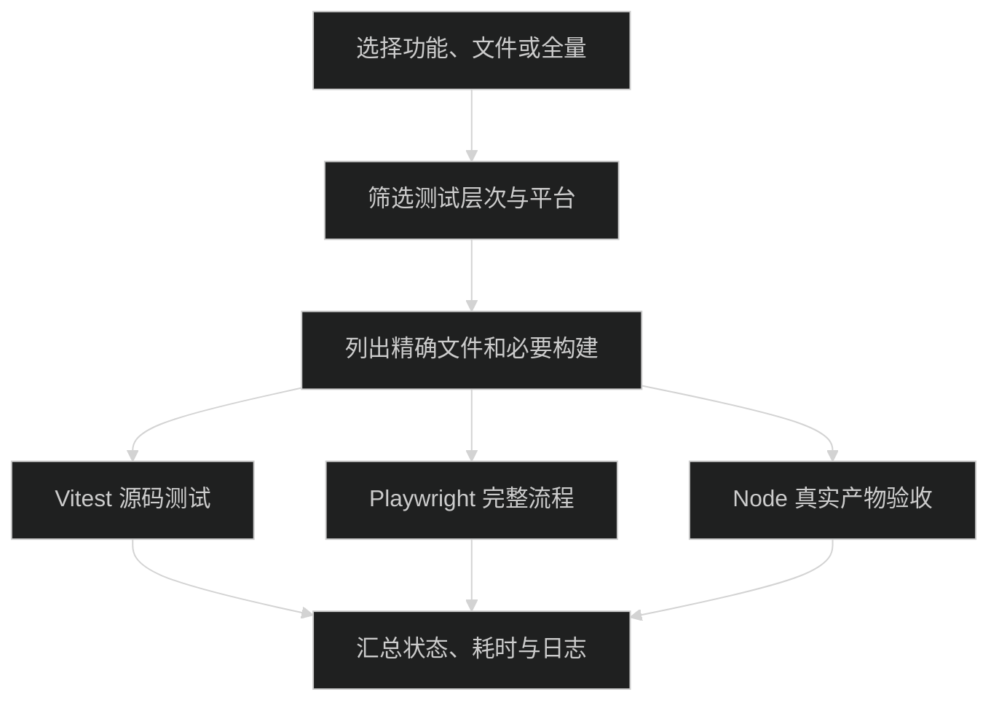

# 测试

从仓库根目录运行。Node.js 使用 24.14.0，pnpm 使用 10.29.1。

业务功能决定文件范围，测试层次决定验证深度。`sessions` 可以同时选择 contracts、client、Host、运行时和 UI 中的会话测试。无参数 `pnpm test` 显示帮助并返回非零状态，不执行测试。



## 入口

```bash
pnpm test --list
pnpm test --feature sessions --list
pnpm test --feature sessions
pnpm test --feature sessions --feature chat --layer unit,component
pnpm test --feature plugins --layer integration
pnpm test --file packages/contracts/tests/plan-message.unit.test.ts --name 中文
pnpm test --feature chat --layer e2e --target web
pnpm test --all --layer artifact --target server
pnpm test --all --layer e2e,artifact --target desktop
pnpm test:all
```

`--list` 只列清单。`--feature` 和 `--file` 支持重复指定；`--all` 与它们互斥。`--name` 接受正则表达式，必须同时指定文件。未知功能、无匹配测试和显式选择不支持的平台都会失败。

普通功能测试默认运行 unit、component、integration，不构建应用、不启动 Electron、不收集覆盖率。`test:all` 包含当前平台支持的全部层次；macOS 包含 Desktop，Linux 只包含源码、Web 和 Server。它不代表已验证其他操作系统或 WSL。

## 层次与运行器

| 后缀                   | 运行器                           | 测试边界                                                        |
| ---------------------- | -------------------------------- | --------------------------------------------------------------- |
| `.unit.test.ts`        | Vitest / Node                    | 纯逻辑、状态投影、协议参数和明确的初始渲染契约                  |
| `.component.test.tsx`  | Vitest / jsdom / Testing Library | React 实际挂载、effect、输入、点击、状态更新和回调              |
| `.integration.test.ts` | Vitest / Node                    | 临时文件、真实 Host、Worker、HTTP/WebSocket、SDK 和插件生命周期 |
| `.e2e.spec.ts`         | Playwright                       | Web 与开发态 Electron 的完整流程、焦点、布局和平台接线          |
| `.artifact.test.ts`    | Node 原生测试                    | 构建后的 Server、真实 `.app`、签名和运行时资源                  |

单元与集成测试允许保留 `node:assert/strict` 断言；测试注册和生命周期统一使用 Vitest。不要直接替换 `node:test` 的 import 后保留不兼容的钩子：`after` 对应 `afterAll`，`t.after` 对应 `t.onTestFinished`，动态子测试改为收集阶段的 `describe` 和 `test`。

jsdom 不计算布局；测试环境只补 Radix 需要的指针捕获和滚动方法。尺寸、真实焦点、图片解码、原生按键及文件对话框留在 E2E。静态 HTML 测试只证明初始结构，不证明交互可用。不要修改 React 私有 dispatcher 来执行 effect。

## 按改动选测

| 改动                           | 先选择的功能              | 需要扩大的条件                                     |
| ------------------------------ | ------------------------- | -------------------------------------------------- |
| 输入框、流式消息、暂停和队列   | `chat`                    | 模式切换加 `plan`；技能引用加 `skills`             |
| 历史、分支、客户端选择和恢复   | `sessions`                | 跨服务加 `connection`；项目归属加 `workspace`      |
| 计划文档与规划限制             | `plan`                    | 子任务协作加 `subagents`；权限守卫加 `permissions` |
| 子代理调度、消息与完成状态     | `subagents`               | 计划落盘加 `plan`                                  |
| 模型配置和凭据                 | `models`                  | 登录、重连和远程凭据加 `connection`                |
| 插件、DevKit、资源代次         | `plugins`                 | 技能快照加 `skills`；主题加 `settings`             |
| 技能导入、编辑和调用           | `skills`                  | 插件附带资源加 `plugins`                           |
| MCP 配置、诊断与连接           | `mcp`                     | 规划模式限制加 `plan`                              |
| 权限、沙箱和嵌套工具           | `permissions`、`codemode` | 规划限制加 `plan`                                  |
| 工作区、侧栏、Git 和 Worktree  | `workspace`、`git`        | 会话目标加 `sessions`                              |
| 文件、预览、保存和终端         | `files`、`terminal`       | 工具标签与插件作用域加 `plugins`                   |
| 设置、指令、外观和用量         | `settings`、`usage`       | 凭据加 `models`                                    |
| HTTP/WebSocket、认证与重连     | `connection`              | 目标恢复加 `sessions`                              |
| Electron 壳、preload、平台 IPC | `desktop`、`connection`   | 显式运行 Desktop 的 e2e、artifact 层               |
| 选测入口、清单和框架配置       | `testing`                 | 完成后运行一次 `test:all`                          |

同一文件同时验证多个功能时，可以登记多个功能，选择结果会去重。独立行为较多的大文件按功能拆分，共用所属包内的 fixture。新增文件必须登记到 [catalog.ts](../tests/catalog.ts)；`testing` 功能检查漏登记、重复登记、未知功能和层次后缀。

## 环境、报告与完整验收

安装浏览器：

```bash
pnpm exec playwright install chromium
```

Linux CI 使用 `pnpm exec playwright install --with-deps chromium`，并安装 bubblewrap。Web E2E 使用构建后的界面、临时 Host 和本地假模型。Desktop E2E 使用可调试的开发态 Electron；真实产物直接启动应用可执行文件，保留正式 Fuse 设置。

包含 e2e 或 artifact 的命令会准备相应构建，同次执行每个构建只运行一次。修改测试本身后调试已有构建，可以直接用运行器的文件过滤：

```bash
pnpm exec playwright test apps/web/tests/chat.e2e.spec.ts --project web
pnpm exec vitest run packages/contracts/tests/plan-message.unit.test.ts
```

每次统一入口执行写入独立的 `out/tests/<时间戳>-<进程号>/`：`summary.json` 记录平台、步骤、退出状态和耗时，数字命名的 `.log` 保存各步骤输出。Vitest 写 JSON 报告；Playwright 写 HTML、JSON 和失败截图、trace。直接运行 Playwright 时也使用独立目录。报告、覆盖率和构建产物不提交。

覆盖率按需启用：

```bash
pnpm test --feature chat --layer unit,component --coverage
```

覆盖率输出在 `coverage/`，只统计 Vitest 进程执行的代码，不代表独立 Worker 和产物的完整覆盖率。当前只报告数值，不设全仓百分比门槛。

PR 的 [Linux 检查](../.github/workflows/linux.yml) 运行源码测试和 Web 核心流程。[完整测试](../.github/workflows/full-tests.yml) 手动触发 Linux、macOS 两个平台；发布前汇总两者结果。WSL 专项只能在真实 WSL 上运行并单独记录；平台跳过不算完成该平台验收。

旧用例的处理位置见 [测试审查](testing-audit.md)。质量检查仍按 `pnpm type-check`、`pnpm lint`、`pnpm format` 顺序执行，并运行 `pnpm check-boundaries`。
